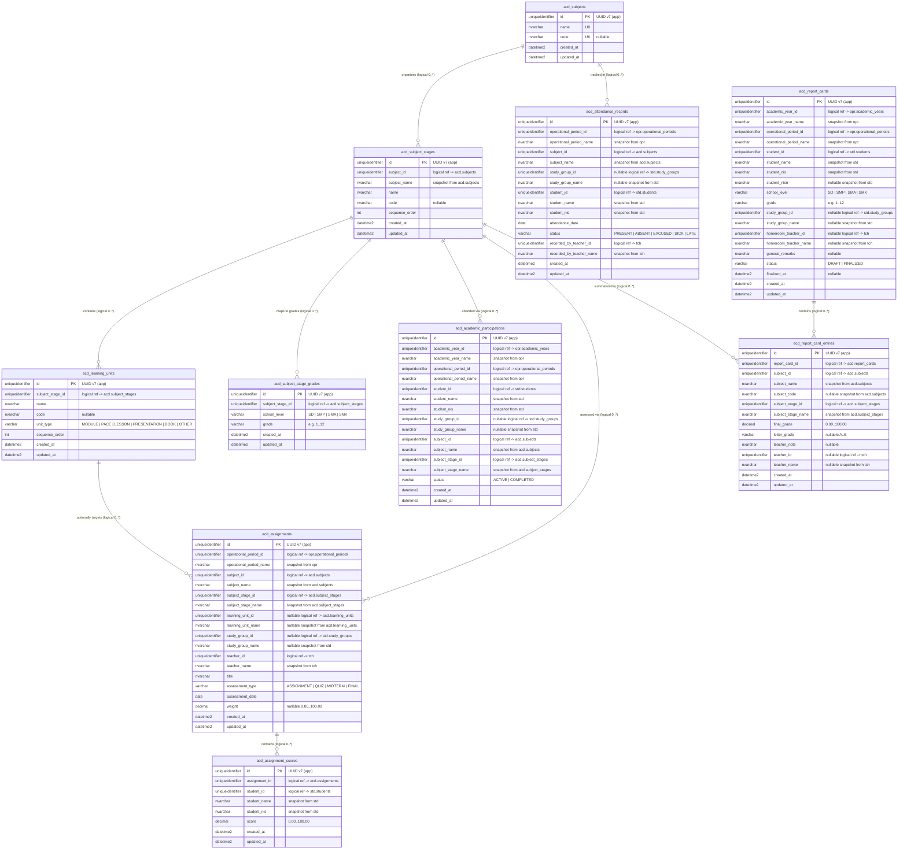

# Academic Domain (Basic) — Database Table Design

> **Source Domain Specification:** [academic-domain-basic.md](file:///d:/Project.Private/elsasa-sis-v4/docs/domains/academic-domain-basic.md)
> **Target RDBMS:** Microsoft SQL Server (2019+ / Azure SQL Database, T-SQL)
> **Architecture Alignment:** Clean Architecture evolved to Vertical Slices — **Database as Pure Persistence Layer**
> **Scope:** Basic level only (Curriculum-Agnostic 3-Level Learning Structure `Subject -> Subject Stage -> Learning Unit` with separate Administrative Grade mapping, Academic Participation per `Subject Stage`, Daily Student Attendance per `Subject`, Assignments & Scores per `Subject Stage` with optional `Learning Unit`, and Semester Report Cards). Intermediate/Enterprise features such as multi-curriculum frameworks, progress tracking, academic interventions, academic standing, promotion/graduation recommendations, formal grade correction logs, and student learning plans are intentionally excluded.

---

## 1. Overview & Design Principles

### 1.1 Module Schema Convention

Each domain module owns an isolated SQL Server schema inside the database:

| Module / Bounded Context | Schema Name |
|---|---|
| **Operational** | `opr` |
| **Student** | `std` |
| **Academic** *(this document)* | `acd` |
| **Finance** | `fin` |
| **Teaching** | `tch` |
| **Development** | `dev` |

All Academic Domain tables live under the `acd` schema (`acd.*`).

### 1.2 Aggregate-to-Table Mapping

Every aggregate and owned entity in [academic-domain-basic.md](file:///d:/Project.Private/elsasa-sis-v4/docs/domains/academic-domain-basic.md) maps to a normalized plural relational table in `acd` (10 tables across 6 aggregates):

| Aggregate Root | Domain Objects | Table(s) | Mapping Rationale |
|---|---|---|---|
| **Subject** | Subject | `acd.subjects` | Holds authoritative broad subject identity (`name`, optional `code`), decoupled from curriculum stages and administrative grades. |
| **Subject Stage** | Subject Stage, Learning Unit, Stage Grade Mapping | `acd.subject_stages`, `acd.learning_units`, `acd.subject_stage_grades` | `acd.subject_stages` holds progression phases/levels within a Subject (`sequence_order`); owns child `acd.learning_units` (Modules, PACEs, Lessons, Presentations, Books) and separate 0..N `acd.subject_stage_grades` mappings to Administrative Grades (`School Level` + `Grade`). |
| **Academic Participation** | Academic Participation | `acd.academic_participations` | Links one Student to one Subject Stage for one Operational Period (Semester) (`BR-APRT-001`), tracking lifecycle state (`ACTIVE` -> `COMPLETED`) while supporting multiple stages or differentiated proficiency levels within one administrative grade. |
| **Attendance Record** | Attendance Record | `acd.attendance_records` | Records daily student presence (`PRESENT`, `ABSENT`, `EXCUSED`, `SICK`, `LATE`) per Student, Subject, and date (`BR-ATTN-001`), matching timetable session scheduling. |
| **Assignment** | Assignment (or Exam), Score | `acd.assignments`, `acd.assignment_scores` | `acd.assignments` is the assessed work/exam container scoped by Subject Stage (with optional `learning_unit_id` for unit-level tasks/PACE tests) and Operational Period; `acd.assignment_scores` holds at most one numeric score (`0.00`–`100.00`) per Student per Assignment (`BR-ASGN-004`). |
| **Report Card** | Report Card, Final Grade Entry | `acd.report_cards`, `acd.report_card_entries` | `acd.report_cards` holds one semester report card header per Student per Operational Period (`BR-RPCD-001`) with `DRAFT` -> `FINALIZED` lifecycle; `acd.report_card_entries` is keyed per `(report_card_id, subject_stage_id)` holding both `Subject` and `Subject Stage` snapshots, computed grades, and teacher notes (`BR-RPCD-003`). |

### 1.3 Pure Persistence Layer Principles

1. **Zero Business Logic in the Database:**
   - No triggers, no stored procedures, no `CHECK` constraints, and no column `DEFAULT` constraints exist in the database.
   - All domain invariants, active-participation checks before attendance/scoring (`BR-ATTN-003`, `BR-ASGN-005`), stage/unit membership consistency (`BR-ASGN-001`), weight sum validation (`BR-ASGN-006`), score range checks (`BR-ASGN-003`), final grade calculations (`BR-RPCD-002`), and report card finalization state transitions are enforced in the **Application Layer** (Domain Entities / Vertical Slice command handlers).
2. **Application-Generated Primary Keys (UUID v7):**
   - Every table's `id` column is `UNIQUEIDENTIFIER NOT NULL` with `PRIMARY KEY CLUSTERED (id)` and no database-side generation.
   - The Application Layer generates **UUID v7** identifiers prior to persistence. Time-ordered UUID v7 values minimize clustered index fragmentation while keeping entity identity independent of database round-trips.
3. **Application-Supplied Audit & Lifecycle Columns:**
   - Every table includes `created_at DATETIME2(3) NOT NULL` and `updated_at DATETIME2(3) NOT NULL` (UTC) populated explicitly by the Application Layer on insert and update.
   - Initial lifecycle statuses (`'ACTIVE'` on `acd.academic_participations`, `'DRAFT'` on `acd.report_cards`) and completion/finalization timestamps (`finalized_at`) are supplied by the Application Layer.
4. **No Database Foreign Keys:**
   - Both intra-module references (`subject_id`, `subject_stage_id`, `learning_unit_id`, `assignment_id`, `report_card_id` -> `acd.*`) and cross-module references (`academic_year_id`, `operational_period_id` -> `opr`; `student_id`, `study_group_id` -> `std`; `teacher_id`, `recorded_by_teacher_id`, `homeroom_teacher_id` -> `tch`) are stored as plain `UNIQUEIDENTIFIER` columns.
   - Referential integrity and deletion/cascade rules are managed explicitly in the Application Layer.
5. **Cross-Domain & Intra-Domain Snapshot Denormalization:**
   - Because cross-schema database joins are avoided in Vertical Slices, `acd` tables store a **snapshot of display attributes** alongside foreign IDs so stage catalogs, participation rosters, attendance sheets, scorebooks, and printable report cards render directly from `acd`:
     - `acd.subject_stages`: `subject_name`
     - `acd.academic_participations`: `academic_year_name`, `operational_period_name`, `student_name`, `student_nis`, `study_group_name`, `subject_name`, `subject_stage_name`
     - `acd.attendance_records`: `operational_period_name`, `subject_name`, `study_group_name`, `student_name`, `student_nis`, `recorded_by_teacher_name`
     - `acd.assignments`: `operational_period_name`, `subject_name`, `subject_stage_name`, `learning_unit_name`, `study_group_name`, `teacher_name`
     - `acd.assignment_scores`: `student_name`, `student_nis`
     - `acd.report_cards`: `academic_year_name`, `operational_period_name`, `student_name`, `student_nis`, `student_nisn`, `study_group_name`, `homeroom_teacher_name`
     - `acd.report_card_entries`: `subject_name`, `subject_code`, `subject_stage_name`, `teacher_name`
   - When upstream names or codes change in `opr`, `std`, `tch`, or `acd`, Application Layer event handlers update non-finalized/open snapshots while preserving historical finalized report cards if required by school policy.
6. **Curriculum & Administrative Separation + Ubiquitous Language Alignment:**
   - **Curriculum Hierarchy:** `acd.subjects` $\rightarrow$ `acd.subject_stages` $\rightarrow$ `acd.learning_units` is strictly independent of Administrative Grade (`School Level` + `Grade`).
   - **Administrative Grade Mapping:** `acd.subject_stage_grades` models an optional 0..N many-to-many link between `acd.subject_stages` and timeless `(school_level, grade)` values (`'SD' | 'SMP' | 'SMA' | 'SMK'` and `'1'`..`'12'`).
   - **Temporal & Grouping Context:** Temporal scoping aligns with `opr` (**`Operational Period`** for Semester and **`Academic Year`**), and student grouping uses academic-year-bound **`Study Group`** (`study_group_id`, `study_group_name` from `std.study_groups`).
7. **Uniqueness Rules Enforced in the Database:**
   - Only pure uniqueness guarantees are declared as database `UNIQUE` constraints / filtered unique indexes:
     - `UQ_subjects_name` on `acd.subjects (name)` (`BR-LSTR-001`)
     - `UQ_subjects_code` as filtered unique index `ON acd.subjects (code) WHERE code IS NOT NULL` (`BR-LSTR-002`)
     - `UQ_subject_stages_subject_name` on `acd.subject_stages (subject_id, name)` (`BR-LSTR-003`)
     - `UQ_subject_stages_subject_sequence` on `acd.subject_stages (subject_id, sequence_order)` (`BR-LSTR-003`)
     - `UQ_subject_stage_grades_stage_level_grade` on `acd.subject_stage_grades (subject_stage_id, school_level, grade)` (`BR-LSTR-005`)
     - `UQ_learning_units_stage_name` on `acd.learning_units (subject_stage_id, name)` (`BR-LSTR-004`)
     - `UQ_learning_units_stage_sequence` on `acd.learning_units (subject_stage_id, sequence_order)` (`BR-LSTR-004`)
     - `UQ_academic_participations_student_stage_period` on `acd.academic_participations (student_id, subject_stage_id, operational_period_id)` (`BR-APRT-001`)
     - `UQ_attendance_records_student_subject_date` on `acd.attendance_records (student_id, subject_id, attendance_date)` (`BR-ATTN-001`)
     - `UQ_assignment_scores_assignment_student` on `acd.assignment_scores (assignment_id, student_id)` (`BR-ASGN-004`)
     - `UQ_report_cards_student_period` on `acd.report_cards (student_id, operational_period_id)` (`BR-RPCD-001`)
     - `UQ_report_card_entries_card_stage` on `acd.report_card_entries (report_card_id, subject_stage_id)` (`BR-RPCD-003`)
8. **Performance-Only Indexing:**
   - Non-unique indexes exist strictly to accelerate Vertical Slice query handlers (stages by grade mapping, rosters per subject stage or subject, daily attendance sheets, scorebooks, and semester report card lists).
9. **Standard SQL Server Data Types:**
   - **Identifiers:** `UNIQUEIDENTIFIER` (UUID v7)
   - **Unicode Text:** `NVARCHAR(n)` for subject/stage/unit names, codes, snapshot strings, assignment titles, teacher notes, and remarks
   - **Enum / Code Values:** `VARCHAR(5)` / `VARCHAR(10)` / `VARCHAR(20)` (`'SD'`, `'SMP'`, `'SMA'`, `'SMK'`, `'MODULE'`, `'PACE'`, `'LESSON'`, `'PRESENTATION'`, `'BOOK'`, `'OTHER'`, `'ACTIVE'`, `'COMPLETED'`, `'PRESENT'`, `'ABSENT'`, `'EXCUSED'`, `'SICK'`, `'LATE'`, `'ASSIGNMENT'`, `'QUIZ'`, `'MIDTERM'`, `'FINAL'`, `'DRAFT'`, `'FINALIZED'`, letter grades `'A'`–`'E'`), validated in the Application Layer
   - **Ordering Sequence:** `INT` (`sequence_order` on stages and units)
   - **Numeric Scores & Weights:** `DECIMAL(5,2)` supporting `0.00` to `100.00` cleanly without floating-point rounding drift
   - **Temporal:** `DATE`, `DATETIME2(3)`

---

## 2. Entity-Relationship Diagram (Logical)

> Relationships below represent **logical domain associations** enforced by the Application Layer (no physical database foreign key constraints).



---

## 3. Table Definitions

### 3.1 `acd.subjects`

Persists the **Subject** aggregate root — the broad learning area catalog offered by the school (e.g., `Mathematics`, `Science`, `Islamic Studies`), independent of curriculum levels and administrative grades.

| Column | SQL Server Data Type | Nullable | DB Constraint / Key | Application Layer Responsibility |
|---|---|---|---|---|
| `id` | `UNIQUEIDENTIFIER` | `NO` | `PK_subjects` | Generate UUID v7 |
| `name` | `NVARCHAR(100)` | `NO` | `UQ_subjects_name` | Non-blank subject name (`BR-LSTR-001`) |
| `code` | `NVARCHAR(30)` | `YES` | `UQ_subjects_code` *(filtered)* | Optional short code (e.g., `MTK`, `IPA`); normalize blank strings to `NULL` (`BR-LSTR-002`) |
| `created_at` | `DATETIME2(3)` | `NO` | — | Populate UTC timestamp on create |
| `updated_at` | `DATETIME2(3)` | `NO` | — | Populate UTC timestamp on create & update |

**Constraints & Indexes:**
- `PK_subjects`: `PRIMARY KEY CLUSTERED (id)`
- `UQ_subjects_name`: `UNIQUE (name)` (`BR-LSTR-001`)
- `UQ_subjects_code`: `UNIQUE NONCLUSTERED INDEX (code) WHERE code IS NOT NULL` (`BR-LSTR-002`)

---

### 3.2 `acd.subject_stages`

Persists the **Subject Stage** aggregate root — a progression phase or curriculum level within a Subject (e.g., `Mathematics Level 7`, `Matematika Fase D`).

| Column | SQL Server Data Type | Nullable | DB Constraint / Key | Application Layer Responsibility |
|---|---|---|---|---|
| `id` | `UNIQUEIDENTIFIER` | `NO` | `PK_subject_stages` | Generate UUID v7 |
| `subject_id` | `UNIQUEIDENTIFIER` | `NO` | `UQ_subject_stages_subject_name`, `UQ_subject_stages_subject_sequence` | Logical reference to `acd.subjects(id)` (`BR-LSTR-003`) |
| `subject_name` | `NVARCHAR(100)` | `NO` | — | Snapshot of parent subject name from `acd.subjects` |
| `name` | `NVARCHAR(100)` | `NO` | `UQ_subject_stages_subject_name` | Non-blank stage name unique within parent Subject (`BR-LSTR-003`) |
| `code` | `NVARCHAR(30)` | `YES` | — | Optional stage code (e.g., `MTK-L7`, `MTK-FD`) |
| `sequence_order` | `INT` | `NO` | `UQ_subject_stages_subject_sequence` | Positive integer progression order unique within Subject (`BR-LSTR-003`) |
| `created_at` | `DATETIME2(3)` | `NO` | — | Populate UTC timestamp on create |
| `updated_at` | `DATETIME2(3)` | `NO` | — | Populate UTC timestamp on create & update |

**Constraints & Indexes:**
- `PK_subject_stages`: `PRIMARY KEY CLUSTERED (id)`
- `UQ_subject_stages_subject_name`: `UNIQUE (subject_id, name)` (`BR-LSTR-003`)
- `UQ_subject_stages_subject_sequence`: `UNIQUE (subject_id, sequence_order)` (`BR-LSTR-003`)

---

### 3.3 `acd.subject_stage_grades`

Persists optional **Stage Grade Mapping** entries owned by a **Subject Stage** — decoupling Administrative Grades (`School Level` + `Grade`) from the curriculum progression hierarchy (`BR-LSTR-005`). Supports 0..N mappings in either direction.

| Column | SQL Server Data Type | Nullable | DB Constraint / Key | Application Layer Responsibility |
|---|---|---|---|---|
| `id` | `UNIQUEIDENTIFIER` | `NO` | `PK_subject_stage_grades` | Generate UUID v7 |
| `subject_stage_id` | `UNIQUEIDENTIFIER` | `NO` | `UQ_subject_stage_grades_stage_level_grade` | Logical reference to `acd.subject_stages(id)` |
| `school_level` | `VARCHAR(10)` | `NO` | `UQ_subject_stage_grades_stage_level_grade` | Validate `'SD'`, `'SMP'`, `'SMA'`, or `'SMK'` |
| `grade` | `VARCHAR(20)` | `NO` | `UQ_subject_stage_grades_stage_level_grade` | Validate grade within school level (e.g., `'1'`..`'12'`) |
| `created_at` | `DATETIME2(3)` | `NO` | — | Populate UTC timestamp on create |
| `updated_at` | `DATETIME2(3)` | `NO` | — | Populate UTC timestamp on create & update |

**Constraints & Indexes:**
- `PK_subject_stage_grades`: `PRIMARY KEY CLUSTERED (id)`
- `UQ_subject_stage_grades_stage_level_grade`: `UNIQUE (subject_stage_id, school_level, grade)` (`BR-LSTR-005`)
- `IX_subject_stage_grades_level_grade`: `NONCLUSTERED INDEX (school_level, grade, subject_stage_id)` (lookup stages mapped to an administrative grade)

---

### 3.4 `acd.learning_units`

Persists **Learning Unit** entities owned by a **Subject Stage** — instructional packages such as Teaching Modules, PACEs, Lessons, Presentations, or Books (`BR-LSTR-004`).

| Column | SQL Server Data Type | Nullable | DB Constraint / Key | Application Layer Responsibility |
|---|---|---|---|---|
| `id` | `UNIQUEIDENTIFIER` | `NO` | `PK_learning_units` | Generate UUID v7 |
| `subject_stage_id` | `UNIQUEIDENTIFIER` | `NO` | `UQ_learning_units_stage_name`, `UQ_learning_units_stage_sequence` | Logical reference to `acd.subject_stages(id)` (`BR-LSTR-004`) |
| `name` | `NVARCHAR(150)` | `NO` | `UQ_learning_units_stage_name` | Non-blank learning unit name unique within parent Subject Stage (`BR-LSTR-004`) |
| `code` | `NVARCHAR(30)` | `YES` | — | Optional unit code (e.g., `PACE-1073`, `MOD-01`) |
| `unit_type` | `VARCHAR(20)` | `NO` | — | Validate `'MODULE'`, `'PACE'`, `'LESSON'`, `'PRESENTATION'`, `'BOOK'`, or `'OTHER'` (`BR-LSTR-004`) |
| `sequence_order` | `INT` | `NO` | `UQ_learning_units_stage_sequence` | Positive integer sequence order unique within parent Subject Stage (`BR-LSTR-004`) |
| `created_at` | `DATETIME2(3)` | `NO` | — | Populate UTC timestamp on create |
| `updated_at` | `DATETIME2(3)` | `NO` | — | Populate UTC timestamp on create & update |

**Constraints & Indexes:**
- `PK_learning_units`: `PRIMARY KEY CLUSTERED (id)`
- `UQ_learning_units_stage_name`: `UNIQUE (subject_stage_id, name)` (`BR-LSTR-004`)
- `UQ_learning_units_stage_sequence`: `UNIQUE (subject_stage_id, sequence_order)` (`BR-LSTR-004`)

---

### 3.5 `acd.academic_participations`

Persists the **Academic Participation** aggregate — recording that a Student undertakes a specific **Subject Stage** in a given Operational Period (Semester). Students in the same administrative Grade/Study Group can take different stages of a Subject, and a Student can progress through multiple stages of the same Subject within a semester.

| Column | SQL Server Data Type | Nullable | DB Constraint / Key | Application Layer Responsibility |
|---|---|---|---|---|
| `id` | `UNIQUEIDENTIFIER` | `NO` | `PK_academic_participations` | Generate UUID v7 |
| `academic_year_id` | `UNIQUEIDENTIFIER` | `NO` | — | Logical reference to `opr.academic_years(id)` |
| `academic_year_name` | `NVARCHAR(50)` | `NO` | — | Snapshot of Academic Year name from `opr` |
| `operational_period_id` | `UNIQUEIDENTIFIER` | `NO` | `UQ_academic_participations_student_stage_period` | Logical reference to `opr.operational_periods(id)` (Semester) |
| `operational_period_name` | `NVARCHAR(50)` | `NO` | — | Snapshot of Operational Period name from `opr` |
| `student_id` | `UNIQUEIDENTIFIER` | `NO` | `UQ_academic_participations_student_stage_period` | Logical reference to `std.students(id)` (`BR-APRT-003`) |
| `student_name` | `NVARCHAR(150)` | `NO` | — | Snapshot of student full name from `std.students` |
| `student_nis` | `NVARCHAR(30)` | `NO` | — | Snapshot of student NIS from `std.students` |
| `study_group_id` | `UNIQUEIDENTIFIER` | `YES` | — | Optional logical reference to `std.study_groups(id)` |
| `study_group_name` | `NVARCHAR(50)` | `YES` | — | Optional snapshot from `std.study_groups`; `NULL` iff `study_group_id IS NULL` |
| `subject_id` | `UNIQUEIDENTIFIER` | `NO` | — | Logical reference to parent `acd.subjects(id)` (denormalized from `SubjectStage` for Subject-level attendance validation & roster queries) |
| `subject_name` | `NVARCHAR(100)` | `NO` | — | Snapshot of subject name from `acd.subjects` |
| `subject_stage_id` | `UNIQUEIDENTIFIER` | `NO` | `UQ_academic_participations_student_stage_period` | Logical reference to `acd.subject_stages(id)` (`BR-APRT-002`) |
| `subject_stage_name` | `NVARCHAR(100)` | `NO` | — | Snapshot of stage name from `acd.subject_stages` |
| `status` | `VARCHAR(20)` | `NO` | — | Set initial `'ACTIVE'`; enforce `'ACTIVE' -> 'COMPLETED'` transition |
| `created_at` | `DATETIME2(3)` | `NO` | — | Populate UTC timestamp on create |
| `updated_at` | `DATETIME2(3)` | `NO` | — | Populate UTC timestamp on create & update |

**Constraints & Indexes:**
- `PK_academic_participations`: `PRIMARY KEY CLUSTERED (id)`
- `UQ_academic_participations_student_stage_period`: `UNIQUE (student_id, subject_stage_id, operational_period_id)` (`BR-APRT-001`)
- `IX_academic_participations_stage_group`: `NONCLUSTERED INDEX (operational_period_id, subject_stage_id, study_group_id, status)` (scorebook rosters by Subject Stage)
- `IX_academic_participations_subject_group`: `NONCLUSTERED INDEX (operational_period_id, subject_id, study_group_id, status)` (attendance rosters by Subject + Study Group)
- `IX_academic_participations_student_period`: `NONCLUSTERED INDEX (student_id, operational_period_id, status)` (student's semester Subject Stages & Report Card generation)

---

### 3.6 `acd.attendance_records`

Persists the **Attendance Record** aggregate — capturing a student's presence status for a **Subject** session on a given school date (matching timetable scheduling regardless of individual Subject Stage progression).

| Column | SQL Server Data Type | Nullable | DB Constraint / Key | Application Layer Responsibility |
|---|---|---|---|---|
| `id` | `UNIQUEIDENTIFIER` | `NO` | `PK_attendance_records` | Generate UUID v7 |
| `operational_period_id` | `UNIQUEIDENTIFIER` | `NO` | — | Logical reference to `opr.operational_periods(id)` |
| `operational_period_name` | `NVARCHAR(50)` | `NO` | — | Snapshot of Operational Period name from `opr` |
| `subject_id` | `UNIQUEIDENTIFIER` | `NO` | `UQ_attendance_records_student_subject_date` | Logical reference to `acd.subjects(id)` |
| `subject_name` | `NVARCHAR(100)` | `NO` | — | Snapshot of subject name from `acd.subjects` |
| `study_group_id` | `UNIQUEIDENTIFIER` | `YES` | — | Optional logical reference to `std.study_groups(id)` |
| `study_group_name` | `NVARCHAR(50)` | `YES` | — | Optional snapshot from `std.study_groups`; `NULL` iff `study_group_id IS NULL` |
| `student_id` | `UNIQUEIDENTIFIER` | `NO` | `UQ_attendance_records_student_subject_date` | Logical reference to `std.students(id)`; validate `'ACTIVE'` participation in `subject_id` (`BR-ATTN-003`) |
| `student_name` | `NVARCHAR(150)` | `NO` | — | Snapshot of student full name from `std.students` |
| `student_nis` | `NVARCHAR(30)` | `NO` | — | Snapshot of student NIS from `std.students` |
| `attendance_date` | `DATE` | `NO` | `UQ_attendance_records_student_subject_date` | Calendar date of the session |
| `status` | `VARCHAR(20)` | `NO` | — | Validate `'PRESENT'`, `'ABSENT'`, `'EXCUSED'`, `'SICK'`, or `'LATE'` (`BR-ATTN-002`) |
| `recorded_by_teacher_id` | `UNIQUEIDENTIFIER` | `NO` | — | Logical reference to Teacher Profile (`tch` schema) |
| `recorded_by_teacher_name` | `NVARCHAR(150)` | `NO` | — | Snapshot of teacher name from `tch` |
| `created_at` | `DATETIME2(3)` | `NO` | — | Populate UTC timestamp on create |
| `updated_at` | `DATETIME2(3)` | `NO` | — | Populate UTC timestamp on create & update |

**Constraints & Indexes:**
- `PK_attendance_records`: `PRIMARY KEY CLUSTERED (id)`
- `UQ_attendance_records_student_subject_date`: `UNIQUE (student_id, subject_id, attendance_date)` (`BR-ATTN-001`)
- `IX_attendance_records_subject_group_date`: `NONCLUSTERED INDEX (subject_id, study_group_id, attendance_date)` (daily study group attendance sheet lookup)
- `IX_attendance_records_student_period`: `NONCLUSTERED INDEX (student_id, operational_period_id, attendance_date)` (student attendance recap per semester)

---

### 3.7 `acd.assignments`

Persists the **Assignment** aggregate root — assessed works (assignments, quizzes, midterms, finals) defined within a **Subject Stage** for an Operational Period, with an optional **Learning Unit** link (`BR-ASGN-001`).

| Column | SQL Server Data Type | Nullable | DB Constraint / Key | Application Layer Responsibility |
|---|---|---|---|---|
| `id` | `UNIQUEIDENTIFIER` | `NO` | `PK_assignments` | Generate UUID v7 |
| `operational_period_id` | `UNIQUEIDENTIFIER` | `NO` | — | Logical reference to `opr.operational_periods(id)` |
| `operational_period_name` | `NVARCHAR(50)` | `NO` | — | Snapshot of Operational Period name from `opr` |
| `subject_id` | `UNIQUEIDENTIFIER` | `NO` | — | Logical reference to parent `acd.subjects(id)` |
| `subject_name` | `NVARCHAR(100)` | `NO` | — | Snapshot of subject name from `acd.subjects` |
| `subject_stage_id` | `UNIQUEIDENTIFIER` | `NO` | — | Logical reference to `acd.subject_stages(id)` (`BR-ASGN-001`) |
| `subject_stage_name` | `NVARCHAR(100)` | `NO` | — | Snapshot of stage name from `acd.subject_stages` |
| `learning_unit_id` | `UNIQUEIDENTIFIER` | `YES` | — | Optional logical reference to `acd.learning_units(id)`; if set, must belong to `subject_stage_id` (`BR-ASGN-001`) |
| `learning_unit_name` | `NVARCHAR(150)` | `YES` | — | Optional snapshot from `acd.learning_units`; `NULL` iff `learning_unit_id IS NULL` |
| `study_group_id` | `UNIQUEIDENTIFIER` | `YES` | — | Optional logical reference to `std.study_groups(id)` |
| `study_group_name` | `NVARCHAR(50)` | `YES` | — | Optional snapshot from `std.study_groups`; `NULL` iff `study_group_id IS NULL` |
| `teacher_id` | `UNIQUEIDENTIFIER` | `NO` | — | Logical reference to Teacher Profile (`tch` schema) |
| `teacher_name` | `NVARCHAR(150)` | `NO` | — | Snapshot of teacher name from `tch` |
| `title` | `NVARCHAR(150)` | `NO` | — | Non-blank assignment or exam title |
| `assessment_type` | `VARCHAR(20)` | `NO` | — | Validate `'ASSIGNMENT'`, `'QUIZ'`, `'MIDTERM'`, or `'FINAL'` (`BR-ASGN-002`) |
| `assessment_date` | `DATE` | `NO` | — | Scheduled or given date of assessment |
| `weight` | `DECIMAL(5,2)` | `YES` | — | Optional relative percentage (`0.00`–`100.00`); verify sum = `100.00` across weighted Subject Stage assessments (`BR-ASGN-006`) |
| `created_at` | `DATETIME2(3)` | `NO` | — | Populate UTC timestamp on create |
| `updated_at` | `DATETIME2(3)` | `NO` | — | Populate UTC timestamp on create & update |

**Indexes (Performance Only):**
- `PK_assignments`: `PRIMARY KEY CLUSTERED (id)`
- `IX_assignments_period_stage_group`: `NONCLUSTERED INDEX (operational_period_id, subject_stage_id, study_group_id, assessment_date)` (Subject Stage scorebook & final grade computation lookup)
- `IX_assignments_learning_unit`: `NONCLUSTERED INDEX (learning_unit_id, assessment_date) WHERE learning_unit_id IS NOT NULL` (filtering unit-specific quizzes/PACE tests)

---

### 3.8 `acd.assignment_scores`

Persists **Score** records owned by an **Assignment** — at most one numeric score (`0.00`–`100.00`) per Student per Assignment (`BR-ASGN-004`).

| Column | SQL Server Data Type | Nullable | DB Constraint / Key | Application Layer Responsibility |
|---|---|---|---|---|
| `id` | `UNIQUEIDENTIFIER` | `NO` | `PK_assignment_scores` | Generate UUID v7 |
| `assignment_id` | `UNIQUEIDENTIFIER` | `NO` | `UQ_assignment_scores_assignment_student` | Logical reference to `acd.assignments(id)` |
| `student_id` | `UNIQUEIDENTIFIER` | `NO` | `UQ_assignment_scores_assignment_student` | Logical reference to `std.students(id)`; validate `'ACTIVE'` participation in assignment's Subject Stage (`BR-ASGN-005`) |
| `student_name` | `NVARCHAR(150)` | `NO` | — | Snapshot of student full name from `std.students` |
| `student_nis` | `NVARCHAR(30)` | `NO` | — | Snapshot of student NIS from `std.students` |
| `score` | `DECIMAL(5,2)` | `NO` | — | Validate `0.00 <= score <= 100.00` (`BR-ASGN-003`) |
| `created_at` | `DATETIME2(3)` | `NO` | — | Populate UTC timestamp on create |
| `updated_at` | `DATETIME2(3)` | `NO` | — | Populate UTC timestamp on create & update |

**Constraints & Indexes:**
- `PK_assignment_scores`: `PRIMARY KEY CLUSTERED (id)`
- `UQ_assignment_scores_assignment_student`: `UNIQUE (assignment_id, student_id)` (`BR-ASGN-004`)
- `IX_assignment_scores_student`: `NONCLUSTERED INDEX (student_id, assignment_id)` (student score history & final grade computation)

---

### 3.9 `acd.report_cards`

Persists the **Report Card** aggregate root — one periodic learning report per Student per Operational Period (Semester) (`BR-RPCD-001`).

| Column | SQL Server Data Type | Nullable | DB Constraint / Key | Application Layer Responsibility |
|---|---|---|---|---|
| `id` | `UNIQUEIDENTIFIER` | `NO` | `PK_report_cards` | Generate UUID v7 |
| `academic_year_id` | `UNIQUEIDENTIFIER` | `NO` | — | Logical reference to `opr.academic_years(id)` |
| `academic_year_name` | `NVARCHAR(50)` | `NO` | — | Snapshot of Academic Year name from `opr` |
| `operational_period_id` | `UNIQUEIDENTIFIER` | `NO` | `UQ_report_cards_student_period` | Logical reference to `opr.operational_periods(id)` (Semester) |
| `operational_period_name` | `NVARCHAR(50)` | `NO` | — | Snapshot of Operational Period name from `opr` |
| `student_id` | `UNIQUEIDENTIFIER` | `NO` | `UQ_report_cards_student_period` | Logical reference to `std.students(id)` |
| `student_name` | `NVARCHAR(150)` | `NO` | — | Snapshot of student full name from `std.students` |
| `student_nis` | `NVARCHAR(30)` | `NO` | — | Snapshot of student NIS from `std.students` |
| `student_nisn` | `NVARCHAR(20)` | `YES` | — | Optional snapshot of student NISN from `std.students` |
| `school_level` | `VARCHAR(10)` | `NO` | — | Snapshot of student's `'SD'`, `'SMP'`, `'SMA'`, or `'SMK'` placement level |
| `grade` | `VARCHAR(20)` | `NO` | — | Snapshot of student's administrative grade for the academic year (e.g., `'7'`, `'10'`) |
| `study_group_id` | `UNIQUEIDENTIFIER` | `YES` | — | Optional logical reference to `std.study_groups(id)` |
| `study_group_name` | `NVARCHAR(50)` | `YES` | — | Optional snapshot from `std.study_groups`; `NULL` iff `study_group_id IS NULL` |
| `homeroom_teacher_id` | `UNIQUEIDENTIFIER` | `YES` | — | Optional logical reference to Homeroom Teacher (`tch` schema) |
| `homeroom_teacher_name` | `NVARCHAR(150)` | `YES` | — | Optional snapshot of homeroom teacher name; `NULL` iff `homeroom_teacher_id IS NULL` |
| `general_remarks` | `NVARCHAR(1000)` | `YES` | — | Optional overall remarks added by Homeroom Teacher |
| `status` | `VARCHAR(20)` | `NO` | — | Set initial `'DRAFT'`; enforce `'DRAFT' -> 'FINALIZED'` transition |
| `finalized_at` | `DATETIME2(3)` | `YES` | — | `NULL` while `'DRAFT'`; set UTC timestamp when finalized |
| `created_at` | `DATETIME2(3)` | `NO` | — | Populate UTC timestamp on create |
| `updated_at` | `DATETIME2(3)` | `NO` | — | Populate UTC timestamp on create & update |

**Constraints & Indexes:**
- `PK_report_cards`: `PRIMARY KEY CLUSTERED (id)`
- `UQ_report_cards_student_period`: `UNIQUE (student_id, operational_period_id)` (`BR-RPCD-001`)
- `IX_report_cards_period_group_status`: `NONCLUSTERED INDEX (operational_period_id, study_group_id, status)` (homeroom review & bulk finalization list)

---

### 3.10 `acd.report_card_entries`

Persists **Final Grade Entry** lines owned by a **Report Card** — keyed by `subject_stage_id` so every participated **Subject Stage** receives its own line (with both Subject and Subject Stage details) (`BR-RPCD-003`).

| Column | SQL Server Data Type | Nullable | DB Constraint / Key | Application Layer Responsibility |
|---|---|---|---|---|
| `id` | `UNIQUEIDENTIFIER` | `NO` | `PK_report_card_entries` | Generate UUID v7 |
| `report_card_id` | `UNIQUEIDENTIFIER` | `NO` | `UQ_report_card_entries_card_stage` | Logical reference to `acd.report_cards(id)` |
| `subject_id` | `UNIQUEIDENTIFIER` | `NO` | — | Logical reference to parent `acd.subjects(id)` |
| `subject_name` | `NVARCHAR(100)` | `NO` | — | Snapshot of subject name from `acd.subjects` |
| `subject_code` | `NVARCHAR(30)` | `YES` | — | Optional snapshot of subject code from `acd.subjects` |
| `subject_stage_id` | `UNIQUEIDENTIFIER` | `NO` | `UQ_report_card_entries_card_stage` | Logical reference to `acd.subject_stages(id)` (`BR-RPCD-003`) |
| `subject_stage_name` | `NVARCHAR(100)` | `NO` | — | Snapshot of stage name from `acd.subject_stages` |
| `final_grade` | `DECIMAL(5,2)` | `NO` | — | Computed weighted or simple average (`0.00`–`100.00`) for the Subject Stage (`BR-RPCD-002`) |
| `letter_grade` | `VARCHAR(5)` | `YES` | — | Optional mapped grade (`'A'`, `'B'`, `'C'`, `'D'`, `'E'`) via conversion table (`BR-RPCD-004`) |
| `teacher_note` | `NVARCHAR(500)` | `YES` | — | Optional remark by subject teacher |
| `teacher_id` | `UNIQUEIDENTIFIER` | `YES` | — | Optional logical reference to subject teacher (`tch` schema) |
| `teacher_name` | `NVARCHAR(150)` | `YES` | — | Optional snapshot of subject teacher name; `NULL` iff `teacher_id IS NULL` |
| `created_at` | `DATETIME2(3)` | `NO` | — | Populate UTC timestamp on create |
| `updated_at` | `DATETIME2(3)` | `NO` | — | Populate UTC timestamp on create & update |

**Constraints & Indexes:**
- `PK_report_card_entries`: `PRIMARY KEY CLUSTERED (id)`
- `UQ_report_card_entries_card_stage`: `UNIQUE (report_card_id, subject_stage_id)` (`BR-RPCD-003`)
- `IX_report_card_entries_report_card`: `NONCLUSTERED INDEX (report_card_id)` (loading report card Subject Stage lines)

---

## 4. Business Rules Traceability Matrix

Every business rule in Section 7 of [academic-domain-basic.md](file:///d:/Project.Private/elsasa-sis-v4/docs/domains/academic-domain-basic.md) plus snapshot/referential rules is mapped below — **only uniqueness rules are enforced in the database**, while all other business rules live in the **Application Layer** (Domain Entities / Vertical Slice Handlers):

| Rule ID | Business Rule | Enforcement Layer | Exact Implementation |
|---|---|---|---|
| **BR-LSTR-001** | Every Subject must have a unique name within the school. | **Database (`UNIQUE`)** + App Layer | `UQ_subjects_name`: `UNIQUE (name)` on `acd.subjects` *(paired with trimming/normalization in the command handler)*. |
| **BR-LSTR-002** | A Subject code, if provided, must be unique within the school. | **Database (`UNIQUE` Filtered Index)** + App Layer | `UQ_subjects_code`: `UNIQUE NONCLUSTERED INDEX (code) WHERE code IS NOT NULL`; handler normalizes blank codes to `NULL`. |
| **BR-LSTR-003** | Every Subject Stage must belong to one Subject and have a unique name and sequence order within that Subject. | **Database (`UNIQUE`)** + App Layer | `SubjectStage` handler verifies `subject_id` exists in `acd.subjects` and `sequence_order > 0`; `UQ_subject_stages_subject_name` and `UQ_subject_stages_subject_sequence` enforce uniqueness within `subject_id`. |
| **BR-LSTR-004** | Every Learning Unit must belong to one Subject Stage, specify a valid Unit Type (`MODULE`, `PACE`, `LESSON`, `PRESENTATION`, `BOOK`, `OTHER`), and have a unique name and sequence order within that Subject Stage. | **Database (`UNIQUE`)** + App Layer | `SubjectStage` aggregate validates `unit_type`, `sequence_order > 0`, and parent stage existence; `UQ_learning_units_stage_name` and `UQ_learning_units_stage_sequence` enforce uniqueness within `subject_stage_id`. |
| **BR-LSTR-005** | A Subject Stage may map to zero or more Administrative Grades (`School Level` + `Grade`), without duplicate mappings. | **Database (`UNIQUE`)** + App Layer | `SubjectStage` aggregate validates `school_level` and `grade` when mapping; `UQ_subject_stage_grades_stage_level_grade` prevents duplicate `(subject_stage_id, school_level, grade)` rows. |
| **BR-APRT-001** | A Student may participate in a given Subject Stage at most once per Academic Year/Semester (Operational Period). | **Database (`UNIQUE`)** + App Layer | `UQ_academic_participations_student_stage_period`: `UNIQUE (student_id, subject_stage_id, operational_period_id)`. |
| **BR-APRT-002** | Academic Participation can only be created for a Subject Stage that exists in the Learning Structure. | **Application Layer** | `EstablishParticipation` handler verifies `subject_stage_id` in `acd.subject_stages` and populates `subject_id`, `subject_name`, and `subject_stage_name`. |
| **BR-APRT-003** | Academic Participation can only be created for a Student recognized by the school. | **Application Layer** | `EstablishParticipation` handler verifies `student_id` in `std.students` and snapshots `student_name` and `student_nis`. |
| **BR-ATTN-001** | Only one Attendance Record may exist per Student per Subject per date. | **Database (`UNIQUE`)** + App Layer | `UQ_attendance_records_student_subject_date`: `UNIQUE (student_id, subject_id, attendance_date)`. |
| **BR-ATTN-002** | Attendance Status must be one of: Present, Absent, Excused, Sick, Late. | **Application Layer** (+ `NOT NULL`) | `status` is `NOT NULL`; `AttendanceRecord` entity validates value in `{'PRESENT', 'ABSENT', 'EXCUSED', 'SICK', 'LATE'}`. |
| **BR-ATTN-003** | Attendance may only be recorded for a Student with an Active Academic Participation in at least one Subject Stage of that Subject. | **Application Layer** | `RecordAttendance` handler confirms `>= 1` `'ACTIVE'` row exists in `acd.academic_participations` matching `(student_id, subject_id, operational_period_id)`. |
| **BR-ASGN-001** | An Assignment must belong to exactly one Subject Stage, and any optional Learning Unit referenced must belong to that same Subject Stage. | **Application Layer** (+ `NOT NULL`) | `subject_stage_id` is `NOT NULL`; `CreateAssignment` / `UpdateAssignment` verify `subject_stage_id` in `acd.subject_stages` (deriving `subject_id` + `subject_name`) and confirm `learning_unit.subject_stage_id == assignment.subject_stage_id` whenever `learning_unit_id` is provided. |
| **BR-ASGN-002** | Assessment Type must be one of: Assignment, Quiz, Midterm, Final. | **Application Layer** (+ `NOT NULL`) | `assessment_type` is `NOT NULL`; `Assignment` entity validates value in `{'ASSIGNMENT', 'QUIZ', 'MIDTERM', 'FINAL'}`. |
| **BR-ASGN-003** | A Score must be a numeric value between 0 and 100 inclusive. | **Application Layer** (+ `NOT NULL`) | `score` is `DECIMAL(5,2) NOT NULL`; `Score` value object enforces `0.00 <= score <= 100.00`. |
| **BR-ASGN-004** | A Student may have at most one Score per Assignment. | **Database (`UNIQUE`)** + App Layer | `UQ_assignment_scores_assignment_student`: `UNIQUE (assignment_id, student_id)` on `acd.assignment_scores`. |
| **BR-ASGN-005** | Scores may only be recorded for Students with Active Academic Participation in the Assignment's Subject Stage. | **Application Layer** | `RecordAssignmentScore` handler verifies an `'ACTIVE'` row exists in `acd.academic_participations` matching `(student_id, assignment.subject_stage_id, assignment.operational_period_id)`. |
| **BR-ASGN-006** | If weights are used for assignments within a Subject Stage, the sum of all weights for that Subject Stage should equal 100%. | **Application Layer** | `CreateAssignment` / `UpdateAssignment` / `GenerateReportCard` handlers validate weight totals per `(operational_period_id, subject_stage_id, study_group_id)` when weighted grading is used. |
| **BR-RPCD-001** | A Report Card is generated per Student per Semester (Operational Period). | **Database (`UNIQUE`)** + App Layer | `UQ_report_cards_student_period`: `UNIQUE (student_id, operational_period_id)` on `acd.report_cards`. |
| **BR-RPCD-002** | Final Grade for a Subject Stage is the weighted average of all scores in that Subject Stage for the semester (or simple average if no weights). | **Application Layer** | `GenerateReportCard` handler computes weighted sum `SUM(score * weight) / SUM(weight)` or arithmetic mean `AVG(score)` from `acd.assignments` + `acd.assignment_scores` grouped by `subject_stage_id`. |
| **BR-RPCD-003** | A Report Card must include a Final Grade Entry for every Subject Stage in which the Student has an Active or Completed participation during the semester. | **Application Layer** (+ `UNIQUE`) | `GenerateReportCard` inserts one `acd.report_card_entries` row per `acd.academic_participations` row in that period; `UQ_report_card_entries_card_stage` guarantees uniqueness per Subject Stage. |
| **BR-RPCD-004** | Letter Grade mapping, if used, must follow the school's defined conversion table. | **Application Layer** | `GenerateReportCard` applies the configured school conversion scale to derive optional `letter_grade` (`'A'`–`'E'`). |
| **EXT-ACD-001** | Report Card Finalization prevents further mutations and completes Academic Participations. | **Application Layer** | `FinalizeReportCard` handler updates `acd.report_cards.status = 'FINALIZED'`, sets `finalized_at`, transitions matching `acd.academic_participations` to `'COMPLETED'`, and guards against edits to finalized cards. |
| **EXT-ACD-002** | Nullable ID + snapshot pairs (`learning_unit_id`/`learning_unit_name`, `study_group_id`/`study_group_name`, `homeroom_teacher_id`/`homeroom_teacher_name`, `teacher_id`/`teacher_name`) stay paired. | **Application Layer** | Command handlers populate both ID and snapshot name when referenced, or set both to `NULL` together. |
| **EXT-ACD-003** | Snapshot columns stay synchronized with source entities in `opr`, `std`, `tch`, and `acd`. | **Application Layer** | Integration/domain event handlers propagate display name updates to non-finalized/open `acd.*` records. |

---

## 5. Complete SQL DDL Reference (Microsoft SQL Server / T-SQL)

```sql
-- ============================================================================
-- Academic Domain (Basic) — Pure Persistence Layer DDL (Microsoft SQL Server)
-- Target: Microsoft SQL Server 2019+ / Azure SQL Database (T-SQL)
-- Schema: acd
-- Source: docs/domains/academic-domain-basic.md
-- Notes:
--   - IDs are application-generated UUID v7 values
--   - Timestamps, statuses, and snapshot names are supplied by the application
--   - Only PRIMARY KEY and UNIQUE constraints/indexes are enforced in the DB
--   - All other indexes exist strictly for query performance
-- ============================================================================

IF NOT EXISTS (SELECT 1 FROM sys.schemas WHERE name = N'acd')
BEGIN
    EXEC(N'CREATE SCHEMA acd');
END;
GO

-- ----------------------------------------------------------------------------
-- 1. Subjects
-- ----------------------------------------------------------------------------
CREATE TABLE acd.subjects (
    id          UNIQUEIDENTIFIER NOT NULL,
    name        NVARCHAR(100)    NOT NULL,
    code        NVARCHAR(30)     NULL,
    created_at  DATETIME2(3)     NOT NULL,
    updated_at  DATETIME2(3)     NOT NULL,

    CONSTRAINT PK_subjects PRIMARY KEY CLUSTERED (id),
    -- BR-LSTR-001: Subject name must be unique within the school
    CONSTRAINT UQ_subjects_name UNIQUE (name)
);

-- BR-LSTR-002: Subject code, when provided, must be unique within the school
CREATE UNIQUE NONCLUSTERED INDEX UQ_subjects_code
    ON acd.subjects (code)
    WHERE code IS NOT NULL;
GO

-- ----------------------------------------------------------------------------
-- 2. Subject Stages
-- ----------------------------------------------------------------------------
CREATE TABLE acd.subject_stages (
    id              UNIQUEIDENTIFIER NOT NULL,
    subject_id      UNIQUEIDENTIFIER NOT NULL,
    subject_name    NVARCHAR(100)    NOT NULL,
    name            NVARCHAR(100)    NOT NULL,
    code            NVARCHAR(30)     NULL,
    sequence_order  INT              NOT NULL,
    created_at      DATETIME2(3)     NOT NULL,
    updated_at      DATETIME2(3)     NOT NULL,

    CONSTRAINT PK_subject_stages PRIMARY KEY CLUSTERED (id),
    -- BR-LSTR-003: Unique stage name and progression sequence per Subject
    CONSTRAINT UQ_subject_stages_subject_name UNIQUE (subject_id, name),
    CONSTRAINT UQ_subject_stages_subject_sequence UNIQUE (subject_id, sequence_order)
);
GO

-- ----------------------------------------------------------------------------
-- 3. Subject Stage Grade Mappings (Separate Administrative Grade Links)
-- ----------------------------------------------------------------------------
CREATE TABLE acd.subject_stage_grades (
    id                UNIQUEIDENTIFIER NOT NULL,
    subject_stage_id  UNIQUEIDENTIFIER NOT NULL,
    school_level      VARCHAR(10)      NOT NULL,
    grade             VARCHAR(20)      NOT NULL,
    created_at        DATETIME2(3)     NOT NULL,
    updated_at        DATETIME2(3)     NOT NULL,

    CONSTRAINT PK_subject_stage_grades PRIMARY KEY CLUSTERED (id),
    -- BR-LSTR-005: Prevent duplicate Stage-Level-Grade mappings
    CONSTRAINT UQ_subject_stage_grades_stage_level_grade
        UNIQUE (subject_stage_id, school_level, grade)
);

CREATE NONCLUSTERED INDEX IX_subject_stage_grades_level_grade
    ON acd.subject_stage_grades (school_level, grade, subject_stage_id);
GO

-- ----------------------------------------------------------------------------
-- 4. Learning Units (Modules, PACEs, Lessons, Presentations, Books)
-- ----------------------------------------------------------------------------
CREATE TABLE acd.learning_units (
    id                UNIQUEIDENTIFIER NOT NULL,
    subject_stage_id  UNIQUEIDENTIFIER NOT NULL,
    name              NVARCHAR(150)    NOT NULL,
    code              NVARCHAR(30)     NULL,
    unit_type         VARCHAR(20)      NOT NULL,
    sequence_order    INT              NOT NULL,
    created_at        DATETIME2(3)     NOT NULL,
    updated_at        DATETIME2(3)     NOT NULL,

    CONSTRAINT PK_learning_units PRIMARY KEY CLUSTERED (id),
    -- BR-LSTR-004: Unique unit name and progression sequence per Subject Stage
    CONSTRAINT UQ_learning_units_stage_name UNIQUE (subject_stage_id, name),
    CONSTRAINT UQ_learning_units_stage_sequence UNIQUE (subject_stage_id, sequence_order)
);
GO

-- ----------------------------------------------------------------------------
-- 5. Academic Participations (Student + Subject Stage + Operational Period)
-- ----------------------------------------------------------------------------
CREATE TABLE acd.academic_participations (
    id                       UNIQUEIDENTIFIER NOT NULL,
    academic_year_id         UNIQUEIDENTIFIER NOT NULL,
    academic_year_name       NVARCHAR(50)     NOT NULL,
    operational_period_id    UNIQUEIDENTIFIER NOT NULL,
    operational_period_name  NVARCHAR(50)     NOT NULL,
    student_id               UNIQUEIDENTIFIER NOT NULL,
    student_name             NVARCHAR(150)    NOT NULL,
    student_nis              NVARCHAR(30)     NOT NULL,
    study_group_id           UNIQUEIDENTIFIER NULL,
    study_group_name         NVARCHAR(50)     NULL,
    subject_id               UNIQUEIDENTIFIER NOT NULL,
    subject_name             NVARCHAR(100)    NOT NULL,
    subject_stage_id         UNIQUEIDENTIFIER NOT NULL,
    subject_stage_name       NVARCHAR(100)    NOT NULL,
    status                   VARCHAR(20)      NOT NULL,
    created_at               DATETIME2(3)     NOT NULL,
    updated_at               DATETIME2(3)     NOT NULL,

    CONSTRAINT PK_academic_participations PRIMARY KEY CLUSTERED (id),
    -- BR-APRT-001: A student participates in a Subject Stage at most once per period
    CONSTRAINT UQ_academic_participations_student_stage_period
        UNIQUE (student_id, subject_stage_id, operational_period_id)
);

CREATE NONCLUSTERED INDEX IX_academic_participations_stage_group
    ON acd.academic_participations (operational_period_id, subject_stage_id, study_group_id, status);

CREATE NONCLUSTERED INDEX IX_academic_participations_subject_group
    ON acd.academic_participations (operational_period_id, subject_id, study_group_id, status);

CREATE NONCLUSTERED INDEX IX_academic_participations_student_period
    ON acd.academic_participations (student_id, operational_period_id, status);
GO

-- ----------------------------------------------------------------------------
-- 6. Attendance Records (Per Student + Subject + Date)
-- ----------------------------------------------------------------------------
CREATE TABLE acd.attendance_records (
    id                        UNIQUEIDENTIFIER NOT NULL,
    operational_period_id     UNIQUEIDENTIFIER NOT NULL,
    operational_period_name   NVARCHAR(50)     NOT NULL,
    subject_id                UNIQUEIDENTIFIER NOT NULL,
    subject_name              NVARCHAR(100)    NOT NULL,
    study_group_id            UNIQUEIDENTIFIER NULL,
    study_group_name          NVARCHAR(50)     NULL,
    student_id                UNIQUEIDENTIFIER NOT NULL,
    student_name              NVARCHAR(150)    NOT NULL,
    student_nis               NVARCHAR(30)     NOT NULL,
    attendance_date           DATE             NOT NULL,
    status                    VARCHAR(20)      NOT NULL,
    recorded_by_teacher_id    UNIQUEIDENTIFIER NOT NULL,
    recorded_by_teacher_name  NVARCHAR(150)    NOT NULL,
    created_at                DATETIME2(3)     NOT NULL,
    updated_at                DATETIME2(3)     NOT NULL,

    CONSTRAINT PK_attendance_records PRIMARY KEY CLUSTERED (id),
    -- BR-ATTN-001: One attendance record per student per subject per date
    CONSTRAINT UQ_attendance_records_student_subject_date
        UNIQUE (student_id, subject_id, attendance_date)
);

CREATE NONCLUSTERED INDEX IX_attendance_records_subject_group_date
    ON acd.attendance_records (subject_id, study_group_id, attendance_date);

CREATE NONCLUSTERED INDEX IX_attendance_records_student_period
    ON acd.attendance_records (student_id, operational_period_id, attendance_date);
GO

-- ----------------------------------------------------------------------------
-- 7. Assignments (Scoped to Subject Stage, Optional Learning Unit)
-- ----------------------------------------------------------------------------
CREATE TABLE acd.assignments (
    id                       UNIQUEIDENTIFIER NOT NULL,
    operational_period_id    UNIQUEIDENTIFIER NOT NULL,
    operational_period_name  NVARCHAR(50)     NOT NULL,
    subject_id               UNIQUEIDENTIFIER NOT NULL,
    subject_name             NVARCHAR(100)    NOT NULL,
    subject_stage_id         UNIQUEIDENTIFIER NOT NULL,
    subject_stage_name       NVARCHAR(100)    NOT NULL,
    learning_unit_id         UNIQUEIDENTIFIER NULL,
    learning_unit_name       NVARCHAR(150)    NULL,
    study_group_id           UNIQUEIDENTIFIER NULL,
    study_group_name         NVARCHAR(50)     NULL,
    teacher_id               UNIQUEIDENTIFIER NOT NULL,
    teacher_name             NVARCHAR(150)    NOT NULL,
    title                    NVARCHAR(150)    NOT NULL,
    assessment_type          VARCHAR(20)      NOT NULL,
    assessment_date          DATE             NOT NULL,
    weight                   DECIMAL(5,2)     NULL,
    created_at               DATETIME2(3)     NOT NULL,
    updated_at               DATETIME2(3)     NOT NULL,

    CONSTRAINT PK_assignments PRIMARY KEY CLUSTERED (id)
);

CREATE NONCLUSTERED INDEX IX_assignments_period_stage_group
    ON acd.assignments (operational_period_id, subject_stage_id, study_group_id, assessment_date);

CREATE NONCLUSTERED INDEX IX_assignments_learning_unit
    ON acd.assignments (learning_unit_id, assessment_date)
    WHERE learning_unit_id IS NOT NULL;
GO

-- ----------------------------------------------------------------------------
-- 8. Assignment Scores
-- ----------------------------------------------------------------------------
CREATE TABLE acd.assignment_scores (
    id             UNIQUEIDENTIFIER NOT NULL,
    assignment_id  UNIQUEIDENTIFIER NOT NULL,
    student_id     UNIQUEIDENTIFIER NOT NULL,
    student_name   NVARCHAR(150)    NOT NULL,
    student_nis    NVARCHAR(30)     NOT NULL,
    score          DECIMAL(5,2)     NOT NULL,
    created_at     DATETIME2(3)     NOT NULL,
    updated_at     DATETIME2(3)     NOT NULL,

    CONSTRAINT PK_assignment_scores PRIMARY KEY CLUSTERED (id),
    -- BR-ASGN-004: At most one score per student per assignment
    CONSTRAINT UQ_assignment_scores_assignment_student
        UNIQUE (assignment_id, student_id)
);

CREATE NONCLUSTERED INDEX IX_assignment_scores_student
    ON acd.assignment_scores (student_id, assignment_id);
GO

-- ----------------------------------------------------------------------------
-- 9. Report Cards
-- ----------------------------------------------------------------------------
CREATE TABLE acd.report_cards (
    id                       UNIQUEIDENTIFIER NOT NULL,
    academic_year_id         UNIQUEIDENTIFIER NOT NULL,
    academic_year_name       NVARCHAR(50)     NOT NULL,
    operational_period_id    UNIQUEIDENTIFIER NOT NULL,
    operational_period_name  NVARCHAR(50)     NOT NULL,
    student_id               UNIQUEIDENTIFIER NOT NULL,
    student_name             NVARCHAR(150)    NOT NULL,
    student_nis              NVARCHAR(30)     NOT NULL,
    student_nisn             NVARCHAR(20)     NULL,
    school_level             VARCHAR(10)      NOT NULL,
    grade                    VARCHAR(20)      NOT NULL,
    study_group_id           UNIQUEIDENTIFIER NULL,
    study_group_name         NVARCHAR(50)     NULL,
    homeroom_teacher_id      UNIQUEIDENTIFIER NULL,
    homeroom_teacher_name    NVARCHAR(150)    NULL,
    general_remarks          NVARCHAR(1000)   NULL,
    status                   VARCHAR(20)      NOT NULL,
    finalized_at             DATETIME2(3)     NULL,
    created_at               DATETIME2(3)     NOT NULL,
    updated_at               DATETIME2(3)     NOT NULL,

    CONSTRAINT PK_report_cards PRIMARY KEY CLUSTERED (id),
    -- BR-RPCD-001: One report card per student per semester
    CONSTRAINT UQ_report_cards_student_period
        UNIQUE (student_id, operational_period_id)
);

CREATE NONCLUSTERED INDEX IX_report_cards_period_group_status
    ON acd.report_cards (operational_period_id, study_group_id, status);
GO

-- ----------------------------------------------------------------------------
-- 10. Report Card Entries (Final Grade Entries per Subject Stage)
-- ----------------------------------------------------------------------------
CREATE TABLE acd.report_card_entries (
    id                  UNIQUEIDENTIFIER NOT NULL,
    report_card_id      UNIQUEIDENTIFIER NOT NULL,
    subject_id          UNIQUEIDENTIFIER NOT NULL,
    subject_name        NVARCHAR(100)    NOT NULL,
    subject_code        NVARCHAR(30)     NULL,
    subject_stage_id    UNIQUEIDENTIFIER NOT NULL,
    subject_stage_name  NVARCHAR(100)    NOT NULL,
    final_grade         DECIMAL(5,2)     NOT NULL,
    letter_grade        VARCHAR(5)       NULL,
    teacher_note        NVARCHAR(500)    NULL,
    teacher_id          UNIQUEIDENTIFIER NULL,
    teacher_name        NVARCHAR(150)    NULL,
    created_at          DATETIME2(3)     NOT NULL,
    updated_at          DATETIME2(3)     NOT NULL,

    CONSTRAINT PK_report_card_entries PRIMARY KEY CLUSTERED (id),
    -- BR-RPCD-003: One entry per Subject Stage inside a report card
    CONSTRAINT UQ_report_card_entries_card_stage
        UNIQUE (report_card_id, subject_stage_id)
);

CREATE NONCLUSTERED INDEX IX_report_card_entries_report_card
    ON acd.report_card_entries (report_card_id);
GO
```

---

## 6. Common Query Patterns (Vertical Slice Persistence Queries)

### 6.1 Load Full Curriculum Tree & Administrative Grade Mappings (`GetCurriculumStructure` Slice)

```sql
-- 1. All Subject Stages under a Subject (ordered by progression)
SELECT
    st.id              AS subject_stage_id,
    st.subject_id,
    st.subject_name,
    st.name            AS stage_name,
    st.code            AS stage_code,
    st.sequence_order
FROM acd.subject_stages st
WHERE st.subject_id = @subject_id
ORDER BY st.sequence_order;

-- 2. Ordered Learning Units for a Subject Stage
SELECT
    lu.id              AS learning_unit_id,
    lu.subject_stage_id,
    lu.name            AS unit_name,
    lu.code            AS unit_code,
    lu.unit_type,
    lu.sequence_order
FROM acd.learning_units lu
WHERE lu.subject_stage_id = @subject_stage_id
ORDER BY lu.sequence_order;

-- 3. Default Subject Stages mapped to an Administrative Grade (cohort assignment helper)
SELECT
    st.id              AS subject_stage_id,
    st.subject_id,
    st.subject_name,
    st.name            AS stage_name,
    st.code            AS stage_code,
    st.sequence_order,
    ssg.school_level,
    ssg.grade
FROM acd.subject_stage_grades ssg
INNER JOIN acd.subject_stages st
    ON st.id = ssg.subject_stage_id
WHERE ssg.school_level = @school_level
  AND ssg.grade = @grade
ORDER BY st.subject_name, st.sequence_order;
```

### 6.2 List Participating Students for a Subject Stage Scorebook (`GetSubjectStageRoster` Slice)

*(Supports individualized rosters where only students assigned to a specific Subject Stage appear in that stage's scorebook.)*

```sql
SELECT
    ap.id                  AS participation_id,
    ap.student_id,
    ap.student_nis,
    ap.student_name,
    ap.study_group_id,
    ap.study_group_name,
    ap.subject_id,
    ap.subject_name,
    ap.subject_stage_id,
    ap.subject_stage_name,
    ap.status
FROM acd.academic_participations ap
WHERE ap.operational_period_id = @operational_period_id
  AND ap.subject_stage_id = @subject_stage_id
  AND (@study_group_id IS NULL OR ap.study_group_id = @study_group_id)
  AND ap.status = 'ACTIVE'
ORDER BY ap.student_name;
```

### 6.3 Daily Subject Attendance Sheet & Student Semester Recap

*(Queries `acd.academic_participations` by `subject_id` + `study_group_id` using `DISTINCT` across Subject Stages so a student taking multiple stages in one subject appears once on the Subject attendance sheet.)*

```sql
-- 1. Daily attendance sheet for a Study Group & Subject on @target_date
WITH participating_students AS (
    SELECT DISTINCT
        ap.student_id,
        ap.student_nis,
        ap.student_name
    FROM acd.academic_participations ap
    WHERE ap.operational_period_id = @operational_period_id
      AND ap.subject_id = @subject_id
      AND ap.study_group_id = @study_group_id
      AND ap.status IN ('ACTIVE', 'COMPLETED')
)
SELECT
    ps.student_id,
    ps.student_nis,
    ps.student_name,
    ar.id     AS attendance_record_id,
    ar.status AS attendance_status,
    ar.recorded_by_teacher_name
FROM participating_students ps
LEFT JOIN acd.attendance_records ar
    ON ar.student_id = ps.student_id
   AND ar.subject_id = @subject_id
   AND ar.attendance_date = @target_date
ORDER BY ps.student_name;

-- 2. Student attendance summary across subjects in a semester
SELECT
    ar.subject_id,
    ar.subject_name,
    SUM(CASE WHEN ar.status = 'PRESENT' THEN 1 ELSE 0 END) AS present_count,
    SUM(CASE WHEN ar.status = 'ABSENT'  THEN 1 ELSE 0 END) AS absent_count,
    SUM(CASE WHEN ar.status = 'EXCUSED' THEN 1 ELSE 0 END) AS excused_count,
    SUM(CASE WHEN ar.status = 'SICK'    THEN 1 ELSE 0 END) AS sick_count,
    SUM(CASE WHEN ar.status = 'LATE'    THEN 1 ELSE 0 END) AS late_count
FROM acd.attendance_records ar
WHERE ar.student_id = @student_id
  AND ar.operational_period_id = @operational_period_id
GROUP BY ar.subject_id, ar.subject_name
ORDER BY ar.subject_name;
```

### 6.4 Compute Final Grade Inputs per Subject Stage for a Student (`GenerateReportCard` Slice)

*(Supports `BR-RPCD-002` and `BR-RPCD-003`: retrieves every Subject Stage participation in the semester along with the student's weighted and simple average inputs for the Application Layer to apply conversion rules and persist `acd.report_cards` / `acd.report_card_entries`.)*

```sql
SELECT
    ap.subject_id,
    ap.subject_name,
    s.code AS subject_code,
    ap.subject_stage_id,
    ap.subject_stage_name,
    COUNT(sc.id) AS scored_assessment_count,
    SUM(CASE WHEN a.weight IS NOT NULL AND sc.id IS NOT NULL THEN sc.score * a.weight ELSE 0 END) AS weighted_score_sum,
    SUM(CASE WHEN a.weight IS NOT NULL AND sc.id IS NOT NULL THEN a.weight ELSE 0 END) AS applied_weight_sum,
    AVG(sc.score) AS simple_average_score
FROM acd.academic_participations ap
INNER JOIN acd.subjects s
    ON s.id = ap.subject_id
LEFT JOIN acd.assignments a
    ON a.operational_period_id = ap.operational_period_id
   AND a.subject_stage_id = ap.subject_stage_id
   AND (a.study_group_id = ap.study_group_id OR a.study_group_id IS NULL)
LEFT JOIN acd.assignment_scores sc
    ON sc.assignment_id = a.id
   AND sc.student_id = ap.student_id
WHERE ap.student_id = @student_id
  AND ap.operational_period_id = @operational_period_id
  AND ap.status IN ('ACTIVE', 'COMPLETED')
GROUP BY ap.subject_id, ap.subject_name, s.code, ap.subject_stage_id, ap.subject_stage_name
ORDER BY ap.subject_name, ap.subject_stage_name;
```

### 6.5 Retrieve Report Card with Subject Stage Grade Entries (`GetReportCard` Slice)

```sql
-- Header
SELECT
    rc.id,
    rc.academic_year_name,
    rc.operational_period_name,
    rc.student_id,
    rc.student_nis,
    rc.student_nisn,
    rc.student_name,
    rc.school_level,
    rc.grade,
    rc.study_group_name,
    rc.homeroom_teacher_name,
    rc.general_remarks,
    rc.status,
    rc.finalized_at
FROM acd.report_cards rc
WHERE rc.student_id = @student_id
  AND rc.operational_period_id = @operational_period_id;

-- Subject Stage lines
SELECT
    rce.id,
    rce.subject_id,
    rce.subject_code,
    rce.subject_name,
    rce.subject_stage_id,
    rce.subject_stage_name,
    rce.final_grade,
    rce.letter_grade,
    rce.teacher_note,
    rce.teacher_name
FROM acd.report_card_entries rce
INNER JOIN acd.report_cards rc
    ON rc.id = rce.report_card_id
WHERE rc.student_id = @student_id
  AND rc.operational_period_id = @operational_period_id
ORDER BY rce.subject_name, rce.subject_stage_name;
```
