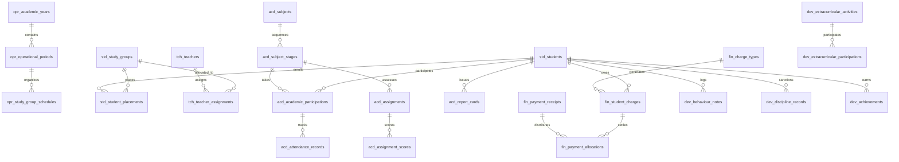
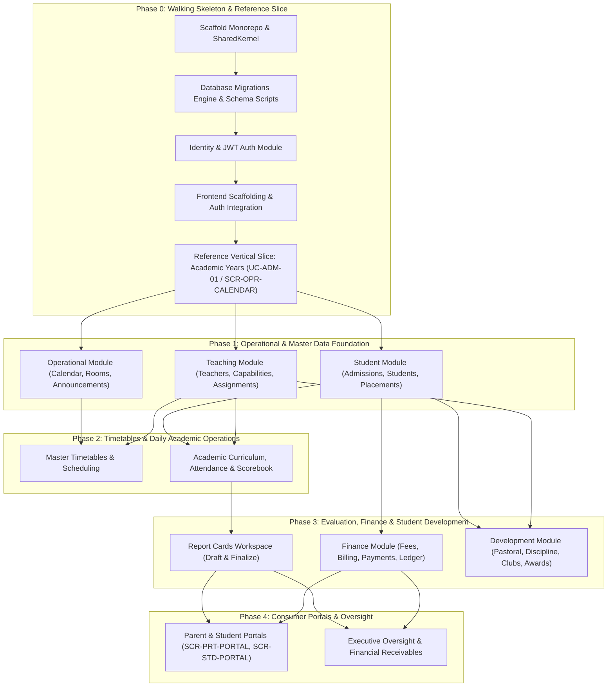

# 1. Overview

This document defines the authoritative target system architecture for the greenfield implementation of **ELSASA-SIS (Basic Level)** — an enterprise-grade School Information System tailored for Indonesian K-12 educational institutions (SD, SMP, SMA, and SMK).

The architecture establishes the complete technical realization across **6 core operational bounded contexts** (`opr`, `std`, `tch`, `acd`, `fin`, `dev`), **1 identity/authentication context** (`auth`), and **1 transactional outbox context** (`outbox`). It bridges approved business domains, relational table designs, actor specifications, 68 actor-driven use cases, and 20 UI screens into an actionable technical blueprint for autonomous agentic implementation.

### Pre-Implementation Codebase Baseline
* **Current Codebase State:** True Greenfield (0 lines of application code exist in the repository).
* **Repository Strategy:** Single Monorepo (`src/backend/` and `src/frontend/`).
* **Database Engine:** Single Microsoft SQL Server database utilizing isolated schemas.
* **Planning Mode:** Greenfield Planning Mode under `ics-greenfield-architecture-creation`.

---

# 2. Architectural Basis

## 2.1 Upstream Product-Definition Inputs
The architecture directly consumes and synthesizes the following approved product-definition specifications:

| Input Category | Upstream Artifact(s) | Role & Authority in Architecture |
| :--- | :--- | :--- |
| **Domain Definitions** | `docs/domains/*-domain-basic.md`<br>`docs/domains/priorities/*-domain-priorities.md` | Authoritative definition of business entities, boundaries, invariants, and Basic-level scoping. (Intermediate and Enterprise scopes are strictly excluded). |
| **Persistence Design** | `docs/architecture/*-tables-design.md` (6 files) | Authoritative Pure Persistence Layer schema designs, column types, constraints, and indexes. |
| **Actors & Roles** | `docs/actors-roles-specification-basic.md` | Authoritative definition of 5 internal operational actors (`SCHOOL_ADMIN`, `FINANCE_OFFICER`, `TEACHER`, `HOMEROOM_TEACHER`, `PRINCIPAL`) and 2 external consumer actors (`PARENT`, `STUDENT`). |
| **Use Cases** | `docs/use-case-discovery-basic.md` | Authoritative definition of all 68 actor-driven use cases (40 Commands, 28 Queries). Serves as formal substitute for operational scenario documents. |
| **Screens & UI/UX** | `docs/screen-inventory.md`<br>`docs/architecture/ui-ux-guideline.md` | Authoritative definition of 20 interaction screens, layout hierarchy, and ergonomics. Serves as formal substitute for user journeys and navigation graphs. |
| **Technical Conventions** | `docs/architecture/backend-architecture.md`<br>`docs/architecture/frontend-architecture.md` | Authoritative technical standards: Modular Monolith + Vertical Slice Architecture (VSA) + Domain-Driven Design (DDD) + CQRS + Dapper + Vue 3 / Vite. |

---

# 3. Scope

## 3.1 In-Scope (Basic Level v1.0)
* **Operational Domain (`opr`):** Academic years, operational semesters, school calendar days/holidays, rooms, study group timetables, and school announcements.
* **Student Domain (`std`):** Prospective student candidate intake, admission decisions, atomic student enrollment with NIS generation, student profile maintenance, guardian management, annual study groups (rombel), and student grade/rombel placements.
* **Teaching Domain (`tch`):** Teacher master profiles, qualified subject capabilities, and subject-to-study-group teaching assignments.
* **Academic Domain (`acd`):** Subject curriculum structures (stages & units), student academic participation tracking, daily classroom attendance, teacher scorebook grading, and collaborative semester report card generation/finalization.
* **Development Domain (`dev`):** Student behaviour logs, disciplinary incident sanctions, extracurricular activity catalogs/participations, and student achievement awards.
* **Finance Domain (`fin`):** Fee structure setup, student fee discounts, periodic & ad-hoc charge generation, cashier payment receipts, advance deposit management, fund allocations, and student ledger statements.
* **Identity & Access Management (`auth`):** App-issued JWT authentication, secure refresh tokens, password hashing, and role + data-scope authorization.
* **UI Applications:** 18 internal operational screens and 2 external read-only consumer portal screens implemented in a single Vue 3 SPA.

## 3.2 Out-of-Scope (Deferred to Future Levels)
* Automated online payment gateway integrations (Midtrans/Xendit) — Basic uses manual cashier counter, bank transfer verification, and advance deposit.
* Self-service online candidate registration portal for parents — Basic uses back-office administrative entry.
* Algorithmic automated timetable conflict solvers — Basic uses manual scheduling and SMK rotation block planning.
* Multi-curriculum neutral abstractions, student individual learning plans (SLP), and credit-unit (SKS) systems.

---

# 4. Architectural Drivers

1. **Locality of Behavior & Low-Reasoning Agentic Implementability:** Every functional capability is packaged into an isolated vertical slice containing its endpoint, request/response DTOs, validator, and handler. Implementer agents can construct slices with zero risk of cross-slice side-effects.
2. **Strict Module Ownership & Boundary Isolation:** Compile-time isolation prevents cyclic assembly dependencies. Domain write models never join tables across schemas or perform cross-schema mutations.
3. **Explicit CQRS:** Write slices execute via Aggregate Roots and Dapper-backed Repositories to enforce business invariants. Read slices project directly from the database into DTOs via Dapper queries for maximum performance.
4. **Data Scoping & Multi-Role Authorization:** Security is enforced not only by role names but by contextual record scoping (teachers can only access their assigned classes; homeroom teachers their rombel; parents their linked children; students themselves).
5. **Transactional Consistency & Resilient Reaction:** Cross-module reactions (e.g., student placement triggering academic participation or fee billing) are executed via in-process domain events awaited post-commit for UI consistency, supported by a Transactional Outbox for resilient background delivery.

---

# 5. System Structure

## 5.1 Monorepo Workspace Organization
The project is structured as a unified monorepo with distinct backend and frontend boundary roots:

```
elsasa-sis-v4/
├── docs/                                      # Specifications, domain models, and table designs
└── src/
    ├── backend/                               # .NET 8 / C# 12 Modular Monolith Solution
    │   ├── ElsasaSis.sln
    │   ├── src/
    │   │   ├── ElsasaSis.Api/                 # ASP.NET Core Host (DI, Middleware, Swagger, Endpoints)
    │   │   ├── ElsasaSis.SharedKernel/        # Result<T>, DomainError, UuidV7, ICurrentUser, PagedQuery
    │   │   ├── ElsasaSis.Contracts/           # Cross-module interfaces & Domain Event records
    │   │   ├── ElsasaSis.Database/            # DbUp migration runner & idempotent SQL migration scripts
    │   │   └── Modules/
    │   │       ├── ElsasaSis.Modules.Auth/    # Identity, JWT, user accounts, password hashing
    │   │       ├── ElsasaSis.Modules.Opr/     # Operational context (opr schema)
    │   │       ├── ElsasaSis.Modules.Std/     # Student context (std schema) — Stage 1+
    │   │       ├── ElsasaSis.Modules.Tch/     # Teaching context (tch schema) — Stage 1+
    │   │       ├── ElsasaSis.Modules.Acd/     # Academic context (acd schema) — Stage 2+
    │   │       ├── ElsasaSis.Modules.Fin/     # Finance context (fin schema) — Stage 3+
    │   │       └── ElsasaSis.Modules.Dev/     # Development context (dev schema) — Stage 3+
    │   └── tests/
    │       ├── ElsasaSis.ArchitectureTests/   # NetArchTest compile-time boundary enforcement
    │       ├── ElsasaSis.UnitTests/           # Domain & Application unit tests
    │       └── ElsasaSis.IntegrationTests/    # WebApplicationFactory + Respawn (local SQL Server / LocalDB or container)
    └── frontend/                              # Vue 3.5+ + Vite 6+ Single Page Application
        ├── package.json
        ├── vite.config.ts
        └── src/
            ├── app/                           # Bootstrap, router, global layouts, Pinia setup
            ├── shared/                        # Shared UI primitives, HTTP client, formatters, types
            └── features/                      # Vertical feature modules matching screen inventory
                ├── auth/                      # Login & session (views/LoginView.vue)
                ├── operations/                # Calendar (views/CalendarWorkspaceView.vue), Timetables, Announcements
                ├── student/                   # Admissions, Student Directory & Placement
                ├── teaching/                  # Teacher Directory & Teaching Assignments
                ├── academic/                  # Curriculum, Attendance, Scorebook, Report Cards
                ├── finance/                   # Fee Policy, Billing, Payments/Cashier, Receivables
                ├── development/               # Pastoral, Discipline, Extracurriculars, Awards
                ├── portal-parent/             # Parent read-only portal view
                └── portal-student/            # Student read-only portal view
```

---

# 6. Module Boundaries

| Module Name | Schema | Primary Responsibility | Allowed Upstream References | Outgoing Contracts / Events |
| :--- | :---: | :--- | :--- | :--- |
| **`ElsasaSis.SharedKernel`** | — | Core domain primitives (`Result<T>`, `DomainError`, `AggregateRoot`, `Entity`, `IDomainEventDispatcher`). Zero dependencies. | *None* | Shared by all modules |
| **`ElsasaSis.Contracts`** | — | Cross-module synchronous query interfaces and domain event records. | `ElsasaSis.SharedKernel` | Implemented/consumed across modules |
| **`ElsasaSis.Modules.Auth`** | `auth` | User account lifecycle, password hashing, JWT creation/refresh, and permission claims. | `SharedKernel`, `Contracts` | `IAuthModule`, `UserCreatedEvent` |
| **`ElsasaSis.Modules.Opr`** | `opr` | Academic years, operational periods, calendar days, room inventory, schedules, timetables, and announcements. | `SharedKernel`, `Contracts` | `IOperationalModule`, `AcademicYearActivatedDomainEvent`, `OperationalPeriodActivatedDomainEvent` |
| **`ElsasaSis.Modules.Std`** | `std` | Admission candidates, candidate decisions, student enrollment, student profiles, guardians, study groups, and student placements. | `SharedKernel`, `Contracts` | `IStudentModule`, `StudentEnrolledEvent`, `StudentPlacedEvent` |
| **`ElsasaSis.Modules.Tch`** | `tch` | Teacher directory, subject capabilities, and teaching assignment allocations. | `SharedKernel`, `Contracts` | `ITeachingModule`, `TeacherAssignedEvent` |
| **`ElsasaSis.Modules.Acd`** | `acd` | Curriculum stages & units, academic participations, attendance records, assignments, scores, and draft/final report cards. | `SharedKernel`, `Contracts` | `IAcademicModule`, `ReportCardFinalizedEvent` |
| **`ElsasaSis.Modules.Fin`** | `fin` | Charge types, student discounts, student fee charges, payment receipts, advance deposits, and payment allocations. | `SharedKernel`, `Contracts` | `IFinanceModule`, `PaymentReceivedEvent` |
| **`ElsasaSis.Modules.Dev`** | `dev` | Behaviour notes, disciplinary sanctions, extracurricular activity catalogs/logs, and student achievements. | `SharedKernel`, `Contracts` | `IDevelopmentModule`, `SanctionImposedEvent` |
| **`ElsasaSis.Api`** | `outbox` | Host entrypoint, endpoint scanning, Swagger/OpenAPI, CORS, Authentication middleware, Transactional Outbox processor. | All Module Assemblies | Web Host |

---

# 7. Component Responsibilities

| Technical Component | Location | Responsibility & Ownership |
| :--- | :--- | :--- |
| **Aggregate Roots** | `Modules.<Mod>/Domain/` | Pure business entities enforcing all domain invariants. Exposes public mutation methods; raises Domain Events; zero external I/O or SQL. |
| **Repositories** | `Modules.<Mod>/Infrastructure/` | Dapper-based persistence implementations for Aggregate Roots. Executes within transactional scope; owns module SQL queries for write hydration and save. |
| **Command Slice Handlers** | `Modules.<Mod>/Features/<Sub>/<Cmd>/` | Thin orchestrators. Validates input format $\rightarrow$ rehydrates Aggregate via Repo $\rightarrow$ calls domain method $\rightarrow$ persists via Repo $\rightarrow$ dispatches domain events. |
| **Query Slice Handlers** | `Modules.<Mod>/Features/<Sub>/<Qry>/` | Direct projection handlers. Queries local (or permitted cross-schema read) tables directly using Dapper into flat/enveloped DTOs. |
| **Minimal API Endpoints** | `Modules.<Mod>/Features/<Sub>/<Feat>/` | Exposes route, maps request parameters, invokes Slice Handler, handles authorization attributes, and documents OpenAPI responses. |
| **Domain Event Listeners** | `Modules.<Mod>/Subscribers/` | Subscribes to cross-module domain events via MediatR; executes reactive secondary side-effects in the listening module's local schema. |
| **Outbox Dispatcher** | `ElsasaSis.Api/BackgroundServices/` | Periodic hosted service *(Stage 1+)* that reads pending rows from `outbox.messages`, invokes local handlers with exponential backoff, and marks dispatched. |
| **Frontend Pinia Stores** | `src/frontend/src/app/stores/` *(and feature stores)* | Manages transient client state (authenticated user context, active academic year selection, active UI state). |
| **TanStack Query Hooks** | `src/frontend/src/features/<domain>/<submod>/api/` | Manages server-state caching, background revalidation, query invalidation on mutation success, and optimistic UI updates. |

---

# 8. Use Case Mapping (All 68 Basic Use Cases)

Every one of the 68 Use Cases defined in `docs/use-case-discovery-basic.md` is explicitly mapped to its implementing backend module, vertical slice handler, HTTP method/route, primary UI screen, and authorization rule:

### 8.1 School Administrator (`SCHOOL_ADMIN`) — 27 Use Cases
| UC ID | Type | Use Case Name | Module | Backend Slice Name | HTTP Route | UI Screen |
| :--- | :---: | :--- | :---: | :--- | :--- | :--- |
| `UC-ADM-01` | CMD / QRY | Manage Academic Years & Operational Periods | `opr` | `AcademicYears` slices (`GetAcademicYears`, `GetAcademicYearById`, `CreateAcademicYear`, `UpdateAcademicYear`, `ActivateAcademicYear`, `ActivateOperationalPeriod`) | `GET /api/opr/academic-years`<br>`GET /api/opr/academic-years/{id}`<br>`POST /api/opr/academic-years`<br>`PUT /api/opr/academic-years/{id}`<br>`POST /api/opr/academic-years/{id}/activate`<br>`POST /api/opr/academic-years/{id}/periods/{periodId}/activate` | `SCR-OPR-CALENDAR` |
| `UC-ADM-02` | CMD | Manage School Calendar Entries | `opr` | `ManageCalendarEntries` | `POST /api/opr/calendar-entries`<br>`DELETE /api/opr/calendar-entries/{id}` | `SCR-OPR-CALENDAR` |
| `UC-ADM-03` | CMD | Manage Room Master Data | `opr` | `ManageRooms` | `POST /api/opr/rooms`<br>`PUT /api/opr/rooms/{id}` | `SCR-OPR-TIMETABLE` |
| `UC-ADM-04` | CMD | Configure Timetables & Block Rotations | `opr` | `ConfigureStudyGroupTimetables` | `POST /api/opr/study-groups/{id}/timetables` | `SCR-OPR-TIMETABLE` |
| `UC-ADM-05` | CMD | Author & Publish School Announcements | `opr` | `PublishAnnouncement` | `POST /api/opr/announcements` | `SCR-OPR-ANNOUNCEMENTS` |
| `UC-ADM-06` | CMD | Register Admission Candidate | `std` | `RegisterAdmissionCandidate` | `POST /api/std/candidates` | `SCR-STD-ADMISSIONS` |
| `UC-ADM-07` | CMD | Record Candidate Admission Decision | `std` | `RecordCandidateAdmissionDecision` | `POST /api/std/candidates/{id}/decision` | `SCR-STD-ADMISSIONS` |
| `UC-ADM-08` | CMD | Enroll Accepted Candidate | `std` | `EnrollAcceptedCandidate` | `POST /api/std/candidates/{id}/enroll` | `SCR-STD-ADMISSIONS` |
| `UC-ADM-09` | CMD | Maintain Student Profile & Guardians | `std` | `MaintainStudentProfileAndGuardians` | `PUT /api/std/students/{id}` | `SCR-STD-DIRECTORY` |
| `UC-ADM-10` | CMD | Manage Annual Study Groups (Rombel) | `std` | `ManageStudyGroups` | `POST /api/std/study-groups`<br>`PUT /api/std/study-groups/{id}` | `SCR-STD-DIRECTORY` |
| `UC-ADM-11` | CMD | Assign Student Placement | `std` | `AssignStudentPlacement` | `POST /api/std/placements` | `SCR-STD-DIRECTORY` |
| `UC-ADM-12` | QRY | Browse Student Directory & Candidate Queue | `std` | `BrowseStudentDirectory` | `GET /api/std/students`<br>`GET /api/std/candidates` | `SCR-STD-DIRECTORY` |
| `UC-ADM-13` | CMD | Manage Teacher Profiles | `tch` | `ManageTeacherProfiles` | `POST /api/tch/teachers`<br>`PUT /api/tch/teachers/{id}` | `SCR-TCH-ASSIGNMENTS` |
| `UC-ADM-14` | CMD | Maintain Teacher Subject Capabilities | `tch` | `MaintainTeacherCapabilities` | `POST /api/tch/teachers/{id}/capabilities` | `SCR-TCH-ASSIGNMENTS` |
| `UC-ADM-15` | CMD | Assign & Remove Teacher Teaching Assignments | `tch` | `AssignTeacherStudyGroup` | `POST /api/tch/assignments`<br>`DELETE /api/tch/assignments/{id}` | `SCR-TCH-ASSIGNMENTS` |
| `UC-ADM-16` | QRY | View Teacher Directory & Assignment Matrix | `tch` | `ViewTeacherDirectoryAndAssignments` | `GET /api/tch/teachers`<br>`GET /api/tch/assignments` | `SCR-TCH-ASSIGNMENTS` |
| `UC-ADM-17` | CMD | Manage Learning Structure (Curriculum) | `acd` | `ManageLearningStructure` | `POST /api/acd/subjects`<br>`POST /api/acd/subjects/{id}/stages` | `SCR-ACD-CURRICULUM` |
| `UC-ADM-18` | CMD | Enroll Students in Subject Stages | `acd` | `EnrollStudentsInSubjectStages` | `POST /api/acd/participations/batch` | `SCR-ACD-CURRICULUM` |
| `UC-ADM-19` | CMD | Batch-Generate Draft Semester Report Cards | `acd` | `GenerateDraftReportCards` | `POST /api/acd/report-cards/generate-batch` | `SCR-ACD-REPORT-CARDS` |
| `UC-ADM-20` | CMD | Administrative Report Card Override | `acd` | `OverrideReportCardStatus` | `POST /api/acd/report-cards/{id}/override` | `SCR-ACD-REPORT-CARDS` |
| `UC-ADM-21` | QRY | Monitor School-Wide Academic Progress | `acd` | `MonitorSchoolWideAcademicProgress` | `GET /api/acd/progress/summary` | `SCR-ACD-MONITORING` |
| `UC-ADM-22` | CMD | Record Administrative Disciplinary Incident | `dev` | `RecordAdministrativeDiscipline` | `POST /api/dev/discipline` | `SCR-DEV-PASTORAL` |
| `UC-ADM-23` | CMD | Record Official Student Achievement Award | `dev` | `RecordStudentAchievement` | `POST /api/dev/achievements` | `SCR-DEV-PASTORAL` |
| `UC-ADM-24` | QRY | View Student Development Dossier | `dev` | `ViewStudentDevelopmentDossier` | `GET /api/dev/students/{id}/dossier` | `SCR-DEV-PASTORAL` |
| `UC-ADM-25` | CMD | Manage Extracurricular Activities Catalog | `dev` | `ManageExtracurricularActivities` | `POST /api/dev/extracurriculars` | `SCR-DEV-EXTRACURRICULAR` |
| `UC-ADM-26` | QRY | Monitor Tuition Receivables & Arrears | `fin` | `GetReceivablesSummary` *(read-only)* | `GET /api/fin/receivables/summary` | `SCR-FIN-RECEIVABLES` |
| `UC-ADM-27` | QRY | Browse Operational Dashboard & Calendar | `opr` | `BrowseOperationalDashboard` | `GET /api/opr/dashboard/summary` | `SCR-OPR-CALENDAR` |

### 8.2 Finance Officer (`FINANCE_OFFICER`) — 11 Use Cases
| UC ID | Type | Use Case Name | Module | Backend Slice Name | HTTP Route | UI Screen |
| :--- | :---: | :--- | :---: | :--- | :--- | :--- |
| `UC-FIN-01` | CMD | Define Fee Structure & Charge Types | `fin` | `DefineFeeStructure` | `POST /api/fin/charge-types`<br>`PUT /api/fin/charge-types/{id}` | `SCR-FIN-FEES-POLICY` |
| `UC-FIN-02` | CMD | Grant & Revoke Student Discounts | `fin` | `ManageStudentDiscounts` | `POST /api/fin/discounts`<br>`DELETE /api/fin/discounts/{id}` | `SCR-FIN-FEES-POLICY` |
| `UC-FIN-03` | CMD | Generate Periodic Student Charges (Billing) | `fin` | `GeneratePeriodicCharges` | `POST /api/fin/charges/generate-batch` | `SCR-FIN-BILLING` |
| `UC-FIN-04` | CMD | Issue Manual Ad-Hoc Student Charge | `fin` | `IssueAdHocCharge` | `POST /api/fin/charges/adhoc` | `SCR-FIN-BILLING` |
| `UC-FIN-05` | CMD | Cancel Erroneous Unpaid Student Charge | `fin` | `CancelUnpaidCharge` | `POST /api/fin/charges/{id}/cancel` | `SCR-FIN-BILLING` |
| `UC-FIN-06` | CMD | Record Payment Receipt & Allocate | `fin` | `RecordPaymentReceiptAndAllocate` | `POST /api/fin/payments` | `SCR-FIN-PAYMENTS` |
| `UC-FIN-07` | CMD | Allocate Advance Deposit to Charges | `fin` | `AllocateDepositToCharges` | `POST /api/fin/deposits/allocate` | `SCR-FIN-PAYMENTS` |
| `UC-FIN-08` | QRY | View Student Financial Statement | `fin` | `GetStudentFinancialStatement` | `GET /api/fin/students/{id}/statement` | `SCR-FIN-PAYMENTS` |
| `UC-FIN-09` | QRY | Generate Receivables & Arrears Aging Report | `fin` | `GetReceivablesAgingReport` | `GET /api/fin/reports/receivables-aging` | `SCR-FIN-RECEIVABLES` |
| `UC-FIN-10` | QRY | Lookup Student & Guardian Billing Contacts | `std` | `LookupStudentBillingContacts` *(contract)* | `GET /api/std/billing-lookup` | `SCR-FIN-PAYMENTS` |
| `UC-FIN-11` | QRY | Generate Daily Cashier Collection Summary | `fin` | `GetDailyCashierCollectionSummary` | `GET /api/fin/reports/daily-cashier` | `SCR-FIN-PAYMENTS` |

### 8.3 Teacher (`TEACHER`) — 11 Use Cases
| UC ID | Type | Use Case Name | Module | Backend Slice Name | HTTP Route | UI Screen |
| :--- | :---: | :--- | :---: | :--- | :--- | :--- |
| `UC-TCH-01` | CMD | Record Daily Subject Attendance | `acd` | `RecordSubjectAttendance` | `POST /api/acd/attendance` | `SCR-ACD-ATTENDANCE` |
| `UC-TCH-02` | CMD | Create Classroom Assignment or Assessment | `acd` | `CreateClassroomAssignment` | `POST /api/acd/assignments` | `SCR-ACD-SCOREBOOK` |
| `UC-TCH-03` | CMD | Enter Student Scores & Feedback | `acd` | `EnterStudentScores` | `POST /api/acd/assignments/{id}/scores` | `SCR-ACD-SCOREBOOK` |
| `UC-TCH-04` | CMD | Provide Subject Notes for Report Card | `acd` | `ProvideSubjectReportCardNotes` | `POST /api/acd/report-cards/{id}/subject-notes` | `SCR-ACD-REPORT-CARDS` |
| `UC-TCH-05` | QRY | View Subject Gradebook & Attendance Summary | `acd` | `GetSubjectGradebookSummary` | `GET /api/acd/gradebook` | `SCR-ACD-SCOREBOOK` |
| `UC-TCH-06` | CMD | Record Student Behaviour Observation Note | `dev` | `RecordBehaviourNote` | `POST /api/dev/behaviour` | `SCR-DEV-PASTORAL` |
| `UC-TCH-07` | CMD | Record Incident & Disciplinary Action | `dev` | `RecordClassroomDiscipline` | `POST /api/dev/discipline` | `SCR-DEV-PASTORAL` |
| `UC-TCH-08` | CMD | Record Student Achievement Award | `dev` | `NominateStudentAchievement` | `POST /api/dev/achievements` | `SCR-DEV-PASTORAL` |
| `UC-TCH-09` | CMD | Record Extracurricular Attendance & Activity Log | `dev` | `RecordExtracurricularLog` | `POST /api/dev/extracurriculars/{id}/logs` | `SCR-DEV-EXTRACURRICULAR` |
| `UC-TCH-10` | QRY | View Assigned Classes & Teaching Timetable | `opr` | `GetTeacherPersonalSchedule` | `GET /api/opr/teacher-schedule` | `SCR-OPR-TIMETABLE` |
| `UC-TCH-11` | QRY | Browse School Calendar & Teacher Bulletins | `opr` | `BrowseTeacherCalendarAndAnnouncements`| `GET /api/opr/teacher-bulletins` | `SCR-OPR-ANNOUNCEMENTS` |

### 8.4 Homeroom Teacher (`HOMEROOM_TEACHER`) — 5 Use Cases
| UC ID | Type | Use Case Name | Module | Backend Slice Name | HTTP Route | UI Screen |
| :--- | :---: | :--- | :---: | :--- | :--- | :--- |
| `UC-HRM-01` | QRY | Review Draft Semester Report Cards for Group | `acd` | `GetHomeroomReportCards` | `GET /api/acd/report-cards/homeroom` | `SCR-ACD-REPORT-CARDS` |
| `UC-HRM-02` | CMD | Write General Remarks on Draft Report Card | `acd` | `WriteHomeroomRemarks` | `POST /api/acd/report-cards/{id}/homeroom-remarks` | `SCR-ACD-REPORT-CARDS` |
| `UC-HRM-03` | CMD | Finalize Study Group Report Cards | `acd` | `FinalizeHomeroomReportCards` | `POST /api/acd/report-cards/{id}/finalize` | `SCR-ACD-REPORT-CARDS` |
| `UC-HRM-04` | QRY | View Holistic Student Development Profile | `dev` | `GetHomeroomDevelopmentProfile` | `GET /api/dev/homeroom/students/{id}/profile` | `SCR-DEV-PASTORAL` |
| `UC-HRM-05` | QRY | View Study Group Roster & Guardian Contacts | `std` | `GetHomeroomGroupRoster` | `GET /api/std/study-groups/{id}/roster` | `SCR-STD-DIRECTORY` |

### 8.5 Principal (`PRINCIPAL`) — 7 Use Cases
| UC ID | Type | Use Case Name | Module | Backend Slice Name | HTTP Route | UI Screen |
| :--- | :---: | :--- | :---: | :--- | :--- | :--- |
| `UC-PRC-01` | CMD | Approve or Reject Admission Candidates | `std` | `RecordCandidateAdmissionDecision` | `POST /api/std/candidates/{id}/decision` | `SCR-STD-ADMISSIONS` |
| `UC-PRC-02` | QRY | Review Draft & Finalized Student Report Cards | `acd` | `ReviewAllReportCards` | `GET /api/acd/report-cards/overview` | `SCR-ACD-REPORT-CARDS` |
| `UC-PRC-03` | CMD | Record Escalated Disciplinary Sanction | `dev` | `RecordEscalatedDiscipline` | `POST /api/dev/discipline/escalated` | `SCR-DEV-PASTORAL` |
| `UC-PRC-04` | QRY | Monitor School-Wide Student Development | `dev` | `MonitorSchoolWideDevelopment` | `GET /api/dev/overview` | `SCR-DEV-PASTORAL` |
| `UC-PRC-05` | QRY | Review Teacher Workload Distribution | `tch` | `ReviewTeacherWorkloadMatrix` | `GET /api/tch/workload-matrix` | `SCR-TCH-ASSIGNMENTS` |
| `UC-PRC-06` | QRY | Monitor School Financial Collection & Arrears | `fin` | `GetReceivablesSummary` *(read-only)* | `GET /api/fin/receivables/summary` | `SCR-FIN-RECEIVABLES` |
| `UC-PRC-07` | QRY | View School Calendar, Timetables & Bulletins | `opr` | `BrowsePrincipalOperationalOverview` | `GET /api/opr/overview` | `SCR-OPR-CALENDAR` |

### 8.6 Parent (`PARENT`) & Student (`STUDENT`) Read-Only Portals — 7 Use Cases
| UC ID | Type | Use Case Name | Module | Backend Slice Name | HTTP Route | UI Screen |
| :--- | :---: | :--- | :---: | :--- | :--- | :--- |
| `UC-PRT-01` | QRY | View & Download Child's Finalized Report Card | `acd` | `GetChildFinalizedReportCard` | `GET /api/portal/parent/children/{id}/report-card` | `SCR-PRT-PORTAL` |
| `UC-PRT-02` | QRY | View Child's Monthly Billing & Deposit Balance | `fin` | `GetChildBillingStatement` | `GET /api/portal/parent/children/{id}/billing` | `SCR-PRT-PORTAL` |
| `UC-PRT-03` | QRY | View & Download Official Payment Receipts | `fin` | `GetChildPaymentReceipts` | `GET /api/portal/parent/children/{id}/receipts` | `SCR-PRT-PORTAL` |
| `UC-PRT-04` | QRY | View School Calendar & Parent Announcements | `opr` | `GetParentAnnouncementsAndCalendar` | `GET /api/portal/parent/calendar-announcements` | `SCR-PRT-PORTAL` |
| `UC-STD-01` | QRY | View Personal Study Group Timetable | `opr` | `GetStudentPersonalTimetable` | `GET /api/portal/student/timetable` | `SCR-STD-PORTAL` |
| `UC-STD-02` | QRY | View School Calendar | `opr` | `GetStudentSchoolCalendar` | `GET /api/portal/student/calendar` | `SCR-STD-PORTAL` |
| `UC-STD-03` | QRY | View Student Announcements | `opr` | `GetStudentAnnouncements` | `GET /api/portal/student/announcements` | `SCR-STD-PORTAL` |

---

# 9. Feature Mapping (Screen Inventory to Frontend Architecture)

| Screen ID | Screen Title | Frontend Route | Page Component | Authorized Roles | Mapped Use Cases |
| :--- | :--- | :--- | :--- | :--- | :--- |
| `SCR-AUTH-LOGIN` | Sign In | `/auth/login` *(alias `/login` redirects to `/auth/login`)* | `features/auth/views/LoginView.vue` | *Public / Anonymous* | Session initialization |
| `SCR-OPR-CALENDAR` | Academic Cycle & Calendar | `/operations/calendar` *(default `/` in Stage 0)* | `features/operations/calendar/views/CalendarWorkspaceView.vue` | `SCHOOL_ADMIN`, `PRINCIPAL` | `UC-ADM-01`, `UC-ADM-02`, `UC-ADM-27`, `UC-PRC-07` |
| `SCR-OPR-TIMETABLE` | Master Timetables | `/operational/timetables` | `features/operational/pages/TimetablePage.vue` | `SCHOOL_ADMIN`, `TEACHER` | `UC-ADM-03`, `UC-ADM-04`, `UC-TCH-10` |
| `SCR-OPR-ANNOUNCEMENTS` | Announcements & Bulletins | `/operational/announcements`| `features/operational/pages/AnnouncementsPage.vue`| `SCHOOL_ADMIN`, `TEACHER` | `UC-ADM-05`, `UC-TCH-11` |
| `SCR-STD-ADMISSIONS` | Admissions Queue | `/student/admissions` | `features/student/pages/AdmissionsPage.vue` | `SCHOOL_ADMIN`, `PRINCIPAL` | `UC-ADM-06`, `UC-ADM-07`, `UC-ADM-08`, `UC-PRC-01` |
| `SCR-STD-DIRECTORY` | Student Directory & Rombel | `/student/directory` | `features/student/pages/StudentDirectoryPage.vue` | `SCHOOL_ADMIN`, `HOMEROOM_TEACHER` | `UC-ADM-09`, `UC-ADM-10`, `UC-ADM-11`, `UC-ADM-12`, `UC-HRM-05` |
| `SCR-TCH-ASSIGNMENTS` | Teacher Directory & Workload | `/teaching/assignments` | `features/teaching/pages/TeacherAssignmentsPage.vue`| `SCHOOL_ADMIN`, `PRINCIPAL` | `UC-ADM-13`, `UC-ADM-14`, `UC-ADM-15`, `UC-ADM-16`, `UC-PRC-05` |
| `SCR-ACD-CURRICULUM` | Curriculum Setup | `/academic/curriculum` | `features/academic/pages/CurriculumPage.vue` | `SCHOOL_ADMIN` | `UC-ADM-17`, `UC-ADM-18` |
| `SCR-ACD-ATTENDANCE` | Daily Attendance | `/academic/attendance` | `features/academic/pages/AttendancePage.vue` | `TEACHER` | `UC-TCH-01` |
| `SCR-ACD-SCOREBOOK` | Teacher Scorebook | `/academic/scorebook` | `features/academic/pages/ScorebookPage.vue` | `TEACHER` | `UC-TCH-02`, `UC-TCH-03`, `UC-TCH-05` |
| `SCR-ACD-REPORT-CARDS` | Report Card Workspace | `/academic/report-cards` | `features/academic/pages/ReportCardsPage.vue` | `HOMEROOM_TEACHER`, `TEACHER`, `ADMIN`, `PRINCIPAL` | `UC-ADM-19`, `UC-ADM-20`, `UC-TCH-04`, `UC-HRM-01`..`03`, `UC-PRC-02` |
| `SCR-ACD-MONITORING` | Academic Progress Monitoring | `/academic/monitoring` | `features/academic/pages/AcademicMonitoringPage.vue`| `SCHOOL_ADMIN`, `PRINCIPAL` | `UC-ADM-21` |
| `SCR-DEV-PASTORAL` | Pastoral & Discipline Dossier | `/development/pastoral` | `features/development/pages/PastoralDossierPage.vue`| `TEACHER`, `HOMEROOM_TEACHER`, `ADMIN`, `PRINCIPAL` | `UC-ADM-22`, `UC-ADM-23`, `UC-ADM-24`, `UC-TCH-06`..`08`, `UC-HRM-04`, `UC-PRC-03`..`04` |
| `SCR-DEV-EXTRACURRICULAR`| Extracurricular Clubs | `/development/clubs` | `features/development/pages/ExtracurricularPage.vue`| `SCHOOL_ADMIN`, `TEACHER` | `UC-ADM-25`, `UC-TCH-09` |
| `SCR-FIN-FEES-POLICY` | Fee Policy & Discounts | `/finance/fees-policy` | `features/finance/pages/FeesPolicyPage.vue` | `FINANCE_OFFICER` | `UC-FIN-01`, `UC-FIN-02` |
| `SCR-FIN-BILLING` | Billing Generation | `/finance/billing` | `features/finance/pages/BillingPage.vue` | `FINANCE_OFFICER` | `UC-FIN-03`, `UC-FIN-04`, `UC-FIN-05` |
| `SCR-FIN-PAYMENTS` | Cashier & Payments | `/finance/payments` | `features/finance/pages/PaymentsWorkbenchPage.vue` | `FINANCE_OFFICER` | `UC-FIN-06`, `UC-FIN-07`, `UC-FIN-08`, `UC-FIN-10`, `UC-FIN-11` |
| `SCR-FIN-RECEIVABLES` | Receivables & Arrears Aging | `/finance/receivables` | `features/finance/pages/ReceivablesPage.vue` | `FINANCE_OFFICER`, `ADMIN`, `PRINCIPAL` | `UC-FIN-09`, `UC-ADM-26`, `UC-PRC-06` |
| `SCR-PRT-PORTAL` | Parent Family Portal | `/portal/parent` | `features/portal-parent/pages/ParentPortalPage.vue` | `PARENT` | `UC-PRT-01`, `UC-PRT-02`, `UC-PRT-03`, `UC-PRT-04` |
| `SCR-STD-PORTAL` | Student Learner Portal | `/portal/student` | `features/portal-student/pages/StudentPortalPage.vue` | `STUDENT` | `UC-STD-01`, `UC-STD-02`, `UC-STD-03` |

---

# 10. Integration Design

## 10.1 Synchronous Prerequisite Contracts
Cross-module validation calls execute strictly through interfaces declared in `ElsasaSis.Contracts`:

| Target Interface | Implemented By | Consumed By | Business Purpose |
| :--- | :--- | :--- | :--- |
| `IOperationalContract` | `ElsasaSis.Modules.Opr` | `Std`, `Tch`, `Acd`, `Fin` | Verify active `academic_year_id` and active `operational_period_id` before mutations. |
| `IStudentLookupContract`| `ElsasaSis.Modules.Std` | `Acd`, `Dev`, `Fin` | Verify student exists, is `ACTIVE`, and fetch enrolled grade/level for billing/eligibility. |
| `ITeacherLookupContract`| `ElsasaSis.Modules.Tch` | `Opr`, `Acd`, `Dev` | Verify teacher exists, is `ACTIVE`, and holds subject qualification capability. |

## 10.2 Domain Events Catalog (Asynchronous Reactive Pub/Sub)

| Event Name | Raised By (Module) | Triggering Action | Consumed By (Subscriber) | Reactive Side-Effect |
| :--- | :---: | :--- | :---: | :--- |
| `AcademicYearActivatedDomainEvent` | `opr` | `UC-ADM-01` Academic Year activated | *Internal / Stage 1+ subscribers* | Signals transition to a new active operating academic year. |
| `OperationalPeriodActivatedDomainEvent` | `opr` | `UC-ADM-01` Operational Period activated | *Internal / Stage 1+ subscribers* | Signals transition to a new active semester/operational period. |
| `CandidateEnrolledDomainEvent` | `std` | `UC-ADM-08` Candidate enrolled | `fin`, `auth` | Automatically provision student user account (`auth`) and initialize default fee profile (`fin`). |
| `StudentPlacedDomainEvent` | `std` | `UC-ADM-11` Student placed in rombel | `acd`, `fin` | Create draft academic participations for mandatory subjects (`acd`); queue periodic tuition billings (`fin`). |
| `TeacherAssignedDomainEvent` | `tch` | `UC-ADM-15` Teacher assigned to study group | `opr` | Flag timetable slots for teacher allocation (`opr`). |
| `ReportCardFinalizedDomainEvent`| `acd` | `UC-HRM-03` Homeroom locks report card | `std` | Update student placement record academic completion flag (`std`). |
| `PaymentReceiptPostedDomainEvent`| `fin` | `UC-FIN-06` Cashier posts payment | `outbox` | Queue formal receipt generation / SMS / push notification for parent. |

---

# 11. Data Ownership & Schema Isolation

## 11.1 Schema Boundaries & Write Authority
Strict compile-time isolation and Pure Persistence rules dictate that **no module may write to tables outside its owned schema**.

| Database Schema | Owning Module | Tables Owned | Write Authority | Read Consumers |
| :---: | :--- | :--- | :--- | :--- |
| `auth` | `Modules.Auth` | `users`, `user_roles`, `refresh_tokens`, `user_actors` *(role-to-permission catalog is maintained in code inside `Modules.Auth`)* | Exclusively `Modules.Auth` | All modules (via security principal) |
| `opr` | `Modules.Opr` | `academic_years`, `operational_periods`, `calendar_entries`, `rooms`, `study_group_schedules`, `study_group_timetables`, `announcements` | Exclusively `Modules.Opr` | `Std`, `Tch`, `Acd`, `Fin`, UI |
| `std` | `Modules.Std` | `candidates`, `candidate_guardians`, `students`, `student_guardians`, `study_groups`, `student_placements` | Exclusively `Modules.Std` | `Tch`, `Acd`, `Dev`, `Fin`, UI |
| `tch` | `Modules.Tch` | `teachers`, `teaching_capabilities`, `teacher_assignments` | Exclusively `Modules.Tch` | `Opr`, `Acd`, `Dev`, UI |
| `acd` | `Modules.Acd` | `subjects`, `subject_stages`, `subject_stage_grades`, `learning_units`, `academic_participations`, `attendance_records`, `assignments`, `assignment_scores`, `report_cards`, `report_card_entries` | Exclusively `Modules.Acd` | `Dev`, UI |
| `fin` | `Modules.Fin` | `charge_types`, `student_discounts`, `student_charges`, `payment_receipts`, `payment_allocations` | Exclusively `Modules.Fin` | `Std` (read), UI |
| `dev` | `Modules.Dev` | `behaviour_notes`, `discipline_records`, `extracurricular_activities`, `extracurricular_participations`, `achievements` | Exclusively `Modules.Dev` | `Acd` (read), UI |
| `outbox` | `ElsasaSis.Api` | `messages` (`outbox.messages`) | Transactional Repositories (write); Outbox Processor (read/update, Stage 1+) | Shared Infrastructure |

## 11.2 Cross-Schema Persistence Rules
1. **No Cross-Schema Foreign Keys:** Tables must not declare hard database-level `FOREIGN KEY` constraints across schemas. Cross-boundary references are stored as raw GUIDs (e.g., `acd.report_cards.student_id` references `std.students.id`).
2. **No Cross-Schema Writes:** A transaction initiated in `Modules.Fin` must never execute an `INSERT`, `UPDATE`, or `DELETE` on a table in `std.*` or `acd.*`.
3. **Permitted Cross-Schema Joins (Read Projections Only):** In Query Slice Handlers (CQRS Read side), Dapper projection queries may join across schemas (e.g., joining `fin.student_charges` with `std.students` to display student names on the Cashier Workbench). This eliminates n+1 API roundtrips while preserving write isolation.

---

# 12. Database Design

## 12.1 Persistence Architecture
All tables defined in the 6 upstream table design documents (`docs/architecture/*-tables-design.md`) are adopted directly as authoritative pure relational structures.



## 12.2 Identity & System Schemas

### `auth` Schema (Authentication & Role Management)
* `auth.users`: `id` (PK, UNIQUEIDENTIFIER), `username` (VARCHAR(50), UNIQUE), `password_hash` (VARCHAR(255)), `email` (VARCHAR(100), NULL), `display_name` (NVARCHAR(100)), `is_active` (BIT), `created_at` (DATETIME2(3)), `updated_at` (DATETIME2(3)).
* `auth.user_roles`: `user_id` (PK, FK -> `auth.users`), `role_code` (PK, VARCHAR(30)), `created_at` (DATETIME2(3)), `updated_at` (DATETIME2(3)).
* `auth.refresh_tokens`: `id` (PK, UNIQUEIDENTIFIER), `user_id` (FK -> `auth.users`), `token_hash` (VARCHAR(255)), `expires_at` (DATETIME2(3)), `revoked_at` (DATETIME2(3), NULL), `created_at` (DATETIME2(3)), `updated_at` (DATETIME2(3)).
* `auth.user_actors`: `user_id` (PK, FK -> `auth.users`), `teacher_id` (UNIQUEIDENTIFIER, NULL), `student_id` (UNIQUEIDENTIFIER, NULL), `guardian_id` (UNIQUEIDENTIFIER, NULL), `created_at` (DATETIME2(3)), `updated_at` (DATETIME2(3)) — *Binds an authenticated user to their operational actor records*.

### `outbox` Schema (Transactional Outbox)
* `outbox.messages`: `id` (PK, UNIQUEIDENTIFIER), `module_name` (VARCHAR(50)), `event_type` (VARCHAR(150)), `payload` (NVARCHAR(MAX)), `occurred_at` (DATETIME2(3)), `processed_at` (DATETIME2(3), NULL), `retry_count` (INT), `error` (NVARCHAR(MAX), NULL), `created_at` (DATETIME2(3)), `updated_at` (DATETIME2(3)).

## 12.3 Migration Strategy
Migrations are managed via **DbUp** inside `ElsasaSis.Database` (runnable both as a standalone CLI tool and embedded on `ElsasaSis.Api` startup in `Development`), executing raw idempotent `.sql` scripts phased by stage:
* Stage 0:
  * `Scripts/001_CreateSchemas.sql` (creates all 8 schemas: `auth`, `outbox`, `opr`, `std`, `tch`, `acd`, `fin`, `dev`)
  * `Scripts/002_CreateAuthTables.sql`
  * `Scripts/003_CreateOutboxTables.sql`
  * `Scripts/010_CreateOprAcademicYearTables.sql` (`opr.academic_years`, `opr.operational_periods` with `status`)
  * Idempotent `SCHOOL_ADMIN` (`admin`) seed via `PasswordHasher<object>`
* Stage 1+:
  * Remaining `opr` tables (`011_CreateOprRemainingTables.sql`), `Scripts/020_CreateStdTables.sql`, `Scripts/030_CreateTchTables.sql`, `Scripts/040_CreateAcdTables.sql`, `Scripts/050_CreateFinTables.sql`, `Scripts/060_CreateDevTables.sql`

---

# 13. Cross-Cutting Concerns

## 13.1 Authentication & Data Scoping
* **JWT Claims:** The token emitted by `Modules.Auth` contains:
  * `sub`: User ID
  * `preferred_username`: Username
  * `name`: Display Name
  * `roles`: Array of role codes (`SCHOOL_ADMIN`, `FINANCE_OFFICER`, `TEACHER`, `HOMEROOM_TEACHER`, `PRINCIPAL`, `PARENT`, `STUDENT`)
  * `permissions`: Array of resolved permission strings (`Permissions.*`) mapped in `Modules.Auth`
  * `teacherId`: Associated `tch.teachers.id` (if actor is Teacher)
  * `studentId`: Associated `std.students.id` (if actor is Student)
  * `guardianId`: Associated `std.student_guardians.id` (if actor is Parent)
  * *(Note: `org_unit_id` / `X-Organization-Unit-ID` multi-tenant template fields are omitted because ELSASA-SIS Basic targets a single school.)*
* **Authoritative Data Scoping:**
  * **Teacher Queries:** Handlers automatically inject `WHERE teacher_id = @currentTeacherId` when user is in the `TEACHER` role.
  * **Homeroom Teacher Queries:** Handlers filter study group rosters and report cards by `WHERE homeroom_teacher_id = @currentTeacherId`.
  * **Parent Portal:** Handlers enforce `JOIN std.student_guardians sg ON sg.student_id = s.id WHERE sg.id = @currentGuardianId`.
  * **Student Portal:** Handlers filter records by `WHERE student_id = @currentStudentId`.

## 13.2 RFC 7807 Error Handling & Result Pattern
* **Business Outcomes:** All command handlers return `Result<T>` or `Result`.
* **Domain Errors:** Errors are categorized using standard `ErrorType` enum (`NotFound`, `Conflict`, `Validation`, `Unauthorized`, `Forbidden`).
* **HTTP Translation:** Mapped via `.ToProblemDetails()` into standardized RFC 7807 payloads. Field validation failures normalize dictionary keys to `camelCase` to match frontend form model names.

## 13.3 Audit Trail & Observability
* Aligned with the Pure Persistence Layer `*-tables-design.md` specifications, every database table in all schemas includes `created_at DATETIME2(3) NOT NULL` and `updated_at DATETIME2(3) NOT NULL` populated explicitly in UTC by the Application Layer (`DateTime.UtcNow` / `TimeProvider.GetUtcNow().UtcDateTime`), with zero database `DEFAULT` constraints and no `created_by` / `updated_by` columns.
* The API host pipeline injects a unique `X-Correlation-Id` header into every HTTP request, propagating it across Serilog log contexts and outbox messages.

---

# 14. Technology Decisions

| Technology Area | Selected Standard | Justification |
| :--- | :--- | :--- |
| **Backend Framework** | .NET 8 LTS / C# 12 | High performance, long-term stability, native Minimal API performance. |
| **Data Access** | Dapper 2.1+ | Explicit SQL control, zero ORM caching bugs, lightweight memory footprint. |
| **Database Engine** | Microsoft SQL Server 2022 / Azure SQL | Enterprise transactional consistency, native schema isolation, strict ACID. |
| **Database Migrations** | DbUp-SqlServer 5.0+ | Lightweight, script-based, predictable idempotent migrations. |
| **Input Validation** | FluentValidation 11+ | Clean separation of HTTP format validation from domain business invariants. |
| **In-Process Events** | MediatR 12+ | Decoupled cross-module domain event publication and handler dispatch. |
| **Frontend Framework** | Vue 3.5+ (Composition API, `<script setup lang="ts">`) + TypeScript 5.6+ | Intuitive ergonomics, lightweight reactive footprint, official TypeScript support. |
| **Build & Tooling** | Vite 6+ | Fast HMR, optimized chunk splitting, modern ESM packaging. |
| **Server State Management** | TanStack Query v5 (`@tanstack/vue-query`) | Authoritative server state caching, automatic deduplication, background revalidation. |
| **Client State Management** | Pinia 2.1+ | Standardized Vue client-only state (session, token, active filters). |
| **Frontend Validation** | VeeValidate v4 + Zod 3.22+ | Type-safe schema validation matching backend DTO definitions and RFC 7807 `422` field errors. |
| **UI Component Suite** | PrimeVue v4 (`Aura` preset + PassThrough) | Accessible enterprise DataTable, Dialog, Drawer, Select, DatePicker aligned with `ui-ux-guideline.md`. |
| **CSS & Design System** | Tailwind CSS v4 (`@import "tailwindcss"` + `@theme`) | Utility-first CSS with CSS layer ordering (`@layer primevue, custom;`) aligning with `ui-ux-guideline.md`. |
| **HTTP & OpenAPI Sync** | Axios (`withCredentials: true`) + `openapi-typescript` | Single-flight cookie refresh interceptor and compile-time DTO sync from `/swagger/v1/swagger.json`. |

---

# 15. Implementation Constraints

All implementation subagents and developers must strictly adhere to the following rules:

1. **Strict Vertical Slice Organization:** Every feature must live inside its own directory (`Features/<Submodule>/<FeatureName>/`) containing its Endpoint, Request DTO, Response DTO, Validator, and Handler.
2. **No Entity Framework Core:** All database interactions must use raw SQL queries via **Dapper**. No Linq-to-Entities or DbContext.
3. **No MediatR for Command/Query Dispatch:** Minimal API endpoints must invoke Slice Handlers directly. MediatR is strictly reserved for publishing and handling in-process Domain Events.
4. **Mandatory Separation of Validator vs Domain Model:** `FluentValidation` checks format only (nullability, length, regex). Business invariants must be evaluated exclusively within Aggregate Roots in the Domain Layer.
5. **No Cross-Schema Write Operations:** A handler in one module cannot mutate data in another module's database schema.
6. **No Cross-Module Assembly References:** Modules can only reference `SharedKernel` and `Contracts`. They must never add a direct reference to another module's assembly.
7. **Single Repository Boundary per Slice:** Every implementation slice in the implementation plan must target strictly **Backend** or **Frontend**, never both in a single slice.

---

# 16. Implementation Boundaries

| Implementation Boundary | Area | Target Files / Assemblies | Primary Responsibility |
| :--- | :---: | :--- | :--- |
| `BND-SHARED-KERNEL` | Backend | `src/backend/src/ElsasaSis.SharedKernel` | Core domain primitives, `UuidV7`, `Result<T>`, `ICurrentUser`, `PagedQuery`, repository interfaces. |
| `BND-CONTRACTS` | Backend | `src/backend/src/ElsasaSis.Contracts` | Cross-module interfaces and domain event records. |
| `BND-DATABASE` | Backend | `src/backend/src/ElsasaSis.Database` | DbUp migration scripts, CLI runner, and embedded dev runner. |
| `BND-MOD-AUTH` | Backend | `src/backend/src/Modules/ElsasaSis.Modules.Auth` | Identity, JWT, refresh tokens, password hashing, user-actor mappings. |
| `BND-MOD-OPR` | Backend | `src/backend/src/Modules/ElsasaSis.Modules.Opr` | Operational calendar, rooms, timetables, announcements. |
| `BND-MOD-STD` | Backend | `src/backend/src/Modules/ElsasaSis.Modules.Std` | Admissions, students, guardians, rombel, placements *(Stage 1+)*. |
| `BND-MOD-TCH` | Backend | `src/backend/src/Modules/ElsasaSis.Modules.Tch` | Teachers, capabilities, teaching assignments *(Stage 1+)*. |
| `BND-MOD-ACD` | Backend | `src/backend/src/Modules/ElsasaSis.Modules.Acd` | Curriculum, participation, attendance, scores, report cards *(Stage 2+)*. |
| `BND-MOD-FIN` | Backend | `src/backend/src/Modules/ElsasaSis.Modules.Fin` | Fee policies, discounts, billing, receipts, allocations *(Stage 3+)*. |
| `BND-MOD-DEV` | Backend | `src/backend/src/Modules/ElsasaSis.Modules.Dev` | Pastoral, discipline, clubs, student achievements *(Stage 3+)*. |
| `BND-API-HOST` | Backend | `src/backend/src/ElsasaSis.Api` | Web host, Swagger, CORS, DI wiring, outbox processor *(Stage 1+)*. |
| `BND-FE-CORE` | Frontend | `src/frontend/src/app/`, `src/frontend/src/shared/` | App scaffolding, router, layouts, HTTP core, UI primitives. |
| `BND-FE-AUTH` | Frontend | `src/frontend/src/features/auth/` | Sign In view (`LoginView.vue`), auth store, token refresh interceptor. |
| `BND-FE-OPR` | Frontend | `src/frontend/src/features/operations/` | Screens `SCR-OPR-CALENDAR` (`CalendarWorkspaceView.vue`), `SCR-OPR-TIMETABLE`, `SCR-OPR-ANNOUNCEMENTS`. |
| `BND-FE-STD` | Frontend | `src/frontend/src/features/student/` | Screens `SCR-STD-ADMISSIONS`, `SCR-STD-DIRECTORY` *(Stage 1+)*. |
| `BND-FE-TCH` | Frontend | `src/frontend/src/features/teaching/` | Screen `SCR-TCH-ASSIGNMENTS` *(Stage 1+)*. |
| `BND-FE-ACD` | Frontend | `src/frontend/src/features/academic/` | Screens `SCR-ACD-CURRICULUM`, `SCR-ACD-ATTENDANCE`, `SCR-ACD-SCOREBOOK`, `SCR-ACD-REPORT-CARDS`, `SCR-ACD-MONITORING` *(Stage 2+)*. |
| `BND-FE-FIN` | Frontend | `src/frontend/src/features/finance/` | Screens `SCR-FIN-FEES-POLICY`, `SCR-FIN-BILLING`, `SCR-FIN-PAYMENTS`, `SCR-FIN-RECEIVABLES` *(Stage 3+)*. |
| `BND-FE-DEV` | Frontend | `src/frontend/src/features/development/` | Screens `SCR-DEV-PASTORAL`, `SCR-DEV-EXTRACURRICULAR` *(Stage 3+)*. |
| `BND-FE-PORTAL` | Frontend | `src/frontend/src/features/portal-*/` | Consumer portals `SCR-PRT-PORTAL` and `SCR-STD-PORTAL` *(Stage 4)*. |

---

# 17. Implementation Dependency Graph

The implementation sequence is structured into five distinct phases. Independent modules within the same phase can be implemented concurrently:



---

# 18. Acceptance Conditions

The implementation of ELSASA-SIS is architecturally complete when:
1. All 68 Use Cases are realized through vertical slices adhering to VSA and CQRS.
2. All 20 UI screens in the Screen Inventory are functional and backed by their respective TanStack Query hooks.
3. Every module operates within its own database schema without cross-schema write queries.
4. NetArchTest architecture tests pass, verifying zero illegal cross-module assembly references.
5. Role and data-scoping authorization prevents teachers, homeroom teachers, parents, and students from viewing or mutating unauthorized records.
6. Phase 0 walking skeleton proves the end-to-end viability of the technology stack prior to large-scale slice parallelization.

---

# 19. Architecture Input Issues & Resolutions

During the architectural synthesis of upstream artifacts, the following discrepancies were identified and resolved:

| ID | Issue Description | Upstream Artifacts | Architectural Resolution |
| :---: | :--- | :--- | :--- |
| **ISS-01** | **Duplicate Admission Decision Use Cases:** `UC-ADM-07` (`SCHOOL_ADMIN`) and `UC-PRC-01` (`PRINCIPAL`) perform the identical state mutation on `std.candidates`. | `use-case-discovery-basic.md` (§2.2, §6) | Map both use cases to a single vertical slice: `RecordCandidateAdmissionDecisionCommand`, authorized for both `SCHOOL_ADMIN` and `PRINCIPAL` roles. |
| **ISS-02** | **Multi-Role Discipline Recording:** `UC-TCH-07`, `UC-ADM-22`, and `UC-PRC-03` all write to `dev.discipline_records`. | `use-case-discovery-basic.md`, `development-tables-design.md` | Differentiate capabilities in domain validation: Teachers can record classroom incidents (`DETENTION`, `WARNING`); only `PRINCIPAL` or `SCHOOL_ADMIN` can impose severe sanctions (`PARENT_MEETING`, `SUSPENSION`). |
| **ISS-03** | **Pure Persistence vs Cross-Schema Keys:** Database design documents define schema prefixes but omit whether foreign keys cross schema boundaries. | `*-tables-design.md` | Enforce soft GUID foreign keys across schemas. Hard foreign key constraints are strictly confined to tables within the same schema. |
| **ISS-04** | **Consumer Portal Phasing:** Parent and Student actors require zero write operations in Basic scope. | `actors-roles-specification-basic.md` | Internal staff can operate 100% of the school's workflows from Day 1 using PDF printouts. Consumer portal screens (`SCR-PRT-PORTAL`, `SCR-STD-PORTAL`) consume existing query slices without requiring domain model changes. |
