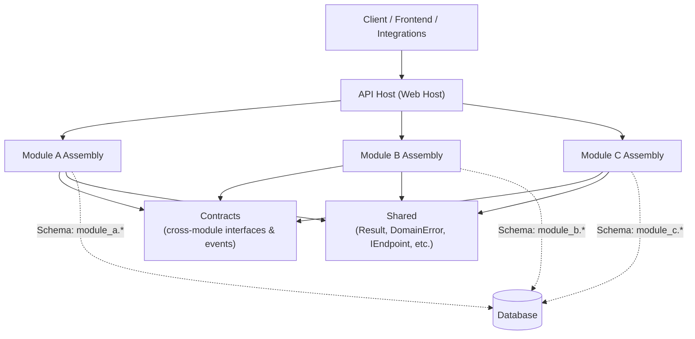
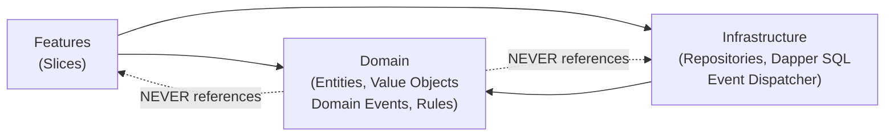
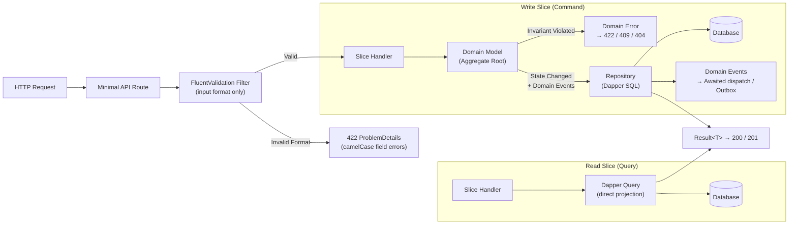
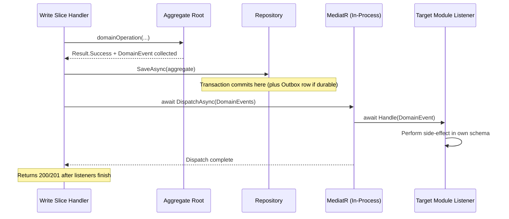
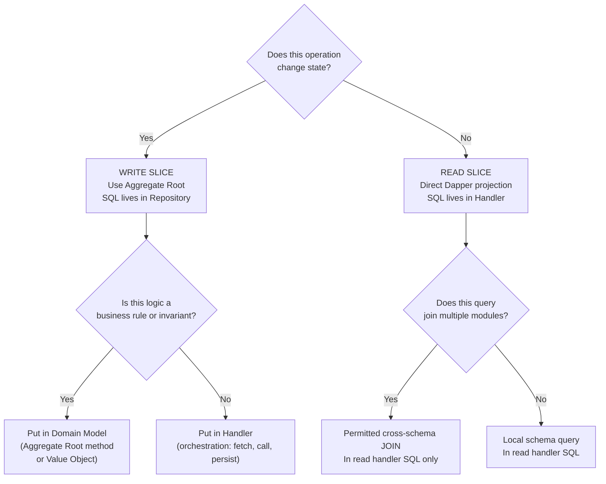

# Backend Architecture Reference — Modular Monolith with VSA + DDD

**Style:** Modular Monolith  
**Packaging:** Vertical Slice Architecture (VSA)  
**Domain Modeling:** Domain-Driven Design (DDD)  
**Dependency Direction:** Clean Architecture (innermost layer has zero outward dependencies)  
**Target Stack:** .NET 8+ / ASP.NET Core / SQL Server (adaptable)

---

## 1. The Two Orthogonal Organizing Philosophies

This architecture is governed by **two independent concerns** that must never be confused with each other:

| Concern | Philosophy | Governs |
|---|---|---|
| **How features are packaged and found** | Vertical Slice Architecture | Folder structure, file co-location, feature discoverability |
| **Where business rules live and how layers depend on each other** | DDD + Clean Architecture | Domain Model authority, dependency direction, invariant enforcement |

> [!IMPORTANT]
> VSA is a **packaging strategy**. DDD + Clean Architecture is a **modeling and dependency strategy**. Using VSA does not eliminate the Domain layer — it changes *where* the Domain layer lives (inside each module assembly), not *whether* it exists.

---

## 2. Architectural Overview

### 2.1 Modular Monolith

The system is a single deployable unit divided into **bounded context modules**. Each module is a separate assembly (project) that owns a distinct business subdomain. Modules never reference each other directly; they communicate through explicit contracts.



### 2.2 Internal Module Structure — Three Layers Inside Every Module

Each module assembly is internally divided into three layers via **folders** (not separate projects). Clean Architecture's dependency direction is enforced within each module.

```
MyApp.ModuleA/
├── Domain/          ← Layer 1 (innermost — no dependencies on anything else)
├── Infrastructure/  ← Layer 2 (depends on Domain only)
└── Features/        ← Layer 3 (depends on Domain + Infrastructure; outermost)
```



---

## 3. Core Principles

### Principle 1 — Domain Model is the First-Class Citizen

Business rules, invariants, state-transition logic, and domain events live exclusively in the **Domain layer**. Feature handlers are thin orchestrators that *call* the Domain Model — they never contain business logic themselves.

> [!CAUTION]
> Any `if` statement in a handler that makes a business decision (e.g., "can this entity transition to this state?") is a violation. That logic belongs in the Domain Model.

### Principle 2 — Mandatory CQRS: Write Slices vs Read Slices

Every feature slice is classified as either a **Write (Command)** or a **Read (Query)**:

- **Write Slice:** Fetches an Aggregate Root → delegates to domain → persists via Repository → dispatches Domain Events. Business logic lives in the domain model, SQL lives in the repository.
- **Read Slice:** Queries the database directly and projects results into a response DTO. No Aggregate Root, no domain invariants. Dapper SQL may live directly in the read handler.

This split is the mechanism that keeps Domain authoritative on mutations without introducing overhead on reads.

### Principle 3 — Locality of Behavior (Vertical Slices)

A feature is packaged as a self-contained folder under `Features/<Submodule>/<FeatureName>/`. All files specific to that feature (endpoint, request, response, validator, handler) live in that folder. The Domain Model is shared by all Write Slices within the module — it is not co-located inside a single slice.

### Principle 4 — Strict Module Ownership

Business responsibilities are partitioned strictly across bounded context modules. No module references another module's assembly directly. Cross-module communication follows the **Contracts + Events** model (see Section 7).

### Principle 5 — Compile-Time Module Isolation

Module assemblies **never reference each other**. The compiler physically prevents direct code coupling across bounded contexts.

### Principle 6 — Explicit Control Flow

- No magic reflection-based pipelines for core business flows.
- Minimal API endpoints call handlers directly (no MediatR for command/query dispatch).
- MediatR (or equivalent) is reserved exclusively for in-process domain event publication **after** the repository transaction commits (awaited before returning the HTTP response, or persisted via a transactional Outbox for resilient async processing).
- No generic repository pattern. Each module defines its own domain-specific repository interfaces.

---

## 4. The Domain Layer

### 4.1 What Belongs Here

| Concept | Description |
|---|---|
| **Aggregate Root** | The authority on state transitions for a cluster of entities. Exposes named methods for each domain operation. Enforces invariants. Raises domain events. |
| **Entity** | Has identity; belongs to an Aggregate. Only mutated through the Aggregate Root. |
| **Value Object** | Has no identity; equality is by value. Enforces its own validity at construction. |
| **Domain Event** | A named record of a significant state change raised by an Aggregate Root. |
| **Domain Service / Policy** | Stateless logic that involves multiple aggregate roots and cannot belong to any single one. |
| **Domain Errors** | Strongly typed, stable error codes owned by the module. |

### 4.2 What Does NOT Belong Here

- SQL strings, Dapper calls, `IDbConnection`, `SqlCommand`.
- HTTP concepts (`HttpContext`, `IResult`, status codes).
- FluentValidation rules (those validate HTTP input format, not business invariants).
- References to `Infrastructure`, `Features`, or any external library except the core language.

### 4.3 Aggregate Root — Template

```csharp
// Domain/Model/Order.cs
public sealed class Order
{
    private readonly List<DomainEventBase> _domainEvents = [];

    public Guid Id { get; private set; }
    public OrderStatus Status { get; private set; }
    public IReadOnlyList<DomainEventBase> DomainEvents => _domainEvents.AsReadOnly();
    public void ClearDomainEvents() => _domainEvents.Clear();

    // ✅ Named domain operation — enforces invariants, raises event
    public Result Cancel(string reason, string cancelledBy)
    {
        if (Status == OrderStatus.Shipped)
            return Result.Failure(OrderErrors.CannotCancelShippedOrder());

        if (string.IsNullOrWhiteSpace(reason))
            return Result.Failure(OrderErrors.ReasonRequired("Cancellation"));

        Status = OrderStatus.Cancelled;
        _domainEvents.Add(new OrderCancelledDomainEvent(Id, reason, cancelledBy));

        return Result.Success();
    }

    // ✅ Factory method for rehydration from persistence (called by Repository)
    public static Order Rehydrate(Guid id, string status, /* ... */)
    {
        return new Order { Id = id, Status = OrderStatus.From(status).Value };
    }
}
```

### 4.4 Value Object — Template

```csharp
// Domain/Model/OrderStatus.cs
public sealed record OrderStatus
{
    public static readonly OrderStatus Pending   = new("pending");
    public static readonly OrderStatus Confirmed = new("confirmed");
    public static readonly OrderStatus Shipped   = new("shipped");
    public static readonly OrderStatus Cancelled = new("cancelled");

    private static readonly Dictionary<OrderStatus, OrderStatus[]> _transitions = new()
    {
        [Pending]   = [Confirmed, Cancelled],
        [Confirmed] = [Shipped, Cancelled],
        [Shipped]   = [],       // Terminal
        [Cancelled] = [],       // Terminal
    };

    public string Value { get; }
    private OrderStatus(string value) => Value = value;

    public static Result<OrderStatus> From(string? raw)
    {
        return raw?.Trim().ToLowerInvariant() switch
        {
            "pending"   => Result.Success(Pending),
            "confirmed" => Result.Success(Confirmed),
            "shipped"   => Result.Success(Shipped),
            "cancelled" => Result.Success(Cancelled),
            _           => Result.Failure<OrderStatus>(OrderErrors.InvalidStatus(raw))
        };
    }

    public static bool IsTransitionAllowed(OrderStatus from, OrderStatus to) =>
        _transitions.TryGetValue(from, out var allowed) && allowed.Contains(to);
}
```

### 4.5 Domain Errors — Template

```csharp
// Domain/Errors/OrderErrors.cs
public static class OrderErrors
{
    public static DomainError NotFound(Guid id) =>
        DomainError.NotFound("Orders.NotFound", $"Order '{id}' was not found.");

    public static DomainError CannotCancelShippedOrder() =>
        DomainError.Conflict("Orders.CannotCancelShipped", "A shipped order cannot be cancelled.");

    public static DomainError ReasonRequired(string forOperation) =>
        DomainError.Validation(
            "Orders.ReasonRequired",
            $"A reason is required for the '{forOperation}' operation.",
            field: "reason");

    public static DomainError InvalidStatus(string? raw) =>
        DomainError.Validation(
            "Orders.InvalidStatus",
            $"'{raw}' is not a recognized order status.",
            field: "status");
}
```

---

## 5. The Infrastructure Layer

### 5.1 What Belongs Here

The Infrastructure layer is the **only** place in a module that contains Dapper SQL for Write operations. It has two responsibilities:

1. **Rehydrate** an Aggregate Root from database rows (SELECT → Aggregate Root factory method).
2. **Persist** an Aggregate Root's state changes back to database rows (UPDATE/INSERT → SQL).

It may also contain:
- Domain Event dispatcher (dispatches events collected by aggregate roots after commit).
- Module-specific database configuration.

> [!NOTE]
> Read Slice handlers (Query) may contain their own Dapper SQL directly, since they project to DTOs and do not need to rehydrate Aggregate Roots.

### 5.2 Repository — Template

```csharp
// Infrastructure/Persistence/OrderRepository.cs
public sealed class OrderRepository(ISqlConnectionFactory connectionFactory) : IOrderRepository
{
    private const string _selectSql = """
        SELECT o.id, o.status, o.created_at, o.created_by
        FROM orders.orders o
        WHERE o.id = @Id;
        """;

    private const string _updateStatusSql = """
        UPDATE orders.orders
        SET status     = @Status,
            updated_at = SYSUTCDATETIME(),
            updated_by = @UpdatedBy
        WHERE id = @Id;
        """;

    // Rehydrate: SQL → Aggregate Root
    public async Task<Order?> GetByIdAsync(Guid id, CancellationToken ct)
    {
        await using var conn = await connectionFactory.CreateConnectionAsync(ct);
        var row = await conn.QuerySingleOrDefaultAsync<OrderRow>(_selectSql, new { Id = id });
        return row is null ? null : Order.Rehydrate(row.Id, row.Status /*, ...*/);
    }

    // Persist: Aggregate Root state → SQL (all transaction management lives here)
    public async Task SaveCancellationAsync(Order order, string cancelledBy, CancellationToken ct)
    {
        await using var conn = await connectionFactory.CreateConnectionAsync(ct);
        await using var tx  = await conn.BeginTransactionAsync(ct);
        try
        {
            await conn.ExecuteAsync(_updateStatusSql,
                new { order.Id, Status = order.Status.Value, UpdatedBy = cancelledBy }, tx);
            // ... any additional rows needed to persist the state change
            await tx.CommitAsync(ct);
        }
        catch
        {
            await tx.RollbackAsync(ct);
            throw;
        }
    }
}
```

### 5.3 Repository Interface — Owned by Domain

The interface for each repository is defined **inside the Domain layer** (or at the module root), not in Infrastructure. This keeps the dependency direction correct: Infrastructure depends on Domain, not the other way around.

```csharp
// Domain/IOrderRepository.cs  (or module root)
public interface IOrderRepository
{
    Task<Order?> GetByIdAsync(Guid id, CancellationToken ct);
    Task SaveCancellationAsync(Order order, string cancelledBy, CancellationToken ct);
}
```

---

## 6. The Feature Slice Layer

### 6.1 Write Slice (Command) — The Thin Orchestrator Pattern

A Write Slice handler must follow this exact sequence. It contains **no business logic** and **no SQL**:

```
1. Parse domain value objects from the request (domain validates the value)
2. Fetch Aggregate Root from Repository → return NotFound if absent
3. Call a named domain method on the Aggregate Root → receive Result<T>
4. If domain result is Failure → return the domain error immediately (do NOT add logic here)
5. Persist via Repository method (all SQL is inside the repository)
6. Dispatch Domain Events raised by the Aggregate Root (via event dispatcher)
7. Return a thin success response
```

```csharp
// Features/Orders/CancelOrder/CancelOrderHandler.cs
public sealed class CancelOrderHandler(
    IOrderRepository repository,
    IDomainEventDispatcher eventDispatcher,
    ICurrentUser currentUser)
{
    public async Task<Result<CancelOrderResponse>> HandleAsync(
        Guid orderId,
        CancelOrderRequest request,
        CancellationToken ct)
    {
        // Step 1: Fetch Aggregate Root
        var order = await repository.GetByIdAsync(orderId, ct);
        if (order is null)
            return Result.Failure<CancelOrderResponse>(OrderErrors.NotFound(orderId));

        // Step 2: Delegate to Domain — domain enforces ALL invariants
        var result = order.Cancel(request.Reason, currentUser.Username);
        if (result.IsFailure)
            return Result.Failure<CancelOrderResponse>(result.Error);

        // Step 3: Persist (SQL is inside the repository)
        await repository.SaveCancellationAsync(order, currentUser.Username, ct);

        // Step 4: Dispatch Domain Events raised by the aggregate root
        await eventDispatcher.DispatchAsync(order.DomainEvents, ct);

        // Step 5: Return thin response
        return Result.Success(new CancelOrderResponse(order.Id, order.Status.Value));
    }
}
```

### 6.2 Read Slice (Query) — Direct Projection

For reads, there is no Aggregate Root. The handler queries the database directly and projects to a DTO. List queries return the shared `PaginatedResponse<T>` envelope using standardized `PagedQuery` parameters (`Page`, `PageSize`, `SortField`, `SortOrder`, `Search`).

```csharp
// Features/Orders/GetOrderById/GetOrderByIdHandler.cs
public sealed class GetOrderByIdHandler(ISqlConnectionFactory connectionFactory)
{
    private const string _sql = """
        SELECT o.id, o.status, o.created_at, c.name AS CustomerName
        FROM orders.orders o
        JOIN customers.customers c ON o.customer_id = c.id
        WHERE o.id = @Id;
        """;

    public async Task<Result<GetOrderByIdResponse>> HandleAsync(Guid id, CancellationToken ct)
    {
        await using var conn = await connectionFactory.CreateConnectionAsync(ct);
        var row = await conn.QuerySingleOrDefaultAsync<GetOrderByIdResponse>(_sql, new { Id = id });

        return row is null
            ? Result.Failure<GetOrderByIdResponse>(OrderErrors.NotFound(id))
            : Result.Success(row);
    }
}
```

### 6.3 Slice Files — Anatomy

```
Features/<Submodule>/<FeatureName>/
├── <FeatureName>Endpoint.cs      # Route definition, OpenAPI metadata & handler invocation
├── <FeatureName>Request.cs       # HTTP request DTO (record)
├── <FeatureName>Response.cs      # HTTP response DTO (record)
├── <FeatureName>Validator.cs     # FluentValidation — input FORMAT only, never business rules
└── <FeatureName>Handler.cs       # Write: thin orchestrator | Read: Dapper projection
```

#### Endpoint & OpenAPI Contract Rule

Every `<FeatureName>Endpoint.cs` **must** expose explicit response metadata via `.Produces<TResponse>()` and `.ProducesProblem(...)` (or `TypedResults`) so `/swagger/v1/swagger.json` emits complete schemas for frontend `openapi-typescript` generation:

```csharp
// Features/Orders/CancelOrder/CancelOrderEndpoint.cs
public sealed class CancelOrderEndpoint : IEndpoint
{
    public void MapEndpoint(IEndpointRouteBuilder app)
    {
        app.MapPost("/api/orders/{orderId:guid}/cancel", async (
                Guid orderId,
                CancelOrderRequest request,
                CancelOrderHandler handler,
                CancellationToken ct) =>
            {
                var result = await handler.HandleAsync(orderId, request, ct);
                return result.IsSuccess
                    ? Results.Ok(result.Value)
                    : result.Error.ToProblemDetails();
            })
            .WithTags("Orders")
            .RequireAuthorization(Permissions.Orders.Cancel)
            .AddEndpointFilter<ValidationFilter<CancelOrderRequest>>()
            .Produces<CancelOrderResponse>(StatusCodes.Status200OK)
            .ProducesProblem(StatusCodes.Status404NotFound)
            .ProducesProblem(StatusCodes.Status409Conflict)
            .ProducesProblem(StatusCodes.Status422UnprocessableEntity);
    }
}
```

> [!NOTE]
> **Validator vs Domain Rules & `camelCase` Keys:** `FluentValidation` validators check HTTP input format (required fields, string length, regex patterns, date format). They must never enforce business rules (e.g., "is this status transition allowed?"). Business rules belong exclusively in the Domain Model. The shared `ValidationFilter<TRequest>` must normalize `FluentValidation` property names to **`camelCase`** (via `JsonNamingPolicy.CamelCase`) when producing the `422` `errors` dictionary so keys match frontend form fields (e.g., `startDate`, not `StartDate`).

### 6.4 Request Pipeline



---

## 7. Cross-Module Communication

Modules must never reference each other's assemblies. When a workflow spans multiple modules, one of two patterns is used:

### 7.1 Synchronous Prerequisite Check (Contracts)

For blocking prerequisite checks before a write operation (e.g., "has the customer paid before we enroll them?"):

- Declare a read-only interface in the **Contracts** assembly.
- Implement it in the target module.
- Inject it via DI into the requesting module's handler.
- Call it **before** invoking the domain method (it is a precondition, not domain logic).

```csharp
// Contracts/Finance/IFinanceModule.cs
public interface IFinanceModule
{
    Task<bool> HasClearedPaymentAsync(Guid customerId, CancellationToken ct);
}
```

### 7.2 Decoupled Reaction (Domain Events via In-Process Pub/Sub & Outbox)

For side-effects that belong to another module (e.g., billing reacts to an enrollment):

- The Aggregate Root raises a **Domain Event** internally.
- **Execution & Consistency Semantics:**
  - **Immediate In-Process Dispatch (Default for UI-Visible Cross-Module State):** After the repository commits the primary transaction, the handler **awaits** `eventDispatcher.DispatchAsync(...)` via MediatR *before* returning the `200`/`201` HTTP response. This guarantees that when the frontend immediately invalidates and refetches cross-module TanStack Query caches on mutation success, the target module's schema is already updated.
  - **Transactional Outbox (Required for Failure Resilience / Eventual Consistency):** Because the primary transaction has already committed, any listener failure cannot simply be logged and forgotten. When a side-effect must be guaranteed across crashes or transient failures, the repository writes the event into a module `outbox_messages` table inside the **same** database transaction (`tx`), and a background Outbox processor retries failed listeners with idempotent handlers. For workflows that use background Outbox processing, the API documentation must note eventual consistency so the frontend does not expect immediate read-after-write visibility across modules.



> [!IMPORTANT]
> Domain Events are dispatched **only after** the primary transaction has committed. Never publish in-process events inside the repository transaction (only Outbox records may be written inside `tx`).

---

## 8. Error Handling & Outcome Representation

### 8.1 The Result Pattern

Handlers never throw exceptions for predictable business outcomes. All business outcomes are represented as `Result<T>`:

```csharp
public sealed class Result<T>
{
    public bool IsSuccess { get; }
    public bool IsFailure => !IsSuccess;
    public T? Value { get; }
    public DomainError Error { get; }

    public static Result<T> Success(T value) => new(true, value, default!);
    public static Result<T> Failure(DomainError error) => new(false, default, error);
}
```

### 8.2 Error Ownership

| Error Source | Where Created |
|---|---|
| Input format errors | `FluentValidation` validators |
| Domain invariant violations | Aggregate Root methods, via module's `XxxErrors` static class |
| Resource not found | Repository returns `null` → handler returns `Result.Failure(XxxErrors.NotFound(...))` |
| Infrastructure failures | Thrown as exceptions → caught by global exception handler |

### 8.3 Standard DomainError

```csharp
// Shared/Common/DomainError.cs
public record DomainError(
    string Code,
    string Message,
    ErrorType Type,
    IReadOnlyDictionary<string, string[]>? Errors = null)
{
    public static DomainError NotFound(string code, string message) =>
        new(code, message, ErrorType.NotFound);

    public static DomainError Conflict(string code, string message) =>
        new(code, message, ErrorType.Conflict);

    public static DomainError Validation(
        string code,
        string message,
        string? field = null) =>
        new(
            code,
            message,
            ErrorType.Validation,
            string.IsNullOrWhiteSpace(field)
                ? null
                : new Dictionary<string, string[]> { [field] = [message] });

    public static DomainError Validation(
        string code,
        string message,
        IReadOnlyDictionary<string, string[]> errors) =>
        new(code, message, ErrorType.Validation, errors);

    public static DomainError Unauthorized(string code, string message) =>
        new(code, message, ErrorType.Unauthorized);

    public static DomainError Forbidden(string code, string message) =>
        new(code, message, ErrorType.Forbidden);
}
```

### 8.4 HTTP Mapping (RFC 7807)

`DomainError` is translated to RFC 7807 `ProblemDetails` responses in a shared extension method aligned with the frontend error mapper (`ApiError`):

```csharp
// Shared/Common/DomainErrorExtensions.cs
public static IResult ToProblemDetails(this DomainError error)
{
    var (statusCode, title) = error.Type switch
    {
        ErrorType.NotFound     => (StatusCodes.Status404NotFound, "Resource Not Found"),
        ErrorType.Conflict     => (StatusCodes.Status409Conflict, "Business Rule Conflict"),
        ErrorType.Validation   => (StatusCodes.Status422UnprocessableEntity, "Validation Error"),
        ErrorType.Unauthorized => (StatusCodes.Status401Unauthorized, "Unauthorized"),
        ErrorType.Forbidden    => (StatusCodes.Status403Forbidden, "Forbidden"),
        _                      => (StatusCodes.Status500InternalServerError, "Internal Server Error")
    };

    var extensions = new Dictionary<string, object?>
    {
        ["errorCode"] = error.Code
    };

    if (error.Errors is { Count: > 0 })
    {
        extensions["errors"] = error.Errors;
    }

    return Results.Problem(
        statusCode: statusCode,
        title: title,
        detail: error.Message,
        extensions: extensions);
}
```

> [!NOTE]
> `FluentValidation` endpoint filters also emit status `422` with `title: "Validation Error"`, `errorCode: "Request.ValidationFailed"`, and `camelCase` field keys in `errors` (`Dictionary<string, string[]>`). Domain `Validation` errors that are not bound to a single field omit `errors` and communicate via `detail` + `errorCode`.

---

## 9. Assembly & Dependency Reference

### 9.1 Recommended Solution Structure

```
src/
├── backend/
│   ├── YourApp.Api/           # ASP.NET Core host — DI wiring, CorrelationIdMiddleware, CORS, OpenAPI, endpoint scanning
│   ├── YourApp.Shared/        # Result<T>, DomainError, PaginatedResponse<T>, PagedQuery, IEndpoint, ISqlConnectionFactory, ICurrentUser, IRequestContext
│   ├── YourApp.Contracts/     # Cross-module interfaces (IFinanceModule) & Domain Event records
│   ├── YourApp.Database/      # Migration runner (DbUp) + SQL scripts
│   ├── YourApp.ModuleA/       # Bounded context A — Domain + Infrastructure + Features
│   ├── YourApp.ModuleB/       # Bounded context B — Domain + Infrastructure + Features
│   └── YourApp.ModuleC/       # Bounded context C — Domain + Infrastructure + Features
└── frontend/                  # Vue 3 SPA (keeps node_modules isolated from .NET MSBuild globbing)

tests/
├── YourApp.IntegrationTests/   # Testcontainers + Respawn + WebApplicationFactory
└── YourApp.ArchitectureTests/  # NetArchTest dependency boundary enforcement
```

#### Shared Cross-Cutting Contracts (`YourApp.Shared` & `YourApp.Api`)

To maintain contract alignment with the frontend SPA:
- **`CorrelationIdMiddleware` (`YourApp.Api`):** Reads the incoming `X-Correlation-ID` header (or generates one), attaches it to the log/trace scope, and echoes `X-Correlation-ID` on the HTTP response.
- **`ICurrentUser` (`YourApp.Shared`):** Exposes authenticated JWT claims aligned with the frontend `JwtClaims` contract: `Guid UserId` (`sub`), `string Username` (`preferred_username`), `string FullName` (`name`), `IReadOnlyList<string> Roles` (`roles`), `IReadOnlyList<string> Permissions` (`permissions`), and `Guid? DefaultOrganizationUnitId` (`org_unit_id`).
- **`IRequestContext` (`YourApp.Shared`):** Resolves active workspace scope headers sent by the frontend client (`X-Organization-Unit-ID`, `X-Active-Period-ID`) after validating the actor is authorized for that organization unit.
- **`PagedQuery` & `PaginatedResponse<T>` (`YourApp.Shared`):** Standard query record (`Page`, `PageSize`, `SortField`, `SortOrder`, `Search`) and response envelope (`Items`, `Page`, `PageSize`, `TotalCount`, `TotalPages`) used across all list Read Slices.
- **CORS & Auth Cookie Policy (`YourApp.Api`):** When the SPA and API run on separate origins (e.g., `app.` vs `api.`), CORS must explicitly configure `.WithOrigins(...)` and `.AllowCredentials()` so `HttpOnly` refresh cookies work with Axios `withCredentials: true` (or deploy both behind a reverse proxy on the same origin under `/api`).

### 9.2 Dependency Rules

| Assembly | May Reference | Must NOT Reference |
|---|---|---|
| `YourApp.Shared` | *(nothing)* | Any application assembly |
| `YourApp.Contracts` | `Shared` | Any module, `Api`, `Database` |
| `YourApp.Database` | Migration library only | Any module, `Api` |
| `YourApp.ModuleA` | `Shared`, `Contracts` | Any other module, `Api` |
| `YourApp.Api` | All assemblies | *(no restriction — it wires everything)* |

### 9.3 Intra-Module Layer Rules

| Layer | May Reference | Must NOT Reference |
|---|---|---|
| `Domain/` | *(nothing inside the module)* | `Infrastructure/`, `Features/`, Dapper, SQL, HTTP |
| `Infrastructure/` | `Domain/` | `Features/` |
| `Features/` | `Domain/`, `Infrastructure/` | *(no additional restriction inside the module)* |

---

## 10. Complete Module Internal Structure (Template)

```
YourApp.ModuleA/
│
├── Domain/
│   ├── Model/
│   │   ├── AggregateRootA.cs          # Aggregate Root (all state transitions + domain events)
│   │   ├── EntityA.cs                  # Entity owned by AggregateRootA
│   │   └── ValueObjectA.cs             # Value Object (validity enforced at construction)
│   ├── Events/
│   │   └── SomethingHappenedDomainEvent.cs
│   ├── Rules/
│   │   └── SomeDomainPolicy.cs         # Cross-entity domain service (if needed)
│   ├── Errors/
│   │   └── ModuleAErrors.cs            # Strongly typed error codes
│   └── IAggregateRootARepository.cs    # Repository interface (domain owns this)
│
├── Infrastructure/
│   └── Persistence/
│       ├── AggregateRootARepository.cs # Dapper implementation of IAggregateRootARepository
│       └── DomainEventDispatcher.cs    # Dispatches collected events after commit
│
├── Features/
│   ├── SubmoduleX/
│   │   ├── DoSomethingCommand/          ← WRITE SLICE
│   │   │   ├── DoSomethingEndpoint.cs
│   │   │   ├── DoSomethingRequest.cs
│   │   │   ├── DoSomethingResponse.cs
│   │   │   ├── DoSomethingValidator.cs   # Input format only
│   │   │   └── DoSomethingHandler.cs     # Thin orchestrator — no SQL, no business logic
│   │   └── GetSomethingQuery/           ← READ SLICE
│   │       ├── GetSomethingEndpoint.cs
│   │       ├── GetSomethingResponse.cs
│   │       └── GetSomethingHandler.cs    # Dapper projection direct to DTO
│   └── SubmoduleY/
│       └── ...
│
├── DependencyInjection.cs               # Registers repositories, handlers, validators
├── Permissions.cs                       # Permission constant strings
└── ModuleAAssemblyMarker.cs             # Empty marker class for assembly scanning
```

---

## 11. Testing Strategy

### 11.1 Integration Tests

- **Engine:** Testcontainers (real database container per test session) **or** local SQL Server / `MSSQLLocalDB` via configurable test connection string when Docker is unavailable on the host.
- **Isolation:** Respawn resets table data between tests (millisecond-fast).
- **Scope:** End-to-end HTTP call through Minimal API → handler → domain → repository → database.
- **Write Slice tests assert two things:**
  1. The correct HTTP response code and body.
  2. The correct resulting database state (domain invariants persisted correctly).
- **Read Slice tests assert:**
  1. The correct data shape returned.

### 11.2 Architecture Tests (NetArchTest)

Automate boundary enforcement at build time:

```csharp
// Cross-module isolation
[Fact] void ModuleA_should_not_reference_ModuleB() { ... }

// Domain purity — domain must not depend on infrastructure
[Fact] void Domain_classes_should_not_reference_Dapper() { ... }
[Fact] void Domain_classes_should_not_reference_SystemData() { ... }

// Handler discipline — Write handlers must not contain direct SQL
[Fact] void WriteHandlers_should_not_reference_ISqlConnectionFactory() { ... }
```

---

## 12. Quick Decision Guide


