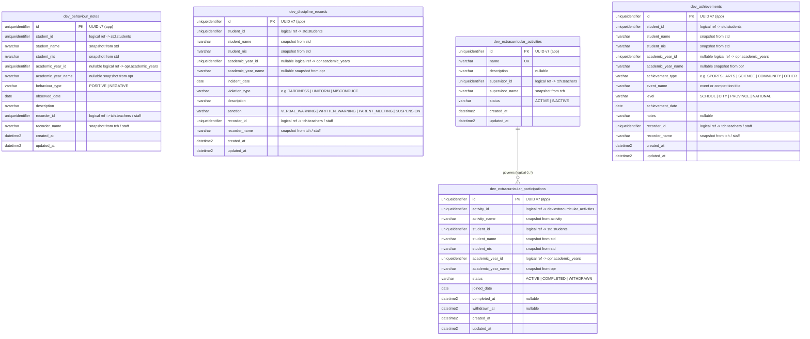

# Development Domain (Basic) — Database Table Design

> **Source Domain Specification:** [development-domain-basic.md](file:///d:/Project.Private/elsasa-sis-v4/docs/domains/development-domain-basic.md)
> **Target RDBMS:** Microsoft SQL Server (2019+ / Azure SQL Database, T-SQL)
> **Architecture Alignment:** Clean Architecture evolved to Vertical Slices — **Database as Pure Persistence Layer**
> **Scope:** Basic level only (Behaviour Notes, Discipline Records with Sanctions, Extracurricular Activities & Student Participation, Non-Academic Achievements, and Holistic Student Development Profile View). Intermediate/Enterprise features such as counselling case management, wellbeing support, safeguarding, formal approval workflows, appeals, multi-step pipelines, and cross-domain clearance are intentionally excluded.

---

## 1. Overview & Design Principles

### 1.1 Module Schema Convention

Each domain module owns an isolated SQL Server schema inside the database:

| Module / Bounded Context | Schema Name |
|---|---|
| **Operational** | `opr` |
| **Student** | `std` |
| **Academic** | `acd` |
| **Finance** | `fin` |
| **Teaching** | `tch` |
| **Development** *(this document)* | `dev` |

All Development Domain tables live under the `dev` schema (`dev.*`).

### 1.2 Aggregate-to-Table Mapping

Every aggregate, owned entity, and read projection in [development-domain-basic.md](file:///d:/Project.Private/elsasa-sis-v4/docs/domains/development-domain-basic.md) maps to a normalized plural relational table in `dev` (5 tables across 4 aggregates + 1 consolidated read view pattern):

| Aggregate Root / Concept | Domain Objects | Table(s) | Mapping Rationale |
|---|---|---|---|
| **Behaviour Note** | Behaviour Note | `dev.behaviour_notes` | Flat, immutable historical record of a single observed student behaviour classified as positive or negative (`BR-DEV-001`–`BR-DEV-003`). |
| **Discipline Record** | Discipline Record | `dev.discipline_records` | Flat record of a code-of-conduct breach, categorized by violation type and sanction applied (`BR-DEV-004`–`BR-DEV-006`, `BR-DEV-014`). |
| **Extracurricular Activity** | Extracurricular Activity, Participation | `dev.extracurricular_activities`, `dev.extracurricular_participations` | `dev.extracurricular_activities` defines the activity offering, assigned supervisor, and active/inactive status (`BR-DEV-007`, `BR-DEV-008`); `dev.extracurricular_participations` records student enrolments per academic year (`BR-DEV-009`, `BR-DEV-010`) with lifecycle transitions (`ACTIVE -> COMPLETED \| WITHDRAWN`). |
| **Achievement** | Achievement | `dev.achievements` | Flat record of non-academic accomplishments, competition events, and recognition levels (`BR-DEV-011`–`BR-DEV-013`). |
| **Student Development Profile** | Consolidated View | *Derived Read Projection (No Dedicated Table)* | Assembled dynamically by querying `dev.behaviour_notes`, `dev.discipline_records`, `dev.extracurricular_participations`, and `dev.achievements` for a specific student to serve homeroom teachers and leadership without data duplication. |

### 1.3 Pure Persistence Layer Principles

1. **Zero Business Logic in the Database:**
   - No triggers, no stored procedures, no `CHECK` constraints, and no column `DEFAULT` constraints exist in the database.
   - All domain invariants, enrolled student validation (`BR-DEV-002`, `BR-DEV-005`, `BR-DEV-011`), active activity verification before enrolment (`BR-DEV-010`), enum validations (`BR-DEV-001`, `BR-DEV-013`, `BR-DEV-014`), activity status toggles (`ACTIVE <-> INACTIVE`), and participation terminal state transitions (`ACTIVE -> COMPLETED | WITHDRAWN`) are enforced in the **Application Layer** (Domain Entities / Vertical Slice command handlers).
2. **Application-Generated Primary Keys (UUID v7):**
   - Every table's `id` column is `UNIQUEIDENTIFIER NOT NULL` with `PRIMARY KEY CLUSTERED (id)` and no database-side generation.
   - The Application Layer generates **UUID v7** identifiers prior to persistence. Time-ordered UUID v7 values minimize clustered index fragmentation while keeping entity identity independent of database round-trips.
3. **Application-Supplied Audit & Lifecycle Columns:**
   - Every table includes `created_at DATETIME2(3) NOT NULL` and `updated_at DATETIME2(3) NOT NULL` (UTC) populated explicitly by the Application Layer on insert and update.
   - Initial lifecycle statuses (`'ACTIVE'` on `dev.extracurricular_activities`, `'ACTIVE'` on `dev.extracurricular_participations`) and terminal timestamps (`completed_at`, `withdrawn_at`) are supplied explicitly by the Application Layer.
4. **No Database Foreign Keys:**
   - Both intra-module references (`activity_id` -> `dev.extracurricular_activities`) and cross-module references (`student_id` -> `std.students`, `academic_year_id` -> `opr.academic_years`, `supervisor_id` / `recorder_id` -> `tch.teachers` or staff user identity) are stored as plain `UNIQUEIDENTIFIER` columns.
   - Referential integrity and lifecycle boundaries are managed explicitly in the Application Layer.
5. **Cross-Domain Snapshot Denormalization:**
   - Because cross-schema database joins are avoided in Vertical Slices, tables holding cross-module references persist **snapshots of display attributes** alongside foreign IDs:
     - `dev.behaviour_notes`: `student_name`, `student_nis`, optional `academic_year_name`, `recorder_name`
     - `dev.discipline_records`: `student_name`, `student_nis`, optional `academic_year_name`, `recorder_name`
     - `dev.extracurricular_activities`: `supervisor_name`
     - `dev.extracurricular_participations`: `activity_name`, `student_name`, `student_nis`, `academic_year_name`
     - `dev.achievements`: `student_name`, `student_nis`, optional `academic_year_name`, `recorder_name`
   - Read queries render student timelines, activity rosters, and development profiles directly from `dev` without cross-schema joins to `std`, `opr`, or `tch`.
6. **Uniqueness Rules Enforced in the Database:**
   - Pure uniqueness guarantees are declared as database `UNIQUE` constraints:
     - `UQ_extracurricular_activities_name` on `dev.extracurricular_activities (name)` (`BR-DEV-007`)
     - `UQ_extracurricular_participations_student_activity_year` on `dev.extracurricular_participations (student_id, activity_id, academic_year_id)` (`BR-DEV-009`)
7. **Performance-Only Indexing:**
   - Non-unique indexes exist strictly to accelerate read queries in Vertical Slice query handlers (student development timeline search, activity membership rosters, and violation/achievement summaries).
8. **Standard SQL Server Data Types:**
   - **Identifiers:** `UNIQUEIDENTIFIER` (UUID v7)
   - **Unicode Text:** `NVARCHAR(n)` for names, event titles, descriptions, and notes
   - **Enum / Classification Codes:** `VARCHAR(20)` / `VARCHAR(50)` storing readable values (`'POSITIVE'`, `'NEGATIVE'`, `'VERBAL_WARNING'`, `'WRITTEN_WARNING'`, `'PARENT_MEETING'`, `'SUSPENSION'`, `'ACTIVE'`, `'INACTIVE'`, `'COMPLETED'`, `'WITHDRAWN'`, `'SCHOOL'`, `'CITY'`, `'PROVINCE'`, `'NATIONAL'`), validated in the Application Layer
   - **Temporal:** `DATE`, `DATETIME2(3)`

---

## 2. Entity-Relationship Diagram (Logical)

> Relationships below represent **logical domain associations** enforced by the Application Layer (no physical database foreign key constraints).



---

## 3. Table Definitions

### 3.1 `dev.behaviour_notes`

Persists the **Behaviour Note** aggregate root — immutable dated observations of student behaviour (positive or negative) attributed to a specific student and recorder.

| Column | SQL Server Data Type | Nullable | DB Constraint / Key | Application Layer Responsibility |
|---|---|---|---|---|
| `id` | `UNIQUEIDENTIFIER` | `NO` | `PK_behaviour_notes` | Generate UUID v7 |
| `student_id` | `UNIQUEIDENTIFIER` | `NO` | — | Logical reference to `std.students(id)`; validate student is enrolled (`BR-DEV-002`) |
| `student_name` | `NVARCHAR(150)` | `NO` | — | Snapshot of student full name from `std.students` |
| `student_nis` | `NVARCHAR(30)` | `NO` | — | Snapshot of student NIS from `std.students` |
| `academic_year_id` | `UNIQUEIDENTIFIER` | `YES` | — | Optional logical reference to `opr.academic_years(id)` for annual reporting |
| `academic_year_name` | `NVARCHAR(50)` | `YES` | — | Optional snapshot from `opr.academic_years`; `NULL` iff `academic_year_id IS NULL` |
| `behaviour_type` | `VARCHAR(10)` | `NO` | — | Validate `'POSITIVE'` or `'NEGATIVE'` (`BR-DEV-001`) |
| `observed_date` | `DATE` | `NO` | — | Date the behaviour occurred (`BR-DEV-003`) |
| `description` | `NVARCHAR(1000)` | `NO` | — | Non-blank observation text (`BR-DEV-003`) |
| `recorder_id` | `UNIQUEIDENTIFIER` | `NO` | — | Logical reference to recorder (`tch.teachers` or staff user) (`BR-DEV-003`) |
| `recorder_name` | `NVARCHAR(150)` | `NO` | — | Snapshot of recorder full name |
| `created_at` | `DATETIME2(3)` | `NO` | — | Populate UTC timestamp on create |
| `updated_at` | `DATETIME2(3)` | `NO` | — | Populate UTC timestamp on create & update |

**Constraints & Indexes:**
- `PK_behaviour_notes`: `PRIMARY KEY CLUSTERED (id)`
- `IX_behaviour_notes_student_date`: `NONCLUSTERED INDEX (student_id, observed_date DESC)` (for student development profile timeline)
- `IX_behaviour_notes_type_date`: `NONCLUSTERED INDEX (behaviour_type, observed_date DESC)` (school-wide behaviour analytics)

---

### 3.2 `dev.discipline_records`

Persists the **Discipline Record** aggregate root — records of student code-of-conduct breaches, incident descriptions, and sanctions applied.

| Column | SQL Server Data Type | Nullable | DB Constraint / Key | Application Layer Responsibility |
|---|---|---|---|---|
| `id` | `UNIQUEIDENTIFIER` | `NO` | `PK_discipline_records` | Generate UUID v7 |
| `student_id` | `UNIQUEIDENTIFIER` | `NO` | — | Logical reference to `std.students(id)`; validate student is enrolled (`BR-DEV-005`) |
| `student_name` | `NVARCHAR(150)` | `NO` | — | Snapshot of student full name from `std.students` |
| `student_nis` | `NVARCHAR(30)` | `NO` | — | Snapshot of student NIS from `std.students` |
| `academic_year_id` | `UNIQUEIDENTIFIER` | `YES` | — | Optional logical reference to `opr.academic_years(id)` for annual reporting |
| `academic_year_name` | `NVARCHAR(50)` | `YES` | — | Optional snapshot from `opr.academic_years`; `NULL` iff `academic_year_id IS NULL` |
| `incident_date` | `DATE` | `NO` | — | Date of incident/violation (`BR-DEV-006`) |
| `violation_type` | `VARCHAR(50)` | `NO` | — | Non-blank category (e.g. `'TARDINESS'`, `'UNIFORM'`, `'MISCONDUCT'`, `'TRUANCY'`) (`BR-DEV-004`) |
| `description` | `NVARCHAR(1000)` | `NO` | — | Non-blank description of incident (`BR-DEV-004`) |
| `sanction` | `VARCHAR(30)` | `NO` | — | Validate `'VERBAL_WARNING'`, `'WRITTEN_WARNING'`, `'PARENT_MEETING'`, or `'SUSPENSION'` (`BR-DEV-004`, `BR-DEV-014`) |
| `recorder_id` | `UNIQUEIDENTIFIER` | `NO` | — | Logical reference to recorder (`tch.teachers` or staff user) (`BR-DEV-006`) |
| `recorder_name` | `NVARCHAR(150)` | `NO` | — | Snapshot of recorder full name |
| `created_at` | `DATETIME2(3)` | `NO` | — | Populate UTC timestamp on create |
| `updated_at` | `DATETIME2(3)` | `NO` | — | Populate UTC timestamp on create & update |

**Constraints & Indexes:**
- `PK_discipline_records`: `PRIMARY KEY CLUSTERED (id)`
- `IX_discipline_records_student_date`: `NONCLUSTERED INDEX (student_id, incident_date DESC)` (for student development profile timeline)
- `IX_discipline_records_violation_date`: `NONCLUSTERED INDEX (violation_type, incident_date DESC)` (discipline reporting & pattern tracking)

---

### 3.3 `dev.extracurricular_activities`

Persists the **Extracurricular Activity** aggregate root — the catalogue of recognized non-academic offerings (clubs, sports teams, arts, scouting) available at the school.

| Column | SQL Server Data Type | Nullable | DB Constraint / Key | Application Layer Responsibility |
|---|---|---|---|---|
| `id` | `UNIQUEIDENTIFIER` | `NO` | `PK_extracurricular_activities` | Generate UUID v7 |
| `name` | `NVARCHAR(100)` | `NO` | `UQ_extracurricular_activities_name` | Non-blank activity name unique within the school (`BR-DEV-007`) |
| `description` | `NVARCHAR(500)` | `YES` | — | Optional description of activity scope and goals |
| `supervisor_id` | `UNIQUEIDENTIFIER` | `NO` | — | Logical reference to `tch.teachers(id)` or staff identity (`BR-DEV-008`) |
| `supervisor_name` | `NVARCHAR(150)` | `NO` | — | Snapshot of supervisor full name |
| `status` | `VARCHAR(20)` | `NO` | — | Set initial `'ACTIVE'`; enforce `'ACTIVE' <-> 'INACTIVE'` transitions |
| `created_at` | `DATETIME2(3)` | `NO` | — | Populate UTC timestamp on create |
| `updated_at` | `DATETIME2(3)` | `NO` | — | Populate UTC timestamp on create & update |

**Constraints & Indexes:**
- `PK_extracurricular_activities`: `PRIMARY KEY CLUSTERED (id)`
- `UQ_extracurricular_activities_name`: `UNIQUE (name)` (`BR-DEV-007`)
- `IX_extracurricular_activities_status_name`: `NONCLUSTERED INDEX (status, name)` (active activity catalogue lookup)

---

### 3.4 `dev.extracurricular_participations`

Persists **Participation** records owned by an **Extracurricular Activity** — tracking student enrolment, academic year boundary, and participation status.

| Column | SQL Server Data Type | Nullable | DB Constraint / Key | Application Layer Responsibility |
|---|---|---|---|---|
| `id` | `UNIQUEIDENTIFIER` | `NO` | `PK_extracurricular_participations` | Generate UUID v7 |
| `activity_id` | `UNIQUEIDENTIFIER` | `NO` | `UQ_extracurricular_participations_student_activity_year` | Logical reference to `dev.extracurricular_activities(id)`; verify activity is `'ACTIVE'` (`BR-DEV-010`) |
| `activity_name` | `NVARCHAR(100)` | `NO` | — | Snapshot of activity name from `dev.extracurricular_activities` |
| `student_id` | `UNIQUEIDENTIFIER` | `NO` | `UQ_extracurricular_participations_student_activity_year` | Logical reference to `std.students(id)` |
| `student_name` | `NVARCHAR(150)` | `NO` | — | Snapshot of student full name from `std.students` |
| `student_nis` | `NVARCHAR(30)` | `NO` | — | Snapshot of student NIS from `std.students` |
| `academic_year_id` | `UNIQUEIDENTIFIER` | `NO` | `UQ_extracurricular_participations_student_activity_year` | Logical reference to `opr.academic_years(id)` |
| `academic_year_name` | `NVARCHAR(50)` | `NO` | — | Snapshot of Academic Year name from `opr.academic_years` |
| `status` | `VARCHAR(20)` | `NO` | — | Set initial `'ACTIVE'`; enforce terminal transitions to `'COMPLETED'` or `'WITHDRAWN'` |
| `joined_date` | `DATE` | `NO` | — | Date student joined the activity |
| `completed_at` | `DATETIME2(3)` | `YES` | — | UTC timestamp when status transitioned to `'COMPLETED'`; `NULL` otherwise |
| `withdrawn_at` | `DATETIME2(3)` | `YES` | — | UTC timestamp when status transitioned to `'WITHDRAWN'`; `NULL` otherwise |
| `created_at` | `DATETIME2(3)` | `NO` | — | Populate UTC timestamp on create |
| `updated_at` | `DATETIME2(3)` | `NO` | — | Populate UTC timestamp on create & update |

**Constraints & Indexes:**
- `PK_extracurricular_participations`: `PRIMARY KEY CLUSTERED (id)`
- `UQ_extracurricular_participations_student_activity_year`: `UNIQUE (student_id, activity_id, academic_year_id)` (`BR-DEV-009` — student can join same activity at most once per academic year)
- `IX_extracurricular_participations_activity_year`: `NONCLUSTERED INDEX (activity_id, academic_year_id, status)` (activity roster lookup)
- `IX_extracurricular_participations_student_year`: `NONCLUSTERED INDEX (student_id, academic_year_id, status)` (student extracurricular history)

---

### 3.5 `dev.achievements`

Persists the **Achievement** aggregate root — records of student non-academic accolades, competitions, and accomplishments.

| Column | SQL Server Data Type | Nullable | DB Constraint / Key | Application Layer Responsibility |
|---|---|---|---|---|
| `id` | `UNIQUEIDENTIFIER` | `NO` | `PK_achievements` | Generate UUID v7 |
| `student_id` | `UNIQUEIDENTIFIER` | `NO` | — | Logical reference to `std.students(id)`; validate student is enrolled (`BR-DEV-011`) |
| `student_name` | `NVARCHAR(150)` | `NO` | — | Snapshot of student full name from `std.students` |
| `student_nis` | `NVARCHAR(30)` | `NO` | — | Snapshot of student NIS from `std.students` |
| `academic_year_id` | `UNIQUEIDENTIFIER` | `YES` | — | Optional logical reference to `opr.academic_years(id)` for annual reporting |
| `academic_year_name` | `NVARCHAR(50)` | `YES` | — | Optional snapshot from `opr.academic_years`; `NULL` iff `academic_year_id IS NULL` |
| `achievement_type` | `VARCHAR(50)` | `NO` | — | Category (e.g. `'SPORTS'`, `'ARTS'`, `'SCIENCE_COMPETITION'`, `'COMMUNITY_SERVICE'`, `'RELIGIOUS'`, `'OTHER'`) (`BR-DEV-012`) |
| `event_name` | `NVARCHAR(200)` | `NO` | — | Non-blank event or competition title (`BR-DEV-012`) |
| `level` | `VARCHAR(20)` | `NO` | — | Validate `'SCHOOL'`, `'CITY'`, `'PROVINCE'`, or `'NATIONAL'` (`BR-DEV-012`, `BR-DEV-013`) |
| `achievement_date` | `DATE` | `NO` | — | Date attained or awarded (`BR-DEV-012`) |
| `notes` | `NVARCHAR(1000)` | `YES` | — | Optional additional notes / remarks |
| `recorder_id` | `UNIQUEIDENTIFIER` | `NO` | — | Logical reference to recorder (`tch.teachers` or staff user) |
| `recorder_name` | `NVARCHAR(150)` | `NO` | — | Snapshot of recorder full name |
| `created_at` | `DATETIME2(3)` | `NO` | — | Populate UTC timestamp on create |
| `updated_at` | `DATETIME2(3)` | `NO` | — | Populate UTC timestamp on create & update |

**Constraints & Indexes:**
- `PK_achievements`: `PRIMARY KEY CLUSTERED (id)`
- `IX_achievements_student_date`: `NONCLUSTERED INDEX (student_id, achievement_date DESC)` (student achievements listing)
- `IX_achievements_type_level_date`: `NONCLUSTERED INDEX (achievement_type, level, achievement_date DESC)` (school Wall of Fame & competition reporting)

---

## 4. Business Rules Traceability Matrix

Every business rule in Section 7 of [development-domain-basic.md](file:///d:/Project.Private/elsasa-sis-v4/docs/domains/development-domain-basic.md) plus snapshot/referential rules is mapped below — **only uniqueness rules are enforced in the database**, while all other business rules live in the **Application Layer** (Domain Entities / Vertical Slice Handlers):

| Rule ID | Business Rule | Enforcement Layer | Exact Implementation |
|---|---|---|---|
| **BR-DEV-001** | Every behaviour note must be classified as exactly one behaviour type: positive or negative. | **Application Layer** (+ `NOT NULL`) | `behaviour_type` is `NOT NULL` in DB; `BehaviourNote` entity validates value in `{'POSITIVE', 'NEGATIVE'}`. |
| **BR-DEV-002** | Every behaviour note must reference a valid enrolled student. | **Application Layer** | `RecordBehaviourNote` handler confirms `student_id` exists in `std.students` with `status = 'ACTIVE'`. |
| **BR-DEV-003** | Every behaviour note must have a date, a brief description, and a recorder. | **Application Layer** (+ `NOT NULL`) | `observed_date`, `description`, and `recorder_id` are `NOT NULL` in DB; handler validates non-empty description. |
| **BR-DEV-004** | Every discipline record must specify a violation type, a description, and a sanction. | **Application Layer** (+ `NOT NULL`) | `violation_type`, `description`, and `sanction` are `NOT NULL` in DB; handler validates non-whitespace strings. |
| **BR-DEV-005** | Every discipline record must reference a valid enrolled student. | **Application Layer** | `RecordDisciplineRecord` handler confirms `student_id` exists in `std.students` with `status = 'ACTIVE'`. |
| **BR-DEV-006** | Every discipline record must have a date and a recorder. | **Application Layer** (+ `NOT NULL`) | `incident_date` and `recorder_id` are `NOT NULL` in DB. |
| **BR-DEV-007** | An extracurricular activity must have a unique name within the school. | **Database (`UNIQUE`)** + App Layer | `UQ_extracurricular_activities_name`: `UNIQUE (name)` on `dev.extracurricular_activities` *(paired with trimming/normalization)*. |
| **BR-DEV-008** | An extracurricular activity must have an assigned supervisor. | **Application Layer** (+ `NOT NULL`) | `supervisor_id` and `supervisor_name` are `NOT NULL` in DB; handler verifies supervisor exists in `tch.teachers`. |
| **BR-DEV-009** | A student may participate in the same extracurricular activity only once per academic year. | **Database (`UNIQUE`)** + App Layer | `UQ_extracurricular_participations_student_activity_year`: `UNIQUE (student_id, activity_id, academic_year_id)` on `dev.extracurricular_participations`. |
| **BR-DEV-010** | A participation can only be created for an extracurricular activity whose status is active. | **Application Layer** | `EnrolInActivity` handler checks `activity.Status == 'ACTIVE'` before creating `dev.extracurricular_participations`. |
| **BR-DEV-011** | Every achievement must reference a valid enrolled student. | **Application Layer** | `RecordAchievement` handler confirms `student_id` exists in `std.students` with `status = 'ACTIVE'`. |
| **BR-DEV-012** | Every achievement must specify an achievement type, event or competition name, level, and date. | **Application Layer** (+ `NOT NULL`) | `achievement_type`, `event_name`, `level`, and `achievement_date` are `NOT NULL` in DB. |
| **BR-DEV-013** | Achievement level must be one of: school, city, province, or national. | **Application Layer** (+ `NOT NULL`) | `level` is `NOT NULL` in DB; `Achievement` entity validates value in `{'SCHOOL', 'CITY', 'PROVINCE', 'NATIONAL'}`. |
| **BR-DEV-014** | A sanction must be one of the recognised sanction types: verbal warning, written warning, parent meeting, or suspension. | **Application Layer** (+ `NOT NULL`) | `sanction` is `NOT NULL` in DB; `DisciplineRecord` entity validates value in `{'VERBAL_WARNING', 'WRITTEN_WARNING', 'PARENT_MEETING', 'SUSPENSION'}`. |
| **EXT-DEV-001** | Cross-domain snapshot columns (`student_name`, `student_nis`, `academic_year_name`, `supervisor_name`, `recorder_name`) stay synchronized with their source entities. | **Application Layer** | Domain event handlers update snapshot names in `dev.*` upon entity updates in `std`, `opr`, or `tch`. |
| **EXT-DEV-002** | Participation terminal states (`COMPLETED`, `WITHDRAWN`) cannot transition back to `ACTIVE`. | **Application Layer** | `ExtracurricularParticipation` entity blocks status transitions once marked as `COMPLETED` or `WITHDRAWN`. |

---

## 5. Complete SQL DDL Reference (Microsoft SQL Server / T-SQL)

```sql
-- ============================================================================
-- Development Domain (Basic) — Pure Persistence Layer DDL (Microsoft SQL Server)
-- Target: Microsoft SQL Server 2019+ / Azure SQL Database (T-SQL)
-- Schema: dev
-- Source: docs/domains/development-domain-basic.md
-- Notes:
--   - IDs are application-generated UUID v7 values
--   - Timestamps, statuses, and snapshot names are supplied by the application
--   - Only PRIMARY KEY and UNIQUE constraints are enforced in the DB
--   - All other indexes exist strictly for query performance
-- ============================================================================

IF NOT EXISTS (SELECT 1 FROM sys.schemas WHERE name = N'dev')
BEGIN
    EXEC(N'CREATE SCHEMA dev');
END;
GO

-- ----------------------------------------------------------------------------
-- 1. Behaviour Notes
-- ----------------------------------------------------------------------------
CREATE TABLE dev.behaviour_notes (
    id                  UNIQUEIDENTIFIER NOT NULL,
    student_id          UNIQUEIDENTIFIER NOT NULL,
    student_name        NVARCHAR(150)    NOT NULL,
    student_nis         NVARCHAR(30)     NOT NULL,
    academic_year_id    UNIQUEIDENTIFIER NULL,
    academic_year_name  NVARCHAR(50)     NULL,
    behaviour_type      VARCHAR(10)      NOT NULL,
    observed_date       DATE             NOT NULL,
    description         NVARCHAR(1000)   NOT NULL,
    recorder_id         UNIQUEIDENTIFIER NOT NULL,
    recorder_name       NVARCHAR(150)    NOT NULL,
    created_at          DATETIME2(3)     NOT NULL,
    updated_at          DATETIME2(3)     NOT NULL,

    CONSTRAINT PK_behaviour_notes PRIMARY KEY CLUSTERED (id)
);

CREATE NONCLUSTERED INDEX IX_behaviour_notes_student_date
    ON dev.behaviour_notes (student_id, observed_date DESC);

CREATE NONCLUSTERED INDEX IX_behaviour_notes_type_date
    ON dev.behaviour_notes (behaviour_type, observed_date DESC);
GO

-- ----------------------------------------------------------------------------
-- 2. Discipline Records
-- ----------------------------------------------------------------------------
CREATE TABLE dev.discipline_records (
    id                  UNIQUEIDENTIFIER NOT NULL,
    student_id          UNIQUEIDENTIFIER NOT NULL,
    student_name        NVARCHAR(150)    NOT NULL,
    student_nis         NVARCHAR(30)     NOT NULL,
    academic_year_id    UNIQUEIDENTIFIER NULL,
    academic_year_name  NVARCHAR(50)     NULL,
    incident_date       DATE             NOT NULL,
    violation_type      VARCHAR(50)      NOT NULL,
    description         NVARCHAR(1000)   NOT NULL,
    sanction            VARCHAR(30)      NOT NULL,
    recorder_id         UNIQUEIDENTIFIER NOT NULL,
    recorder_name       NVARCHAR(150)    NOT NULL,
    created_at          DATETIME2(3)     NOT NULL,
    updated_at          DATETIME2(3)     NOT NULL,

    CONSTRAINT PK_discipline_records PRIMARY KEY CLUSTERED (id)
);

CREATE NONCLUSTERED INDEX IX_discipline_records_student_date
    ON dev.discipline_records (student_id, incident_date DESC);

CREATE NONCLUSTERED INDEX IX_discipline_records_violation_date
    ON dev.discipline_records (violation_type, incident_date DESC);
GO

-- ----------------------------------------------------------------------------
-- 3. Extracurricular Activities
-- ----------------------------------------------------------------------------
CREATE TABLE dev.extracurricular_activities (
    id               UNIQUEIDENTIFIER NOT NULL,
    name             NVARCHAR(100)    NOT NULL,
    description      NVARCHAR(500)    NULL,
    supervisor_id    UNIQUEIDENTIFIER NOT NULL,
    supervisor_name  NVARCHAR(150)    NOT NULL,
    status           VARCHAR(20)      NOT NULL,
    created_at       DATETIME2(3)     NOT NULL,
    updated_at       DATETIME2(3)     NOT NULL,

    CONSTRAINT PK_extracurricular_activities PRIMARY KEY CLUSTERED (id),
    -- BR-DEV-007: Activity name must be unique within the school
    CONSTRAINT UQ_extracurricular_activities_name UNIQUE (name)
);

CREATE NONCLUSTERED INDEX IX_extracurricular_activities_status_name
    ON dev.extracurricular_activities (status, name);
GO

-- ----------------------------------------------------------------------------
-- 4. Extracurricular Participations
-- ----------------------------------------------------------------------------
CREATE TABLE dev.extracurricular_participations (
    id                  UNIQUEIDENTIFIER NOT NULL,
    activity_id         UNIQUEIDENTIFIER NOT NULL,
    activity_name       NVARCHAR(100)    NOT NULL,
    student_id          UNIQUEIDENTIFIER NOT NULL,
    student_name        NVARCHAR(150)    NOT NULL,
    student_nis         NVARCHAR(30)     NOT NULL,
    academic_year_id    UNIQUEIDENTIFIER NOT NULL,
    academic_year_name  NVARCHAR(50)     NOT NULL,
    status              VARCHAR(20)      NOT NULL,
    joined_date         DATE             NOT NULL,
    completed_at        DATETIME2(3)     NULL,
    withdrawn_at        DATETIME2(3)     NULL,
    created_at          DATETIME2(3)     NOT NULL,
    updated_at          DATETIME2(3)     NOT NULL,

    CONSTRAINT PK_extracurricular_participations PRIMARY KEY CLUSTERED (id),
    -- BR-DEV-009: A student may participate in the same activity at most once per academic year
    CONSTRAINT UQ_extracurricular_participations_student_activity_year
        UNIQUE (student_id, activity_id, academic_year_id)
);

CREATE NONCLUSTERED INDEX IX_extracurricular_participations_activity_year
    ON dev.extracurricular_participations (activity_id, academic_year_id, status);

CREATE NONCLUSTERED INDEX IX_extracurricular_participations_student_year
    ON dev.extracurricular_participations (student_id, academic_year_id, status);
GO

-- ----------------------------------------------------------------------------
-- 5. Achievements
-- ----------------------------------------------------------------------------
CREATE TABLE dev.achievements (
    id                  UNIQUEIDENTIFIER NOT NULL,
    student_id          UNIQUEIDENTIFIER NOT NULL,
    student_name        NVARCHAR(150)    NOT NULL,
    student_nis         NVARCHAR(30)     NOT NULL,
    academic_year_id    UNIQUEIDENTIFIER NULL,
    academic_year_name  NVARCHAR(50)     NULL,
    achievement_type    VARCHAR(50)      NOT NULL,
    event_name          NVARCHAR(200)    NOT NULL,
    level               VARCHAR(20)      NOT NULL,
    achievement_date    DATE             NOT NULL,
    notes               NVARCHAR(1000)   NULL,
    recorder_id         UNIQUEIDENTIFIER NOT NULL,
    recorder_name       NVARCHAR(150)    NOT NULL,
    created_at          DATETIME2(3)     NOT NULL,
    updated_at          DATETIME2(3)     NOT NULL,

    CONSTRAINT PK_achievements PRIMARY KEY CLUSTERED (id)
);

CREATE NONCLUSTERED INDEX IX_achievements_student_date
    ON dev.achievements (student_id, achievement_date DESC);

CREATE NONCLUSTERED INDEX IX_achievements_type_level_date
    ON dev.achievements (achievement_type, level, achievement_date DESC);
GO
```

---

## 6. Common Query Patterns (Vertical Slice Persistence Queries)

### 6.1 View Student Holistic Development Profile (`GetStudentDevelopmentProfile` Slice)

*(Homeroom teachers and leadership query all non-academic dimensions for a student without cross-schema joins).*

```sql
-- 1. Behaviour Notes timeline
SELECT
    bn.id,
    bn.observed_date,
    bn.behaviour_type,
    bn.description,
    bn.recorder_name,
    bn.academic_year_name
FROM dev.behaviour_notes bn
WHERE bn.student_id = @student_id
ORDER BY bn.observed_date DESC;

-- 2. Disciplinary Actions history
SELECT
    dr.id,
    dr.incident_date,
    dr.violation_type,
    dr.description,
    dr.sanction,
    dr.recorder_name,
    dr.academic_year_name
FROM dev.discipline_records dr
WHERE dr.student_id = @student_id
ORDER BY dr.incident_date DESC;

-- 3. Extracurricular Activities involvement
SELECT
    ep.id,
    ep.activity_id,
    ep.activity_name,
    ep.academic_year_name,
    ep.status,
    ep.joined_date,
    ep.completed_at,
    ep.withdrawn_at
FROM dev.extracurricular_participations ep
WHERE ep.student_id = @student_id
ORDER BY ep.joined_date DESC;

-- 4. Non-Academic Achievements
SELECT
    a.id,
    a.achievement_date,
    a.achievement_type,
    a.event_name,
    a.level,
    a.notes,
    a.academic_year_name
FROM dev.achievements a
WHERE a.student_id = @student_id
ORDER BY a.achievement_date DESC;
```

### 6.2 Record a Student Behaviour Note (`RecordBehaviourNote` Slice)

```sql
INSERT INTO dev.behaviour_notes (
    id, student_id, student_name, student_nis,
    academic_year_id, academic_year_name,
    behaviour_type, observed_date, description,
    recorder_id, recorder_name,
    created_at, updated_at
)
VALUES (
    @id, @student_id, @student_name, @student_nis,
    @academic_year_id, @academic_year_name,
    @behaviour_type, @observed_date, @description,
    @recorder_id, @recorder_name,
    @now, @now
);
```

### 6.3 Record a Student Discipline Record (`RecordDisciplineRecord` Slice)

```sql
INSERT INTO dev.discipline_records (
    id, student_id, student_name, student_nis,
    academic_year_id, academic_year_name,
    incident_date, violation_type, description, sanction,
    recorder_id, recorder_name,
    created_at, updated_at
)
VALUES (
    @id, @student_id, @student_name, @student_nis,
    @academic_year_id, @academic_year_name,
    @incident_date, @violation_type, @description, @sanction,
    @recorder_id, @recorder_name,
    @now, @now
);
```

### 6.4 List Active Extracurricular Offerings (`GetExtracurricularCatalogue` Slice)

```sql
SELECT
    ea.id,
    ea.name,
    ea.description,
    ea.supervisor_id,
    ea.supervisor_name,
    ea.status
FROM dev.extracurricular_activities ea
WHERE ea.status = 'ACTIVE'
ORDER BY ea.name;
```

### 6.5 Extracurricular Activity Roster by Academic Year (`GetActivityRoster` Slice)

```sql
SELECT
    ep.id,
    ep.student_id,
    ep.student_name,
    ep.student_nis,
    ep.status,
    ep.joined_date
FROM dev.extracurricular_participations ep
WHERE ep.activity_id = @activity_id
  AND ep.academic_year_id = @academic_year_id
ORDER BY ep.student_name;
```

### 6.6 Enrol Student in Extracurricular Activity (`EnrolInActivity` Slice)

*(Executed after Application Layer confirms `activity.status == 'ACTIVE'` and no prior participation exists for this academic year).*

```sql
INSERT INTO dev.extracurricular_participations (
    id, activity_id, activity_name,
    student_id, student_name, student_nis,
    academic_year_id, academic_year_name,
    status, joined_date,
    completed_at, withdrawn_at,
    created_at, updated_at
)
VALUES (
    @id, @activity_id, @activity_name,
    @student_id, @student_name, @student_nis,
    @academic_year_id, @academic_year_name,
    'ACTIVE', @joined_date,
    NULL, NULL,
    @now, @now
);
```

### 6.7 Transition Participation Status (`CompleteOrWithdrawParticipation` Slice)

```sql
-- When completing:
UPDATE dev.extracurricular_participations
   SET status       = 'COMPLETED',
       completed_at = @now,
       updated_at   = @now
 WHERE id = @participation_id
   AND status = 'ACTIVE';

-- When withdrawing:
UPDATE dev.extracurricular_participations
   SET status       = 'WITHDRAWN',
       withdrawn_at = @now,
       updated_at   = @now
 WHERE id = @participation_id
   AND status = 'ACTIVE';
```

### 6.8 Record Non-Academic Achievement (`RecordAchievement` Slice)

```sql
INSERT INTO dev.achievements (
    id, student_id, student_name, student_nis,
    academic_year_id, academic_year_name,
    achievement_type, event_name, level,
    achievement_date, notes,
    recorder_id, recorder_name,
    created_at, updated_at
)
VALUES (
    @id, @student_id, @student_name, @student_nis,
    @academic_year_id, @academic_year_name,
    @achievement_type, @event_name, @level,
    @achievement_date, @notes,
    @recorder_id, @recorder_name,
    @now, @now
);
```

### 6.9 School Wall of Fame (Achievements by Level and Date)

```sql
SELECT
    a.id,
    a.student_name,
    a.student_nis,
    a.achievement_type,
    a.event_name,
    a.level,
    a.achievement_date,
    a.academic_year_name
FROM dev.achievements a
WHERE (@level IS NULL OR a.level = @level)
  AND (@academic_year_id IS NULL OR a.academic_year_id = @academic_year_id)
ORDER BY a.achievement_date DESC, a.student_name;
```
