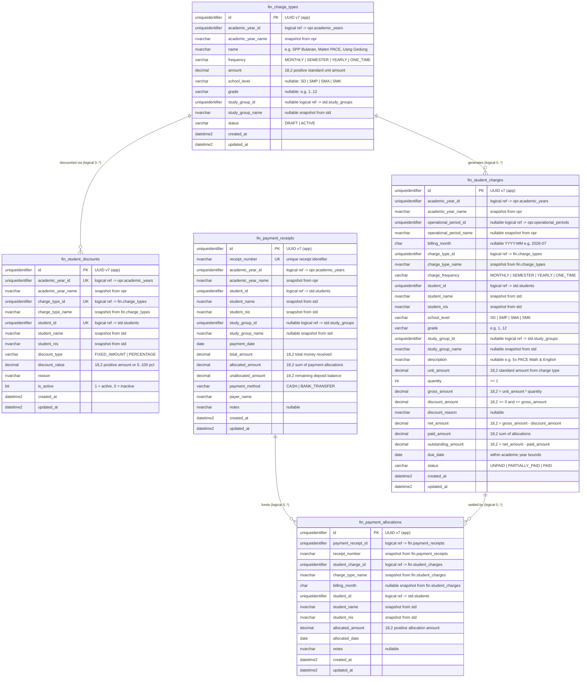

# Finance Domain (Basic) — Database Table Design

> **Source Domain Specification:** [finance-domain-basic.md](file:///d:/Project.Private/elsasa-sis-v4/docs/domains/finance-domain-basic.md)
> **Target RDBMS:** Microsoft SQL Server (2019+ / Azure SQL Database, T-SQL)
> **Architecture Alignment:** Clean Architecture evolved to Vertical Slices — **Database as Pure Persistence Layer**
> **Scope:** Basic v1 with pragmatic client-driven capabilities: Charge Types with recurrence frequencies (`MONTHLY`, `SEMESTER`, `YEARLY`, `ONE_TIME`), Standing & Inline Student Waivers/Discounts, Multiple & Variable-Quantity Student Charges per billing cycle (`billing_month`), Unified Payment Receipts & Guardian Deposit tracking (`allocated_amount` / `unallocated_amount`), Multi-Charge / Partial Payment Allocations (`PARTIALLY_PAID`), and Receivables & Deposit Inquiries. Intermediate/Enterprise features such as formal multi-step approval workflows, external payment gateway integrations, aging buckets, automated dunning engines, cross-student credit transfers, benefit stacking engines, and formal financial clearance are intentionally excluded.

---

## 1. Overview & Design Principles

### 1.1 Module Schema Convention

Each domain module owns an isolated SQL Server schema inside the database:

| Module / Bounded Context | Schema Name |
|---|---|
| **Operational** | `opr` |
| **Student** | `std` |
| **Academic** | `acd` |
| **Finance** *(this document)* | `fin` |
| **Teaching** | `tch` |
| **Development** | `dev` |

All Finance Domain tables live under the `fin` schema (`fin.*`).

### 1.2 Aggregate-to-Table Mapping

Every aggregate, owned entity, and read projection in [finance-domain-basic.md](file:///d:/Project.Private/elsasa-sis-v4/docs/domains/finance-domain-basic.md) maps cleanly to normalized plural tables in `fin` (5 tables across 4 aggregates):

| Aggregate Root / Object | Domain Objects | Table(s) | Mapping Rationale |
|---|---|---|---|
| **Charge Type** | Charge Type | `fin.charge_types` | Self-contained fee definition with `frequency` (`MONTHLY`, `SEMESTER`, `YEARLY`, `ONE_TIME`), standard unit `amount`, `academic_year_id`, applicability (`school_level`, `grade`, `study_group_id`), and `DRAFT -> ACTIVE` lifecycle. |
| **Student Discount** | Student Discount | `fin.student_discounts` | Standing per-student waiver/discount rule (`FIXED_AMOUNT` or `PERCENTAGE`) for a specific Charge Type and Academic Year (`BR-FIN-006`); auto-applied when generating `fin.student_charges`. |
| **Student Charge** | Student Charge | `fin.student_charges` | Individual student obligation scoped to `academic_year_id`, optional `operational_period_id`, and optional `billing_month` (`YYYY-MM`), holding `unit_amount`, `quantity`, `gross_amount`, `discount_amount`, `net_amount`, `paid_amount`, `outstanding_amount`, and `UNPAID \| PARTIALLY_PAID \| PAID` status (`BR-FIN-003`–`BR-FIN-005`, `BR-FIN-007`, `BR-FIN-011`). |
| **Payment Receipt** | Payment Receipt, Payment Allocation | `fin.payment_receipts`, `fin.payment_allocations` | `fin.payment_receipts` records incoming cash/transfer money (`total_amount`, `allocated_amount`, `unallocated_amount`). `fin.payment_allocations` links receipts to one or more `fin.student_charges` immediately or later from remaining deposit balances (`BR-FIN-008`–`BR-FIN-010`). |
| **Receivable & Deposit Position (View)** | Receivable, Outstanding Balance, Deposit Balance | *Derived Read Projection (No Dedicated Table)* | Computed directly from `fin.student_charges` (`outstanding_amount`) and `fin.payment_receipts` (`unallocated_amount`) (`BR-FIN-012`) to serve monthly student billing statements, student balance/deposit summaries, study group outstanding reports, and period receipt reports. |

### 1.3 Pure Persistence Layer Principles

1. **Zero Business Logic in the Database:**
   - No triggers, no stored procedures, no `CHECK` constraints, and no column `DEFAULT` constraints exist in the database.
   - All domain invariants, state transitions (`DRAFT -> ACTIVE`, `UNPAID -> PARTIALLY_PAID -> PAID`), arithmetic consistency (`gross_amount`, `net_amount`, `outstanding_amount`, `unallocated_amount`), frequency-period requirements, auto-discount application, and atomic allocation updates are enforced in the **Application Layer** (Domain Entities / Vertical Slice command handlers).
2. **Application-Generated Primary Keys (UUID v7):**
   - Every table's `id` column is `UNIQUEIDENTIFIER NOT NULL` with `PRIMARY KEY CLUSTERED (id)` and no database-side generation.
   - The Application Layer generates **UUID v7** identifiers prior to persistence. Time-ordered UUID v7 values minimize clustered index fragmentation while keeping entity identity independent of database round-trips.
3. **Application-Supplied Audit & Lifecycle Columns:**
   - Every table includes `created_at DATETIME2(3) NOT NULL` and `updated_at DATETIME2(3) NOT NULL` (UTC) populated explicitly by the Application Layer on insert and update.
   - Initial statuses (`'DRAFT'`/`'ACTIVE'` on `fin.charge_types`, `'UNPAID'`/`'PAID'` on `fin.student_charges`) and numeric/boolean defaults (`quantity = 1`, `discount_amount = 0.00`, `paid_amount = 0.00`, `allocated_amount = 0.00`, `is_active = 1`) are supplied explicitly by the Application Layer.
4. **No Database Foreign Keys:**
   - Both intra-module references (`charge_type_id`, `student_charge_id`, `payment_receipt_id` -> `fin.*`) and cross-module references (`academic_year_id`, `operational_period_id` -> `opr`; `student_id`, `study_group_id` -> `std`) are stored as plain `UNIQUEIDENTIFIER` columns.
   - Referential integrity and deletion/cascade guards are managed explicitly in the Application Layer.
5. **Cross-Domain & Intra-Domain Snapshot Denormalization:**
   - Because cross-schema database joins are avoided in Vertical Slices, `fin` tables persist **snapshots of display attributes** alongside foreign IDs so fee catalogs, discount lists, monthly student billing statements, study group outstanding (*tunggakan*) reports, printable receipts, and allocation logs render purely from `fin`:
     - `fin.charge_types`: `academic_year_name`, optional `study_group_name`
     - `fin.student_discounts`: `academic_year_name`, `charge_type_name`, `student_name`, `student_nis`
     - `fin.student_charges`: `academic_year_name`, optional `operational_period_name`, `charge_type_name`, `student_name`, `student_nis`, `school_level`, `grade`, optional `study_group_name`
     - `fin.payment_receipts`: `academic_year_name`, `student_name`, `student_nis`, optional `study_group_name`
     - `fin.payment_allocations`: `receipt_number`, `charge_type_name`, optional `billing_month`, `student_name`, `student_nis`
   - When upstream names change in `opr` (`academic_years`, `operational_periods`), `std` (`students`, `study_groups`), or `fin.charge_types`, Application Layer event handlers refresh snapshots on active/open records while preserving finalized historical receipts if required by school policy.
6. **Pragmatic Modeling Decisions for the 4 Client Pain Points:**
   - **Multiple Charges per Billing Cycle Without Heavy Invoice Overhead:** Instead of forcing a formal 2-table `invoices` + `invoice_lines` hierarchy, `fin.student_charges` carries `billing_month CHAR(7) NULL` (`'YYYY-MM'`) plus `unit_amount`, `quantity`, and optional `description` (e.g., `"5x PACE Math & English"`). A student's monthly billing statement (SPP + Materi PACE + Uang Gedung) is simply a dynamic grouping of `fin.student_charges` by `(student_id, billing_month)`.
   - **Frequency-Driven Recurrence (`BR-FIN-005`):** A single `fin.charge_types` definition (e.g., `"SPP"` with `frequency = 'MONTHLY'`) is reused across all 12 months. Frequency-scoped filtered unique indexes prevent accidental duplicate `YEARLY`, `SEMESTER`, or `MONTHLY` charges while allowing multiple `ONE_TIME` charges (such as repeat `Materi PACE` orders).
   - **Standing + Inline Discounts (`BR-FIN-006`, `BR-FIN-007`):** `fin.student_discounts` stores recurring per-student rules that bulk generation applies automatically into `discount_amount` / `discount_reason` on `fin.student_charges`, while still allowing inline waivers/adjustments on individual charges.
   - **Unified Receipt + Deposit Ledger (`BR-FIN-008`–`BR-FIN-012`):** `fin.payment_receipts` tracks `total_amount`, `allocated_amount`, and `unallocated_amount`. Any unallocated remainder is immediately the student's **Deposit Balance**, which can be allocated later to future monthly charges via `fin.payment_allocations`. Supporting `PARTIALLY_PAID` on `fin.student_charges` lets leftover deposit balances combine seamlessly with new cash/transfer payments and supports staged payments on large fees (e.g., Uang Gedung) without a separate installment engine.
7. **Uniqueness Rules Enforced in the Database:**
   - Only pure uniqueness guarantees are declared as database `UNIQUE` constraints / filtered unique indexes:
     - `UQ_student_discounts_student_type_year` on `fin.student_discounts (student_id, charge_type_id, academic_year_id)` (`BR-FIN-006`)
     - `UQ_student_charges_yearly` (filtered unique index) on `fin.student_charges (student_id, charge_type_id, academic_year_id) WHERE charge_frequency = 'YEARLY'` (`BR-FIN-005`)
     - `UQ_student_charges_semester` (filtered unique index) on `fin.student_charges (student_id, charge_type_id, operational_period_id) WHERE charge_frequency = 'SEMESTER' AND operational_period_id IS NOT NULL` (`BR-FIN-005`)
     - `UQ_student_charges_monthly` (filtered unique index) on `fin.student_charges (student_id, charge_type_id, academic_year_id, billing_month) WHERE charge_frequency = 'MONTHLY' AND billing_month IS NOT NULL` (`BR-FIN-005`)
     - `UQ_payment_receipts_receipt_number` on `fin.payment_receipts (receipt_number)` (`BR-FIN-008`)
   - *Design Note on `fin.charge_types`:* Fee names are intentionally **not** constrained by a global `UNIQUE (academic_year_id, name)` constraint because a school frequently defines the same fee name (e.g., `"SPP Bulanan"`) with different standard amounts across School Levels, Grades, or Study Groups within the same Academic Year.
8. **Performance-Only Indexing:**
   - Non-unique indexes (including filtered indexes on `unallocated_amount > 0`) exist strictly to accelerate Vertical Slice query handlers.
9. **Standard SQL Server Data Types:**
   - **Identifiers:** `UNIQUEIDENTIFIER` (UUID v7)
   - **Unicode Text:** `NVARCHAR(n)` for fee names, descriptions, discount reasons, receipt numbers, student/payer/study-group snapshots, and notes
   - **Fixed-Length Period Key:** `CHAR(7)` for `billing_month` (`'YYYY-MM'`, e.g., `'2026-07'`)
   - **Enum / Code Values:** `VARCHAR(10)` / `VARCHAR(20)` storing readable codes (`'SD'`, `'SMP'`, `'SMA'`, `'SMK'`, `'MONTHLY'`, `'SEMESTER'`, `'YEARLY'`, `'ONE_TIME'`, `'DRAFT'`, `'ACTIVE'`, `'FIXED_AMOUNT'`, `'PERCENTAGE'`, `'UNPAID'`, `'PARTIALLY_PAID'`, `'PAID'`, `'CASH'`, `'BANK_TRANSFER'`), validated in the Application Layer
   - **Numeric & Boolean:** `INT` for `quantity`, `BIT` for `is_active`, `DECIMAL(18,2)` for IDR monetary amounts and discount values without floating-point rounding drift
   - **Temporal:** `DATE`, `DATETIME2(3)`

---

## 2. Entity-Relationship Diagram (Logical)

> Relationships below represent **logical domain associations** enforced by the Application Layer (no physical database foreign key constraints).



---

## 3. Table Definitions

### 3.1 `fin.charge_types`

Persists the **Charge Type** aggregate root — fee structure definitions specifying the fee name, recurrence frequency, standard unit amount, Academic Year, applicability scope (`school_level`, `grade`, `study_group_id`), and lifecycle status (`DRAFT` -> `ACTIVE`).

| Column | SQL Server Data Type | Nullable | DB Constraint / Key | Application Layer Responsibility |
|---|---|---|---|---|
| `id` | `UNIQUEIDENTIFIER` | `NO` | `PK_charge_types` | Generate UUID v7 |
| `academic_year_id` | `UNIQUEIDENTIFIER` | `NO` | — | Logical reference to `opr.academic_years(id)` (`BR-FIN-001`) |
| `academic_year_name` | `NVARCHAR(50)` | `NO` | — | Snapshot of Academic Year name from `opr.academic_years` |
| `name` | `NVARCHAR(150)` | `NO` | — | Non-blank fee name (`BR-FIN-001`) |
| `frequency` | `VARCHAR(20)` | `NO` | — | Validate `'MONTHLY'`, `'SEMESTER'`, `'YEARLY'`, or `'ONE_TIME'` (`BR-FIN-001`) |
| `amount` | `DECIMAL(18,2)` | `NO` | — | Validate `amount > 0` before activation (`BR-FIN-001`) |
| `school_level` | `VARCHAR(10)` | `YES` | — | Optional `'SD'`, `'SMP'`, `'SMA'`, or `'SMK'`; required when activating if `grade` and `study_group_id` are unset (`BR-FIN-002`) |
| `grade` | `VARCHAR(20)` | `YES` | — | Optional grade (e.g., `'1'`..`'12'`); when set, parent `school_level` is also populated |
| `study_group_id` | `UNIQUEIDENTIFIER` | `YES` | — | Optional logical reference to `std.study_groups(id)` (`BR-FIN-002`) |
| `study_group_name` | `NVARCHAR(50)` | `YES` | — | Optional snapshot from `std.study_groups(name)`; must be `NULL` iff `study_group_id IS NULL` |
| `status` | `VARCHAR(20)` | `NO` | — | Set `'DRAFT'` or `'ACTIVE'`; enforce `'DRAFT' -> 'ACTIVE'` once all required fields (`BR-FIN-001`, `BR-FIN-002`) are satisfied |
| `created_at` | `DATETIME2(3)` | `NO` | — | Populate UTC timestamp on create |
| `updated_at` | `DATETIME2(3)` | `NO` | — | Populate UTC timestamp on create & update |

**Indexes (Performance Only):**
- `PK_charge_types`: `PRIMARY KEY CLUSTERED (id)`
- `IX_charge_types_year_status_scope`: `NONCLUSTERED INDEX (academic_year_id, status, frequency, school_level, grade, study_group_id)` (filtering active charge types by Academic Year, frequency, and target cohort)

---

### 3.2 `fin.student_discounts`

Persists the **Student Discount** aggregate root — standing waiver or discount rules assigned per student, charge type, and academic year (`BR-FIN-006`). Automatically applied by the Application Layer when generating matching student charges.

| Column | SQL Server Data Type | Nullable | DB Constraint / Key | Application Layer Responsibility |
|---|---|---|---|---|
| `id` | `UNIQUEIDENTIFIER` | `NO` | `PK_student_discounts` | Generate UUID v7 |
| `academic_year_id` | `UNIQUEIDENTIFIER` | `NO` | `UQ_student_discounts_student_type_year` | Logical reference to `opr.academic_years(id)` matching the Charge Type's Academic Year |
| `academic_year_name` | `NVARCHAR(50)` | `NO` | — | Snapshot of Academic Year name from `opr.academic_years` |
| `charge_type_id` | `UNIQUEIDENTIFIER` | `NO` | `UQ_student_discounts_student_type_year` | Logical reference to `fin.charge_types(id)` |
| `charge_type_name` | `NVARCHAR(150)` | `NO` | — | Snapshot of fee name from `fin.charge_types` |
| `student_id` | `UNIQUEIDENTIFIER` | `NO` | `UQ_student_discounts_student_type_year` | Logical reference to `std.students(id)` |
| `student_name` | `NVARCHAR(150)` | `NO` | — | Snapshot of student full name from `std.students` |
| `student_nis` | `NVARCHAR(30)` | `NO` | — | Snapshot of student NIS from `std.students` |
| `discount_type` | `VARCHAR(20)` | `NO` | — | Validate `'FIXED_AMOUNT'` or `'PERCENTAGE'` (`BR-FIN-006`) |
| `discount_value` | `DECIMAL(18,2)` | `NO` | — | Validate `discount_value > 0`; if `'PERCENTAGE'`, validate `discount_value <= 100.00` (`BR-FIN-006`) |
| `reason` | `NVARCHAR(255)` | `NO` | — | Non-blank reason (e.g., `"Sibling Discount 20%"`, `"Staff Child Waiver"`) (`BR-FIN-006`) |
| `is_active` | `BIT` | `NO` | — | Set `1` on create; toggle `1`/`0` to enable or pause standing application |
| `created_at` | `DATETIME2(3)` | `NO` | — | Populate UTC timestamp on create |
| `updated_at` | `DATETIME2(3)` | `NO` | — | Populate UTC timestamp on create & update |

**Constraints & Indexes:**
- `PK_student_discounts`: `PRIMARY KEY CLUSTERED (id)`
- `UQ_student_discounts_student_type_year`: `UNIQUE (student_id, charge_type_id, academic_year_id)` (`BR-FIN-006` — at most one standing discount per student per charge type per academic year)
- `IX_student_discounts_type_active`: `NONCLUSTERED INDEX (charge_type_id, academic_year_id, is_active)` (batch lookup of applicable discounts during bulk monthly charge generation)

---

### 3.3 `fin.student_charges`

Persists the **Student Charge** aggregate root — an individual student's fee obligation generated from an active Charge Type for an Academic Year, optional Operational Period (`SEMESTER`), and optional Billing Month (`MONTHLY` / grouped cycle billing), supporting variable quantities, student-specific waivers/discounts, and partial/full payment settlement.

| Column | SQL Server Data Type | Nullable | DB Constraint / Key | Application Layer Responsibility |
|---|---|---|---|---|
| `id` | `UNIQUEIDENTIFIER` | `NO` | `PK_student_charges` | Generate UUID v7 |
| `academic_year_id` | `UNIQUEIDENTIFIER` | `NO` | `UQ_student_charges_yearly`, `UQ_student_charges_monthly` | Logical reference to `opr.academic_years(id)` matching the Charge Type's Academic Year |
| `academic_year_name` | `NVARCHAR(50)` | `NO` | — | Snapshot of Academic Year name from `opr.academic_years` |
| `operational_period_id` | `UNIQUEIDENTIFIER` | `YES` | `UQ_student_charges_semester` | Required when `charge_frequency = 'SEMESTER'`; logical reference to `opr.operational_periods(id)` |
| `operational_period_name` | `NVARCHAR(50)` | `YES` | — | Optional snapshot from `opr.operational_periods(name)`; `NULL` iff `operational_period_id IS NULL` |
| `billing_month` | `CHAR(7)` | `YES` | `UQ_student_charges_monthly` | Calendar billing month `'YYYY-MM'` (e.g., `'2026-07'`); required when `charge_frequency = 'MONTHLY'` and recommended for grouping non-monthly items onto a monthly bill |
| `charge_type_id` | `UNIQUEIDENTIFIER` | `NO` | `UQ_student_charges_*` | Logical reference to active `fin.charge_types(id)` (`BR-FIN-001`) |
| `charge_type_name` | `NVARCHAR(150)` | `NO` | — | Snapshot of fee name from `fin.charge_types` |
| `charge_frequency` | `VARCHAR(20)` | `NO` | `UQ_student_charges_*` | Copied from `fin.charge_types(frequency)`: `'MONTHLY'`, `'SEMESTER'`, `'YEARLY'`, or `'ONE_TIME'` |
| `student_id` | `UNIQUEIDENTIFIER` | `NO` | `UQ_student_charges_*` | Logical reference to `std.students(id)` |
| `student_name` | `NVARCHAR(150)` | `NO` | — | Snapshot of student full name from `std.students` |
| `student_nis` | `NVARCHAR(30)` | `NO` | — | Snapshot of student NIS from `std.students` |
| `school_level` | `VARCHAR(10)` | `NO` | — | Snapshot of student's placement `'SD'`, `'SMP'`, `'SMA'`, or `'SMK'` |
| `grade` | `VARCHAR(20)` | `NO` | — | Snapshot of student's placement grade (e.g., `'7'`, `'10'`) |
| `study_group_id` | `UNIQUEIDENTIFIER` | `YES` | — | Optional logical reference to `std.study_groups(id)` from student placement |
| `study_group_name` | `NVARCHAR(50)` | `YES` | — | Optional snapshot from `std.study_groups(name)`; must be `NULL` iff `study_group_id IS NULL` |
| `description` | `NVARCHAR(500)` | `YES` | — | Optional itemized detail (e.g., `"5x PACE Math 1073-1075 & English 1073-1074"`) |
| `unit_amount` | `DECIMAL(18,2)` | `NO` | — | Copied directly from `fin.charge_types(amount)` at generation (`BR-FIN-003`) |
| `quantity` | `INT` | `NO` | — | Positive integer (`>= 1`, default `1`) (`BR-FIN-003`) |
| `gross_amount` | `DECIMAL(18,2)` | `NO` | — | Computed as `unit_amount * quantity` (`BR-FIN-003`) |
| `discount_amount` | `DECIMAL(18,2)` | `NO` | — | Auto-populated from `fin.student_discounts` or inline waiver; `0 <= discount_amount <= gross_amount` (`BR-FIN-007`) |
| `discount_reason` | `NVARCHAR(255)` | `YES` | — | Snapshot or inline reason when `discount_amount > 0` |
| `net_amount` | `DECIMAL(18,2)` | `NO` | — | Computed as `gross_amount - discount_amount`; must remain `>= paid_amount` (`BR-FIN-007`) |
| `paid_amount` | `DECIMAL(18,2)` | `NO` | — | Set `0.00` on create; synchronized as `SUM(allocated_amount)` from `fin.payment_allocations` (`BR-FIN-011`) |
| `outstanding_amount` | `DECIMAL(18,2)` | `NO` | — | Computed as `net_amount - paid_amount` (`BR-FIN-011`) |
| `due_date` | `DATE` | `NO` | — | Validate `due_date` falls within the Academic Year's `[start_date, end_date]` (`BR-FIN-004`) |
| `status` | `VARCHAR(20)` | `NO` | — | Derived from amounts (`BR-FIN-011`): `'UNPAID'` (`paid_amount = 0` and `net_amount > 0`), `'PARTIALLY_PAID'` (`0 < paid_amount < net_amount`), or `'PAID'` (`outstanding_amount = 0`) |
| `created_at` | `DATETIME2(3)` | `NO` | — | Populate UTC timestamp on create |
| `updated_at` | `DATETIME2(3)` | `NO` | — | Populate UTC timestamp on create & update |

**Constraints & Indexes:**
- `PK_student_charges`: `PRIMARY KEY CLUSTERED (id)`
- `UQ_student_charges_yearly`: `UNIQUE NONCLUSTERED INDEX (student_id, charge_type_id, academic_year_id) WHERE charge_frequency = 'YEARLY'` (`BR-FIN-005`)
- `UQ_student_charges_semester`: `UNIQUE NONCLUSTERED INDEX (student_id, charge_type_id, operational_period_id) WHERE charge_frequency = 'SEMESTER' AND operational_period_id IS NOT NULL` (`BR-FIN-005`)
- `UQ_student_charges_monthly`: `UNIQUE NONCLUSTERED INDEX (student_id, charge_type_id, academic_year_id, billing_month) WHERE charge_frequency = 'MONTHLY' AND billing_month IS NOT NULL` (`BR-FIN-005`)
- `IX_student_charges_student_billing_month`: `NONCLUSTERED INDEX (student_id, academic_year_id, billing_month, status, due_date)` (monthly student billing statement & unpaid/partially paid charge lookup)
- `IX_student_charges_study_group_status`: `NONCLUSTERED INDEX (academic_year_id, study_group_id, status, billing_month, student_name)` (study group outstanding report)
- `IX_student_charges_charge_type`: `NONCLUSTERED INDEX (charge_type_id, status)` (tracking generated charges and checking charge type usage)

---

### 3.4 `fin.payment_receipts`

Persists the **Payment Receipt** aggregate root — an authoritative record of cash or bank transfer money received from a payer for a student. Supports immediate multi-charge payment, partial payment, or advance multi-month guardian deposit via `allocated_amount` and `unallocated_amount` (`BR-FIN-008`, `BR-FIN-009`, `BR-FIN-012`).

| Column | SQL Server Data Type | Nullable | DB Constraint / Key | Application Layer Responsibility |
|---|---|---|---|---|
| `id` | `UNIQUEIDENTIFIER` | `NO` | `PK_payment_receipts` | Generate UUID v7 |
| `receipt_number` | `NVARCHAR(50)` | `NO` | `UQ_payment_receipts_receipt_number` | Application-generated unique receipt number (e.g., `KWT-202607-0001`) (`BR-FIN-008`) |
| `academic_year_id` | `UNIQUEIDENTIFIER` | `NO` | — | Logical reference to `opr.academic_years(id)` |
| `academic_year_name` | `NVARCHAR(50)` | `NO` | — | Snapshot of Academic Year name from `opr.academic_years` |
| `student_id` | `UNIQUEIDENTIFIER` | `NO` | — | Logical reference to `std.students(id)` |
| `student_name` | `NVARCHAR(150)` | `NO` | — | Snapshot of student full name from `std.students` |
| `student_nis` | `NVARCHAR(30)` | `NO` | — | Snapshot of student NIS from `std.students` |
| `study_group_id` | `UNIQUEIDENTIFIER` | `YES` | — | Optional logical reference to `std.study_groups(id)` |
| `study_group_name` | `NVARCHAR(50)` | `YES` | — | Optional snapshot from `std.study_groups(name)`; must be `NULL` iff `study_group_id IS NULL` |
| `payment_date` | `DATE` | `NO` | — | Date money was received |
| `total_amount` | `DECIMAL(18,2)` | `NO` | — | Validate `total_amount > 0` (`BR-FIN-008`) |
| `allocated_amount` | `DECIMAL(18,2)` | `NO` | — | Synchronized as `SUM(allocated_amount)` across `fin.payment_allocations`; `0 <= allocated_amount <= total_amount` (`BR-FIN-009`) |
| `unallocated_amount` | `DECIMAL(18,2)` | `NO` | — | Computed as `total_amount - allocated_amount`; represents remaining deposit balance (`BR-FIN-009`, `BR-FIN-012`) |
| `payment_method` | `VARCHAR(20)` | `NO` | — | Validate `'CASH'` or `'BANK_TRANSFER'` (`BR-FIN-008`) |
| `payer_name` | `NVARCHAR(150)` | `NO` | — | Non-blank payer name (`BR-FIN-008`) |
| `notes` | `NVARCHAR(500)` | `YES` | — | Optional payment or deposit note (e.g., `"Transfer deposit SPP Jul-Des 2026"`) |
| `created_at` | `DATETIME2(3)` | `NO` | — | Populate UTC timestamp on create |
| `updated_at` | `DATETIME2(3)` | `NO` | — | Populate UTC timestamp on create & update |

**Constraints & Indexes:**
- `PK_payment_receipts`: `PRIMARY KEY CLUSTERED (id)`
- `UQ_payment_receipts_receipt_number`: `UNIQUE (receipt_number)` (`BR-FIN-008`)
- `IX_payment_receipts_student_unallocated`: `NONCLUSTERED INDEX (student_id, payment_date ASC, created_at ASC) WHERE unallocated_amount > 0` (FIFO lookup of remaining deposit receipts and fast deposit balance calculation)
- `IX_payment_receipts_payment_date`: `NONCLUSTERED INDEX (payment_date DESC, created_at DESC)` (receipts per period reporting)
- `IX_payment_receipts_student_year`: `NONCLUSTERED INDEX (student_id, academic_year_id, payment_date DESC)` (student payment & deposit receipt history)

---

### 3.5 `fin.payment_allocations`

Persists **Payment Allocation** entities owned by a **Payment Receipt** — recording each assignment of funds from a receipt (or guardian deposit) to a specific **Student Charge** (`BR-FIN-009`, `BR-FIN-010`, `BR-FIN-011`).

| Column | SQL Server Data Type | Nullable | DB Constraint / Key | Application Layer Responsibility |
|---|---|---|---|---|
| `id` | `UNIQUEIDENTIFIER` | `NO` | `PK_payment_allocations` | Generate UUID v7 |
| `payment_receipt_id` | `UNIQUEIDENTIFIER` | `NO` | — | Logical reference to `fin.payment_receipts(id)` (`BR-FIN-010`) |
| `receipt_number` | `NVARCHAR(50)` | `NO` | — | Snapshot of receipt number from `fin.payment_receipts` |
| `student_charge_id` | `UNIQUEIDENTIFIER` | `NO` | — | Logical reference to `fin.student_charges(id)` (`BR-FIN-010`) |
| `charge_type_name` | `NVARCHAR(150)` | `NO` | — | Snapshot of charge type name from `fin.student_charges` |
| `billing_month` | `CHAR(7)` | `YES` | — | Optional snapshot of `billing_month` from `fin.student_charges` |
| `student_id` | `UNIQUEIDENTIFIER` | `NO` | — | Logical reference to `std.students(id)`; must match both receipt and charge (`BR-FIN-010`) |
| `student_name` | `NVARCHAR(150)` | `NO` | — | Snapshot of student full name from `std.students` |
| `student_nis` | `NVARCHAR(30)` | `NO` | — | Snapshot of student NIS from `std.students` |
| `allocated_amount` | `DECIMAL(18,2)` | `NO` | — | Validate `allocated_amount > 0`, `<= receipt.unallocated_amount`, and `<= charge.outstanding_amount` (`BR-FIN-010`) |
| `allocated_date` | `DATE` | `NO` | — | Date the funds were allocated (payment date for immediate settlement, or allocation date for deposit drawdowns) |
| `notes` | `NVARCHAR(255)` | `YES` | — | Optional allocation note (e.g., `"Alokasi deposit bulan Agustus"`) |
| `created_at` | `DATETIME2(3)` | `NO` | — | Populate UTC timestamp on create |
| `updated_at` | `DATETIME2(3)` | `NO` | — | Populate UTC timestamp on create & update |

**Indexes (Performance Only):**
- `PK_payment_allocations`: `PRIMARY KEY CLUSTERED (id)`
- `IX_payment_allocations_receipt`: `NONCLUSTERED INDEX (payment_receipt_id, allocated_date ASC)` (loading all charges settled by a receipt / deposit breakdown)
- `IX_payment_allocations_charge`: `NONCLUSTERED INDEX (student_charge_id, allocated_date ASC)` (loading payment history for a specific charge)
- `IX_payment_allocations_student_date`: `NONCLUSTERED INDEX (student_id, allocated_date DESC)` (student allocation audit history)

---

## 4. Business Rules Traceability Matrix

Every business rule in Section 7 of [finance-domain-basic.md](file:///d:/Project.Private/elsasa-sis-v4/docs/domains/finance-domain-basic.md) plus concurrency, pairing, and snapshot synchronization rules is mapped below — **only uniqueness rules are enforced in the database**, while all other business rules live in the **Application Layer** (Domain Entities / Vertical Slice Handlers):

| Rule ID | Business Rule | Enforcement Layer | Exact Implementation |
|---|---|---|---|
| **BR-FIN-001** | A charge type must have a fee name, a positive amount, a valid frequency (`MONTHLY`, `SEMESTER`, `YEARLY`, `ONE_TIME`), and an assigned academic year before charge generation. | **Application Layer** (+ `NOT NULL`) | `name`, `frequency`, `amount`, and `academic_year_id` are `NOT NULL`; `ChargeType` entity validates non-whitespace `name`, `amount > 0`, valid `frequency`, valid `opr.academic_years(id)`, and `status == 'ACTIVE'`. |
| **BR-FIN-002** | A charge type must specify at least one applicable school level, grade, or study group. | **Application Layer** | `CreateChargeType` / `ActivateChargeType` validates at least one of `school_level`, `grade`, or `study_group_id` is populated before `'ACTIVE'` (and populates parent `school_level`/`grade` when `study_group_id` is set). |
| **BR-FIN-003** | Student charge `unit_amount` equals the Charge Type's standard `amount` at generation, `quantity >= 1`, and `gross_amount = unit_amount * quantity`. | **Application Layer** | `GenerateStudentCharges` reads `fin.charge_types(amount)`, validates `quantity >= 1`, and sets `gross_amount = unit_amount * quantity`. |
| **BR-FIN-004** | A student charge must have a due date that falls within the academic year of its charge type. | **Application Layer** | `GenerateStudentCharges` validates `due_date` is within the target Academic Year's `[start_date, end_date]` from `opr.academic_years` (and when `SEMESTER`, ensures `operational_period_id` belongs to that year). |
| **BR-FIN-005** | Frequency-based uniqueness: at most 1 `YEARLY` charge per year, 1 `SEMESTER` charge per operational period, 1 `MONTHLY` charge per `billing_month`; `ONE_TIME` may repeat. | **Database (`UNIQUE` Filtered Indexes)** + App Layer | `UQ_student_charges_yearly`, `UQ_student_charges_semester`, and `UQ_student_charges_monthly`; handlers enforce required period fields (`operational_period_id` for `SEMESTER`, `billing_month` for `MONTHLY`) and skip duplicates during bulk generation. |
| **BR-FIN-006** | At most one standing student discount per `(student_id, charge_type_id, academic_year_id)` with valid `discount_type`, valid `discount_value`, and non-empty `reason`. | **Database (`UNIQUE`)** + App Layer | `UQ_student_discounts_student_type_year`: `UNIQUE (student_id, charge_type_id, academic_year_id)`; `StudentDiscount` entity validates `'FIXED_AMOUNT'` (`> 0`) or `'PERCENTAGE'` (`> 0` and `<= 100.00`) and non-whitespace `reason`. |
| **BR-FIN-007** | Charge `discount_amount` is in `[0, gross_amount]`, `net_amount = gross_amount - discount_amount`, and `net_amount >= paid_amount`. | **Application Layer** | `GenerateStudentCharges` auto-applies active `fin.student_discounts` capped at `gross_amount`; `ApplyChargeDiscount` verifies `0 <= discount_amount <= gross_amount` and `gross_amount - discount_amount >= paid_amount`. |
| **BR-FIN-008** | Payment receipt has `total_amount > 0`, valid `payment_method` (`CASH \| BANK_TRANSFER`), non-empty `payer_name`, and unique `receipt_number`. | **Database (`UNIQUE`)** + App Layer | `UQ_payment_receipts_receipt_number`: `UNIQUE (receipt_number)`; `PaymentReceipt` entity validates `total_amount > 0`, `payment_method`, and `payer_name`. |
| **BR-FIN-009** | On every receipt, `allocated_amount` equals the sum of its allocations, `unallocated_amount = total_amount - allocated_amount`, and `allocated_amount <= total_amount`. | **Application Layer** | `RecordPayment` / `AllocateDeposit` updates `fin.payment_receipts` inside a transaction checking `unallocated_amount >= @alloc_amount`. |
| **BR-FIN-010** | Each allocation links a receipt and a charge of the same student for `0 < allocated_amount <= min(receipt.unallocated_amount, charge.outstanding_amount)`. | **Application Layer** | Allocation command handler validates matching `student_id`, positive `@alloc_amount`, sufficient `unallocated_amount` on receipt, and sufficient `outstanding_amount` on charge. |
| **BR-FIN-011** | On every student charge, `paid_amount = SUM(allocations)`, `outstanding_amount = net_amount - paid_amount`, and `status` reflects `UNPAID \| PARTIALLY_PAID \| PAID`. | **Application Layer** | Atomic transaction updates `paid_amount`, `outstanding_amount`, and recalculates `status` (`'UNPAID'`, `'PARTIALLY_PAID'`, or `'PAID'` when `outstanding_amount = 0`). |
| **BR-FIN-012** | Student outstanding balance = `SUM(outstanding_amount)` on `fin.student_charges`; remaining deposit balance = `SUM(unallocated_amount)` on `fin.payment_receipts`. | **Application Layer** / Derived Read Query | Computed dynamically in Receivable & Deposit inquiry slices; no separate mutable wallet balance table needed. |
| **EXT-FIN-001** | Concurrent allocation safety prevents over-allocating a receipt or over-paying a charge. | **Application Layer** | Conditional `UPDATE` predicates (`WHERE id = @receipt_id AND unallocated_amount >= @amount` and `WHERE id = @charge_id AND outstanding_amount >= @amount`) verify `@@ROWCOUNT = 1` inside a single `DbTransaction`. |
| **EXT-FIN-002** | Paired optional columns (`operational_period_id`/`operational_period_name`, `study_group_id`/`study_group_name`) are either both populated or both `NULL`. | **Application Layer** | Command handlers resolve snapshot names from `opr.operational_periods` / `std.study_groups` when IDs are supplied, and clear both to `NULL` otherwise. |
| **EXT-FIN-003** | Cross-domain and intra-domain snapshots stay synchronized with source entities. | **Application Layer** | Event/integration handlers update snapshots across `fin.*` when Academic Year, Operational Period, Charge Type, Student, or Study Group names change. |

---

## 5. Complete SQL DDL Reference (Microsoft SQL Server / T-SQL)

```sql
-- ============================================================================
-- Finance Domain (Basic v1) — Pure Persistence Layer DDL (Microsoft SQL Server)
-- Target: Microsoft SQL Server 2019+ / Azure SQL Database (T-SQL)
-- Schema: fin
-- Source: docs/domains/finance-domain-basic.md
-- Notes:
--   - IDs are application-generated UUID v7 values
--   - Timestamps, statuses, arithmetic fields, and snapshots are supplied by app
--   - Only PRIMARY KEY and UNIQUE constraints/indexes are enforced in the DB
--   - All other indexes exist strictly for query performance
-- ============================================================================

IF NOT EXISTS (SELECT 1 FROM sys.schemas WHERE name = N'fin')
BEGIN
    EXEC(N'CREATE SCHEMA fin');
END;
GO

-- ----------------------------------------------------------------------------
-- 1. Charge Types (Fee Structure Definitions with Recurrence Frequency)
-- ----------------------------------------------------------------------------
CREATE TABLE fin.charge_types (
    id                  UNIQUEIDENTIFIER NOT NULL,
    academic_year_id    UNIQUEIDENTIFIER NOT NULL,
    academic_year_name  NVARCHAR(50)     NOT NULL,
    name                NVARCHAR(150)    NOT NULL,
    frequency           VARCHAR(20)      NOT NULL,
    amount              DECIMAL(18,2)    NOT NULL,
    school_level        VARCHAR(10)      NULL,
    grade               VARCHAR(20)      NULL,
    study_group_id      UNIQUEIDENTIFIER NULL,
    study_group_name    NVARCHAR(50)     NULL,
    status              VARCHAR(20)      NOT NULL,
    created_at          DATETIME2(3)     NOT NULL,
    updated_at          DATETIME2(3)     NOT NULL,

    CONSTRAINT PK_charge_types PRIMARY KEY CLUSTERED (id)
);

CREATE NONCLUSTERED INDEX IX_charge_types_year_status_scope
    ON fin.charge_types (academic_year_id, status, frequency, school_level, grade, study_group_id);
GO

-- ----------------------------------------------------------------------------
-- 2. Student Discounts (Standing Per-Student Waivers / Discounts)
-- ----------------------------------------------------------------------------
CREATE TABLE fin.student_discounts (
    id                  UNIQUEIDENTIFIER NOT NULL,
    academic_year_id    UNIQUEIDENTIFIER NOT NULL,
    academic_year_name  NVARCHAR(50)     NOT NULL,
    charge_type_id      UNIQUEIDENTIFIER NOT NULL,
    charge_type_name    NVARCHAR(150)    NOT NULL,
    student_id          UNIQUEIDENTIFIER NOT NULL,
    student_name        NVARCHAR(150)    NOT NULL,
    student_nis         NVARCHAR(30)     NOT NULL,
    discount_type       VARCHAR(20)      NOT NULL,
    discount_value      DECIMAL(18,2)    NOT NULL,
    reason              NVARCHAR(255)    NOT NULL,
    is_active           BIT              NOT NULL,
    created_at          DATETIME2(3)     NOT NULL,
    updated_at          DATETIME2(3)     NOT NULL,

    CONSTRAINT PK_student_discounts PRIMARY KEY CLUSTERED (id),
    -- BR-FIN-006: At most one standing discount per student per charge type per academic year
    CONSTRAINT UQ_student_discounts_student_type_year
        UNIQUE (student_id, charge_type_id, academic_year_id)
);

CREATE NONCLUSTERED INDEX IX_student_discounts_type_active
    ON fin.student_discounts (charge_type_id, academic_year_id, is_active);
GO

-- ----------------------------------------------------------------------------
-- 3. Student Charges (Multi-Period, Variable-Quantity, Discount-Aware)
-- ----------------------------------------------------------------------------
CREATE TABLE fin.student_charges (
    id                       UNIQUEIDENTIFIER NOT NULL,
    academic_year_id         UNIQUEIDENTIFIER NOT NULL,
    academic_year_name       NVARCHAR(50)     NOT NULL,
    operational_period_id    UNIQUEIDENTIFIER NULL,
    operational_period_name  NVARCHAR(50)     NULL,
    billing_month            CHAR(7)          NULL,
    charge_type_id           UNIQUEIDENTIFIER NOT NULL,
    charge_type_name         NVARCHAR(150)    NOT NULL,
    charge_frequency         VARCHAR(20)      NOT NULL,
    student_id               UNIQUEIDENTIFIER NOT NULL,
    student_name             NVARCHAR(150)    NOT NULL,
    student_nis              NVARCHAR(30)     NOT NULL,
    school_level             VARCHAR(10)      NOT NULL,
    grade                    VARCHAR(20)      NOT NULL,
    study_group_id           UNIQUEIDENTIFIER NULL,
    study_group_name         NVARCHAR(50)     NULL,
    description              NVARCHAR(500)    NULL,
    unit_amount              DECIMAL(18,2)    NOT NULL,
    quantity                 INT              NOT NULL,
    gross_amount             DECIMAL(18,2)    NOT NULL,
    discount_amount          DECIMAL(18,2)    NOT NULL,
    discount_reason          NVARCHAR(255)    NULL,
    net_amount               DECIMAL(18,2)    NOT NULL,
    paid_amount              DECIMAL(18,2)    NOT NULL,
    outstanding_amount       DECIMAL(18,2)    NOT NULL,
    due_date                 DATE             NOT NULL,
    status                   VARCHAR(20)      NOT NULL,
    created_at               DATETIME2(3)     NOT NULL,
    updated_at               DATETIME2(3)     NOT NULL,

    CONSTRAINT PK_student_charges PRIMARY KEY CLUSTERED (id)
);

-- BR-FIN-005: Frequency-scoped uniqueness (ONE_TIME charges may repeat freely)
CREATE UNIQUE NONCLUSTERED INDEX UQ_student_charges_yearly
    ON fin.student_charges (student_id, charge_type_id, academic_year_id)
    WHERE charge_frequency = 'YEARLY';

CREATE UNIQUE NONCLUSTERED INDEX UQ_student_charges_semester
    ON fin.student_charges (student_id, charge_type_id, operational_period_id)
    WHERE charge_frequency = 'SEMESTER' AND operational_period_id IS NOT NULL;

CREATE UNIQUE NONCLUSTERED INDEX UQ_student_charges_monthly
    ON fin.student_charges (student_id, charge_type_id, academic_year_id, billing_month)
    WHERE charge_frequency = 'MONTHLY' AND billing_month IS NOT NULL;

CREATE NONCLUSTERED INDEX IX_student_charges_student_billing_month
    ON fin.student_charges (student_id, academic_year_id, billing_month, status, due_date);

CREATE NONCLUSTERED INDEX IX_student_charges_study_group_status
    ON fin.student_charges (academic_year_id, study_group_id, status, billing_month, student_name);

CREATE NONCLUSTERED INDEX IX_student_charges_charge_type
    ON fin.student_charges (charge_type_id, status);
GO

-- ----------------------------------------------------------------------------
-- 4. Payment Receipts (Payments & Unallocated Guardian Deposits)
-- ----------------------------------------------------------------------------
CREATE TABLE fin.payment_receipts (
    id                  UNIQUEIDENTIFIER NOT NULL,
    receipt_number      NVARCHAR(50)     NOT NULL,
    academic_year_id    UNIQUEIDENTIFIER NOT NULL,
    academic_year_name  NVARCHAR(50)     NOT NULL,
    student_id          UNIQUEIDENTIFIER NOT NULL,
    student_name        NVARCHAR(150)    NOT NULL,
    student_nis         NVARCHAR(30)     NOT NULL,
    study_group_id      UNIQUEIDENTIFIER NULL,
    study_group_name    NVARCHAR(50)     NULL,
    payment_date        DATE             NOT NULL,
    total_amount        DECIMAL(18,2)    NOT NULL,
    allocated_amount    DECIMAL(18,2)    NOT NULL,
    unallocated_amount  DECIMAL(18,2)    NOT NULL,
    payment_method      VARCHAR(20)      NOT NULL,
    payer_name          NVARCHAR(150)    NOT NULL,
    notes               NVARCHAR(500)    NULL,
    created_at          DATETIME2(3)     NOT NULL,
    updated_at          DATETIME2(3)     NOT NULL,

    CONSTRAINT PK_payment_receipts PRIMARY KEY CLUSTERED (id),
    -- BR-FIN-008: Unique receipt number across all payment receipts
    CONSTRAINT UQ_payment_receipts_receipt_number UNIQUE (receipt_number)
);

CREATE NONCLUSTERED INDEX IX_payment_receipts_student_unallocated
    ON fin.payment_receipts (student_id, payment_date ASC, created_at ASC)
    WHERE unallocated_amount > 0;

CREATE NONCLUSTERED INDEX IX_payment_receipts_payment_date
    ON fin.payment_receipts (payment_date DESC, created_at DESC);

CREATE NONCLUSTERED INDEX IX_payment_receipts_student_year
    ON fin.payment_receipts (student_id, academic_year_id, payment_date DESC);
GO

-- ----------------------------------------------------------------------------
-- 5. Payment Allocations (Receipt / Deposit -> Student Charge Links)
-- ----------------------------------------------------------------------------
CREATE TABLE fin.payment_allocations (
    id                  UNIQUEIDENTIFIER NOT NULL,
    payment_receipt_id  UNIQUEIDENTIFIER NOT NULL,
    receipt_number      NVARCHAR(50)     NOT NULL,
    student_charge_id   UNIQUEIDENTIFIER NOT NULL,
    charge_type_name    NVARCHAR(150)    NOT NULL,
    billing_month       CHAR(7)          NULL,
    student_id          UNIQUEIDENTIFIER NOT NULL,
    student_name        NVARCHAR(150)    NOT NULL,
    student_nis         NVARCHAR(30)     NOT NULL,
    allocated_amount    DECIMAL(18,2)    NOT NULL,
    allocated_date      DATE             NOT NULL,
    notes               NVARCHAR(255)    NULL,
    created_at          DATETIME2(3)     NOT NULL,
    updated_at          DATETIME2(3)     NOT NULL,

    CONSTRAINT PK_payment_allocations PRIMARY KEY CLUSTERED (id)
);

CREATE NONCLUSTERED INDEX IX_payment_allocations_receipt
    ON fin.payment_allocations (payment_receipt_id, allocated_date ASC);

CREATE NONCLUSTERED INDEX IX_payment_allocations_charge
    ON fin.payment_allocations (student_charge_id, allocated_date ASC);

CREATE NONCLUSTERED INDEX IX_payment_allocations_student_date
    ON fin.payment_allocations (student_id, allocated_date DESC);
GO
```

---

## 6. Common Query Patterns (Vertical Slice Persistence Queries)

### 6.1 Bulk Monthly Charge Generation with Auto-Applied Standing Discounts (`GenerateStudentCharges` Slice)

*(After validating the active `fin.charge_types` row and gathering target cohort students from `std`, the handler checks existing charges for that frequency/period per `BR-FIN-005` and loads active `fin.student_discounts` per `BR-FIN-006` before inserting each student's charge with calculated `gross_amount`, `discount_amount`, `net_amount`, and initial status `'UNPAID'` or `'PAID'` if 100% waived.)*

```sql
-- 1. Identify students already charged for this period (example: MONTHLY for @billing_month)
SELECT sc.student_id
FROM fin.student_charges sc
WHERE sc.charge_type_id = @charge_type_id
  AND sc.academic_year_id = @academic_year_id
  AND sc.charge_frequency = 'MONTHLY'
  AND sc.billing_month = @billing_month;

-- 2. Load active standing student discounts for this charge type & academic year
SELECT
    sd.student_id,
    sd.discount_type,
    sd.discount_value,
    sd.reason
FROM fin.student_discounts sd
WHERE sd.charge_type_id = @charge_type_id
  AND sd.academic_year_id = @academic_year_id
  AND sd.is_active = 1;

-- 3. Insert calculated Student Charge per eligible student
INSERT INTO fin.student_charges (
    id, academic_year_id, academic_year_name,
    operational_period_id, operational_period_name, billing_month,
    charge_type_id, charge_type_name, charge_frequency,
    student_id, student_name, student_nis,
    school_level, grade, study_group_id, study_group_name,
    description, unit_amount, quantity, gross_amount,
    discount_amount, discount_reason, net_amount,
    paid_amount, outstanding_amount, due_date, status,
    created_at, updated_at
)
VALUES (
    @student_charge_id, @academic_year_id, @academic_year_name,
    @operational_period_id, @operational_period_name, @billing_month,
    @charge_type_id, @charge_type_name, @charge_frequency,
    @student_id, @student_name, @student_nis,
    @school_level, @grade, @study_group_id, @study_group_name,
    @description, @unit_amount, @quantity, @gross_amount,
    @discount_amount, @discount_reason, @net_amount,
    0.00, @net_amount, @due_date, @initial_status, -- 'PAID' if @net_amount = 0 else 'UNPAID'
    @now, @now
);
```

### 6.2 Monthly Student Billing Statement — Multiple Charges in One Billing Cycle (`GetStudentMonthlyBill` Slice)

*(Groups `SPP`, `Materi PACE`, `Uang Gedung`, etc. dynamically by `(student_id, billing_month)` without needing a separate `invoices` header table.)*

```sql
SELECT
    sc.id                  AS student_charge_id,
    sc.billing_month,
    sc.charge_type_id,
    sc.charge_type_name,
    sc.charge_frequency,
    sc.description,
    sc.unit_amount,
    sc.quantity,
    sc.gross_amount,
    sc.discount_amount,
    sc.discount_reason,
    sc.net_amount,
    sc.paid_amount,
    sc.outstanding_amount,
    sc.due_date,
    sc.status
FROM fin.student_charges sc
WHERE sc.student_id = @student_id
  AND sc.academic_year_id = @academic_year_id
  AND (@billing_month IS NULL OR sc.billing_month = @billing_month)
ORDER BY sc.billing_month ASC, sc.due_date ASC, sc.charge_type_name ASC;
```

### 6.3 Record Payment Receipt with Multi-Charge Allocation and/or Remaining Deposit (`RecordPayment` Slice)

*(Executed inside a single `TransactionScope` / `DbTransaction`. Records the incoming receipt, inserts one `fin.payment_allocations` row per targeted charge, updates each targeted charge atomically, and leaves any remaining amount in `unallocated_amount` as guardian deposit.)*

```sql
-- 1. Insert the Payment Receipt (for pure deposit: @allocated_amount = 0, @unallocated_amount = @total_amount)
INSERT INTO fin.payment_receipts (
    id, receipt_number, academic_year_id, academic_year_name,
    student_id, student_name, student_nis, study_group_id, study_group_name,
    payment_date, total_amount, allocated_amount, unallocated_amount,
    payment_method, payer_name, notes, created_at, updated_at
)
VALUES (
    @receipt_id, @receipt_number, @academic_year_id, @academic_year_name,
    @student_id, @student_name, @student_nis, @study_group_id, @study_group_name,
    @payment_date, @total_amount, @initial_allocated_amount, @initial_unallocated_amount,
    @payment_method, @payer_name, @notes, @now, @now
);

-- 2. For each charge allocation item in the request:
INSERT INTO fin.payment_allocations (
    id, payment_receipt_id, receipt_number,
    student_charge_id, charge_type_name, billing_month,
    student_id, student_name, student_nis,
    allocated_amount, allocated_date, notes, created_at, updated_at
)
VALUES (
    @allocation_id, @receipt_id, @receipt_number,
    @student_charge_id, @charge_type_name, @billing_month,
    @student_id, @student_name, @student_nis,
    @alloc_amount, @payment_date, @alloc_notes, @now, @now
);

-- 3. Atomically apply allocation to target Student Charge (guards against over-payment)
UPDATE fin.student_charges
   SET paid_amount        = paid_amount + @alloc_amount,
       outstanding_amount = outstanding_amount - @alloc_amount,
       status             = CASE
                                WHEN (outstanding_amount - @alloc_amount) = 0 THEN 'PAID'
                                ELSE 'PARTIALLY_PAID'
                            END,
       updated_at         = @now
 WHERE id = @student_charge_id
   AND student_id = @student_id
   AND outstanding_amount >= @alloc_amount;
-- Application verifies @@ROWCOUNT = 1; rolls back otherwise.
```

### 6.4 Allocate Existing Guardian Deposit to Next Month's Charge(s) (FIFO) (`AllocateDeposit` Slice)

*(Used when monthly charges are generated or when Finance Officer allocates remaining guardian deposits to settle unpaid/partially paid charges.)*

```sql
-- 1. Load student's receipts with remaining unallocated deposit balance in FIFO order
SELECT
    pr.id,
    pr.receipt_number,
    pr.payment_date,
    pr.unallocated_amount
FROM fin.payment_receipts pr
WHERE pr.student_id = @student_id
  AND pr.unallocated_amount > 0
ORDER BY pr.payment_date ASC, pr.created_at ASC;

-- 2. Inside DbTransaction, deduct from chosen source receipt (guards concurrent drawdown)
UPDATE fin.payment_receipts
   SET allocated_amount   = allocated_amount + @alloc_amount,
       unallocated_amount = unallocated_amount - @alloc_amount,
       updated_at         = @now
 WHERE id = @payment_receipt_id
   AND student_id = @student_id
   AND unallocated_amount >= @alloc_amount;
-- Application verifies @@ROWCOUNT = 1.

-- 3. Insert fin.payment_allocations row and update fin.student_charges (same atomic pattern as 6.3)
```

### 6.5 Student Receivable & Deposit Balance Summary (`GetStudentReceivableAndDeposit` Slice)

*(Computes `BR-FIN-012`: total net charges, total paid, total outstanding balance, and total remaining guardian deposit balance.)*

```sql
-- 1. Charges & Outstanding Balance Totals
SELECT
    sc.student_id,
    MAX(sc.student_nis)                         AS student_nis,
    MAX(sc.student_name)                        AS student_name,
    COALESCE(SUM(sc.net_amount), 0.00)          AS total_net_charges,
    COALESCE(SUM(sc.paid_amount), 0.00)         AS total_paid,
    COALESCE(SUM(sc.outstanding_amount), 0.00)  AS outstanding_balance
FROM fin.student_charges sc
WHERE sc.student_id = @student_id
  AND (@academic_year_id IS NULL OR sc.academic_year_id = @academic_year_id)
GROUP BY sc.student_id;

-- 2. Available Guardian Deposit Balance
SELECT
    pr.student_id,
    COALESCE(SUM(pr.unallocated_amount), 0.00)  AS remaining_deposit_balance
FROM fin.payment_receipts pr
WHERE pr.student_id = @student_id
  AND pr.unallocated_amount > 0
GROUP BY pr.student_id;
```

### 6.6 Study Group Outstanding & Deposit Balance Report (`GetStudyGroupReceivables` Slice)

```sql
WITH charge_summary AS (
    SELECT
        sc.student_id,
        MAX(sc.student_nis)       AS student_nis,
        MAX(sc.student_name)      AS student_name,
        MAX(sc.study_group_name)  AS study_group_name,
        COUNT(CASE WHEN sc.status IN ('UNPAID', 'PARTIALLY_PAID') THEN 1 END) AS open_charge_count,
        SUM(sc.outstanding_amount) AS outstanding_balance,
        MIN(CASE WHEN sc.status IN ('UNPAID', 'PARTIALLY_PAID') THEN sc.due_date END) AS earliest_due_date
    FROM fin.student_charges sc
    WHERE sc.academic_year_id = @academic_year_id
      AND sc.study_group_id = @study_group_id
    GROUP BY sc.student_id
),
deposit_summary AS (
    SELECT
        pr.student_id,
        SUM(pr.unallocated_amount) AS remaining_deposit_balance
    FROM fin.payment_receipts pr
    WHERE pr.unallocated_amount > 0
    GROUP BY pr.student_id
)
SELECT
    cs.student_id,
    cs.student_nis,
    cs.student_name,
    cs.study_group_name,
    cs.open_charge_count,
    cs.outstanding_balance,
    COALESCE(ds.remaining_deposit_balance, 0.00) AS remaining_deposit_balance,
    cs.earliest_due_date
FROM charge_summary cs
LEFT JOIN deposit_summary ds
    ON ds.student_id = cs.student_id
WHERE cs.outstanding_balance > 0
   OR COALESCE(ds.remaining_deposit_balance, 0.00) > 0
ORDER BY cs.student_name;
```

### 6.7 Payment Receipts per Period (`GetPaymentReceiptsByPeriod` Slice)

```sql
SELECT
    pr.id,
    pr.receipt_number,
    pr.payment_date,
    pr.total_amount,
    pr.allocated_amount,
    pr.unallocated_amount,
    pr.payment_method,
    pr.payer_name,
    pr.notes,
    pr.academic_year_id,
    pr.academic_year_name,
    pr.student_id,
    pr.student_nis,
    pr.student_name,
    pr.study_group_id,
    pr.study_group_name,
    pr.created_at
FROM fin.payment_receipts pr
WHERE pr.payment_date BETWEEN @start_date AND @end_date
  AND (@academic_year_id IS NULL OR pr.academic_year_id = @academic_year_id)
  AND (@payment_method IS NULL OR pr.payment_method = @payment_method)
ORDER BY pr.payment_date DESC, pr.created_at DESC;
```
