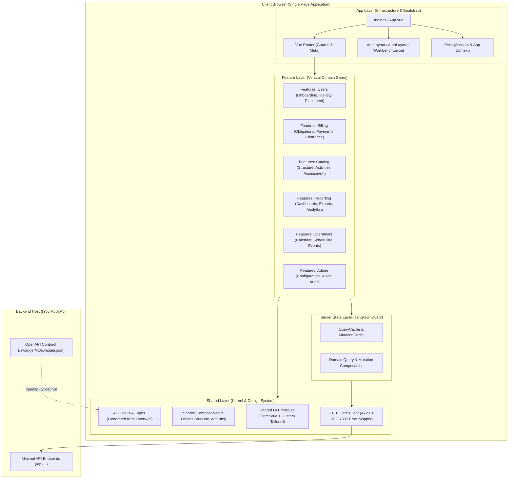
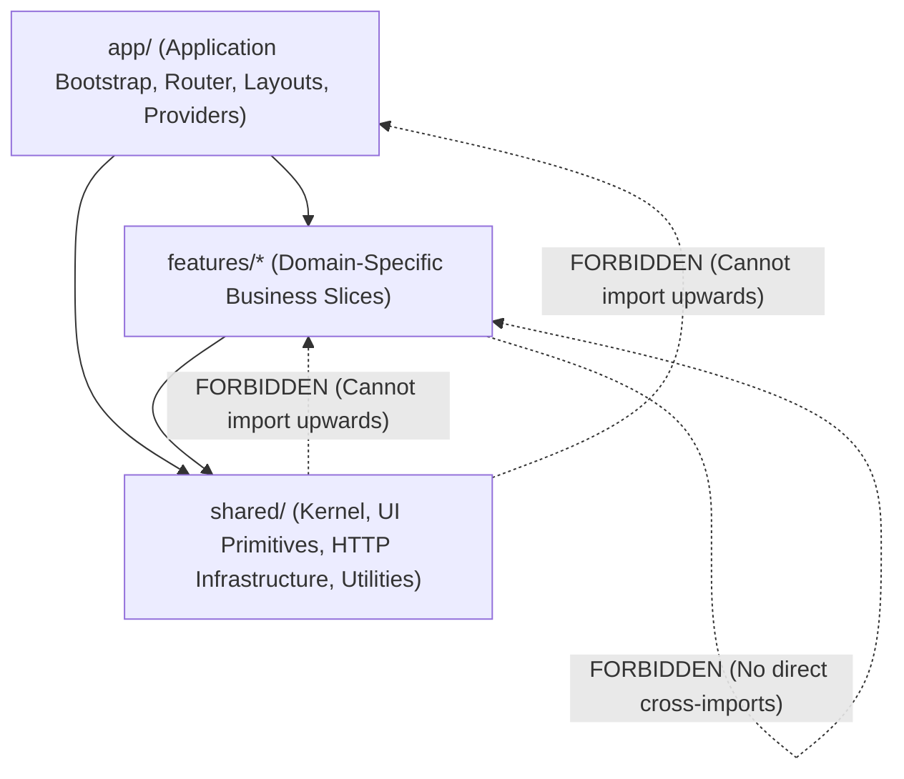
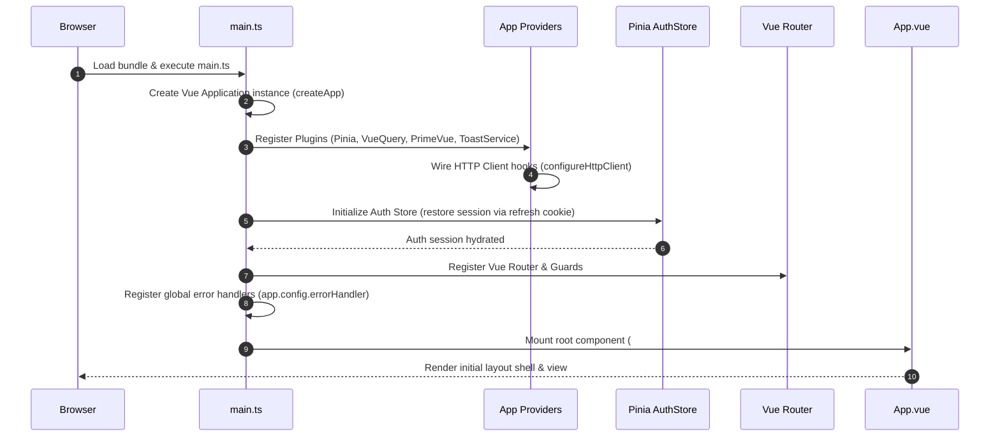
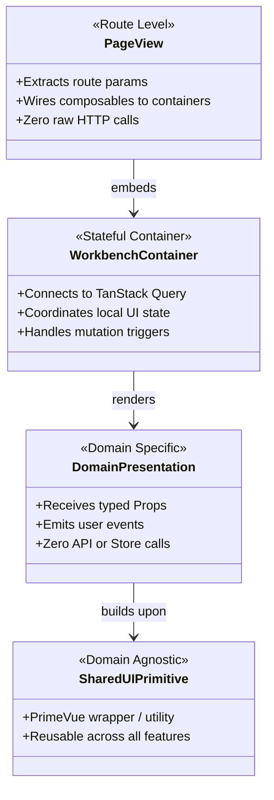
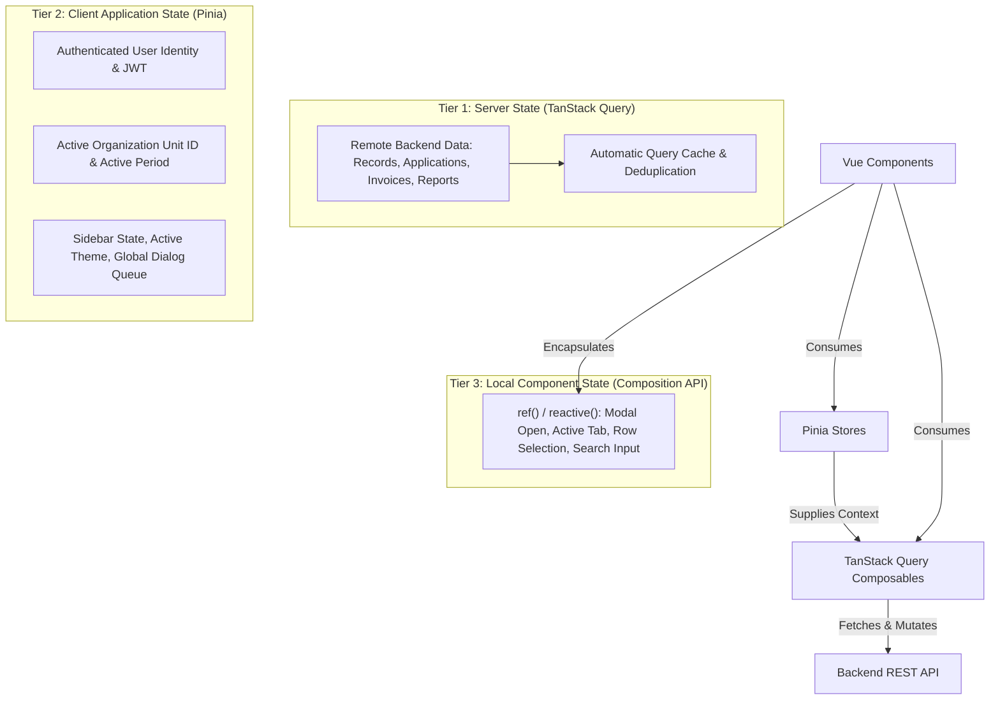
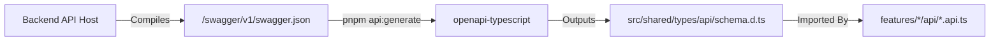
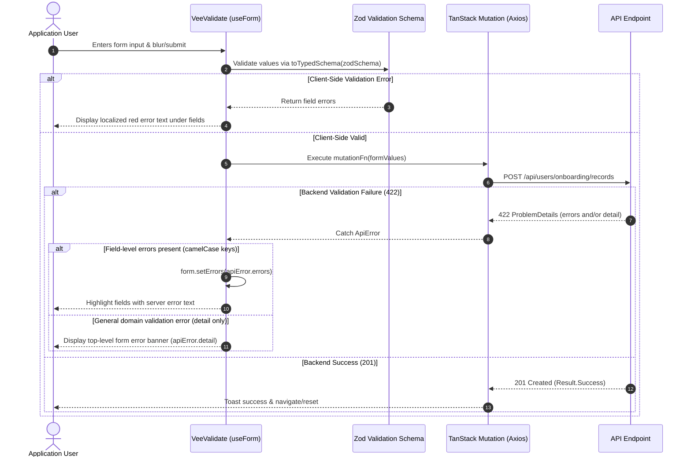
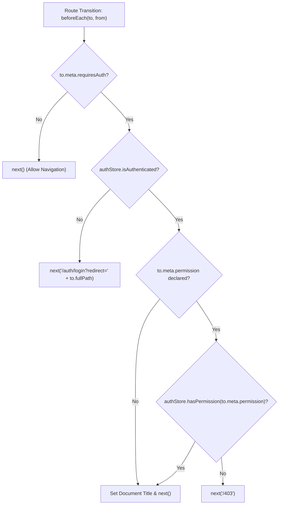
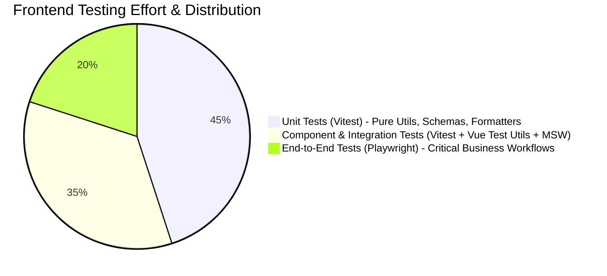

# Frontend Architecture Document & Technical Reference — [YourApp]

**Document Version:** 2.0
**Status:** Reference Template
**Target Ecosystem:** Vue 3 (v3.5+), TypeScript (v5.6+), Vite (v6+), Tailwind CSS (v4+), PrimeVue (v4+)
**State Management:** TanStack Query Vue (v5+) & Pinia (v2+)
**Date:** November 2026

---

## 1. Architecture Overview

[YourApp] is an enterprise-grade information system serving multiple core business domains, functional modules, business workflows, and operational screens.

The frontend is architected as a **Feature-Oriented Modular Frontend (Domain-Driven Vertical Slices)**. It directly mirrors the backend modular monolith boundaries defined in [`docs/architecture/backend-architecture.md`](docs/architecture/backend-architecture.md), adhering to compile-time modularity, zero circular dependencies, explicit dependency direction, and strict domain ownership.



### 1.1 Architectural Objectives & Priorities

1. **Maintainability & Comprehensibility:** Code is organized by business feature rather than technical type. A developer modifying the "Entity Onboarding Review" workflow works inside a dedicated, cohesive slice directory without jumping across global folders.
2. **Domain Isolation & Integrity:** Frontend modules do not redefine business domain ownership. Domain logic, permissions, and entity boundaries established in [`docs/domains/`](docs/domains/) are strictly preserved.
3. **Strict Separation of State Concerns:** Server state (persisted on backend) is managed exclusively by **TanStack Query**. Client session state (active user, organization context, sidebar collapse) is managed by **Pinia**. Ephemeral UI state lives in Vue's **Composition API** (`ref`/`reactive`).
4. **Predictable & Robust Error Handling:** Full alignment with backend RFC 7807 `ProblemDetails` outcome modeling, mapping domain errors (`Validation`, `NotFound`, `Conflict`, `Unauthorized`, `Forbidden`) into user-friendly UI interactions.
5. **Contract-Driven Type Safety:** Compile-time TypeScript definitions generated directly from backend OpenAPI definitions ensure zero type drift between backend endpoints and Vue composables.

---

## 2. Technology Stack Evaluation & Baseline

The table below summarizes the evaluated and confirmed technology stack. Each technology has been evaluated for technical suitability, team ergonomics, ecosystem maturity, and compatibility with the backend.

| Concern | Technology | Status | Version | Rationale & Responsibility |
|---|---|---|---|---|
| **Language** | TypeScript | Mandatory | `^5.6.0` | Strict typing, interface safety, exhaustive union checks, compile-time error catching. |
| **UI Framework** | Vue 3 | Mandatory | `^3.5.0` | High-performance reactive DOM, Composition API, SFC ergonomics, small bundle size. |
| **Component Syntax** | Single File Components (`.vue`) | Mandatory | N/A | High cohesion combining template, typed script, and scoped styles in one artifact. |
| **Script Flavor** | `<script setup lang="ts">` | Mandatory | N/A | Idiomatic Vue 3 syntax, zero boilerplate, optimal TypeScript inference, best runtime performance. |
| **Build Tool** | Vite | Mandatory | `^6.0.0` | Lightning-fast HMR, Rollup bundling, native ESM dev server, rich plugin ecosystem. |
| **CSS Framework** | Tailwind CSS | Mandatory | `^4.0.0` | Utility-first CSS engine (`@theme`, modern CSS variables), zero runtime overhead, high design velocity. |
| **UI Component Library** | PrimeVue | Mandatory | `^4.2.0` | Enterprise-grade accessible UI primitives (DataTable, TreeTable, Calendar, Select, Dialog) styled via Tailwind integration. |
| **Client Routing** | Vue Router | Mandatory | `^4.4.0` | Declarative nested routing, route-level navigation guards, dynamic imports, layout orchestration. |
| **Client State Management** | Pinia | Mandatory | `^2.2.0` | Scoped to global client-only state: authenticated user identity, active organization unit, sidebar toggle, toast queue. |
| **Server State Management** | TanStack Query for Vue | Mandatory | `^5.60.0` | Cache invalidation, query deduplication, optimistic updates, loading/error states, garbage collection. |
| **HTTP Client** | Axios | Mandatory | `^1.7.0` | Request/response interceptors, Bearer token injection, `X-Correlation-ID` tracing, unified error transformation. |
| **Form Management** | VeeValidate | Mandatory | `^4.14.0` | Form lifecycle management, dirty/touched state, validation triggering, server-side field error mapping. |
| **Schema Validation** | Zod | Mandatory | `^3.23.0` | Declarative TypeScript schemas, runtime input validation, integration with VeeValidate (`toTypedSchema`). |
| **Icons** | Lucide Vue Next | Mandatory | `^0.460.0` | Crisp, modern, accessible SVG icon set with complete tree-shaking support. |
| **Date Utilities** | date-fns | Mandatory | `^4.1.0` | Modular, tree-shakeable, immutable date manipulation matching backend ISO-8601, `DateOnly`, and `TimeOnly`. |
| **Utility Composables** | VueUse | Mandatory | `^11.3.0` | Battle-tested reactive composables (`useLocalStorage`, `useDebounceFn`, `useIntersectionObserver`, `onClickOutside`). |
| **API Contract Generation** | openapi-typescript | Mandatory | `^7.4.0` | Generates TypeScript definitions from backend `/swagger/v1/swagger.json`, preventing contract drift. |
| **API Mocking** | MSW (Mock Service Worker) | Mandatory | `^2.6.0` | Network-level request interception for offline development, contract prototyping, and component tests. |
| **Unit & Component Testing** | Vitest | Mandatory | `^2.1.0` | Native Vite integration, fast in-memory execution, Jest-compatible API, Vue Test Utils support. |
| **Component Test Harness** | `@vue/test-utils` | Mandatory | `^2.4.0` | Official Vue test utility library for mounting and interacting with SFCs in Vitest. |
| **End-to-End Testing** | Playwright | Mandatory | `^1.49.0` | Cross-browser automated browser testing for end-to-end user workflows with tracing and video artifacts. |
| **Code Linting** | ESLint (Flat Config) | Mandatory | `^9.15.0` | Enforces code quality, architectural boundary rules (`no-restricted-imports`), and Vue SFC standards. |
| **Code Formatting** | Prettier | Mandatory | `^3.3.0` | Automated deterministic formatting across `.vue`, `.ts`, `.css`, and `.json`. |
| **Type Checking** | vue-tsc | Mandatory | `^2.1.0` | Command-line type checking of Vue SFCs during CI verification and pre-commit checks. |
| **Package Manager** | pnpm | Mandatory | `^9.14.0` | Fast, deterministic, disk-efficient package installation with strict non-flat `node_modules`. |
| **Internationalization** | vue-i18n | Deferred | N/A | Deferred. Architecture provides tokenized labels ready for i18n extraction without refactoring when needed. |
| **Component Catalog** | Storybook | Deferred — prefer Histoire | N/A | Histoire is the Vue-native component workbench (built by the VueUse team), lighter and Vite-native. Preferred over Storybook when a component catalog becomes needed. |

> [!TIP]
> **Histoire vs Storybook:** Histoire (`histoire.dev`) is the Vue-native component workbench built by the VueUse/Anthony Fu team. It is lighter, Vite-native, and integrates seamlessly with the Vue 3 Composition API and `<script setup>`. Prefer Histoire over Storybook when a component catalog becomes needed.

### 2.1 Overlap Resolution & Boundary Enforcements

- **Pinia vs TanStack Query:** Pinia **must never** store backend entity collections or cache API responses. Any data that originated on the backend server belongs in TanStack Query. Pinia is strictly restricted to ephemeral browser state and current authenticated session context.
- **VeeValidate vs Zod:** Zod owns the contract and validation schema definition (declarative rules and error messages). VeeValidate owns form lifecycle orchestration (touched, dirty, submitting states, dynamic fields, and DOM event binding).
- **PrimeVue vs Tailwind CSS:** PrimeVue provides the accessible behavioral mechanics, ARIA attributes, keyboard navigation, and complex DOM structure (e.g. popover anchoring, virtual table scrolling). Tailwind CSS 4 provides the styling layer via PrimeVue's modern PassThrough (PT) system and design tokens.

---

## 3. Architectural Principles & Dependency Direction

The frontend adopts a **Strict Layered Dependency Architecture** centered on feature cohesion and infrastructure decoupling.



### 3.1 Architectural Principles

1. **Vertical Feature Cohesion:**
   Every feature directory corresponds to a business capability (e.g., `features/users/onboarding`). All assets required to execute that capability—views, domain components, API queries, form schemas, and view models—reside together within that slice.
2. **Explicit Layer Boundaries:**
   - **`app/`** depends on `features/` and `shared/`.
   - **`features/`** depends strictly on `shared/`.
   - **`shared/`** has zero dependencies on `features/` or `app/`. It is completely domain-agnostic.
3. **No Cross-Feature Code Coupling:**
   Feature modules must not import internal components, composables, or schemas from other feature modules. If Feature A needs to link to Feature B, it does so through **named routes** or public identifiers. If Feature A needs shared domain models (e.g., `EntitySummary`), the type is declared in `shared/types/contracts/` derived from backend OpenAPI contracts.
4. **Thin Page Components (Views as Orchestrators):**
   Page components under `views/` act as layout orchestrators: they extract route parameters, wire feature composables to domain components, and delegate rendering to presentation components. Pages must not contain raw HTTP calls or monolithic 500-line templates.
5. **Separation of Presentation and Orchestration:**
   Components are categorized into:
   - **Shared UI Primitives:** Completely generic (e.g., `AppButton`, `AppDataTable`, `StatusPill`).
   - **Feature Presentation Components:** Domain-specific but pure, receiving data via props and emitting user intent via emits (e.g., `EntityIdentityCard.vue`).
   - **Feature Container Components / Workbenches:** Stateful feature components connected to TanStack Query and Pinia (e.g., `EntityReviewWorkbench.vue`).

---

## 4. Project & Directory Structure

The repository frontend source code resides under `src/frontend/` with the following authoritative directory layout:

```text
src/frontend/
├── public/                     # Static public assets (favicon, manifest)
├── src/
│   ├── app/                    # Application Layer: Bootstrap & Infrastructure
│   │   ├── config/             # Environment, PrimeVue, and runtime configurations
│   │   ├── layouts/            # Shell layouts (AppLayout, AuthLayout, WorkbenchLayout)
│   │   ├── providers/          # Root Vue plugin providers (QueryClient, PrimeVue, http.provider.ts)
│   │   ├── router/             # Vue Router definition, route hierarchy, navigation guards
│   │   └── stores/             # Global client-only Pinia stores (auth.store.ts, appContext.store.ts, ui.store.ts)
│   │
│   ├── shared/                 # Shared Layer: Domain-Agnostic Kernel
│   │   ├── components/         # Shared presentation UI components
│   │   │   ├── feedback/       # Toast, Alert, LoadingSpinner, EmptyState
│   │   │   ├── forms/          # FormField, TextInput, SelectInput, DatePicker
│   │   │   ├── layout/         # PageHeader, ContentCard, SplitPane, WorkbenchLayout
│   │   │   └── tables/         # AppDataTable, FilterBar, PaginationControls
│   │   ├── composables/        # Generic composables (useDebounce, useConfirmModal, useBreakpoints)
│   │   ├── constants/          # Application-wide constants, regexes, route names
│   │   ├── services/           # Core infrastructure services (HTTP client, Storage, Logger)
│   │   ├── styles/             # Global styles, Tailwind @theme definitions, PrimeVue overrides
│   │   ├── types/              # Cross-cutting TypeScript types & generated API contracts
│   │   │   ├── api/            # Auto-generated OpenAPI contract types (openapi-typescript)
│   │   │   ├── common.ts       # Result, PaginatedResponse, ProblemDetails types
│   │   │   └── navigation.ts   # Navigation, breadcrumb, and menu item definitions
│   │   └── utils/              # Pure utility functions (formatters, dateUtils, currencyUtils)
│   │
│   ├── features/               # Feature Layer: Domain Bounded Contexts
│   │   ├── operations/         # Operations Domain
│   │   │   ├── calendar/       # Calendar & Periods submodule
│   │   │   │   ├── api/        # TanStack Query hooks & API endpoints
│   │   │   │   ├── components/ # Submodule-specific components
│   │   │   │   ├── schemas/    # Zod validation schemas
│   │   │   │   ├── types/      # Submodule-specific view types
│   │   │   │   └── views/      # Route pages (CalendarWorkspaceView.vue)
│   │   │   ├── scheduling/     # Scheduling & Resources submodule
│   │   │   └── events/         # Events & Announcements submodule
│   │   │
│   │   ├── users/              # Users Domain
│   │   │   ├── onboarding/     # Onboarding submodule
│   │   │   │   ├── api/        # useEntityQueries.ts, useEntityMutations.ts
│   │   │   │   ├── components/ # EntityCard.vue, EntityReviewWorkbench.vue
│   │   │   │   ├── composables/# useEntityFilter.ts
│   │   │   │   ├── schemas/    # entityRecord.schema.ts
│   │   │   │   ├── types/      # entity.types.ts
│   │   │   │   └── views/      # EntityQueueView.vue, EntityDetailView.vue
│   │   │   ├── identity/       # Identity & Profile submodule
│   │   │   └── placement/      # Placement & Status submodule
│   │   │
│   │   ├── billing/            # Billing Domain
│   │   │   ├── obligations/    # Obligations & Invoicing submodule
│   │   │   ├── payments/       # Payments & Receivables submodule
│   │   │   ├── benefits/       # Discounts & Adjustments submodule
│   │   │   └── clearance/      # Financial Clearance submodule
│   │   │
│   │   ├── catalog/            # Catalog Domain
│   │   │   ├── structure/
│   │   │   ├── participation/
│   │   │   ├── assessment/
│   │   │   └── progression/
│   │   │
│   │   ├── reporting/          # Reporting Domain
│   │   │   ├── dashboards/
│   │   │   └── exports/
│   │   │
│   │   └── admin/              # Admin Domain
│   │       ├── configuration/
│   │       ├── roles/
│   │       └── audit/
│   │
│   ├── assets/                 # Brand assets, static images, SVG illustrations
│   ├── App.vue                 # Root component with router-view and global toast/dialogs
│   └── main.ts                 # Application bootstrap entry point
│
├── tests/                      # Global Test Configuration & E2E Suites
│   ├── e2e/                    # Playwright end-to-end test suites by feature
│   │   ├── onboarding/         # Onboarding, Identity, Billing E2E tests
│   │   ├── reporting/          # Catalog & Reporting workflows
│   │   └── fixtures/           # Playwright fixtures and auth helpers
│   ├── mocks/                  # MSW mock handlers and test server setup
│   │   ├── handlers/           # MSW route handlers mirroring OpenAPI endpoints
│   │   ├── browser.ts          # MSW worker for dev browser mocking
│   │   └── server.ts           # MSW server for Vitest unit/component tests
│   └── setup/                  # Vitest setup files and DOM extensions
│
├── .env.development            # Local development environment configuration
├── .env.staging                # Staging environment configuration
├── .env.production             # Production environment configuration
├── index.html                  # HTML entry point template
├── package.json                # Dependencies, scripts, and package metadata
├── pnpm-lock.yaml              # Deterministic dependency lockfile
├── playwright.config.ts        # Playwright E2E configuration
├── tailwind.config.ts          # Tailwind CSS v4 configuration
├── tsconfig.json               # Root TypeScript configuration
├── tsconfig.app.json           # Application TypeScript compilation rules
├── tsconfig.node.json          # Tooling / Vite TypeScript compilation rules
└── vite.config.ts              # Vite build, aliases, and plugin configuration
```

---

## 5. Application Layer Architecture

The Application layer (`src/app/`) bootstraps the Single Page Application, configures providers, establishes top-level routing, wraps views in persistent shells, and enforces runtime security.

### 5.1 Bootstrap Lifecycle (`main.ts`)



### 5.2 Layout Architecture (`src/app/layouts/`)

Layouts provide persistent framing across route transitions, eliminating layout reflow:

1. **`AppLayout.vue`:** Primary authenticated administrative portal shell.
   - **Top Navigation Bar:** Application logo, active period indicator, organization unit switcher, User Profile menu, and Notification trigger.
   - **Collapsible Sidebar:** Hierarchical navigation menu filtered dynamically by current actor permissions. Supports pinned and collapsed modes.
   - **Breadcrumb & Page Header:** Dynamic path navigation synced with Vue Router meta.
   - **Main Content Region:** Routed view container wrapped in `<router-view>` with `<suspense>` and accessible transitions.
2. **`AuthLayout.vue`:** Centered, distraction-free container for authentication, login, MFA challenge, and password reset.
3. **`WorkbenchLayout.vue`:** Specialized split-pane administrative shell supporting the **Work Queue** pattern (List/Queue on the left, Contextual Workbench on the right).
4. **`PrintLayout.vue`:** Clean, unstyled layout optimized for generating printables, reports, and financial statements.

---

## 6. Feature Layer Architecture

Features represent bounded business capabilities aligned with the application domains. Each feature is organized into cohesive submodules following the Vertical Slice convention.

### 6.1 Anatomical Structure of a Feature Submodule

Every feature submodule (e.g. `features/users/onboarding`) follows a standard directory structure:

```text
features/users/onboarding/
├── api/
│   ├── entity.api.ts               # Raw Axios endpoints using OpenAPI DTOs
│   ├── entity.keys.ts              # Query Key factory for TanStack Query
│   ├── useEntityQueries.ts         # Custom query hooks (useEntityList, useEntityDetail)
│   └── useEntityMutations.ts       # Custom mutation hooks (useCreateRecord, useSubmitDecision)
├── components/
│   ├── EntityFilterBar.vue         # Filter component (period, status, search)
│   ├── EntityCard.vue              # Presentation card for entity summary
│   ├── EntityReviewWorkbench.vue   # Complex workbench component
│   └── DecisionDialog.vue          # Modal dialog for approve/reject decision
├── composables/
│   └── useEntityWorkbench.ts       # Feature-specific state machine and UI logic
├── schemas/
│   ├── createRecord.schema.ts      # Zod validation schema
│   └── submitDecision.schema.ts    # Zod schema for decision submission
├── types/
│   └── entity.types.ts             # Extended view models and UI filter interfaces
├── views/
│   ├── EntityQueueView.vue         # Primary work queue page
│   └── EntityDetailView.vue        # Deep-link entity detail view
└── __tests__/
    ├── entity.schema.spec.ts       # Zod schema unit tests
    └── EntityQueueView.spec.ts     # Component interaction tests with MSW
```

### 6.2 Component Classification & Responsibility

To prevent business logic bloat and ensure high maintainability, components are categorized according to strict responsibilities:



| Component Class | Directory | Responsibility | Allowed Dependencies | Prohibited Code |
|---|---|---|---|---|
| **Page View** | `features/*/views/` | Top-level routed views. Coordinates layout, extracts route params (`useRoute`), and renders containers. | Feature containers, shared layout components. | Direct Axios calls, monolithic 500-line templates, raw business logic. |
| **Container / Workbench** | `features/*/components/` | Stateful coordinator for a work queue or multi-step action. Calls query/mutation composables. | Custom query hooks, domain presentation components, PrimeVue dialogs. | Generic CSS styling; direct DOM mutations. |
| **Domain Presentation** | `features/*/components/` | Renders domain information (e.g. `EntityBadge`). Pure presentation. | Shared UI primitives, formatting utilities. | Direct store mutations, API imports, route manipulation. |
| **Shared Primitive** | `shared/components/` | Business-agnostic UI building block (e.g. `AppDataTable`, `StatusPill`). | PrimeVue primitives, Tailwind utilities. | Any domain concepts (e.g., cannot import `EntityDto`). |

---

## 7. Shared Layer Architecture

The Shared layer (`src/shared/`) contains reusable, domain-agnostic foundations.

### 7.1 Shared UI Primitives (`src/shared/components/`)

Shared components standardize common interaction patterns across all application screens:

- **`AppDataTable.vue`:** Standard wrapper around PrimeVue `DataTable`. Enforces uniform pagination, sorting, row selection, sticky headers, loading skeletons, and empty state slots.
- **`WorkbenchLayout.vue`:** Reusable two-pane master-detail layout powering the **Work Queue** pattern (left pane: worklist/filter, right pane: active item workbench).
- **`StatusPill.vue`:** Unified badge component mapping domain status strings to standard color palettes (e.g., `active` → green, `pending` → amber, `archived` → red).
- **`ConfirmActionDialog.vue`:** Standard accessible modal for confirming destructive or consequential operations (e.g., record deletion, payment reversal, role revocation).
- **`EmptyState.vue`:** Uniform display for empty lists, search misses, and zero-data conditions with illustrative icons and action buttons.

### 7.2 Common Services & HTTP Core (`src/shared/services/`)

- **`http.ts`:** Central Axios instance configured with base URL, timeout policies, correlation ID generator, and global interceptors.
- **`storage.ts`:** Type-safe wrapper around `localStorage` and `sessionStorage` with JSON serialization and versioned namespace keys (e.g., `app:v1:session`).
- **`logger.ts`:** Client logger that formats console messages in development and dispatches structured telemetry in staging/production.

### 7.3 Shared Utilities & Formatters (`src/shared/utils/`)

- **`dateUtils.ts`:** Wraps `date-fns` to format dates consistently:
  - Display Date: `12 Nov 2026` (`format(date, 'dd MMM yyyy')`)
  - Display DateTime: `12 Nov 2026, 14:30` (`format(date, 'dd MMM yyyy, HH:mm')`)
  - Backend DateOnly: `2026-11-12` (`format(date, 'yyyy-MM-dd')`)
  - Backend TimeOnly: `14:30:00` (`format(date, 'HH:mm:ss')`)
- **`currencyUtils.ts`:** Standard locale-aware currency formatting using the `Intl.NumberFormat` API (e.g., `formatCurrency(1500000, 'USD')` → `"$1,500,000.00"`). Configure the locale and currency code per deployment via environment variables.
- **`stringUtils.ts`:** Sanitization, initials extractor, slug generation, name truncation.

### 7.4 Error Boundaries (`AppErrorBoundary.vue`)

> [!IMPORTANT]
> Every major workbench, panel, or widget section of the application should be wrapped in an `AppErrorBoundary`. A crashing chart component or failed API-dependent widget **must not** tear down the entire application layout.

Vue 3 provides the `onErrorCaptured` lifecycle hook, which acts as an error boundary: it intercepts errors thrown by any descendant component in the subtree and prevents them from propagating further up the component tree.

#### Shared `AppErrorBoundary.vue` Component

```vue
<!-- src/shared/components/feedback/AppErrorBoundary.vue -->
<script setup lang="ts">
import { ref, onErrorCaptured } from 'vue';

// Optional: allow consumers to customize the fallback message
const props = withDefaults(
  defineProps<{
    fallbackTitle?: string;
    fallbackMessage?: string;
  }>(),
  {
    fallbackTitle: 'Something went wrong',
    fallbackMessage: 'This section encountered an unexpected error. Please refresh or try again.'
  }
);

const hasError = ref(false);
const capturedError = ref<Error | null>(null);

onErrorCaptured((err: Error, instance, info) => {
  hasError.value = true;
  capturedError.value = err;

  // Log structured error to your telemetry/logger service
  console.error('[AppErrorBoundary] Captured error:', {
    error: err.message,
    componentInfo: info,
    stack: err.stack
  });

  // Return false to prevent the error from propagating further
  return false;
});

function reset() {
  hasError.value = false;
  capturedError.value = null;
}
</script>

<template>
  <slot v-if="!hasError" />
  <div
    v-else
    class="flex flex-col items-center justify-center gap-4 rounded-lg border border-rose-200 bg-rose-50 p-8 text-center"
    role="alert"
  >
    <h3 class="text-sm font-semibold text-rose-800">{{ fallbackTitle }}</h3>
    <p class="text-sm text-rose-600">{{ fallbackMessage }}</p>
    <button
      class="rounded-md bg-rose-600 px-4 py-2 text-sm font-medium text-white hover:bg-rose-700"
      @click="reset"
    >
      Try Again
    </button>
  </div>
</template>
```

#### Usage Pattern

Wrap each major workbench, dashboard widget, or feature panel with an error boundary at the page or layout level:

```vue
<!-- features/billing/obligations/views/ObligationsView.vue -->
<template>
  <AppLayout>
    <!-- Critical billing summary widget isolated in its own error boundary -->
    <AppErrorBoundary fallback-title="Billing Summary Unavailable">
      <BillingSummaryWidget />
    </AppErrorBoundary>

    <!-- Main data table also isolated -->
    <AppErrorBoundary>
      <ObligationsWorkbench />
    </AppErrorBoundary>
  </AppLayout>
</template>
```

> [!TIP]
> Register `AppErrorBoundary` globally in `main.ts` via `app.component('AppErrorBoundary', AppErrorBoundary)` so it is available in every feature template without an explicit import.

---

## 8. State Management Strategy

State is strictly categorized into three distinct tiers to eliminate data duplication and synchronization bugs.



### 8.1 Server State (TanStack Query)

All asynchronous data originating from or persisted to the backend API is managed by TanStack Query (`@tanstack/vue-query`).

#### Query Key Factories

Query keys must follow deterministic, hierarchical factory patterns to enable targeted cache invalidation:

```typescript
// features/users/onboarding/api/entity.keys.ts
export const entityKeys = {
  all: ['entity'] as const,
  lists: () => [...entityKeys.all, 'list'] as const,
  list: (filters: EntityFilterParams) => [...entityKeys.lists(), filters] as const,
  details: () => [...entityKeys.all, 'detail'] as const,
  detail: (id: string) => [...entityKeys.details(), id] as const,
  counts: () => [...entityKeys.all, 'counts'] as const,
};
```

#### Cache & Stale Time Conventions

| Data Category | Stale Time | Garbage Collection (gcTime) | Refetch Policy | Example Entities |
|---|---|---|---|---|
| **Static / Configuration** | 30 minutes | 60 minutes | Do not refetch on window focus | Organization Units, Period Types, Grading Scales |
| **Operational Reference** | 5 minutes | 15 minutes | Refetch on window focus | Fee Policies, Resource Catalog, User Profiles |
| **Active Work Queues** | 30 seconds | 5 minutes | Refetch on window focus & reconnect | Pending Applications, Payment Verification Queue |
| **Transactional Details** | 0 seconds (stale immediately) | 5 minutes | Always refetch on component mount | Invoice Balance, Clearance Determinations |

#### Mutation & Deterministic Invalidation Pattern

```typescript
// features/users/onboarding/api/useEntityMutations.ts
import { useMutation, useQueryClient } from '@tanstack/vue-query';
import { entityApi } from './entity.api';
import { entityKeys } from './entity.keys';
import { useToast } from 'primevue/usetoast';

export function useSubmitEntityDecision() {
  const queryClient = useQueryClient();
  const toast = useToast();

  return useMutation({
    mutationFn: ({ id, command }: { id: string; command: SubmitDecisionCommand }) =>
      entityApi.submitDecision(id, command),
    onSuccess: (_, variables) => {
      // 1. Invalidate queue list so status updates immediately
      queryClient.invalidateQueries({ queryKey: entityKeys.lists() });
      // 2. Invalidate specific item detail
      queryClient.invalidateQueries({ queryKey: entityKeys.detail(variables.id) });
      // 3. Invalidate dashboard counter badges
      queryClient.invalidateQueries({ queryKey: entityKeys.counts() });

      toast.add({
        severity: 'success',
        summary: 'Decision Recorded',
        detail: `Record decision has been recorded successfully.`,
        life: 4000
      });
    },
    onError: (error: ApiError) => {
      toast.add({
        severity: 'error',
        summary: 'Action Failed',
        detail: error.detail || 'Failed to submit decision.',
        life: 5000
      });
    }
  });
}
```

### 8.2 Client State (Pinia)

Pinia is strictly reserved for client-only, non-server-persisted state:

1. **`useAuthStore` (`app/stores/auth.store.ts`):**
   - State: `user: UserProfile | null`, `token: string | null`, `permissions: string[]`, `roles: string[]`.
   - Getters: `isAuthenticated: boolean`, `hasPermission(perm: string): boolean`, `hasAnyRole(roles: string[]): boolean`.
   - Actions: `login(credentials)`, `logout()`, `refreshSession()`, `handleSessionExpired()`.
2. **`useAppContextStore` (`app/stores/appContext.store.ts`):**
   - State: `activeOrganizationUnitId: string | null`, `activePeriodId: string | null`.
   - Actions: `setOrganizationUnit(unitId)`, `setActivePeriod(periodId)`. (Forwarded on API calls via `X-Organization-Unit-ID` and `X-Active-Period-ID` headers injected by `http.provider.ts`.)
3. **`useUIStore` (`app/stores/ui.store.ts`):**
   - State: `isSidebarCollapsed: boolean`, `activeTheme: 'light' | 'dark'`, `activeBreadcrumbs: BreadcrumbItem[]`.
   - Actions: `toggleSidebar()`, `setTheme()`, `setBreadcrumbs()`.

### 8.3 State Ownership Rule of Law

```
┌────────────────────────────────────────────────────────┐
│ If the data exists in a database table on the server,  │
│ it DOES NOT BELONG IN PINIA. It belongs in TanStack    │
│ Query.                                                 │
└────────────────────────────────────────────────────────┘
```

Manual replication of server state in Pinia stores is strictly prohibited. Storing API response arrays in Pinia causes stale data bugs, requires manual sync logic, and defeats TanStack Query's automatic caching, garbage collection, and window-focus refetching.

---

## 9. Backend API Integration & Contract Management

### 9.1 HTTP Client Infrastructure (`src/shared/services/http.ts`)

Communication with the backend API uses a centralized, pre-configured Axios instance. To preserve strict layer boundaries (`shared/` must never import from `app/`), `http.ts` exposes a `configureHttpClient()` hook wired during application bootstrap in `src/app/providers/http.provider.ts`.

> [!NOTE]
> `crypto.randomUUID()` is natively available in all modern browsers and Node.js 14.17+. No external `uuid` package is needed.

```typescript
// src/shared/services/http.ts
import axios, { AxiosError, type AxiosRequestConfig, type InternalAxiosRequestConfig } from 'axios';
import { ApiError } from '@/shared/types/common';

interface ProblemDetailsPayload {
  title?: string;
  detail?: string;
  errorCode?: string;
  errors?: Record<string, string[]>;
  extensions?: {
    errorCode?: string;
    errors?: Record<string, string[]>;
  };
}

export interface HttpClientHooks {
  getAccessToken: () => string | null;
  getContextHeaders: () => Record<string, string>;
  refreshAccessToken: () => Promise<string | null>;
  onSessionExpired: () => void;
}

interface RetryableRequestConfig extends InternalAxiosRequestConfig {
  _retry?: boolean;
}

let clientHooks: HttpClientHooks | null = null;
let refreshPromise: Promise<string | null> | null = null;

export function configureHttpClient(hooks: HttpClientHooks): void {
  clientHooks = hooks;
}

export const apiClient = axios.create({
  baseURL: import.meta.env.VITE_API_BASE_URL || '/api',
  timeout: 15000,
  withCredentials: true, // Required so HttpOnly refresh cookies are sent on auth calls
  headers: {
    'Content-Type': 'application/json',
    Accept: 'application/json'
  }
});

// 1. Request Interceptor: Attach JWT, Scoped Context, and Tracing Headers
apiClient.interceptors.request.use((config: InternalAxiosRequestConfig) => {
  const token = clientHooks?.getAccessToken();
  if (token && config.headers) {
    config.headers.Authorization = `Bearer ${token}`;
  }

  const contextHeaders = clientHooks?.getContextHeaders() ?? {};
  for (const [key, value] of Object.entries(contextHeaders)) {
    if (value && config.headers) {
      config.headers[key] = value;
    }
  }

  // Inject correlation ID matching backend CorrelationIdMiddleware
  if (config.headers && !config.headers['X-Correlation-ID']) {
    config.headers['X-Correlation-ID'] = crypto.randomUUID();
  }

  return config;
});

// 2. Response Interceptor: Single-Flight 401 Refresh & RFC 7807 ProblemDetails Mapping
apiClient.interceptors.response.use(
  (response) => response.data,
  async (error: AxiosError<ProblemDetailsPayload>) => {
    if (!error.response) {
      return Promise.reject(
        new ApiError(0, 'Network Error', 'Unable to reach the server. Please check your network connection.')
      );
    }

    const { status, data } = error.response;
    const originalRequest = error.config as RetryableRequestConfig | undefined;
    const isAuthEndpoint = originalRequest?.url?.includes('/auth/login') || originalRequest?.url?.includes('/auth/refresh');

    // Attempt a single-flight silent token refresh once before failing the session
    if (status === 401 && originalRequest && !originalRequest._retry && !isAuthEndpoint && clientHooks) {
      originalRequest._retry = true;
      try {
        refreshPromise ??= clientHooks.refreshAccessToken().finally(() => {
          refreshPromise = null;
        });

        const newToken = await refreshPromise;
        if (newToken) {
          originalRequest.headers.Authorization = `Bearer ${newToken}`;
          return apiClient(originalRequest as AxiosRequestConfig);
        }
      } catch {
        // Fall through to session expiration handler
      }

      clientHooks.onSessionExpired();
      return Promise.reject(new ApiError(401, 'Unauthorized', 'Session has expired. Please log in again.'));
    }

    if (status === 401) {
      clientHooks?.onSessionExpired();
      return Promise.reject(new ApiError(401, 'Unauthorized', 'Session has expired. Please log in again.'));
    }

    // Map RFC 7807 ProblemDetails payload
    const apiError = new ApiError(
      status,
      data?.title || 'An unexpected error occurred',
      data?.detail || error.message,
      data?.errorCode || data?.extensions?.errorCode,
      data?.errors || data?.extensions?.errors
    );

    return Promise.reject(apiError);
  }
);
```

```typescript
// src/app/providers/http.provider.ts
import { configureHttpClient } from '@/shared/services/http';
import { useAuthStore } from '@/app/stores/auth.store';
import { useAppContextStore } from '@/app/stores/appContext.store';

export function setupHttpClient(): void {
  configureHttpClient({
    getAccessToken: () => useAuthStore().token,
    getContextHeaders: () => {
      const ctx = useAppContextStore();
      const headers: Record<string, string> = {};
      if (ctx.activeOrganizationUnitId) headers['X-Organization-Unit-ID'] = ctx.activeOrganizationUnitId;
      if (ctx.activePeriodId) headers['X-Active-Period-ID'] = ctx.activePeriodId;
      return headers;
    },
    refreshAccessToken: () => useAuthStore().refreshSession(),
    onSessionExpired: () => useAuthStore().handleSessionExpired()
  });
}
```

> [!NOTE]
> **Axios vs ofetch:** The modern Vue/Nuxt ecosystem is shifting toward `ofetch` (by the UnJS/Nuxt team) or the native `fetch` API. Axios was selected for this architecture for its mature interceptor model, familiar developer experience, and robust error-handling surface area. Evaluate `ofetch` at the next major dependency review — it offers a leaner API, built-in retry support, and tighter Nuxt/H3 integration if the stack migrates in that direction.

### 9.2 RFC 7807 ProblemDetails Alignment

The backend transforms all domain error instances into standard RFC 7807 `ProblemDetails` payloads:

| Backend ErrorType | HTTP Status | ProblemDetails Title | Frontend Handling Strategy |
|---|---|---|---|
| `Validation` | 422 Unprocessable Entity | `"Validation Error"` | Parsed by `ApiError.errors` and mapped directly onto VeeValidate form fields via `form.setErrors()`. |
| `Conflict` | 409 Conflict | `"Business Rule Conflict"` | Displayed as an inline alert or warning modal (e.g. duplicate active record or period collision). |
| `NotFound` | 404 Not Found | `"Resource Not Found"` | Renders feature-level `EmptyState` or redirects to standard `/404` page. |
| `Unauthorized` | 401 Unauthorized | `"Unauthorized"` | Redirects user to `/login` with preserved `redirect` query parameter. |
| `Forbidden` | 403 Forbidden | `"Forbidden"` | Displays accessible forbidden banner or redirects to `/403`. |
| Infrastructure Crash | 500 Internal Server Error | `"Internal Server Error"` | Triggers global toast notification: "An unexpected server error occurred." |

### 9.3 Contract Generation & Type Synchronization

To guarantee 100% type safety and eliminate manual DTO synchronization:



1. **Tooling:** `openapi-typescript` generates strict TypeScript definitions from the backend OpenAPI schema.
2. **Generation Script:**
   ```bash
   pnpm api:generate
   ```
   Command executes: `openapi-typescript http://localhost:5000/swagger/v1/swagger.json -o src/shared/types/api/schema.d.ts`
3. **Immutability Rule:** `src/shared/types/api/schema.d.ts` is generated code and **must never be edited manually**.
4. **Contract Testing & CI:** The CI pipeline runs `pnpm api:check` against the committed schema to immediately flag any breaking backend API changes before deployment.

---

## 10. UI Architecture & Design System

The UI architecture integrates **PrimeVue v4** and **Tailwind CSS v4** to deliver an accessible, high-density administrative interface suited for complex information system operations.

### 10.1 Component Library & CSS Framework Integration

- **Styling Architecture:** PrimeVue v4 is configured with the **Aura** base preset wrapped in CSS layers, allowing Tailwind CSS utility classes to cleanly override or extend component styles without brittle `!important` declarations.
- **PassThrough (PT) System:** Custom tailoring of complex PrimeVue components (e.g., customizing table header padding or dropdown search input) is implemented using PrimeVue's native `pt` properties configured globally in `app/config/primevue.ts`.
- **CSS Precedence Layering:**
  ```css
  /* src/shared/styles/main.css */
  @import "tailwindcss";

  @layer primevue, custom;

  @theme {
    --color-brand-primary-900: #0f172a;
    --color-brand-primary-800: #1e293b;
    --color-brand-accent-600: #0d9488;
    --color-brand-accent-500: #14b8a6;
    --color-brand-accent-50:  #f0fdfa;
    --font-sans: 'Inter', system-ui, -apple-system, sans-serif;
  }
  ```

### 10.2 Design Tokens

The application design language emphasizes density, legibility, and immediate status recognition. Replace token values with your brand palette during project setup.

| Token Category | Token Name | Example Value | Usage |
|---|---|---|---|
| **Primary Dark** | `brand-primary-900` | `#0f172a` | App top bar, primary text, brand headings |
| **Brand Accent** | `brand-accent-600` | `#0d9488` | Primary action buttons, active navigation indicator, focus rings |
| **Accent Light** | `brand-accent-50` | `#f0fdfa` | Selected table row background, active sidebar badge |
| **Surface Neutral** | `slate-50` / `white` | `#f8fafc` / `#ffffff` | Page background / Card workbench background |
| **Border Neutral** | `slate-200` | `#e2e8f0` | Dividers, card borders, table grid lines |
| **Status Success** | `emerald-600` | `#059669` | `Active`, `Accepted`, `Paid`, `Complete` |
| **Status Warning** | `amber-600` | `#d97706` | `Pending`, `UnderReview`, `Installment`, `OnHold` |
| **Status Danger** | `rose-600` | `#e11d48` | `Rejected`, `Overdue`, `Withdrawn`, `Inactive` |
| **Status Info** | `sky-600` | `#0284c7` | `Draft`, `Scheduled`, `Submitted` |

### 10.3 Core Interaction Patterns

All application screens adhere to 5 consistent interaction patterns:

```mermaid
graph TD
    subgraph Pattern1["Pattern 1: Work Queue"]
        WQ_Filter["Filter & Search Bar"] --> WQ_List["Pending / Actionable Worklist"]
        WQ_List --> WQ_Bench["Contextual Workbench (Details + Primary Actions)"]
        WQ_Bench --> WQ_Secondary["Secondary Actions & Audit History"]
    end

    subgraph Pattern2["Pattern 2: Information Lookup"]
        IL_Search["Comprehensive Entity Search"] --> IL_Results["Candidate Match List"]
        IL_Results --> IL_360["360-degree Profile (Tabs: Identity, History, Billing)"]
    end

    subgraph Pattern3["Pattern 3: Schedule Management"]
        SM_Calendar["Period & Year Hierarchy"] --> SM_Grid["Visual Calendar & Break Matrix"]
        SM_Grid --> SM_Editor["Period Inspector & Exception Coordinator"]
    end

    subgraph Pattern4["Pattern 4: Monitoring Dashboard"]
        MO_KPI["Summary KPI & Allocation Metrics"] --> MO_Table["Threshold Table (Drill-down)"]
        MO_Table --> MO_Action["Direct Reallocation / Action Drawer"]
    end
```



1. **Work Queue (Worklist + Workbench):**
   - Left Pane (40% width): Searchable, filterable list of pending queue items with status badges and timestamp.
   - Right Pane (60% width): Active item workbench displaying entity summary, verified data, decision controls, and the authoritative submit action.
2. **Information Lookup (Search/List + Detail):**
   - High-speed indexed search with instant keyboard navigation (`/` or `Ctrl+K`).
   - Detailed tabbed profile (Identity, History, Billing, Activity) with strict audit tracking.
3. **Schedule Management (Calendar/Schedule + Workspace):**
   - Visual date picker and period hierarchy tree supporting years, terms, and holiday closures.
4. **Monitoring Dashboard (Overview + Drill-down):**
   - High-level metric tiles with warning thresholds; clicking a threshold card automatically filters the underlying table.
5. **Planning Workspace:**
   - Multi-step builder for complex frameworks, hierarchical structures, and billing cycles.

### 10.4 Vue Vapor Mode — Forward-Looking

> [!NOTE]
> **Status: Future Enhancement / Planned Adoption**
>
> Vue 3.5+ is progressively advancing toward **Vapor Mode**, an alternative compilation strategy that compiles templates to **direct DOM operations** instead of using a Virtual DOM (vdom) diffing layer. This eliminates vdom overhead entirely for components compiled in Vapor mode, resulting in lower memory usage and faster runtime for large data-intensive views.

#### Relevance for Enterprise Information Systems

For applications with large data tables (hundreds of rows, real-time updates, dense dashboards), Vapor Mode is architecturally significant:

- DataTable rows, dynamic lists, and monitoring dashboards will benefit most from direct DOM operations.
- Vapor Mode is opt-in per component and is backward-compatible with non-Vapor components in the same tree.

#### Best Practices for Vapor Compatibility (Apply Now)

Adopt these coding habits now to ensure smooth adoption when Vapor Mode stabilizes:

1. **Keep templates clean and semantic.** Avoid deeply nested conditional chains and excessive `v-for` nesting inside `v-for`.
2. **Avoid dynamic slot abuse.** Vapor Mode handles static and named slots efficiently. Dynamic slot names (`v-slot:[dynamicName]`) add compilation complexity — minimize their use.
3. **Avoid deep `provide`/`inject` chains.** Deeply nested providers create implicit dependencies that complicate Vapor's static analysis.
4. **Prefer `shallowRef` / `shallowReactive` for large datasets** (see Section 15.4). These integrate better with Vapor's targeted update model.
5. **Use `markRaw()` for third-party class instances** (see Section 15.4) to prevent unnecessary proxy wrapping.

---

## 11. Form Architecture & Validation

Form handling follows a strict **Schema-First** architecture combining **Zod** and **VeeValidate**.

### 11.1 Form Lifecycle & Validation Pipeline



### 11.2 Zod Schema Definition Example

Validation schemas mirror backend server-side validation rules:

```typescript
// features/users/onboarding/schemas/createRecord.schema.ts
import { z } from 'zod';

export const createEntityRecordSchema = z.object({
  entityId: z.string().uuid({ message: 'A valid entity must be selected' }),
  periodId: z.string().uuid({ message: 'Period is required' }),
  categoryId: z.string().uuid({ message: 'Category is required' }),
  startDate: z.string().regex(/^\d{4}-\d{2}-\d{2}$/, { message: 'Date format must be YYYY-MM-DD' }),
  referenceSource: z.string().trim().max(200, { message: 'Reference source cannot exceed 200 characters' }).optional(),
  notes: z.string().trim().max(1000, { message: 'Notes cannot exceed 1000 characters' }).optional()
});

export type CreateEntityRecordFormValues = z.infer<typeof createEntityRecordSchema>;
```

### 11.3 Standardized Form Component Pattern

```vue
<!-- features/users/onboarding/components/CreateRecordModal.vue -->
<script setup lang="ts">
import { ref } from 'vue';
import { useForm } from 'vee-validate';
import { toTypedSchema } from '@vee-validate/zod';
import { createEntityRecordSchema, type CreateEntityRecordFormValues } from '../schemas/createRecord.schema';
import { useCreateEntityRecord } from '../api/useEntityMutations';
import { ApiError } from '@/shared/types/common';
import FormField from '@/shared/components/forms/FormField.vue';
import Dialog from 'primevue/dialog';
import Button from 'primevue/button';
import InputText from 'primevue/inputtext';

const props = defineProps<{
  visible: boolean;
  entityId: string;
}>();

// Vue 3.3+ defineEmits shorthand (see Section 15.3)
const emit = defineEmits<{
  'update:visible': [value: boolean];
  success: [recordId: string];
}>();

const { mutateAsync: createRecord, isPending } = useCreateEntityRecord();
const serverError = ref<string | null>(null);

const { handleSubmit, errors, defineField, setErrors, resetForm } = useForm<CreateEntityRecordFormValues>({
  validationSchema: toTypedSchema(createEntityRecordSchema),
  initialValues: {
    entityId: props.entityId,
    startDate: new Date().toISOString().split('T')[0],
    referenceSource: '',
    notes: ''
  }
});

const [referenceSource, referenceSourceProps] = defineField('referenceSource');
const [notes, notesProps] = defineField('notes');

const onSubmit = handleSubmit(async (values) => {
  serverError.value = null;
  try {
    const response = await createRecord(values);
    emit('success', response.recordId);
    emit('update:visible', false);
    resetForm();
  } catch (err: unknown) {
    if (err instanceof ApiError) {
      if (err.errors && Object.keys(err.errors).length > 0) {
        setErrors(err.errors);
      } else {
        serverError.value = err.detail || 'Unable to save record due to a validation or business rule error.';
      }
    }
  }
});
</script>

<template>
  <Dialog :visible="visible" header="Create New Record" :modal="true" @update:visible="emit('update:visible', $event)">
    <form @submit.prevent="onSubmit" class="space-y-4">
      <div
        v-if="serverError"
        role="alert"
        class="rounded-md border border-rose-200 bg-rose-50 px-3 py-2 text-sm text-rose-700"
      >
        {{ serverError }}
      </div>

      <FormField label="Reference Source" :error="errors.referenceSource">
        <InputText v-model="referenceSource" v-bind="referenceSourceProps" class="w-full" />
      </FormField>

      <FormField label="Administrative Notes" :error="errors.notes">
        <InputText v-model="notes" v-bind="notesProps" class="w-full" />
      </FormField>

      <div class="flex justify-end gap-2 pt-4">
        <Button label="Cancel" severity="secondary" text @click="emit('update:visible', false)" />
        <Button type="submit" label="Submit Record" :loading="isPending" />
      </div>
    </form>
  </Dialog>
</template>
```

---

## 12. Routing, Navigation & Authorization Architecture

### 12.1 Route Organization & Hierarchical Naming

Routes are organized hierarchically by domain and feature module using Vue Router:

```typescript
// app/router/routes.ts
import type { RouteRecordRaw } from 'vue-router';

export const routes: RouteRecordRaw[] = [
  {
    path: '/',
    redirect: '/dashboard'
  },
  {
    path: '/auth',
    component: () => import('@/app/layouts/AuthLayout.vue'),
    children: [
      {
        path: 'login',
        name: 'auth.login',
        component: () => import('@/features/auth/views/LoginView.vue'),
        meta: { requiresAuth: false, title: 'Sign In — [YourApp]' }
      }
    ]
  },
  {
    path: '/',
    component: () => import('@/app/layouts/AppLayout.vue'),
    meta: { requiresAuth: true },
    children: [
      {
        path: 'dashboard',
        name: 'dashboard',
        component: () => import('@/features/dashboard/views/DashboardView.vue'),
        meta: { title: 'Dashboard' }
      },
      // USERS DOMAIN
      {
        path: 'users',
        children: [
          {
            path: 'onboarding',
            name: 'users.onboarding.queue',
            component: () => import('@/features/users/onboarding/views/EntityQueueView.vue'),
            meta: {
              permission: 'Permissions.Users.Onboarding.View',
              title: 'Onboarding Work Queue'
            }
          },
          {
            path: 'onboarding/:id',
            name: 'users.onboarding.detail',
            component: () => import('@/features/users/onboarding/views/EntityDetailView.vue'),
            meta: {
              permission: 'Permissions.Users.Onboarding.Review',
              title: 'Record Review'
            }
          },
          {
            path: 'identity',
            name: 'users.identity.desk',
            component: () => import('@/features/users/identity/views/IdentityDeskView.vue'),
            meta: {
              permission: 'Permissions.Users.Identity.Manage',
              title: 'Identity Management Desk'
            }
          }
        ]
      },
      // BILLING DOMAIN
      {
        path: 'billing',
        children: [
          {
            path: 'obligations',
            name: 'billing.obligations.list',
            component: () => import('@/features/billing/obligations/views/ObligationsListView.vue'),
            meta: {
              permission: 'Permissions.Billing.Obligations.View',
              title: 'Obligations & Invoicing'
            }
          },
          {
            path: 'payments',
            name: 'billing.payments.desk',
            component: () => import('@/features/billing/payments/views/PaymentDeskView.vue'),
            meta: {
              permission: 'Permissions.Billing.Payments.Receive',
              title: 'Payment Receipt Desk'
            }
          }
        ]
      },
      // OPERATIONS DOMAIN
      {
        path: 'operations',
        children: [
          {
            path: 'calendar',
            name: 'operations.calendar.workspace',
            component: () => import('@/features/operations/calendar/views/CalendarWorkspaceView.vue'),
            meta: {
              permission: 'Permissions.Operations.Calendar.Manage',
              title: 'Calendar & Periods Workspace'
            }
          }
        ]
      },
      // Error Routes
      {
        path: '403',
        name: 'forbidden',
        component: () => import('@/shared/views/ForbiddenView.vue'),
        meta: { title: 'Access Forbidden' }
      },
      {
        path: ':pathMatch(.*)*',
        name: 'not-found',
        component: () => import('@/shared/views/NotFoundView.vue'),
        meta: { title: 'Page Not Found' }
      }
    ]
  }
];
```

### 12.2 Navigation Guard Pipeline

Route transitions pass through three sequential guards:



### 12.3 Navigation Visibility vs Authoritative Authorization

- **UI Visibility (Convenience):** Sidebar items and action buttons use `v-if="authStore.hasPermission('...')"` to hide actions the current actor is not permitted to perform.
- **Navigation Guard (UX Defense):** Route guards prevent direct URL manipulation to unauthorized pages, redirecting to `/403`.
- **Backend API (Authoritative Security):** The backend API endpoints enforce authorization checks. If a user tampers with client code, the backend returns HTTP 403 Forbidden, which is handled cleanly by the HTTP response interceptor.

---

## 13. Authentication & Security Architecture

### 13.1 JWT Token Lifecycle & Scoped User Context

The frontend authentication model maps directly to the backend JWT Bearer claims model.

```typescript
// features/auth/types/auth.types.ts
export interface JwtClaims {
  sub: string;                  // User GUID (UserId)
  name: string;                 // Full Name
  preferred_username: string;   // Username
  roles: string[];              // Assigned roles (e.g., 'Administrator', 'OperationsManager')
  permissions: string[];        // Granular permissions ('Permissions.Users.Onboarding.Register')
  org_unit_id?: string;         // Active Organization Unit GUID context
  exp: number;                  // Expiration timestamp
}

export interface UserSession {
  userId: string;
  username: string;
  fullName: string;
  roles: string[];
  permissions: string[];
  organizationUnitId: string | null;
}
```

### 13.2 Token Storage & Session Expiration Strategy

1. **Storage Location & Same-Origin Cookie Delivery:**
   - **Access Token:** Maintained in-memory inside the Pinia `auth.store.ts` to defend against XSS token exfiltration.
   - **Session Persistence:** A secure, short-lived session signature or refresh token is stored in an `HttpOnly`, `Secure`, `SameSite=Strict` cookie managed by the authentication server. Because Axios sets `withCredentials: true`, production deployments **should** reverse-proxy `/api/` under the SPA origin (`app.yourdomain.com/api`, see Section 16.3) so `SameSite=Strict` cookies are sent reliably. If the API is hosted on a separate origin (e.g., `api.yourdomain.com`), the backend CORS policy must allow `AllowCredentials()` and set `SameSite=Lax` (for same-site subdomains) or `SameSite=None`.
   - *Fallback for Decoupled Local Development:* For isolated local dev without cookie domains, local storage is supported via configurable `VITE_AUTH_PERSISTENCE=memory|storage` switch.
2. **Session Timeout, Silent Refresh & Inactivity:**
   - On a `401 Unauthorized` response, the Axios interceptor triggers a single-flight silent refresh (`authStore.refreshSession()`) and retries queued requests transparently.
   - Client also tracks token expiration via the JWT `exp` claim. When refresh fails or the session expires, pending mutations are halted, the query cache is cleared (`queryClient.clear()`), and the user is redirected to `/auth/login` with an informative session-timeout toast.

### 13.3 Frontend Security Safeguards

- **Cross-Site Scripting (XSS) Prevention:**
  - Direct usage of `v-html` is strictly prohibited in business views.
  - User-generated content (notes, names, addresses) is rendered exclusively through standard Vue mustache bindings (`{{ value }}`) which auto-escape HTML entities.
- **Cross-Site Request Forgery (CSRF) Prevention:**
  - The API uses explicit `Authorization: Bearer <token>` headers on all mutating requests. Because Bearer tokens are not automatically attached by browsers (unlike raw cookies), CSRF attacks are fundamentally mitigated.
- **Information Leakage Prevention:**
  - Sensitive records display sanitized views based on explicit permissions.
  - Client code never receives or stores secrets. All `VITE_*` environment variables are treated as publicly visible.

---

## 14. Testing Strategy

The frontend testing pyramid balances fast unit feedback, reliable component verification, and automated browser workflows.



### 14.1 Unit Testing (Vitest)

- **Target:** Date formatters, currency math, Zod validation schemas, pure transformation functions, and Pinia store state transitions.
- **Execution:** Runs in-memory with sub-second execution speeds via native Vite HMR primitives.
- **Convention:** Tests live in `__tests__/*.spec.ts` adjacent to the tested unit.

```typescript
// features/users/onboarding/__tests__/entity.schema.spec.ts
import { describe, it, expect } from 'vitest';
import { createEntityRecordSchema } from '../schemas/createRecord.schema';

describe('createEntityRecordSchema', () => {
  it('rejects an invalid UUID for entityId', () => {
    const result = createEntityRecordSchema.safeParse({
      entityId: 'not-a-uuid',
      periodId: crypto.randomUUID(),
      categoryId: crypto.randomUUID(),
      startDate: '2026-11-18'
    });
    expect(result.success).toBe(false);
    expect(result.error?.issues[0].path).toContain('entityId');
  });

  it('accepts a valid record payload', () => {
    const result = createEntityRecordSchema.safeParse({
      entityId: crypto.randomUUID(),
      periodId: crypto.randomUUID(),
      categoryId: crypto.randomUUID(),
      startDate: '2026-11-18'
    });
    expect(result.success).toBe(true);
  });
});
```

### 14.2 Component & Integration Testing (Vitest + `@vue/test-utils` + MSW)

- **Target:** Domain components and Workbenches (`EntityReviewWorkbench.vue`, `AppDataTable.vue`).
- **Network Isolation:** **Mock Service Worker (MSW)** intercepts all HTTP calls at the network level, returning realistic mock DTOs conforming to the OpenAPI contract.
- **Assertions:** Tests verify user interactions (clicking buttons, filling inputs), form error state display, and successful emit/mutation dispatches without touching real backend databases.

```typescript
// features/users/onboarding/__tests__/EntityQueueView.spec.ts
import { describe, it, expect, beforeAll, afterAll, afterEach } from 'vitest';
import { mount } from '@vue/test-utils';
import { createTestingPinia } from '@pinia/testing';
import { VueQueryPlugin } from '@tanstack/vue-query';
import { server } from '@/tests/mocks/server';
import EntityQueueView from '../views/EntityQueueView.vue';

beforeAll(() => server.listen());
afterEach(() => server.resetHandlers());
afterAll(() => server.close());

describe('EntityQueueView', () => {
  it('renders pending records from MSW mock', async () => {
    const wrapper = mount(EntityQueueView, {
      global: {
        plugins: [createTestingPinia(), VueQueryPlugin]
      }
    });

    // Wait for async data to load
    await wrapper.vm.$nextTick();

    expect(wrapper.findAll('[data-testid="entity-row"]').length).toBeGreaterThan(0);
  });
});
```

### 14.3 End-to-End Testing (Playwright)

Playwright automates end-to-end user workflows against real browser engines (Chromium, Firefox, WebKit).

#### Priority E2E Workflows

1. **`E2E-01` Create and Approve Entity Record:**
   Operator logs in → Opens Work Queue → Selects pending item → Reviews attached documents → Approves record → Verifies status updates to `Accepted`.
2. **`E2E-02` Complete Billing Flow:**
   Finance user logs in → Verifies assessed billing obligation → Registers payment receipt → Confirms payment allocation → Verifies outstanding balance reduces to zero.
3. **`E2E-03` Period Initialization Workflow:**
   Operations Coordinator logs in → Creates new Period → Configures start/end dates and breaks → Publishes calendar → Verifies period becomes `Active`.
4. **`E2E-04` Role Assignment & Permission Verification:**
   Administrator logs in → Assigns a role to a user → Logs out → Logs in as that user → Verifies permitted navigation items appear and restricted items are hidden.

```typescript
// tests/e2e/onboarding/entity-approval.spec.ts
import { test, expect } from '@playwright/test';

test('E2E-01: Operator can approve a pending record', async ({ page }) => {
  await page.goto('/auth/login');
  await page.getByLabel('Username').fill('operator@example.com');
  await page.getByLabel('Password').fill('TestPassword123!');
  await page.getByRole('button', { name: 'Sign In' }).click();

  await page.waitForURL('/dashboard');
  await page.goto('/users/onboarding');

  const firstRow = page.getByTestId('entity-row').first();
  await firstRow.click();

  await page.getByRole('button', { name: 'Approve' }).click();
  await page.getByRole('button', { name: 'Confirm Decision' }).click();

  await expect(page.getByTestId('status-pill')).toHaveText('Accepted');
});
```

### 14.4 Quality Gates & CI Checklist

All frontend code must satisfy five mandatory quality gates before PR merge:

```bash
# 1. Type Checking
pnpm typecheck       # vue-tsc --noEmit

# 2. Static Code Analysis
pnpm lint            # eslint . --max-warnings 0

# 3. Code Formatting Verification
pnpm format:check    # prettier --check .

# 4. Unit & Component Test Suite
pnpm test:unit       # vitest run --coverage

# 5. Critical E2E Test Suite
pnpm test:e2e        # playwright test
```

---

## 15. Coding Standards & Conventions

### 15.1 TypeScript Conventions

- **Strict Mode:** Enabled in `tsconfig.json` (`"strict": true`, `"noImplicitAny": true`, `"exactOptionalPropertyTypes": true`).
- **No `any`:** The use of `any` is strictly prohibited. Use `unknown` with type narrowing or generic type parameters.
- **Type Imports:** Always use explicit type-only imports:
  ```typescript
  import type { EntityRecordDto } from '@/shared/types/api';
  ```

### 15.2 Naming Conventions

| Category | Format | Example |
|---|---|---|
| **Vue Single File Components** | PascalCase | `EntityCard.vue`, `EntityQueueView.vue` |
| **Component Props & Emits** | camelCase | `defineProps<{ entityId: string }>()`, `emit('changeStatus')` |
| **Composables** | camelCase with `use` prefix | `useEntityQueries.ts`, `useConfirmModal.ts` |
| **Zod Schemas** | camelCase with `Schema` suffix | `createEntityRecordSchema.ts` |
| **TypeScript Types & Interfaces** | PascalCase | `EntityFilterParams`, `RecordStatusEnum` |
| **Directories / Routes** | kebab-case | `features/users/identity-management/`, `/users/onboarding-queue` |
| **Query Key Factories** | camelCase with `Keys` suffix | `entityKeys`, `billingKeys`, `calendarKeys` |
| **Constants / Enums** | UPPER_SNAKE_CASE | `DEFAULT_PAGE_SIZE = 25`, `STORAGE_KEYS` |

### 15.3 SFC Template & Script Structure

Every `.vue` component must follow a standardized top-down block ordering:

```vue
<!-- 1. Script Setup Block (TypeScript) -->
<script setup lang="ts">
// 1.1 Vue & Core Library Imports
import { ref, computed } from 'vue';

// 1.2 Third-Party Library Imports (TanStack, PrimeVue, Lucide)
import { useQuery } from '@tanstack/vue-query';
import Button from 'primevue/button';
import { UserCheck } from 'lucide-vue-next';

// 1.3 Internal Project Imports (Shared -> Feature)
import { useDateFormatter } from '@/shared/composables/useDateFormatter';
import type { EntityRecordDto } from '@/shared/types/api';

// 1.4 Component Props & Emits
const props = withDefaults(
  defineProps<{
    record: EntityRecordDto;
    readonly?: boolean;
  }>(),
  {
    readonly: false
  }
);

// Vue 3.3+ shorthand defineEmits (preferred over the Vue 3.2 tuple syntax)
// OLD (Vue 3.2 style):
// const emit = defineEmits<{
//   (e: 'select', id: string): void;
// }>();

// NEW (Vue 3.3+ shorthand — preferred):
const emit = defineEmits<{
  select: [id: string];
}>();

// 1.5 Local Reactive State & Composables
const isExpanded = ref(false);
const { formatDate } = useDateFormatter();

// 1.6 Computed Properties
const formattedDate = computed(() => formatDate(props.record.createdAt));

// 1.7 Methods / Event Handlers
function handleCardClick() {
  emit('select', props.record.id);
}
</script>

<!-- 2. Template Block (Semantic HTML + PrimeVue + Tailwind) -->
<template>
  <div
    class="p-4 bg-white border border-slate-200 rounded-lg shadow-xs hover:border-slate-300 transition-colors cursor-pointer"
    @click="handleCardClick"
  >
    <div class="flex items-center justify-between">
      <div class="flex items-center gap-3">
        <UserCheck class="w-5 h-5 text-brand-accent-600" />
        <h4 class="text-sm font-semibold text-slate-900">{{ record.displayName }}</h4>
      </div>
      <span class="text-xs text-slate-500">{{ formattedDate }}</span>
    </div>
  </div>
</template>

<!-- 3. Scoped Style Block (Optional — ONLY when Tailwind classes cannot suffice) -->
<style scoped>
/* Reserved strictly for complex SVG keyframes or PrimeVue shadow DOM overrides */
</style>
```

### 15.4 Reactivity Performance Guidelines

> [!IMPORTANT]
> Incorrect use of Vue's reactivity system on large datasets can cause significant performance degradation. Apply the following guidelines consistently in data-heavy views.

#### `shallowRef()` for Large Dataset Responses

Use `shallowRef()` for large dataset responses from TanStack Query when you do not need deep nested reactivity tracking (e.g., lists of 100+ records). Vue will only track the top-level reference change, not every nested property.

```typescript
import { shallowRef } from 'vue';

// BAD: deep reactivity on 500-item list causes excessive proxy overhead
const records = ref<EntityRecordDto[]>([]);

// GOOD: only the array reference itself is tracked reactively
const records = shallowRef<EntityRecordDto[]>([]);

// In a TanStack Query composable:
const { data: entityList } = useQuery({
  queryKey: entityKeys.lists(),
  queryFn: () => entityApi.getList(),
  // TanStack Query already manages the reactive wrapper;
  // use shallowRef in your own composables for large arrays
});
```

#### `shallowReactive()` for Large Config Objects

Use `shallowReactive()` for large configuration or state objects where only root-level property changes need to be tracked.

```typescript
import { shallowReactive } from 'vue';

// GOOD: only root-level keys trigger updates
const tableConfig = shallowReactive({
  pageSize: 25,
  sortField: 'createdAt',
  sortOrder: -1,
  filters: {} // changes to nested filter properties won't trigger re-render
});

// Update a root-level key — this DOES trigger reactivity
tableConfig.pageSize = 50;
```

#### `markRaw()` for Third-Party Class Instances

Wrap third-party class instances (chart libraries, map instances, canvas renderers, complex class objects) in `markRaw()` to prevent Vue from recursively proxying them. Proxying complex class instances is wasteful and can break internal `this` bindings.

```typescript
import { ref, markRaw } from 'vue';
import Chart from 'chart.js/auto';

const chartInstance = ref<Chart | null>(null);

onMounted(() => {
  const canvas = document.getElementById('myChart') as HTMLCanvasElement;

  // GOOD: markRaw prevents Vue from deep-proxying the Chart instance
  chartInstance.value = markRaw(new Chart(canvas, { type: 'bar', data: { ... } }));
});

onUnmounted(() => {
  chartInstance.value?.destroy();
});
```

#### Never Destructure `reactive()` at the Top Level

Destructuring a `reactive()` object loses reactivity because plain object properties are not reactive values.

```typescript
import { reactive, toRefs } from 'vue';

const state = reactive({ count: 0, label: 'items' });

// BAD: count and label are plain values — no longer reactive
const { count, label } = state;

// GOOD Option 1: Access via the reactive container
state.count++;

// GOOD Option 2: Use toRefs() to convert to individual Refs
const { count, label } = toRefs(state);
count.value++; // now reactive
```

### 15.5 Two-Way Binding with `defineModel()`

> [!NOTE]
> Vue 3.4 introduced `defineModel()` as the official, ergonomic replacement for the manual `modelValue` prop + `update:modelValue` emit pattern. Use it in all custom form input wrapper components that support `v-model`.

#### Before / After Comparison

**Before (Vue 3.3 and earlier — manual pattern):**

```vue
<script setup lang="ts">
// OLD: manual modelValue prop + update:modelValue emit
const props = defineProps<{
  modelValue: string;
}>();

const emit = defineEmits<{
  'update:modelValue': [value: string];
}>();

function handleInput(event: Event) {
  emit('update:modelValue', (event.target as HTMLInputElement).value);
}
</script>

<template>
  <input :value="modelValue" @input="handleInput" class="form-input" />
</template>
```

**After (Vue 3.4+ — `defineModel()` preferred):**

```vue
<script setup lang="ts">
// NEW: defineModel() handles both the prop and emit automatically
const model = defineModel<string>({ default: '' });
</script>

<template>
  <!-- model.value is a writable Ref — bind it directly with v-model -->
  <input v-model="model" class="form-input" />
</template>
```

**Usage at the parent is identical:**

```vue
<template>
  <!-- Both old and new child components are consumed the same way -->
  <CustomTextInput v-model="formValue" />
</template>
```

#### Named `defineModel()` for Multiple Bindings

```vue
<script setup lang="ts">
// Support multiple v-model bindings with named models
const firstName = defineModel<string>('firstName', { default: '' });
const lastName = defineModel<string>('lastName', { default: '' });
</script>

<template>
  <input v-model="firstName" placeholder="First name" />
  <input v-model="lastName" placeholder="Last name" />
</template>
```

```vue
<!-- Parent usage with named models -->
<NameInput v-model:firstName="user.firstName" v-model:lastName="user.lastName" />
```

> [!IMPORTANT]
> Use `defineModel()` exclusively in custom form **input wrapper** components (components that wrap `<input>`, `<select>`, `<textarea>`, or PrimeVue form primitives). Do not use it in containers, workbenches, or views.

---

## 16. Build, Environment Configuration & Deployment

### 16.1 Vite Build Configuration & Chunk Splitting

The production Vite build is tuned to prevent monolithic JavaScript bundles, ensuring high caching efficiency and sub-second initial page load times.

```typescript
// vite.config.ts
import { defineConfig } from 'vite';
import vue from '@vitejs/plugin-vue';
import tailwindcss from '@tailwindcss/vite';
import path from 'path';

export default defineConfig({
  plugins: [
    vue(),
    tailwindcss()
  ],
  resolve: {
    alias: {
      '@': path.resolve(__dirname, './src')
    }
  },
  build: {
    target: 'es2022',
    sourcemap: false,
    chunkSizeWarningLimit: 600,
    rollupOptions: {
      output: {
        manualChunks: {
          'vendor-core':     ['vue', 'vue-router', 'pinia'],
          'vendor-query':    ['@tanstack/vue-query', 'axios'],
          'vendor-primevue': ['primevue'],
          'vendor-utils':    ['date-fns', 'zod', 'vee-validate', 'lucide-vue-next']
        }
      }
    }
  }
});
```

### 16.2 Environment Configuration

All environment variables follow Vite's `VITE_` prefix convention.

| Variable | Description | Development | Staging | Production |
|---|---|---|---|---|
| `VITE_API_BASE_URL` | Base URL for backend API endpoints (use `/api` when reverse-proxied) | `http://localhost:5000/api` | `/api` | `/api` |
| `VITE_APP_TITLE` | Browser window title prefix | `[YourApp] (Dev)` | `[YourApp] (Staging)` | `[YourApp]` |
| `VITE_ENABLE_MSW` | Flag to enable Mock Service Worker | `true` | `false` | `false` |
| `VITE_LOG_LEVEL` | Minimum client log level | `debug` | `warn` | `error` |
| `VITE_AUTH_PERSISTENCE` | Token storage strategy | `memory` | `memory` | `memory` |

> [!CAUTION]
> All `VITE_*` environment variables are embedded into the compiled JavaScript bundle and are publicly visible. **Never** place secrets, API keys, or credentials in `VITE_*` variables. Those belong in backend configuration only.

### 16.3 Production Deployment & SPA Routing Fallback

The compiled static assets under `dist/` are deployed to standard cloud static web hosting or behind an edge reverse proxy (e.g. Nginx, Cloudflare Pages, Azure Static Web Apps, or AWS S3/CloudFront).

#### Nginx SPA Fallback & Same-Origin `/api/` Proxy Configuration

Proxying `/api/` through the same origin (`app.yourdomain.com/api`) keeps `HttpOnly; Secure; SameSite=Strict` refresh cookies on the same origin without cross-origin CORS preflight overhead. (If hosting the API on a separate subdomain like `api.yourdomain.com`, set `VITE_API_BASE_URL=https://api.yourdomain.com/api`, enable CORS `AllowCredentials()` on the backend, and use `SameSite=Lax` or `SameSite=None` on the refresh cookie.)

```nginx
server {
    listen 80;
    server_name app.yourdomain.com;
    root /usr/share/nginx/html;
    index index.html;

    # Backend API reverse proxy — preserves same-origin SameSite=Strict refresh cookies
    location /api/ {
        proxy_pass http://backend-api:8080/api/;
        proxy_http_version 1.1;
        proxy_set_header Host $host;
        proxy_set_header X-Real-IP $remote_addr;
        proxy_set_header X-Forwarded-For $proxy_add_x_forwarded_for;
        proxy_set_header X-Forwarded-Proto $scheme;
    }

    # Static assets — long-lived cache (content-hashed filenames from Vite)
    location ~* \.(?:css|js|woff2?|svg|png|jpg|ico)$ {
        expires 1y;
        add_header Cache-Control "public, max-age=31536000, immutable";
        access_log off;
    }

    # SPA rewrite: Fall back to index.html for client-side routing
    location / {
        try_files $uri $uri/ /index.html;
        add_header Cache-Control "no-cache, no-store, must-revalidate";
    }
}
```

---

## 17. Frontend Architecture Decision Records (ADRs)

| ADR ID | Decision Title | Status | Rationale Summary |
|---|---|---|---|
| **ADR-FE-001** | Feature-Oriented Vertical Slice Architecture | Confirmed | Organizes frontend code by domain capability instead of technical layers (`views/`, `components/`), maximizing cohesion and matching backend bounded contexts. |
| **ADR-FE-002** | Bifurcated State Management: TanStack Query + Pinia | Confirmed | Server state belongs in TanStack Query for automatic caching, deduplication, and background synchronization; Pinia is strictly restricted to client-only session context. |
| **ADR-FE-003** | PrimeVue v4 with Tailwind CSS v4 Styling | Confirmed | Pairs battle-tested, accessible enterprise components (DataTable, Calendar, Dialog) with modern utility-first CSS styling via PrimeVue's layer/pass-through integration. |
| **ADR-FE-004** | Schema-First Form Architecture (VeeValidate + Zod) | Confirmed | Zod provides single-source TypeScript schema definitions; VeeValidate handles form state and smoothly maps backend RFC 7807 422 errors to fields. |
| **ADR-FE-005** | OpenAPI Automated Contract Synchronization | Confirmed | Eliminates manual DTO authoring and detects contract breakages at compile time via `openapi-typescript` against the backend `/swagger.json`. |
| **ADR-FE-006** | Mock Service Worker (MSW) for Decoupled Development Velocity | Confirmed | Enables frontend teams to develop and test feature views against network-level mock contracts before backend endpoints are fully provisioned. |
| **ADR-FE-007** | Strict Permission-Driven Navigation Guards | Confirmed | Enforces actor permissions at the router guard level (`beforeEach`) to prevent unauthorized view rendering, while recognizing backend endpoints as authoritative. |
| **ADR-FE-008** | In-Memory Token Storage with HttpOnly Session Refresh | Confirmed | Defends against XSS token exfiltration by storing short-lived access tokens in memory while maintaining persistent sessions via secure cookies. |
| **ADR-FE-009** | Progressive Delivery Aligned to Product Roadmap | Confirmed | Delivers core modules first (Calendar, Users/Onboarding, Billing), leaving clean extension points for subsequent functional domains without requiring structural refactoring. |
| **ADR-FE-010** | Axios over ofetch for HTTP Client | Confirmed | Axios was selected for its mature, well-understood interceptor model (request/response), consistent error surface, and familiar developer experience across the team. The modern Vue/Nuxt ecosystem is migrating toward `ofetch` (UnJS/Nuxt team), which offers a leaner API and native retry support. Evaluate `ofetch` at the next major dependency review cycle, particularly if the stack migrates toward a Nuxt-based setup or if Axios bundle size becomes a concern. |

---

## 18. Open Questions, Risks & External Dependencies

### 18.1 External Dependencies & Integration Contracts

1. **Authentication Identity Provider Contract:**
   - *Status:* Architecture decision pending.
   - *Detail:* The system requires a confirmed authentication flow: dedicated Identity Server / Keycloak / Auth0 / ASP.NET Core custom endpoint, or cloud provider (Azure AD, Google Identity). The exact login request payload, token refresh mechanism, and logout flow must be finalized before the auth feature view can be fully implemented. Evaluate whether OpenID Connect (OIDC) with PKCE is the appropriate flow.

2. **File Storage & Document Attachment Pipeline:**
   - *Status:* Unresolved design decision.
   - *Detail:* Workflows that require file uploads (e.g., onboarding documents, identity attachments, report exports) need a confirmed upload strategy: direct-to-cloud-storage with pre-signed URLs (S3 / Azure Blob SAS), or streaming files through a backend multipart proxy endpoint (`/api/documents/upload`). The choice affects the frontend upload component implementation, progress tracking, and error handling approach.

3. **Real-Time Notification Channel:**
   - *Status:* Deferred / Optional.
   - *Detail:* Operational status changes and urgent alerts may require real-time push notifications to active users. The recommended approach is a WebSocket-based channel (e.g., ASP.NET Core SignalR hub, or SSE endpoint) introduced when real-time requirements arise without altering the existing HTTP REST foundation. Frontend integration would use a dedicated `useRealTimeNotifications` composable.

---

## 19. Architecture Verification & Compliance Checklist

Developers and coding agents implementing frontend features must verify their work against the following compliance checklist before submitting a pull request:

- [ ] Does the new feature live inside its designated domain folder (`features/<domain>/<submodule>/`)?
- [ ] Does `shared/` remain free of imports from `app/` or `features/` (enforced by ESLint)?
- [ ] Are all server API requests dispatched through TanStack Query query hooks or mutation hooks?
- [ ] Is Pinia free of any cached backend database entities or API response arrays?
- [ ] Are form validation schemas declared with Zod and integrated via `toTypedSchema`?
- [ ] Does the component properly map backend 422 validation errors to form fields via `form.setErrors()` and render an inline alert when `detail` is returned without field errors?
- [ ] Are all dates formatted using `shared/utils/dateUtils.ts` (handling ISO strings, `DateOnly`, and `TimeOnly`)?
- [ ] Does the view use standard design tokens and Tailwind utility classes rather than hardcoded hex colors?
- [ ] Are destructive actions confirmed using `ConfirmActionDialog` or PrimeVue ConfirmPopup?
- [ ] Does the router configuration declare `meta.requiresAuth` and `meta.permission`?
- [ ] Are large dataset refs using `shallowRef()` / `shallowReactive()` appropriately (see Section 15.4)?
- [ ] Are third-party class instances (charts, maps) wrapped with `markRaw()` (see Section 15.4)?
- [ ] Do custom `v-model` input wrappers use `defineModel()` (see Section 15.5)?
- [ ] Does `defineEmits` use the Vue 3.3+ shorthand syntax (see Section 15.3)?
- [ ] Is each major workbench or widget wrapped in `AppErrorBoundary` (see Section 7.4)?
- [ ] Do unit and component tests run cleanly via `pnpm test:unit`?
- [ ] Does `pnpm typecheck` pass with zero TypeScript errors?
- [ ] Does `pnpm lint` pass with zero warnings?
