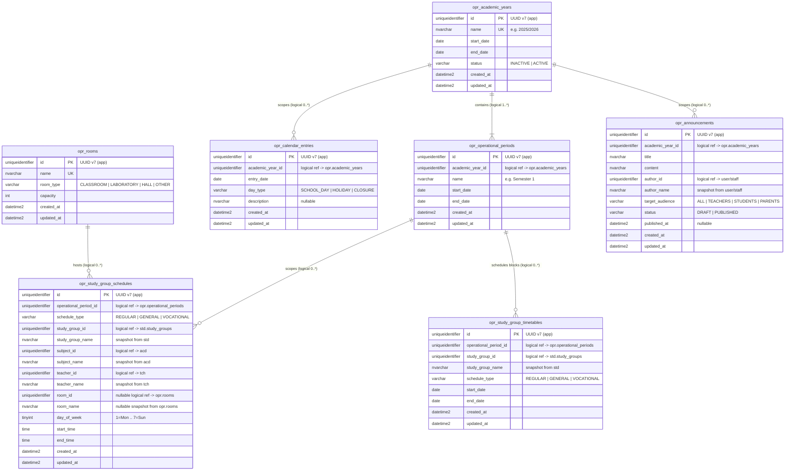

# Operational Domain (Basic) — Database Table Design

> **Source Domain Specification:** [operational-domain-basic.md](file:///d:/Project.Private/elsasa-sis-v4/docs/domains/operational-domain-basic.md)
> **Target RDBMS:** Microsoft SQL Server (2019+ / Azure SQL Database, T-SQL)
> **Architecture Alignment:** Clean Architecture evolved to Vertical Slices — **Database as Pure Persistence Layer**
> **Scope:** Basic level + multi-pattern timetable extension (Academic Year, Operational Periods, School Calendar, Period-Scoped Study Group Schedules with Regular & SMK Umum/Khusus Block Timetables, Rooms, and Announcements). Intermediate/Enterprise features such as room reservations, event management, automatic conflict detection, and approval workflows are intentionally excluded.

---

## 1. Overview & Design Principles

### 1.1 Module Schema Convention

Each domain module owns an isolated SQL Server schema inside the database:

| Module / Bounded Context | Schema Name |
|---|---|
| **Operational** *(this document)* | `opr` |
| **Student** | `std` |
| **Academic** | `acd` |
| **Finance** | `fin` |
| **Teaching** | `tch` |
| **Development** | `dev` |

All Operational Domain tables live under the `opr` schema (`opr.*`).

### 1.2 Aggregate-to-Table Mapping

Every aggregate and domain object in [operational-domain-basic.md](file:///d:/Project.Private/elsasa-sis-v4/docs/domains/operational-domain-basic.md) (extended for semester-level timetables and SMK block rotations) maps to a normalized relational table in `opr`:

| Aggregate Root | Domain Objects | Table(s) | Mapping Rationale |
|---|---|---|---|
| **Academic Year** | Academic Year, Operational Period | `opr.academic_years`, `opr.operational_periods` | `academic_years` is the root temporal boundary; `operational_periods` is a 1-to-many owned child table. |
| **School Calendar** | Calendar Entry | `opr.calendar_entries` | A School Calendar has a strict 1:1 relationship with an Academic Year and carries no header attributes at the Basic level, so `calendar_entries` is scoped directly by `academic_year_id`. |
| **Timetable** | Study Group Schedule (Timetable Entry + Time Slot), Study Group Timetable (Block Mapping) | `opr.study_group_schedules`, `opr.study_group_timetables` | Scoped to `operational_period_id` (so Semester 1 and Semester 2 can have distinct schedules). `Time Slot` (`day_of_week`, `start_time`, `end_time`) is embedded on `study_group_schedules`; `study_group_timetables` plots effective date ranges per study group for SMK 2-week `GENERAL`/`VOCATIONAL` rotations. |
| **Room** | Room | `opr.rooms` | Standalone master data table independent of any Academic Year. |
| **Announcement** | Announcement | `opr.announcements` | Standalone aggregate scoped to `academic_year_id` with lifecycle state (`DRAFT` -> `PUBLISHED`). |

### 1.3 Pure Persistence Layer Principles

1. **Zero Business Logic in the Database:**
   - No triggers, no stored procedures, no `CHECK` constraints, and no column `DEFAULT` constraints exist in the database.
   - All domain invariants, state transitions, enum validations, date/time ordering, overlap checks, and deletion/cascade orchestration are enforced in the **Application Layer** (Domain Entities / Vertical Slice command handlers).
2. **Application-Generated Primary Keys (UUID v7):**
   - Every table's `id` column is `UNIQUEIDENTIFIER NOT NULL` with `PRIMARY KEY CLUSTERED (id)` and no database-side generation.
   - The Application Layer generates **UUID v7** identifiers prior to persistence. Because UUID v7 is time-ordered, it aligns well with clustered primary keys while keeping entity identity independent of database round-trips.
3. **Application-Supplied Audit & Lifecycle Columns:**
   - Every table includes `created_at DATETIME2(3) NOT NULL` and `updated_at DATETIME2(3) NOT NULL` (UTC) populated explicitly by the Application Layer on insert and update.
   - Initial lifecycle statuses (e.g., `'INACTIVE'` on `opr.academic_years`, `'DRAFT'` on `opr.announcements`) are also set by the Application Layer.
4. **No Database Foreign Keys:**
   - Both intra-module references (`academic_year_id`, `operational_period_id`, `room_id`) and cross-module references (`subject_id` -> `acd`, `study_group_id` -> `std`, `teacher_id` -> `tch`, `author_id` -> identity/staff) are stored as plain `UNIQUEIDENTIFIER` columns.
   - Referential integrity and deletion rules (e.g., cleaning up or blocking child records) are managed explicitly in the Application Layer.
5. **Cross-Domain Snapshot Denormalization:**
   - Because cross-schema database joins are avoided in Vertical Slices, tables holding cross-module or display-critical references persist a **snapshot of the display name** alongside the ID:
     - `opr.study_group_schedules`: `study_group_name`, `subject_name`, `teacher_name`, `room_name`
     - `opr.study_group_timetables`: `study_group_name`
     - `opr.announcements`: `author_name`
   - Read queries render timetables and announcement feeds directly from `opr` without calling or joining `acd`, `std`, `tch`, or `opr.rooms`. When source names change in their owning domains, the Application Layer propagates updates (e.g., via domain events / integration handlers) to refresh the snapshots.
6. **Multi-Pattern Timetable Scheduling (`REGULAR` vs. SMK Block `GENERAL` / `VOCATIONAL`):**
   - `opr.study_group_schedules` binds to `operational_period_id` (allowing different schedules between Semester 1 and Semester 2) and includes `schedule_type VARCHAR(20) NOT NULL` (`'REGULAR'`, `'GENERAL'`, `'VOCATIONAL'`).
   - **Regular schools (SD / SMP / SMA):** Store weekly entries with `schedule_type = 'REGULAR'` and do not need any rows in `opr.study_group_timetables`. When no matching row exists in `opr.study_group_timetables` for a study group and date, queries default to `'REGULAR'`.
   - **Vocational schools (SMK) with 2-week rotating blocks:** Store two weekly template sets per study group in `opr.study_group_schedules` (`'GENERAL'` for *Umum* and `'VOCATIONAL'` for *Khusus*), then plot concrete effective date windows per study group in `opr.study_group_timetables` (`operational_period_id`, `study_group_id`, `study_group_name`, `schedule_type`, `start_date`, `end_date`).
   - Plotting explicit date ranges per study group supports staggered schedules across study groups (e.g., Study Group A in `'GENERAL'` week while Study Group B is in `'VOCATIONAL'` week to share workshops/labs) and handles calendar shifts caused by national holidays or exam weeks without breaking an auto-calculated cycle.
7. **Uniqueness Rules Enforced in the Database:**
   - Only pure uniqueness guarantees are declared as database `UNIQUE` constraints:
     - `UQ_academic_years_name` on `opr.academic_years (name)`
     - `UQ_operational_periods_year_name` on `opr.operational_periods (academic_year_id, name)`
     - `UQ_calendar_entries_year_date` on `opr.calendar_entries (academic_year_id, entry_date)` (`BR-OPS-008`)
     - `UQ_rooms_name` on `opr.rooms (name)` (`BR-OPS-010`)
     - `UQ_study_group_timetables_period_group_start` on `opr.study_group_timetables (operational_period_id, study_group_id, start_date)`
   - Single-active-year exclusivity (`BR-OPS-001`) is enforced in the Application Layer rather than via a filtered unique index.
8. **Performance-Only Indexing:**
   - Non-unique indexes exist strictly to accelerate read queries in Vertical Slice query handlers.
9. **Standard SQL Server Data Types:**
   - **Identifiers:** `UNIQUEIDENTIFIER` (UUID v7)
   - **Unicode Text:** `NVARCHAR(n)` / `NVARCHAR(MAX)` for names, descriptions, titles, and content
   - **Enum / Classification Values:** `VARCHAR(20)` storing readable codes (`'ACTIVE'`, `'INACTIVE'`, `'SCHOOL_DAY'`, `'HOLIDAY'`, `'CLOSURE'`, `'CLASSROOM'`, `'LABORATORY'`, `'HALL'`, `'OTHER'`, `'REGULAR'`, `'GENERAL'`, `'VOCATIONAL'`, `'ALL'`, `'TEACHERS'`, `'STUDENTS'`, `'PARENTS'`, `'DRAFT'`, `'PUBLISHED'`), validated in the Application Layer
   - **Weekday:** `TINYINT` (`1` = Monday .. `7` = Sunday)
   - **Numeric:** `INT` for `capacity`
   - **Temporal:** `DATE`, `TIME(0)`, `DATETIME2(3)`

---

## 2. Entity-Relationship Diagram (Logical)

> Relationships below represent **logical domain associations** enforced by the Application Layer (no physical database foreign key constraints).



---

## 3. Table Definitions

### 3.1 `opr.academic_years`

Persists the **Academic Year** aggregate root — the primary temporal boundary and active operating context for the school.

| Column | SQL Server Data Type | Nullable | DB Constraint / Key | Application Layer Responsibility |
|---|---|---|---|---|
| `id` | `UNIQUEIDENTIFIER` | `NO` | `PK_academic_years` | Generate UUID v7 |
| `name` | `NVARCHAR(50)` | `NO` | `UQ_academic_years_name` | Non-blank string (e.g., `2025/2026`) |
| `start_date` | `DATE` | `NO` | — | Academic year start date |
| `end_date` | `DATE` | `NO` | — | Validate `end_date > start_date` (`BR-OPS-005`) |
| `status` | `VARCHAR(20)` | `NO` | — | Set initial `'INACTIVE'`; enforce `'INACTIVE'` / `'ACTIVE'` and single-active rule (`BR-OPS-001`) |
| `created_at` | `DATETIME2(3)` | `NO` | — | Populate UTC timestamp on create |
| `updated_at` | `DATETIME2(3)` | `NO` | — | Populate UTC timestamp on create & update |

**Indexes (Performance Only):**
- `PK_academic_years`: `PRIMARY KEY CLUSTERED (id)`
- `UQ_academic_years_name`: `UNIQUE (name)`
- `IX_academic_years_status`: `NONCLUSTERED INDEX (status)` (supports resolving the active Academic Year)

---

### 3.2 `opr.operational_periods`

Persists **Operational Period** entities owned by an Academic Year (e.g., `Semester 1`, `Semester 2`).

| Column | SQL Server Data Type | Nullable | DB Constraint / Key | Application Layer Responsibility |
|---|---|---|---|---|
| `id` | `UNIQUEIDENTIFIER` | `NO` | `PK_operational_periods` | Generate UUID v7 |
| `academic_year_id` | `UNIQUEIDENTIFIER` | `NO` | — | Logical reference to `opr.academic_years(id)` |
| `name` | `NVARCHAR(50)` | `NO` | `UQ_operational_periods_year_name` | Non-blank period name (e.g., `Semester 1`) |
| `start_date` | `DATE` | `NO` | — | Validate within parent year bounds (`BR-OPS-003`) & non-overlapping (`BR-OPS-004`) |
| `end_date` | `DATE` | `NO` | — | Validate `end_date > start_date` (`BR-OPS-006`), within parent bounds (`BR-OPS-003`), & non-overlapping (`BR-OPS-004`) |
| `created_at` | `DATETIME2(3)` | `NO` | — | Populate UTC timestamp on create |
| `updated_at` | `DATETIME2(3)` | `NO` | — | Populate UTC timestamp on create & update |

**Constraints & Indexes:**
- `PK_operational_periods`: `PRIMARY KEY CLUSTERED (id)`
- `UQ_operational_periods_year_name`: `UNIQUE (academic_year_id, name)`
- `IX_operational_periods_year_dates`: `NONCLUSTERED INDEX (academic_year_id, start_date, end_date)` (supports period lookup by year and date)

---

### 3.3 `opr.calendar_entries`

Persists **Calendar Entry** records within the **School Calendar** aggregate for a single Academic Year.

| Column | SQL Server Data Type | Nullable | DB Constraint / Key | Application Layer Responsibility |
|---|---|---|---|---|
| `id` | `UNIQUEIDENTIFIER` | `NO` | `PK_calendar_entries` | Generate UUID v7 |
| `academic_year_id` | `UNIQUEIDENTIFIER` | `NO` | — | Logical reference to `opr.academic_years(id)` |
| `entry_date` | `DATE` | `NO` | `UQ_calendar_entries_year_date` | Validate within parent Academic Year bounds (`BR-OPS-007`) |
| `day_type` | `VARCHAR(20)` | `NO` | — | Validate `'SCHOOL_DAY'`, `'HOLIDAY'`, or `'CLOSURE'` |
| `description` | `NVARCHAR(500)` | `YES` | — | Optional reason or label |
| `created_at` | `DATETIME2(3)` | `NO` | — | Populate UTC timestamp on create |
| `updated_at` | `DATETIME2(3)` | `NO` | — | Populate UTC timestamp on create & update |

**Constraints & Indexes:**
- `PK_calendar_entries`: `PRIMARY KEY CLUSTERED (id)`
- `UQ_calendar_entries_year_date`: `UNIQUE (academic_year_id, entry_date)` (`BR-OPS-008`)
- `IX_calendar_entries_year_type`: `NONCLUSTERED INDEX (academic_year_id, day_type, entry_date)` (supports filtering holidays/closures/school days for a year)

---

### 3.4 `opr.rooms`

Persists the **Room** aggregate root — shared physical space master data independent of any Academic Year.

| Column | SQL Server Data Type | Nullable | DB Constraint / Key | Application Layer Responsibility |
|---|---|---|---|---|
| `id` | `UNIQUEIDENTIFIER` | `NO` | `PK_rooms` | Generate UUID v7 |
| `name` | `NVARCHAR(100)` | `NO` | `UQ_rooms_name` | Non-blank room name (`BR-OPS-010`) |
| `room_type` | `VARCHAR(20)` | `NO` | — | Validate `'CLASSROOM'`, `'LABORATORY'`, `'HALL'`, or `'OTHER'` |
| `capacity` | `INT` | `NO` | — | Validate `capacity > 0` (`BR-OPS-011`) |
| `created_at` | `DATETIME2(3)` | `NO` | — | Populate UTC timestamp on create |
| `updated_at` | `DATETIME2(3)` | `NO` | — | Populate UTC timestamp on create & update |

**Constraints & Indexes:**
- `PK_rooms`: `PRIMARY KEY CLUSTERED (id)`
- `UQ_rooms_name`: `UNIQUE (name)` (`BR-OPS-010`)

---

### 3.5 `opr.study_group_schedules`

Persists **Study Group Schedule** records (weekly timetable entries) within the **Timetable** aggregate scoped to an **Operational Period**, with the **Time Slot** (`day_of_week`, `start_time`, `end_time`), **Schedule Type** (`REGULAR` / `GENERAL` / `VOCATIONAL`), and **cross-domain snapshots** embedded directly.

| Column | SQL Server Data Type | Nullable | DB Constraint / Key | Application Layer Responsibility |
|---|---|---|---|---|
| `id` | `UNIQUEIDENTIFIER` | `NO` | `PK_study_group_schedules` | Generate UUID v7 |
| `operational_period_id` | `UNIQUEIDENTIFIER` | `NO` | — | Logical reference to `opr.operational_periods(id)` |
| `schedule_type` | `VARCHAR(20)` | `NO` | — | Validate `'REGULAR'`, `'GENERAL'`, or `'VOCATIONAL'` |
| `study_group_id` | `UNIQUEIDENTIFIER` | `NO` | — | Logical reference to `std.study_groups(id)` (`std` schema) |
| `study_group_name` | `NVARCHAR(50)` | `NO` | — | Snapshot of study group name from `std` |
| `subject_id` | `UNIQUEIDENTIFIER` | `NO` | — | Logical reference to Subject (`acd` schema) |
| `subject_name` | `NVARCHAR(100)` | `NO` | — | Snapshot of subject name from `acd` |
| `teacher_id` | `UNIQUEIDENTIFIER` | `NO` | — | Logical reference to Teacher Profile (`tch` schema) |
| `teacher_name` | `NVARCHAR(150)` | `NO` | — | Snapshot of teacher name from `tch` |
| `room_id` | `UNIQUEIDENTIFIER` | `YES` | — | Optional logical reference to `opr.rooms(id)` |
| `room_name` | `NVARCHAR(100)` | `YES` | — | Optional snapshot of room name from `opr.rooms`; must be `NULL` iff `room_id IS NULL` |
| `day_of_week` | `TINYINT` | `NO` | — | Validate ISO-8601 weekday `1`–`7` (`1` = Monday .. `7` = Sunday) |
| `start_time` | `TIME(0)` | `NO` | — | Local school clock start time |
| `end_time` | `TIME(0)` | `NO` | — | Validate `end_time > start_time` (`BR-OPS-009`) |
| `created_at` | `DATETIME2(3)` | `NO` | — | Populate UTC timestamp on create |
| `updated_at` | `DATETIME2(3)` | `NO` | — | Populate UTC timestamp on create & update |

**Indexes (Performance Only):**
- `PK_study_group_schedules`: `PRIMARY KEY CLUSTERED (id)`
- `IX_study_group_schedules_study_group_lookup`: `NONCLUSTERED INDEX (operational_period_id, study_group_id, schedule_type, day_of_week, start_time)` (weekly study group schedule view & block resolution)
- `IX_study_group_schedules_teacher_lookup`: `NONCLUSTERED INDEX (operational_period_id, teacher_id, schedule_type, day_of_week, start_time)` (weekly teacher timetable view)
- `IX_study_group_schedules_room_lookup`: `NONCLUSTERED INDEX (operational_period_id, room_id, schedule_type, day_of_week, start_time) WHERE room_id IS NOT NULL` (room schedule lookup)

---

### 3.6 `opr.study_group_timetables`

Persists effective **date-range block mappings** per study group within an Operational Period, enabling SMK 2-week rotating blocks (`GENERAL` vs. `VOCATIONAL`) where different study groups can run different blocks simultaneously and holidays/exams can adjust dates cleanly. Regular schools (`SD/SMP/SMA`) using `'REGULAR'` schedules do not need rows here.

| Column | SQL Server Data Type | Nullable | DB Constraint / Key | Application Layer Responsibility |
|---|---|---|---|---|
| `id` | `UNIQUEIDENTIFIER` | `NO` | `PK_study_group_timetables` | Generate UUID v7 |
| `operational_period_id` | `UNIQUEIDENTIFIER` | `NO` | `UQ_study_group_timetables_period_group_start` | Logical reference to `opr.operational_periods(id)` |
| `study_group_id` | `UNIQUEIDENTIFIER` | `NO` | `UQ_study_group_timetables_period_group_start` | Logical reference to `std.study_groups(id)` (`std` schema) |
| `study_group_name` | `NVARCHAR(50)` | `NO` | — | Snapshot of study group name from `std` |
| `schedule_type` | `VARCHAR(20)` | `NO` | — | Validate `'REGULAR'`, `'GENERAL'`, or `'VOCATIONAL'` |
| `start_date` | `DATE` | `NO` | `UQ_study_group_timetables_period_group_start` | Block start date; must fall within parent Operational Period and not overlap other blocks for the same `(operational_period_id, study_group_id)` |
| `end_date` | `DATE` | `NO` | — | Block end date; validate `end_date >= start_date`, within parent Operational Period bounds, and non-overlapping per study group |
| `created_at` | `DATETIME2(3)` | `NO` | — | Populate UTC timestamp on create |
| `updated_at` | `DATETIME2(3)` | `NO` | — | Populate UTC timestamp on create & update |

**Constraints & Indexes:**
- `PK_study_group_timetables`: `PRIMARY KEY CLUSTERED (id)`
- `UQ_study_group_timetables_period_group_start`: `UNIQUE (operational_period_id, study_group_id, start_date)`
- `IX_study_group_timetables_study_group_dates`: `NONCLUSTERED INDEX (operational_period_id, study_group_id, start_date, end_date)` (resolving active block for a study group on a given date)
- `IX_study_group_timetables_period_dates`: `NONCLUSTERED INDEX (operational_period_id, start_date, end_date)` (resolving all study group blocks active on a given date for teacher/school-wide daily views)

---

### 3.7 `opr.announcements`

Persists the **Announcement** aggregate root scoped to an Academic Year, storing an `author_name` snapshot alongside `author_id`.

| Column | SQL Server Data Type | Nullable | DB Constraint / Key | Application Layer Responsibility |
|---|---|---|---|---|
| `id` | `UNIQUEIDENTIFIER` | `NO` | `PK_announcements` | Generate UUID v7 |
| `academic_year_id` | `UNIQUEIDENTIFIER` | `NO` | — | Logical reference to `opr.academic_years(id)` |
| `title` | `NVARCHAR(255)` | `NO` | — | Validate non-empty (`BR-OPS-013`) |
| `content` | `NVARCHAR(MAX)` | `NO` | — | Validate non-empty (`BR-OPS-013`) |
| `author_id` | `UNIQUEIDENTIFIER` | `NO` | — | Logical reference to Author (School Administrator / Teacher) |
| `author_name` | `NVARCHAR(150)` | `NO` | — | Snapshot of author display name |
| `target_audience` | `VARCHAR(20)` | `NO` | — | Validate `'ALL'`, `'TEACHERS'`, `'STUDENTS'`, or `'PARENTS'` (`BR-OPS-012`) |
| `status` | `VARCHAR(20)` | `NO` | — | Set initial `'DRAFT'`; enforce `DRAFT -> PUBLISHED` transition |
| `published_at` | `DATETIME2(3)` | `YES` | — | `NULL` while `'DRAFT'`; set UTC timestamp when published |
| `created_at` | `DATETIME2(3)` | `NO` | — | Populate UTC timestamp on create |
| `updated_at` | `DATETIME2(3)` | `NO` | — | Populate UTC timestamp on create & update |

**Indexes (Performance Only):**
- `PK_announcements`: `PRIMARY KEY CLUSTERED (id)`
- `IX_announcements_feed`: `NONCLUSTERED INDEX (academic_year_id, status, target_audience, published_at DESC)` (published feed lookup)
- `IX_announcements_author`: `NONCLUSTERED INDEX (academic_year_id, author_id, created_at DESC)` (author draft/published listing)

---

## 4. Business Rules Traceability Matrix

Every business rule in Section 7 of [operational-domain-basic.md](file:///d:/Project.Private/elsasa-sis-v4/docs/domains/operational-domain-basic.md) plus the extended rules for semester-scoped schedules, SMK block rotations, and snapshot consistency is mapped below — **only uniqueness rules are enforced in the database**, while all other business rules live in the **Application Layer** (Domain Entities / Vertical Slice Handlers):

| Rule ID | Business Rule | Enforcement Layer | Exact Implementation |
|---|---|---|---|
| **BR-OPS-001** | Exactly one Academic Year may be active at any time. Activating a new Academic Year deactivates the previously active one. | **Application Layer** | `ActivateAcademicYear` command handler runs inside an application-managed transaction to deactivate the prior active year and activate the target year. |
| **BR-OPS-002** | An Academic Year must contain at least one Operational Period. | **Application Layer** | `AcademicYear` aggregate / command handler verifies `>= 1` Operational Period exists at creation and prior to activation. |
| **BR-OPS-003** | Each Operational Period's start and end dates must fall within the start and end dates of its Academic Year. | **Application Layer** | `AcademicYear` aggregate / handler validates `period.StartDate >= year.StartDate && period.EndDate <= year.EndDate` on period add/update and year resize. |
| **BR-OPS-004** | Operational Periods within the same Academic Year must not have overlapping date ranges. | **Application Layer** | `AcademicYear` aggregate / handler checks existing periods for overlap (`new.StartDate <= existing.EndDate && new.EndDate >= existing.StartDate`) before persisting. |
| **BR-OPS-005** | An Academic Year's end date must be after its start date. | **Application Layer** | `AcademicYear` entity / validator ensures `end_date > start_date`. |
| **BR-OPS-006** | An Operational Period's end date must be after its start date. | **Application Layer** | `OperationalPeriod` entity / validator ensures `end_date > start_date`. |
| **BR-OPS-007** | A Calendar Entry's date must fall within the date range of its Academic Year. | **Application Layer** | `SchoolCalendar` handler validates `entry_date` falls within the target Academic Year's `[start_date, end_date]` (and guards year date changes). |
| **BR-OPS-008** | Each date within an Academic Year may have at most one Calendar Entry. | **Database (`UNIQUE`)** + App Layer | `UQ_calendar_entries_year_date`: `UNIQUE (academic_year_id, entry_date)`. |
| **BR-OPS-009** | A Study Group Schedule entry's end time must be after its start time. | **Application Layer** | `TimeSlot` value object / handler validates `end_time > start_time`. |
| **BR-OPS-010** | Room names must be unique across the school. | **Database (`UNIQUE`)** + App Layer | `UQ_rooms_name`: `UNIQUE (name)` *(paired with app-level normalization/trimming)*. |
| **BR-OPS-011** | Room Capacity must be a positive number. | **Application Layer** | `Room` entity / validator ensures `capacity > 0`. |
| **BR-OPS-012** | An Announcement must specify exactly one Target Audience. | **Application Layer** (+ `NOT NULL`) | `target_audience` is `NOT NULL` in DB; `Announcement` entity validates single enum value in `{'ALL', 'TEACHERS', 'STUDENTS', 'PARENTS'}`. |
| **BR-OPS-013** | An Announcement must have a non-empty title and content. | **Application Layer** (+ `NOT NULL`) | `title` and `content` are `NOT NULL` in DB; `Announcement` entity validates non-whitespace text. |
| **EXT-OPS-001** | Study Group Schedules (`opr.study_group_schedules`) and Study Group Timetables (`opr.study_group_timetables`) belong to a valid `operational_period_id`. | **Application Layer** | Timetable command handlers verify the target Operational Period exists before creating/updating schedule entries or timetable blocks. |
| **EXT-OPS-002** | Study Group Timetable blocks (`opr.study_group_timetables`) for the same `(operational_period_id, study_group_id)` must satisfy `end_date >= start_date`, fall within the Operational Period's `[start_date, end_date]`, and must not overlap. | **Application Layer** (+ `UNIQUE`) | `UQ_study_group_timetables_period_group_start` prevents duplicate start dates; the timetable block handler validates date order, period bounds, and non-overlapping ranges per study group. |
| **EXT-OPS-003** | Optional `room_id` and `room_name` must both be populated or both be `NULL`. | **Application Layer** | Study group schedule command handler populates `room_name` from `opr.rooms` when `room_id` is supplied, and clears both to `NULL` when unassigned. |
| **EXT-OPS-004** | Cross-domain snapshot columns (`study_group_name`, `subject_name`, `teacher_name`, `room_name`, `author_name`) stay synchronized with their source entities. | **Application Layer** | Event/integration handlers update matching snapshot rows in `opr.study_group_schedules`, `opr.study_group_timetables`, and `opr.announcements` whenever source display names change. |

*(Additional uniqueness constraints enforced in DB: `UQ_academic_years_name` on `opr.academic_years(name)` and `UQ_operational_periods_year_name` on `opr.operational_periods(academic_year_id, name)`.)*

---

## 5. Complete SQL DDL Reference (Microsoft SQL Server / T-SQL)

```sql
-- ============================================================================
-- Operational Domain (Basic + Period/Block Timetable) — Pure Persistence DDL
-- Target: Microsoft SQL Server 2019+ / Azure SQL Database (T-SQL)
-- Schema: opr
-- Source: docs/domains/operational-domain-basic.md
-- Notes:
--   - IDs are application-generated UUID v7 values
--   - Timestamps, statuses, and snapshot names are supplied by the application
--   - Only PRIMARY KEY and UNIQUE constraints are enforced in the DB
--   - All other indexes exist strictly for query performance
-- ============================================================================

IF NOT EXISTS (SELECT 1 FROM sys.schemas WHERE name = N'opr')
BEGIN
    EXEC(N'CREATE SCHEMA opr');
END;
GO

-- ----------------------------------------------------------------------------
-- 1. Academic Years
-- ----------------------------------------------------------------------------
CREATE TABLE opr.academic_years (
    id          UNIQUEIDENTIFIER NOT NULL,
    name        NVARCHAR(50)     NOT NULL,
    start_date  DATE             NOT NULL,
    end_date    DATE             NOT NULL,
    status      VARCHAR(20)      NOT NULL,
    created_at  DATETIME2(3)     NOT NULL,
    updated_at  DATETIME2(3)     NOT NULL,

    CONSTRAINT PK_academic_years PRIMARY KEY CLUSTERED (id),
    CONSTRAINT UQ_academic_years_name UNIQUE (name)
);

CREATE NONCLUSTERED INDEX IX_academic_years_status
    ON opr.academic_years (status);
GO

-- ----------------------------------------------------------------------------
-- 2. Operational Periods
-- ----------------------------------------------------------------------------
CREATE TABLE opr.operational_periods (
    id                UNIQUEIDENTIFIER NOT NULL,
    academic_year_id  UNIQUEIDENTIFIER NOT NULL,
    name              NVARCHAR(50)     NOT NULL,
    start_date        DATE             NOT NULL,
    end_date          DATE             NOT NULL,
    created_at        DATETIME2(3)     NOT NULL,
    updated_at        DATETIME2(3)     NOT NULL,

    CONSTRAINT PK_operational_periods PRIMARY KEY CLUSTERED (id),
    CONSTRAINT UQ_operational_periods_year_name UNIQUE (academic_year_id, name)
);

CREATE NONCLUSTERED INDEX IX_operational_periods_year_dates
    ON opr.operational_periods (academic_year_id, start_date, end_date);
GO

-- ----------------------------------------------------------------------------
-- 3. Calendar Entries (School Calendar)
-- ----------------------------------------------------------------------------
CREATE TABLE opr.calendar_entries (
    id                UNIQUEIDENTIFIER NOT NULL,
    academic_year_id  UNIQUEIDENTIFIER NOT NULL,
    entry_date        DATE             NOT NULL,
    day_type          VARCHAR(20)      NOT NULL,
    description       NVARCHAR(500)    NULL,
    created_at        DATETIME2(3)     NOT NULL,
    updated_at        DATETIME2(3)     NOT NULL,

    CONSTRAINT PK_calendar_entries PRIMARY KEY CLUSTERED (id),
    -- BR-OPS-008: At most one Calendar Entry per date within an Academic Year
    CONSTRAINT UQ_calendar_entries_year_date UNIQUE (academic_year_id, entry_date)
);

CREATE NONCLUSTERED INDEX IX_calendar_entries_year_type
    ON opr.calendar_entries (academic_year_id, day_type, entry_date);
GO

-- ----------------------------------------------------------------------------
-- 4. Rooms
-- ----------------------------------------------------------------------------
CREATE TABLE opr.rooms (
    id          UNIQUEIDENTIFIER NOT NULL,
    name        NVARCHAR(100)    NOT NULL,
    room_type   VARCHAR(20)      NOT NULL,
    capacity    INT              NOT NULL,
    created_at  DATETIME2(3)     NOT NULL,
    updated_at  DATETIME2(3)     NOT NULL,

    CONSTRAINT PK_rooms PRIMARY KEY CLUSTERED (id),
    -- BR-OPS-010: Room names must be unique across the school
    CONSTRAINT UQ_rooms_name UNIQUE (name)
);
GO

-- ----------------------------------------------------------------------------
-- 5. Study Group Schedules (Period-Scoped Weekly Slots + Snapshots)
-- ----------------------------------------------------------------------------
CREATE TABLE opr.study_group_schedules (
    id                     UNIQUEIDENTIFIER NOT NULL,
    operational_period_id  UNIQUEIDENTIFIER NOT NULL,
    schedule_type          VARCHAR(20)      NOT NULL,
    study_group_id         UNIQUEIDENTIFIER NOT NULL,
    study_group_name       NVARCHAR(50)     NOT NULL,
    subject_id             UNIQUEIDENTIFIER NOT NULL,
    subject_name           NVARCHAR(100)    NOT NULL,
    teacher_id             UNIQUEIDENTIFIER NOT NULL,
    teacher_name           NVARCHAR(150)    NOT NULL,
    room_id                UNIQUEIDENTIFIER NULL,
    room_name              NVARCHAR(100)    NULL,
    day_of_week            TINYINT          NOT NULL,
    start_time             TIME(0)          NOT NULL,
    end_time               TIME(0)          NOT NULL,
    created_at             DATETIME2(3)     NOT NULL,
    updated_at             DATETIME2(3)     NOT NULL,

    CONSTRAINT PK_study_group_schedules PRIMARY KEY CLUSTERED (id)
);

CREATE NONCLUSTERED INDEX IX_study_group_schedules_study_group_lookup
    ON opr.study_group_schedules (operational_period_id, study_group_id, schedule_type, day_of_week, start_time);

CREATE NONCLUSTERED INDEX IX_study_group_schedules_teacher_lookup
    ON opr.study_group_schedules (operational_period_id, teacher_id, schedule_type, day_of_week, start_time);

CREATE NONCLUSTERED INDEX IX_study_group_schedules_room_lookup
    ON opr.study_group_schedules (operational_period_id, room_id, schedule_type, day_of_week, start_time)
    WHERE room_id IS NOT NULL;
GO

-- ----------------------------------------------------------------------------
-- 6. Study Group Timetables (SMK Per-Study Group Date Range Schedule Mapping)
-- ----------------------------------------------------------------------------
CREATE TABLE opr.study_group_timetables (
    id                     UNIQUEIDENTIFIER NOT NULL,
    operational_period_id  UNIQUEIDENTIFIER NOT NULL,
    study_group_id         UNIQUEIDENTIFIER NOT NULL,
    study_group_name       NVARCHAR(50)     NOT NULL,
    schedule_type          VARCHAR(20)      NOT NULL,
    start_date             DATE             NOT NULL,
    end_date               DATE             NOT NULL,
    created_at             DATETIME2(3)     NOT NULL,
    updated_at             DATETIME2(3)     NOT NULL,

    CONSTRAINT PK_study_group_timetables PRIMARY KEY CLUSTERED (id),
    CONSTRAINT UQ_study_group_timetables_period_group_start
        UNIQUE (operational_period_id, study_group_id, start_date)
);

CREATE NONCLUSTERED INDEX IX_study_group_timetables_study_group_dates
    ON opr.study_group_timetables (operational_period_id, study_group_id, start_date, end_date);

CREATE NONCLUSTERED INDEX IX_study_group_timetables_period_dates
    ON opr.study_group_timetables (operational_period_id, start_date, end_date);
GO

-- ----------------------------------------------------------------------------
-- 7. Announcements (with Author Snapshot)
-- ----------------------------------------------------------------------------
CREATE TABLE opr.announcements (
    id                UNIQUEIDENTIFIER NOT NULL,
    academic_year_id  UNIQUEIDENTIFIER NOT NULL,
    title             NVARCHAR(255)    NOT NULL,
    content           NVARCHAR(MAX)    NOT NULL,
    author_id         UNIQUEIDENTIFIER NOT NULL,
    author_name       NVARCHAR(150)    NOT NULL,
    target_audience   VARCHAR(20)      NOT NULL,
    status            VARCHAR(20)      NOT NULL,
    published_at      DATETIME2(3)     NULL,
    created_at        DATETIME2(3)     NOT NULL,
    updated_at        DATETIME2(3)     NOT NULL,

    CONSTRAINT PK_announcements PRIMARY KEY CLUSTERED (id)
);

CREATE NONCLUSTERED INDEX IX_announcements_feed
    ON opr.announcements (academic_year_id, status, target_audience, published_at DESC);

CREATE NONCLUSTERED INDEX IX_announcements_author
    ON opr.announcements (academic_year_id, author_id, created_at DESC);
GO
```

---

## 6. Common Query Patterns (Vertical Slice Persistence Queries)

### 6.1 Resolve the Active Academic Year & Current Operational Period

```sql
SELECT
    ay.id          AS academic_year_id,
    ay.name        AS academic_year_name,
    ay.start_date  AS year_start_date,
    ay.end_date    AS year_end_date,
    op.id          AS operational_period_id,
    op.name        AS operational_period_name,
    op.start_date  AS period_start_date,
    op.end_date    AS period_end_date
FROM opr.academic_years ay
LEFT JOIN opr.operational_periods op
    ON op.academic_year_id = ay.id
   AND @today BETWEEN op.start_date AND op.end_date
WHERE ay.status = 'ACTIVE';
```

### 6.2 Persist Academic Year Activation (`ActivateAcademicYear` Slice)

*(Executed inside an Application Layer `TransactionScope` / `DbTransaction` after verifying `BR-OPS-002` in the domain handler; `@now` is supplied by the application.)*

```sql
UPDATE opr.academic_years
   SET status     = 'INACTIVE',
       updated_at = @now
 WHERE status = 'ACTIVE'
   AND id <> @target_year_id;

UPDATE opr.academic_years
   SET status     = 'ACTIVE',
       updated_at = @now
 WHERE id = @target_year_id;
```

### 6.3 Check "Is School Open on This Date?" (`School Calendar`)

```sql
SELECT
    ay.name AS academic_year_name,
    ce.entry_date,
    ce.day_type,
    ce.description
FROM opr.academic_years ay
LEFT JOIN opr.calendar_entries ce
    ON ce.academic_year_id = ay.id
   AND ce.entry_date = @target_date
WHERE ay.status = 'ACTIVE';
```

### 6.4 Timetable Queries (Period-Scoped, Snapshotted & SMK Block-Aware)

#### A. Effective Study Group Schedule for a Target Date (Handles Both Regular & SMK Block Schools)

```sql
-- Returns the study group's schedule for @target_date (using ISO weekday @day_of_week).
-- For SMK schools: resolves GENERAL vs VOCATIONAL from opr.study_group_timetables.
-- For regular schools (no block row): falls back to 'REGULAR'.
-- Zero cross-schema joins required thanks to snapshot columns.
SELECT
    sgs.id,
    sgs.schedule_type,
    sgs.day_of_week,
    sgs.start_time,
    sgs.end_time,
    sgs.study_group_id,
    sgs.study_group_name,
    sgs.subject_id,
    sgs.subject_name,
    sgs.teacher_id,
    sgs.teacher_name,
    sgs.room_id,
    sgs.room_name
FROM opr.academic_years ay
INNER JOIN opr.operational_periods op
    ON op.academic_year_id = ay.id
   AND @target_date BETWEEN op.start_date AND op.end_date
LEFT JOIN opr.study_group_timetables sgt
    ON sgt.operational_period_id = op.id
   AND sgt.study_group_id = @study_group_id
   AND @target_date BETWEEN sgt.start_date AND sgt.end_date
INNER JOIN opr.study_group_schedules sgs
    ON sgs.operational_period_id = op.id
   AND sgs.study_group_id = @study_group_id
   AND sgs.schedule_type = COALESCE(sgt.schedule_type, 'REGULAR')
   AND sgs.day_of_week = @day_of_week
WHERE ay.status = 'ACTIVE'
ORDER BY sgs.start_time;
```

#### B. Effective Teacher Schedule for a Target Date Across Study Groups

```sql
-- Accurately resolves a teacher's daily schedule even when Study Group A is in a
-- 'GENERAL' block week and Study Group B is in a 'VOCATIONAL' block week on @target_date.
SELECT
    sgs.id,
    sgs.schedule_type,
    sgs.day_of_week,
    sgs.start_time,
    sgs.end_time,
    sgs.study_group_id,
    sgs.study_group_name,
    sgs.subject_id,
    sgs.subject_name,
    sgs.room_id,
    sgs.room_name
FROM opr.academic_years ay
INNER JOIN opr.operational_periods op
    ON op.academic_year_id = ay.id
   AND @target_date BETWEEN op.start_date AND op.end_date
INNER JOIN opr.study_group_schedules sgs
    ON sgs.operational_period_id = op.id
   AND sgs.teacher_id = @teacher_id
   AND sgs.day_of_week = @day_of_week
LEFT JOIN opr.study_group_timetables sgt
    ON sgt.operational_period_id = sgs.operational_period_id
   AND sgt.study_group_id = sgs.study_group_id
   AND @target_date BETWEEN sgt.start_date AND sgt.end_date
WHERE ay.status = 'ACTIVE'
  AND sgs.schedule_type = COALESCE(sgt.schedule_type, 'REGULAR')
ORDER BY sgs.start_time;
```

#### C. Weekly Template Schedule for Timetable Editor (by Period & Schedule Type)

```sql
-- Used by Curriculum Coordinator when authoring a study group's REGULAR, GENERAL, or VOCATIONAL set
SELECT
    sgs.id,
    sgs.day_of_week,
    sgs.start_time,
    sgs.end_time,
    sgs.subject_id,
    sgs.subject_name,
    sgs.teacher_id,
    sgs.teacher_name,
    sgs.room_id,
    sgs.room_name
FROM opr.study_group_schedules sgs
WHERE sgs.operational_period_id = @operational_period_id
  AND sgs.study_group_id = @study_group_id
  AND sgs.schedule_type = @schedule_type -- 'REGULAR' | 'GENERAL' | 'VOCATIONAL'
ORDER BY sgs.day_of_week, sgs.start_time;
```

### 6.5 Published Announcements Feed by Target Audience

```sql
-- Example: feed visible to Students ('ALL' + 'STUDENTS') in the active Academic Year
SELECT
    a.id,
    a.title,
    a.content,
    a.author_id,
    a.author_name,
    a.target_audience,
    a.published_at
FROM opr.announcements a
INNER JOIN opr.academic_years ay
    ON ay.id = a.academic_year_id
WHERE ay.status = 'ACTIVE'
  AND a.status = 'PUBLISHED'
  AND a.target_audience IN ('ALL', @audience_role) -- e.g. 'TEACHERS' | 'STUDENTS' | 'PARENTS'
ORDER BY a.published_at DESC;
```
