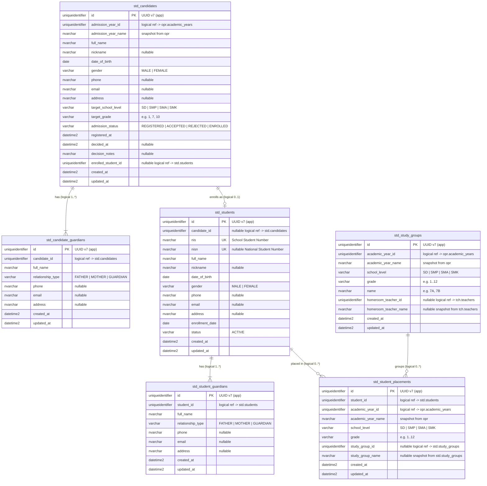

# Student Domain (Basic) — Database Table Design

> **Source Domain Specification:** [student-domain-basic.md](file:///d:/Project.Private/elsasa-sis-v4/docs/domains/student-domain-basic.md)
> **Target RDBMS:** Microsoft SQL Server (2019+ / Azure SQL Database, T-SQL)
> **Architecture Alignment:** Clean Architecture evolved to Vertical Slices — **Database as Pure Persistence Layer**
> **Scope:** Basic level only (Student Identity, Parent & Guardian Data, Simple Admission, Simple Enrollment, Administrative Placement, and Study Group master identity). Intermediate/Enterprise features such as promotions, leaves, transfers, graduation/alumni, formal admission pipelines, and cross-domain clearances are intentionally excluded.

---

## 1. Overview & Design Principles

### 1.1 Module Schema Convention

Each domain module owns an isolated SQL Server schema inside the database:

| Module / Bounded Context | Schema Name |
|---|---|
| **Operational** | `opr` |
| **Student** *(this document)* | `std` |
| **Academic** | `acd` |
| **Finance** | `fin` |
| **Teaching** | `tch` |
| **Development** | `dev` |

All Student Domain tables live under the `std` schema (`std.*`).

### 1.2 Aggregate-to-Table Mapping

Every aggregate, owned entity, and reference object in [student-domain-basic.md](file:///d:/Project.Private/elsasa-sis-v4/docs/domains/student-domain-basic.md) maps to a normalized plural relational table in `std`:

| Aggregate Root | Domain Objects | Table(s) | Mapping Rationale |
|---|---|---|---|
| **Candidate** | Candidate, Guardian (pre-enrollment) | `std.candidates`, `std.candidate_guardians` | Isolates admission applications and pre-enrollment parent/guardian contacts from official enrolled students, keeping candidate history intact once `ENROLLED` (`BR-STU-006`). |
| **Student** | Student, Guardian, Placement | `std.students`, `std.student_guardians`, `std.student_placements` | `std.students` holds authoritative identity and enrollment state; `std.student_guardians` holds 1..N parent/guardian records; `std.student_placements` holds at most one placement per academic year (`BR-STU-004`). |
| **Study Group** | Study Group | `std.study_groups` | Authoritative identity for study groups / rombel (e.g., `7A`, `7B`, `10 TKJ 1`) per Academic Year, consumed by `std.student_placements` as well as `opr.study_group_schedules` / `opr.study_group_timetables` (`study_group_id`), `acd`, and `tch`. |

### 1.3 Pure Persistence Layer Principles

1. **Zero Business Logic in the Database:**
   - No triggers, no stored procedures, no `CHECK` constraints, and no column `DEFAULT` constraints exist in the database.
   - All domain invariants, admission state machine transitions, student guardian minimums (`BR-STU-003`), placement validation, and enrollment orchestration are enforced in the **Application Layer** (Domain Entities / Vertical Slice command handlers).
2. **Application-Generated Primary Keys (UUID v7):**
   - Every table's `id` column is `UNIQUEIDENTIFIER NOT NULL` with `PRIMARY KEY CLUSTERED (id)` and no database-side generation.
   - The Application Layer generates **UUID v7** identifiers prior to persistence. Time-ordered UUID v7 values minimize clustered index fragmentation while keeping identity creation independent of database round-trips.
3. **Application-Supplied Audit & Lifecycle Columns:**
   - Every table includes `created_at DATETIME2(3) NOT NULL` and `updated_at DATETIME2(3) NOT NULL` (UTC) populated explicitly by the Application Layer on insert and update.
   - Initial lifecycle statuses (`'REGISTERED'` on `std.candidates`, `'ACTIVE'` on `std.students`) and action timestamps (`registered_at`, `decided_at`, `enrollment_date`) are supplied by the Application Layer.
4. **No Database Foreign Keys:**
   - Both intra-module references (`candidate_id`, `enrolled_student_id`, `student_id`, `study_group_id`) and cross-module references (`admission_year_id`, `academic_year_id` -> `opr.academic_years`) are stored as plain `UNIQUEIDENTIFIER` columns.
   - Referential integrity and aggregate cascade rules are managed explicitly in the Application Layer.
5. **Cross-Domain & Read-Model Snapshot Denormalization:**
   - Because cross-schema database joins are avoided in Vertical Slices, tables referencing `opr.academic_years` or `std.study_groups` store a **snapshot of the display name** alongside the ID:
     - `std.candidates`: `admission_year_id` + `admission_year_name`
     - `std.study_groups`: `academic_year_id` + `academic_year_name`
     - `std.student_placements`: `academic_year_id` + `academic_year_name`, and optional `study_group_id` + `study_group_name`
   - Read queries in Student Vertical Slices render admission lists, study groups, and student placements without cross-schema joins to `opr`.
6. **Uniqueness Rules Enforced in the Database:**
   - Only pure uniqueness guarantees are declared as database `UNIQUE` constraints / unique indexes:
     - `UQ_students_nis` on `std.students (nis)` (`BR-STU-001`)
     - `UQ_students_nisn` as a filtered unique index `ON std.students (nisn) WHERE nisn IS NOT NULL` (`BR-STU-010` — guarantees uniqueness whenever NISN is supplied while allowing multiple students without NISN)
     - `UQ_study_groups_year_name` on `std.study_groups (academic_year_id, name)`
     - `UQ_student_placements_student_year` on `std.student_placements (student_id, academic_year_id)` (`BR-STU-004`)
7. **Performance-Only Indexing:**
   - Non-unique indexes exist strictly to accelerate read queries in Vertical Slice query handlers (candidate queues, student search, parent/guardian retrieval, and study group rosters).
8. **Standard SQL Server Data Types:**
   - **Identifiers:** `UNIQUEIDENTIFIER` (UUID v7)
   - **Unicode Text:** `NVARCHAR(n)` for person names, addresses, emails, phone numbers, NIS/NISN, and study group names
   - **Enum / Classification Values:** `VARCHAR(10)` / `VARCHAR(20)` storing readable codes (`'MALE'`, `'FEMALE'`, `'SD'`, `'SMP'`, `'SMA'`, `'SMK'`, `'REGISTERED'`, `'ACCEPTED'`, `'REJECTED'`, `'ENROLLED'`, `'ACTIVE'`, `'FATHER'`, `'MOTHER'`, `'GUARDIAN'`), validated in the Application Layer
   - **Temporal:** `DATE`, `DATETIME2(3)`

---

## 2. Entity-Relationship Diagram (Logical)

> Relationships below represent **logical domain associations** enforced by the Application Layer (no physical database foreign key constraints).



---

## 3. Table Definitions

### 3.1 `std.candidates`

Persists the **Candidate** aggregate root — prospective student applications and admission decisions.

| Column | SQL Server Data Type | Nullable | DB Constraint / Key | Application Layer Responsibility |
|---|---|---|---|---|
| `id` | `UNIQUEIDENTIFIER` | `NO` | `PK_candidates` | Generate UUID v7 |
| `admission_year_id` | `UNIQUEIDENTIFIER` | `NO` | — | Logical reference to `opr.academic_years(id)` |
| `admission_year_name` | `NVARCHAR(50)` | `NO` | — | Snapshot of admission year name from `opr.academic_years` |
| `full_name` | `NVARCHAR(150)` | `NO` | — | Validate non-empty full name |
| `nickname` | `NVARCHAR(50)` | `YES` | — | Optional preferred name |
| `date_of_birth` | `DATE` | `NO` | — | Candidate birth date |
| `gender` | `VARCHAR(10)` | `NO` | — | Validate `'MALE'` or `'FEMALE'` |
| `phone` | `NVARCHAR(30)` | `YES` | — | Optional candidate phone number |
| `email` | `NVARCHAR(150)` | `YES` | — | Optional candidate email |
| `address` | `NVARCHAR(500)` | `YES` | — | Optional residential address |
| `target_school_level` | `VARCHAR(10)` | `NO` | — | Validate `'SD'`, `'SMP'`, `'SMA'`, or `'SMK'` |
| `target_grade` | `VARCHAR(20)` | `NO` | — | Target grade (e.g., `'1'`, `'7'`, `'10'`) |
| `admission_status` | `VARCHAR(20)` | `NO` | — | Set initial `'REGISTERED'`; enforce transitions `REGISTERED -> ACCEPTED \| REJECTED` (`BR-STU-009`) and `ACCEPTED -> ENROLLED` (`BR-STU-005`, `BR-STU-006`) |
| `registered_at` | `DATETIME2(3)` | `NO` | — | UTC timestamp of candidate registration |
| `decided_at` | `DATETIME2(3)` | `YES` | — | UTC timestamp when accepted or rejected |
| `decision_notes` | `NVARCHAR(500)` | `YES` | — | Optional notes or rationale recorded by administrator or principal upon decision |
| `enrolled_student_id` | `UNIQUEIDENTIFIER` | `YES` | — | Populated with new `std.students(id)` when `admission_status` becomes `'ENROLLED'` |
| `created_at` | `DATETIME2(3)` | `NO` | — | Populate UTC timestamp on create |
| `updated_at` | `DATETIME2(3)` | `NO` | — | Populate UTC timestamp on create & update |

**Indexes (Performance Only):**
- `PK_candidates`: `PRIMARY KEY CLUSTERED (id)`
- `IX_candidates_admission_lookup`: `NONCLUSTERED INDEX (admission_year_id, admission_status, target_school_level, target_grade)` (admission queue filtering)
- `IX_candidates_full_name`: `NONCLUSTERED INDEX (full_name)` (candidate search by name)

---

### 3.2 `std.candidate_guardians`

Persists pre-enrollment **Guardian** (parent/non-parent guardian) records owned by a Candidate. Upon enrollment, the Application Layer copies these records into `std.student_guardians` so historical admission records remain intact.

| Column | SQL Server Data Type | Nullable | DB Constraint / Key | Application Layer Responsibility |
|---|---|---|---|---|
| `id` | `UNIQUEIDENTIFIER` | `NO` | `PK_candidate_guardians` | Generate UUID v7 |
| `candidate_id` | `UNIQUEIDENTIFIER` | `NO` | — | Logical reference to `std.candidates(id)` |
| `full_name` | `NVARCHAR(150)` | `NO` | — | Validate non-empty full name |
| `relationship_type` | `VARCHAR(20)` | `NO` | — | Validate `'FATHER'`, `'MOTHER'`, or `'GUARDIAN'` (`BR-STU-007`) |
| `phone` | `NVARCHAR(30)` | `YES` | — | Contact phone number |
| `email` | `NVARCHAR(150)` | `YES` | — | Contact email address |
| `address` | `NVARCHAR(500)` | `YES` | — | Residential address |
| `created_at` | `DATETIME2(3)` | `NO` | — | Populate UTC timestamp on create |
| `updated_at` | `DATETIME2(3)` | `NO` | — | Populate UTC timestamp on create & update |

**Indexes (Performance Only):**
- `PK_candidate_guardians`: `PRIMARY KEY CLUSTERED (id)`
- `IX_candidate_guardians_candidate`: `NONCLUSTERED INDEX (candidate_id)`

---

### 3.3 `std.students`

Persists the **Student** aggregate root — the authoritative record of each officially enrolled student.

| Column | SQL Server Data Type | Nullable | DB Constraint / Key | Application Layer Responsibility |
|---|---|---|---|---|
| `id` | `UNIQUEIDENTIFIER` | `NO` | `PK_students` | Generate UUID v7 |
| `candidate_id` | `UNIQUEIDENTIFIER` | `YES` | — | Optional logical reference to source `std.candidates(id)` |
| `nis` | `NVARCHAR(30)` | `NO` | `UQ_students_nis` | Assign unique school Student Number (`BR-STU-001`) |
| `nisn` | `NVARCHAR(20)` | `YES` | `UQ_students_nisn` *(filtered)* | Optional National Student Number; normalize empty string to `NULL` so `BR-STU-010` applies cleanly |
| `full_name` | `NVARCHAR(150)` | `NO` | — | Validate non-empty full name (`BR-STU-002`) |
| `nickname` | `NVARCHAR(50)` | `YES` | — | Optional preferred name |
| `date_of_birth` | `DATE` | `NO` | — | Student birth date (`BR-STU-002`) |
| `gender` | `VARCHAR(10)` | `NO` | — | Validate `'MALE'` or `'FEMALE'` |
| `phone` | `NVARCHAR(30)` | `YES` | — | Optional student phone number |
| `email` | `NVARCHAR(150)` | `YES` | — | Optional student email |
| `address` | `NVARCHAR(500)` | `YES` | — | Optional residential address |
| `enrollment_date` | `DATE` | `NO` | — | Official enrollment date |
| `status` | `VARCHAR(20)` | `NO` | — | Set `'ACTIVE'` (only `'ACTIVE'` exists at Basic level) |
| `created_at` | `DATETIME2(3)` | `NO` | — | Populate UTC timestamp on create |
| `updated_at` | `DATETIME2(3)` | `NO` | — | Populate UTC timestamp on create & update |

**Constraints & Indexes:**
- `PK_students`: `PRIMARY KEY CLUSTERED (id)`
- `UQ_students_nis`: `UNIQUE (nis)` (`BR-STU-001`)
- `UQ_students_nisn`: `UNIQUE NONCLUSTERED INDEX (nisn) WHERE nisn IS NOT NULL` (`BR-STU-010`)
- `IX_students_status_name`: `NONCLUSTERED INDEX (status, full_name)` (student directory search and listing)

---

### 3.4 `std.student_guardians`

Persists **Guardian** (parent/non-parent guardian) records owned by an enrolled Student.

| Column | SQL Server Data Type | Nullable | DB Constraint / Key | Application Layer Responsibility |
|---|---|---|---|---|
| `id` | `UNIQUEIDENTIFIER` | `NO` | `PK_student_guardians` | Generate UUID v7 |
| `student_id` | `UNIQUEIDENTIFIER` | `NO` | — | Logical reference to `std.students(id)` |
| `full_name` | `NVARCHAR(150)` | `NO` | — | Validate non-empty full name |
| `relationship_type` | `VARCHAR(20)` | `NO` | — | Validate `'FATHER'`, `'MOTHER'`, or `'GUARDIAN'` (`BR-STU-007`) |
| `phone` | `NVARCHAR(30)` | `YES` | — | Contact phone number |
| `email` | `NVARCHAR(150)` | `YES` | — | Contact email address |
| `address` | `NVARCHAR(500)` | `YES` | — | Residential address |
| `created_at` | `DATETIME2(3)` | `NO` | — | Populate UTC timestamp on create |
| `updated_at` | `DATETIME2(3)` | `NO` | — | Populate UTC timestamp on create & update |

**Indexes (Performance Only):**
- `PK_student_guardians`: `PRIMARY KEY CLUSTERED (id)`
- `IX_student_guardians_student`: `NONCLUSTERED INDEX (student_id)`

**Minimum Guardian Rule (`BR-STU-003`):**
- The `Student` aggregate / command handlers ensure every enrolled student has `>= 1` row in `std.student_guardians` upon enrollment and block removing the last remaining guardian.

---

### 3.5 `std.study_groups`

Persists **Study Group** (Rombongan Belajar / Rombel, e.g., `7A`, `7B`, `10 TKJ 1`) definitions for an Academic Year. Serves as the authoritative source of `study_group_id` and `study_group_name` referenced by `std.student_placements` as well as `opr.study_group_schedules` / `opr.study_group_timetables`, `acd`, and `tch`.

| Column | SQL Server Data Type | Nullable | DB Constraint / Key | Application Layer Responsibility |
|---|---|---|---|---|
| `id` | `UNIQUEIDENTIFIER` | `NO` | `PK_study_groups` | Generate UUID v7 |
| `academic_year_id` | `UNIQUEIDENTIFIER` | `NO` | `UQ_study_groups_year_name` | Logical reference to `opr.academic_years(id)` |
| `academic_year_name` | `NVARCHAR(50)` | `NO` | — | Snapshot of Academic Year name from `opr.academic_years` |
| `school_level` | `VARCHAR(10)` | `NO` | — | Validate `'SD'`, `'SMP'`, `'SMA'`, or `'SMK'` |
| `grade` | `VARCHAR(20)` | `NO` | — | Grade within level (e.g., `'1'`..`'12'`) |
| `name` | `NVARCHAR(50)` | `NO` | `UQ_study_groups_year_name` | Non-blank study group name (e.g., `7A`, `7B`) |
| `homeroom_teacher_id` | `UNIQUEIDENTIFIER` | `YES` | — | Optional logical reference to assigned homeroom teacher in `tch.teachers(id)` (`UC-HRM-05`) |
| `homeroom_teacher_name` | `NVARCHAR(150)` | `YES` | — | Snapshot of assigned homeroom teacher display name from `tch.teachers` |
| `created_at` | `DATETIME2(3)` | `NO` | — | Populate UTC timestamp on create |
| `updated_at` | `DATETIME2(3)` | `NO` | — | Populate UTC timestamp on create & update |

**Constraints & Indexes:**
- `PK_study_groups`: `PRIMARY KEY CLUSTERED (id)`
- `UQ_study_groups_year_name`: `UNIQUE (academic_year_id, name)`
- `IX_study_groups_year_level_grade`: `NONCLUSTERED INDEX (academic_year_id, school_level, grade)`

---

### 3.6 `std.student_placements`

Persists **Placement** records owned by a Student — assigning a student to a school level, grade, and optional study group for a single Academic Year.

| Column | SQL Server Data Type | Nullable | DB Constraint / Key | Application Layer Responsibility |
|---|---|---|---|---|
| `id` | `UNIQUEIDENTIFIER` | `NO` | `PK_student_placements` | Generate UUID v7 |
| `student_id` | `UNIQUEIDENTIFIER` | `NO` | `UQ_student_placements_student_year` | Logical reference to `std.students(id)` |
| `academic_year_id` | `UNIQUEIDENTIFIER` | `NO` | `UQ_student_placements_student_year` | Logical reference to `opr.academic_years(id)` |
| `academic_year_name` | `NVARCHAR(50)` | `NO` | — | Snapshot of Academic Year name from `opr.academic_years` |
| `school_level` | `VARCHAR(10)` | `NO` | — | Validate `'SD'`, `'SMP'`, `'SMA'`, or `'SMK'` |
| `grade` | `VARCHAR(20)` | `NO` | — | Validate grade (e.g., `'1'`..`'12'`) |
| `study_group_id` | `UNIQUEIDENTIFIER` | `YES` | — | Optional logical reference to `std.study_groups(id)` (`BR-STU-008`) |
| `study_group_name` | `NVARCHAR(50)` | `YES` | — | Optional snapshot from `std.study_groups(name)`; must be `NULL` iff `study_group_id IS NULL` |
| `created_at` | `DATETIME2(3)` | `NO` | — | Populate UTC timestamp on create |
| `updated_at` | `DATETIME2(3)` | `NO` | — | Populate UTC timestamp on create & update |

**Constraints & Indexes:**
- `PK_student_placements`: `PRIMARY KEY CLUSTERED (id)`
- `UQ_student_placements_student_year`: `UNIQUE (student_id, academic_year_id)` (`BR-STU-004` — at most one placement per student per academic year)
- `IX_student_placements_study_group`: `NONCLUSTERED INDEX (academic_year_id, study_group_id) WHERE study_group_id IS NOT NULL` (study group roster lookup)
- `IX_student_placements_level_grade`: `NONCLUSTERED INDEX (academic_year_id, school_level, grade)` (grade-level listing)

---

## 4. Business Rules Traceability Matrix

Every business rule in Section 7 of [student-domain-basic.md](file:///d:/Project.Private/elsasa-sis-v4/docs/domains/student-domain-basic.md) plus snapshot/reference rules is mapped below — **only uniqueness rules are enforced in the database**, while all other business rules live in the **Application Layer** (Domain Entities / Vertical Slice Handlers):

| Rule ID | Business Rule | Enforcement Layer | Exact Implementation |
|---|---|---|---|
| **BR-STU-001** | Each student must have a unique school-assigned student number (NIS) within the school. | **Database (`UNIQUE`)** + App Layer | `UQ_students_nis`: `UNIQUE (nis)` on `std.students` *(paired with trimming/normalization in the enrollment handler)*. |
| **BR-STU-002** | Each student must have a full name and a date of birth. | **Application Layer** (+ `NOT NULL`) | `full_name` and `date_of_birth` are `NOT NULL` in DB; `Student` entity validates non-whitespace `full_name` and valid `date_of_birth`. |
| **BR-STU-003** | A student must have at least one guardian (parent or non-parent guardian) on record. | **Application Layer** | `EnrollCandidate` and `RemoveGuardian` command handlers enforce `count >= 1` in `std.student_guardians`. |
| **BR-STU-004** | A student may have at most one placement per academic year. | **Database (`UNIQUE`)** + App Layer | `UQ_student_placements_student_year`: `UNIQUE (student_id, academic_year_id)` on `std.student_placements`. |
| **BR-STU-005** | A candidate may only be enrolled if their admission status is Accepted. | **Application Layer** | `EnrollCandidate` handler checks `candidate.AdmissionStatus == 'ACCEPTED'` before creating `std.students`. |
| **BR-STU-006** | A candidate's admission status may not change once the candidate has been enrolled. | **Application Layer** | `Candidate` entity rejects `Accept`, `Reject`, or status mutations when `admission_status == 'ENROLLED'`. |
| **BR-STU-007** | The relationship type of a guardian must be one of: father, mother, or guardian. | **Application Layer** (+ `NOT NULL`) | `relationship_type` is `NOT NULL`; Domain entities validate value in `{'FATHER', 'MOTHER', 'GUARDIAN'}`. |
| **BR-STU-008** | A placement must reference a valid academic year, school level, and grade. The study group is optional. | **Application Layer** | `PlaceStudent` handler validates Academic Year exists in `opr`, `school_level` and `grade` are valid, and if `study_group_id` is provided, verifies it belongs to the same `academic_year_id`, `school_level`, and `grade`. |
| **BR-STU-009** | A candidate may only transition from Registered to Accepted or Rejected. No other status transitions are permitted. | **Application Layer** | `Candidate` entity enforces `REGISTERED -> ACCEPTED \| REJECTED` (and `ACCEPTED -> ENROLLED` via `BR-STU-005`). `REJECTED` and `ENROLLED` are terminal. |
| **BR-STU-010** | If a national student number (NISN) is provided, it must be unique across all students. | **Database (`UNIQUE` Filtered Index)** + App Layer | `UQ_students_nisn`: `UNIQUE NONCLUSTERED INDEX (nisn) WHERE nisn IS NOT NULL`; application normalizes blank strings to `NULL`. |
| **EXT-STU-001** | Optional `study_group_id` and `study_group_name` on `std.student_placements` must both be populated or both be `NULL`. | **Application Layer** | `PlaceStudent` handler populates `study_group_name` from `std.study_groups` when `study_group_id` is supplied, and sets both to `NULL` otherwise. |
| **EXT-STU-002** | Cross-domain and intra-domain snapshot columns (`admission_year_name`, `academic_year_name`, `study_group_name`) stay synchronized with their source entities. | **Application Layer** | Integration/domain event handlers update snapshot names in `std.*` when an Academic Year or Study Group is renamed. |
| **EXT-STU-003** | Enrolling a candidate copies pre-enrollment guardians to `std.student_guardians` inside a single transaction. | **Application Layer** | `EnrollCandidate` handler inserts `std.students`, inserts `std.student_guardians`, and marks `std.candidates` as `'ENROLLED'` atomically. |

*(Additional uniqueness constraint enforced in DB: `UQ_study_groups_year_name` on `std.study_groups(academic_year_id, name)`.)*

---

## 5. Complete SQL DDL Reference (Microsoft SQL Server / T-SQL)

```sql
-- ============================================================================
-- Student Domain (Basic) — Pure Persistence Layer DDL (Microsoft SQL Server)
-- Target: Microsoft SQL Server 2019+ / Azure SQL Database (T-SQL)
-- Schema: std
-- Source: docs/domains/student-domain-basic.md
-- Notes:
--   - IDs are application-generated UUID v7 values
--   - Timestamps, statuses, and snapshot names are supplied by the application
--   - Only PRIMARY KEY and UNIQUE constraints/indexes are enforced in the DB
--   - All other indexes exist strictly for query performance
-- ============================================================================

IF NOT EXISTS (SELECT 1 FROM sys.schemas WHERE name = N'std')
BEGIN
    EXEC(N'CREATE SCHEMA std');
END;
GO

-- ----------------------------------------------------------------------------
-- 1. Candidates
-- ----------------------------------------------------------------------------
CREATE TABLE std.candidates (
    id                   UNIQUEIDENTIFIER NOT NULL,
    admission_year_id    UNIQUEIDENTIFIER NOT NULL,
    admission_year_name  NVARCHAR(50)     NOT NULL,
    full_name            NVARCHAR(150)    NOT NULL,
    nickname             NVARCHAR(50)     NULL,
    date_of_birth        DATE             NOT NULL,
    gender               VARCHAR(10)      NOT NULL,
    phone                NVARCHAR(30)     NULL,
    email                NVARCHAR(150)    NULL,
    address              NVARCHAR(500)    NULL,
    target_school_level  VARCHAR(10)      NOT NULL,
    target_grade         VARCHAR(20)      NOT NULL,
    admission_status     VARCHAR(20)      NOT NULL,
    registered_at        DATETIME2(3)     NOT NULL,
    decided_at           DATETIME2(3)     NULL,
    decision_notes       NVARCHAR(500)    NULL,
    enrolled_student_id  UNIQUEIDENTIFIER NULL,
    created_at           DATETIME2(3)     NOT NULL,
    updated_at           DATETIME2(3)     NOT NULL,

    CONSTRAINT PK_candidates PRIMARY KEY CLUSTERED (id)
);

CREATE NONCLUSTERED INDEX IX_candidates_admission_lookup
    ON std.candidates (admission_year_id, admission_status, target_school_level, target_grade);

CREATE NONCLUSTERED INDEX IX_candidates_full_name
    ON std.candidates (full_name);
GO

-- ----------------------------------------------------------------------------
-- 2. Candidate Guardians (Pre-Enrollment Parents / Guardians)
-- ----------------------------------------------------------------------------
CREATE TABLE std.candidate_guardians (
    id                 UNIQUEIDENTIFIER NOT NULL,
    candidate_id       UNIQUEIDENTIFIER NOT NULL,
    full_name          NVARCHAR(150)    NOT NULL,
    relationship_type  VARCHAR(20)      NOT NULL,
    phone              NVARCHAR(30)     NULL,
    email              NVARCHAR(150)    NULL,
    address            NVARCHAR(500)    NULL,
    created_at         DATETIME2(3)     NOT NULL,
    updated_at         DATETIME2(3)     NOT NULL,

    CONSTRAINT PK_candidate_guardians PRIMARY KEY CLUSTERED (id)
);

CREATE NONCLUSTERED INDEX IX_candidate_guardians_candidate
    ON std.candidate_guardians (candidate_id);
GO

-- ----------------------------------------------------------------------------
-- 3. Students
-- ----------------------------------------------------------------------------
CREATE TABLE std.students (
    id               UNIQUEIDENTIFIER NOT NULL,
    candidate_id     UNIQUEIDENTIFIER NULL,
    nis              NVARCHAR(30)     NOT NULL,
    nisn             NVARCHAR(20)     NULL,
    full_name        NVARCHAR(150)    NOT NULL,
    nickname         NVARCHAR(50)     NULL,
    date_of_birth    DATE             NOT NULL,
    gender           VARCHAR(10)      NOT NULL,
    phone            NVARCHAR(30)     NULL,
    email            NVARCHAR(150)    NULL,
    address          NVARCHAR(500)    NULL,
    enrollment_date  DATE             NOT NULL,
    status           VARCHAR(20)      NOT NULL,
    created_at       DATETIME2(3)     NOT NULL,
    updated_at       DATETIME2(3)     NOT NULL,

    CONSTRAINT PK_students PRIMARY KEY CLUSTERED (id),
    -- BR-STU-001: Unique school-assigned Student Number (NIS)
    CONSTRAINT UQ_students_nis UNIQUE (nis)
);

-- BR-STU-010: Unique NISN across all students when provided
CREATE UNIQUE NONCLUSTERED INDEX UQ_students_nisn
    ON std.students (nisn)
    WHERE nisn IS NOT NULL;

CREATE NONCLUSTERED INDEX IX_students_status_name
    ON std.students (status, full_name);
GO

-- ----------------------------------------------------------------------------
-- 4. Student Guardians (Parents / Guardians)
-- ----------------------------------------------------------------------------
CREATE TABLE std.student_guardians (
    id                 UNIQUEIDENTIFIER NOT NULL,
    student_id         UNIQUEIDENTIFIER NOT NULL,
    full_name          NVARCHAR(150)    NOT NULL,
    relationship_type  VARCHAR(20)      NOT NULL,
    phone              NVARCHAR(30)     NULL,
    email              NVARCHAR(150)    NULL,
    address            NVARCHAR(500)    NULL,
    created_at         DATETIME2(3)     NOT NULL,
    updated_at         DATETIME2(3)     NOT NULL,

    CONSTRAINT PK_student_guardians PRIMARY KEY CLUSTERED (id)
);

CREATE NONCLUSTERED INDEX IX_student_guardians_student
    ON std.student_guardians (student_id);
GO

-- ----------------------------------------------------------------------------
-- 5. Study Groups (Rombongan Belajar)
-- ----------------------------------------------------------------------------
CREATE TABLE std.study_groups (
    id                  UNIQUEIDENTIFIER NOT NULL,
    academic_year_id    UNIQUEIDENTIFIER NOT NULL,
    academic_year_name  NVARCHAR(50)     NOT NULL,
    school_level        VARCHAR(10)      NOT NULL,
    grade               VARCHAR(20)      NOT NULL,
    name                NVARCHAR(50)     NOT NULL,
    homeroom_teacher_id UNIQUEIDENTIFIER NULL,
    homeroom_teacher_name NVARCHAR(150)  NULL,
    created_at          DATETIME2(3)     NOT NULL,
    updated_at          DATETIME2(3)     NOT NULL,

    CONSTRAINT PK_study_groups PRIMARY KEY CLUSTERED (id),
    CONSTRAINT UQ_study_groups_year_name UNIQUE (academic_year_id, name)
);

CREATE NONCLUSTERED INDEX IX_study_groups_year_level_grade
    ON std.study_groups (academic_year_id, school_level, grade);
GO

-- ----------------------------------------------------------------------------
-- 6. Student Placements
-- ----------------------------------------------------------------------------
CREATE TABLE std.student_placements (
    id                  UNIQUEIDENTIFIER NOT NULL,
    student_id          UNIQUEIDENTIFIER NOT NULL,
    academic_year_id    UNIQUEIDENTIFIER NOT NULL,
    academic_year_name  NVARCHAR(50)     NOT NULL,
    school_level        VARCHAR(10)      NOT NULL,
    grade               VARCHAR(20)      NOT NULL,
    study_group_id      UNIQUEIDENTIFIER NULL,
    study_group_name    NVARCHAR(50)     NULL,
    created_at          DATETIME2(3)     NOT NULL,
    updated_at          DATETIME2(3)     NOT NULL,

    CONSTRAINT PK_student_placements PRIMARY KEY CLUSTERED (id),
    -- BR-STU-004: At most one placement per student per academic year
    CONSTRAINT UQ_student_placements_student_year UNIQUE (student_id, academic_year_id)
);

CREATE NONCLUSTERED INDEX IX_student_placements_study_group
    ON std.student_placements (academic_year_id, study_group_id)
    WHERE study_group_id IS NOT NULL;

CREATE NONCLUSTERED INDEX IX_student_placements_level_grade
    ON std.student_placements (academic_year_id, school_level, grade);
GO
```

---

## 6. Common Query Patterns (Vertical Slice Persistence Queries)

### 6.1 List Candidates by Admission Year & Status

```sql
SELECT
    c.id,
    c.admission_year_id,
    c.admission_year_name,
    c.full_name,
    c.date_of_birth,
    c.gender,
    c.target_school_level,
    c.target_grade,
    c.admission_status,
    c.registered_at,
    c.decided_at
FROM std.candidates c
WHERE c.admission_year_id = @admission_year_id
  AND (@admission_status IS NULL OR c.admission_status = @admission_status)
ORDER BY c.registered_at DESC, c.full_name;
```

### 6.2 Enroll Accepted Candidate (`EnrollCandidate` Slice)

*(Executed inside an Application Layer `TransactionScope` / `DbTransaction` after validating `BR-STU-003`, `BR-STU-005`, `BR-STU-006`; `@student_id` is an application-generated UUID v7 and `@now` is supplied by the application.)*

```sql
-- 1. Create the Student record
INSERT INTO std.students (
    id, candidate_id, nis, nisn, full_name, nickname, date_of_birth, gender,
    phone, email, address, enrollment_date, status, created_at, updated_at
)
VALUES (
    @student_id, @candidate_id, @nis, @nisn, @full_name, @nickname, @date_of_birth, @gender,
    @phone, @email, @address, @enrollment_date, 'ACTIVE', @now, @now
);

-- 2. Copy pre-enrollment guardians (or insert application-supplied list with UUID v7 IDs)
--    Application generates UUID v7 per row and inserts into std.student_guardians.

-- 3. Mark Candidate as ENROLLED and link to the new Student
UPDATE std.candidates
   SET admission_status    = 'ENROLLED',
       enrolled_student_id = @student_id,
       updated_at          = @now
 WHERE id = @candidate_id;
```

### 6.3 Get Student Profile with Guardians & Placement for an Academic Year

```sql
-- Student core profile & placement (zero cross-schema joins via snapshots)
SELECT
    s.id,
    s.nis,
    s.nisn,
    s.full_name,
    s.nickname,
    s.date_of_birth,
    s.gender,
    s.phone,
    s.email,
    s.address,
    s.enrollment_date,
    s.status,
    sp.id                 AS placement_id,
    sp.academic_year_id,
    sp.academic_year_name,
    sp.school_level,
    sp.grade,
    sp.study_group_id,
    sp.study_group_name
FROM std.students s
LEFT JOIN std.student_placements sp
    ON sp.student_id = s.id
   AND sp.academic_year_id = @academic_year_id
WHERE s.id = @student_id;

-- Guardians for the student
SELECT
    sg.id,
    sg.full_name,
    sg.relationship_type,
    sg.phone,
    sg.email,
    sg.address
FROM std.student_guardians sg
WHERE sg.student_id = @student_id
ORDER BY sg.relationship_type, sg.full_name;
```

### 6.4 Student Roster by Study Group (`GetStudentsByStudyGroup` Slice)

```sql
SELECT
    s.id,
    s.nis,
    s.nisn,
    s.full_name,
    s.gender,
    sp.school_level,
    sp.grade,
    sp.study_group_id,
    sp.study_group_name
FROM std.student_placements sp
INNER JOIN std.students s
    ON s.id = sp.student_id
WHERE sp.academic_year_id = @academic_year_id
  AND sp.study_group_id = @study_group_id
  AND s.status = 'ACTIVE'
ORDER BY s.full_name;
```

### 6.5 Assign or Update Student Placement for an Academic Year (`PlaceStudent` Slice)

*(Supports workflow: "If the student already has a placement for that academic year, the existing placement is updated (`BR-STU-004`)".)*

```sql
UPDATE std.student_placements
   SET academic_year_name = @academic_year_name,
       school_level       = @school_level,
       grade              = @grade,
       study_group_id     = @study_group_id,
       study_group_name   = @study_group_name,
       updated_at         = @now
 WHERE student_id = @student_id
   AND academic_year_id = @academic_year_id;

IF @@ROWCOUNT = 0
BEGIN
    INSERT INTO std.student_placements (
        id, student_id, academic_year_id, academic_year_name,
        school_level, grade, study_group_id, study_group_name,
        created_at, updated_at
    )
    VALUES (
        @placement_id, @student_id, @academic_year_id, @academic_year_name,
        @school_level, @grade, @study_group_id, @study_group_name,
        @now, @now
    );
END;
```
