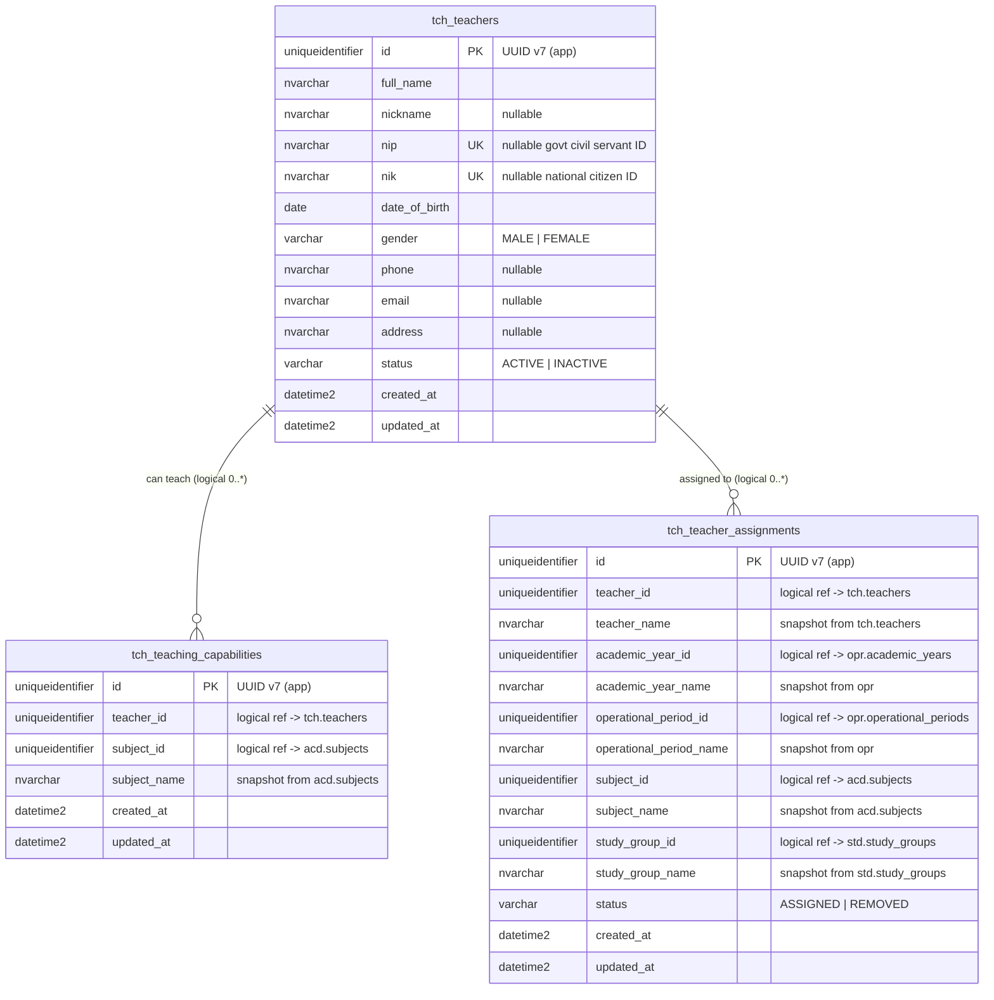

# Teaching Domain (Basic) — Database Table Design

> **Source Domain Specification:** [teaching-domain-basic.md](file:///d:/Project.Private/elsasa-sis-v4/docs/domains/teaching-domain-basic.md)
> **Target RDBMS:** Microsoft SQL Server (2019+ / Azure SQL Database, T-SQL)
> **Architecture Alignment:** Clean Architecture evolved to Vertical Slices — **Database as Pure Persistence Layer**
> **Scope:** Basic level only (Teacher Profile, Teacher Assignment, and Teaching Capability). Intermediate/Enterprise features such as teacher attendance tracking, professional development, certifications, performance evaluation, payroll integration, and workload analysis are intentionally excluded.

---

## 1. Overview & Design Principles

### 1.1 Module Schema Convention

Each domain module owns an isolated SQL Server schema inside the database:

| Module / Bounded Context | Schema Name |
|---|---|
| **Operational** | `opr` |
| **Student** | `std` |
| **Academic** | `acd` |
| **Finance** | `fin` |
| **Teaching** *(this document)* | `tch` |
| **Development** | `dev` |

All Teaching Domain tables live under the `tch` schema (`tch.*`).

### 1.2 Aggregate-to-Table Mapping

Every aggregate, owned entity, and reference object in [teaching-domain-basic.md](file:///d:/Project.Private/elsasa-sis-v4/docs/domains/teaching-domain-basic.md) maps to a normalized plural relational table in `tch` (3 tables across 2 aggregates):

| Aggregate Root | Domain Objects | Table(s) | Mapping Rationale |
|---|---|---|---|
| **Teacher** | Teacher Profile, Teaching Capability | `tch.teachers`, `tch.teaching_capabilities` | `tch.teachers` holds the authoritative teacher identity (full name, NIP/NIK), personal details (nickname, date of birth, gender, address), contact information, and lifecycle status (Active/Inactive); `tch.teaching_capabilities` holds 0..N subject capability records owned by the Teacher aggregate, each linking one teacher to one subject (`BR-TCH-006`). |
| **Teacher Assignment** | Teacher Assignment | `tch.teacher_assignments` | Independent aggregate recording that a specific teacher teaches a specific subject in a specific study group for a specific academic period. Each assignment is created and removed independently (`BR-TCH-004`). |

### 1.3 Pure Persistence Layer Principles

1. **Zero Business Logic in the Database:**
   - No triggers, no stored procedures, no `CHECK` constraints, and no column `DEFAULT` constraints exist in the database.
   - All domain invariants, active-teacher checks before assignment (`BR-TCH-003`), capability-before-assignment enforcement (`BR-TCH-005`), gender validation (`BR-TCH-008`), contact minimum checks (`BR-TCH-002`), status transitions (Active ↔ Inactive), and assignment lifecycle management (`BR-TCH-007`) are enforced in the **Application Layer** (Domain Entities / Vertical Slice command handlers).
2. **Application-Generated Primary Keys (UUID v7):**
   - Every table's `id` column is `UNIQUEIDENTIFIER NOT NULL` with `PRIMARY KEY CLUSTERED (id)` and no database-side generation.
   - The Application Layer generates **UUID v7** identifiers prior to persistence. Time-ordered UUID v7 values minimize clustered index fragmentation while keeping identity creation independent of database round-trips.
3. **Application-Supplied Audit & Lifecycle Columns:**
   - Every table includes `created_at DATETIME2(3) NOT NULL` and `updated_at DATETIME2(3) NOT NULL` (UTC) populated explicitly by the Application Layer on insert and update.
   - Initial lifecycle statuses (`'ACTIVE'` on `tch.teachers`) and assignment states (`'ASSIGNED'` on `tch.teacher_assignments`) are supplied by the Application Layer.
4. **No Database Foreign Keys:**
   - Both intra-module references (`teacher_id`) and cross-module references (`subject_id` -> `acd.subjects`, `study_group_id` -> `std.study_groups`, `academic_year_id` / `operational_period_id` -> `opr`) are stored as plain `UNIQUEIDENTIFIER` columns.
   - Referential integrity and aggregate rules are managed explicitly in the Application Layer.
5. **Cross-Domain & Read-Model Snapshot Denormalization:**
   - Because cross-schema database joins are avoided in Vertical Slices, tables referencing entities from `opr`, `std`, or `acd` store a **snapshot of the display name** alongside the ID:
     - `tch.teaching_capabilities`: `subject_name` (snapshot from `acd.subjects`)
     - `tch.teacher_assignments`: `academic_year_name`, `operational_period_name`, `subject_name`, `study_group_name`, `teacher_name`
   - Read queries in Teaching Vertical Slices render assignment rosters, teacher schedules, and capability lists without cross-schema joins.
6. **Uniqueness Rules Enforced in the Database:**
   - Only pure uniqueness guarantees are declared as database `UNIQUE` constraints / unique indexes:
     - `UQ_teachers_nip` as a filtered unique index `ON tch.teachers (nip) WHERE nip IS NOT NULL` (guarantees NIP uniqueness when provided while allowing multiple teachers without NIP)
     - `UQ_teachers_nik` as a filtered unique index `ON tch.teachers (nik) WHERE nik IS NOT NULL` (guarantees NIK uniqueness when provided while allowing multiple teachers without NIK)
     - `UQ_teaching_capabilities_teacher_subject` on `tch.teaching_capabilities (teacher_id, subject_id)` (`BR-TCH-006`)
     - `UQ_teacher_assignments_teacher_subject_group_period` on `tch.teacher_assignments (teacher_id, subject_id, study_group_id, operational_period_id)` (`BR-TCH-004`)
7. **Performance-Only Indexing:**
   - Non-unique indexes exist strictly to accelerate read queries in Vertical Slice query handlers (teacher directory, assignment rosters by study group or period, and capability lookups).
8. **Standard SQL Server Data Types:**
   - **Identifiers:** `UNIQUEIDENTIFIER` (UUID v7)
   - **Unicode Text:** `NVARCHAR(n)` for person names, NIP/NIK, phone numbers, emails, addresses, and snapshot strings
   - **Enum / Status Values:** `VARCHAR(10)` / `VARCHAR(20)` storing readable codes (`'MALE'`, `'FEMALE'`, `'ACTIVE'`, `'INACTIVE'`, `'ASSIGNED'`, `'REMOVED'`), validated in the Application Layer
   - **Temporal:** `DATE`, `DATETIME2(3)`

---

## 2. Entity-Relationship Diagram (Logical)

> Relationships below represent **logical domain associations** enforced by the Application Layer (no physical database foreign key constraints).



---

## 3. Table Definitions

### 3.1 `tch.teachers`

Persists the **Teacher** aggregate root — the authoritative record of each teacher's identity, personal details, contact information, and lifecycle status at the school.

| Column | SQL Server Data Type | Nullable | DB Constraint / Key | Application Layer Responsibility |
|---|---|---|---|---|
| `id` | `UNIQUEIDENTIFIER` | `NO` | `PK_teachers` | Generate UUID v7 |
| `full_name` | `NVARCHAR(150)` | `NO` | — | Validate non-empty full name (`BR-TCH-001`) |
| `nickname` | `NVARCHAR(50)` | `YES` | — | Optional preferred name |
| `nip` | `NVARCHAR(30)` | `YES` | `UQ_teachers_nip` *(filtered)* | Optional government civil servant ID (Nomor Induk Pegawai); normalize empty string to `NULL` |
| `nik` | `NVARCHAR(30)` | `YES` | `UQ_teachers_nik` *(filtered)* | Optional national citizen ID (Nomor Induk Kependudukan); normalize empty string to `NULL` |
| `date_of_birth` | `DATE` | `NO` | — | Teacher birth date (`BR-TCH-001`) |
| `gender` | `VARCHAR(10)` | `NO` | — | Validate `'MALE'` or `'FEMALE'` (`BR-TCH-008`) |
| `phone` | `NVARCHAR(30)` | `YES` | — | Optional phone number; at least one of `phone` or `email` must be provided (`BR-TCH-002`) |
| `email` | `NVARCHAR(150)` | `YES` | — | Optional email address; at least one of `phone` or `email` must be provided (`BR-TCH-002`) |
| `address` | `NVARCHAR(500)` | `YES` | — | Optional residential address |
| `status` | `VARCHAR(20)` | `NO` | — | Set initial `'ACTIVE'`; enforce `'ACTIVE' <-> 'INACTIVE'` transitions |
| `created_at` | `DATETIME2(3)` | `NO` | — | Populate UTC timestamp on create |
| `updated_at` | `DATETIME2(3)` | `NO` | — | Populate UTC timestamp on create & update |

**Constraints & Indexes:**
- `PK_teachers`: `PRIMARY KEY CLUSTERED (id)`
- `UQ_teachers_nip`: `UNIQUE NONCLUSTERED INDEX (nip) WHERE nip IS NOT NULL`
- `UQ_teachers_nik`: `UNIQUE NONCLUSTERED INDEX (nik) WHERE nik IS NOT NULL`
- `IX_teachers_status_name`: `NONCLUSTERED INDEX (status, full_name)` (teacher directory listing and search)

**Contact Minimum Rule (`BR-TCH-002`):**
- The `Teacher` aggregate / command handlers ensure every teacher has at least one of `phone` or `email` populated, and block updates that would remove the last remaining contact method.

---

### 3.2 `tch.teaching_capabilities`

Persists **Teaching Capability** records owned by the **Teacher** aggregate — recording which subjects a teacher is qualified or able to teach, independent of any study group or academic period.

| Column | SQL Server Data Type | Nullable | DB Constraint / Key | Application Layer Responsibility |
|---|---|---|---|---|
| `id` | `UNIQUEIDENTIFIER` | `NO` | `PK_teaching_capabilities` | Generate UUID v7 |
| `teacher_id` | `UNIQUEIDENTIFIER` | `NO` | `UQ_teaching_capabilities_teacher_subject` | Logical reference to `tch.teachers(id)` |
| `subject_id` | `UNIQUEIDENTIFIER` | `NO` | `UQ_teaching_capabilities_teacher_subject` | Logical reference to `acd.subjects(id)` |
| `subject_name` | `NVARCHAR(100)` | `NO` | — | Snapshot of subject name from `acd.subjects` |
| `created_at` | `DATETIME2(3)` | `NO` | — | Populate UTC timestamp on create |
| `updated_at` | `DATETIME2(3)` | `NO` | — | Populate UTC timestamp on create & update |

**Constraints & Indexes:**
- `PK_teaching_capabilities`: `PRIMARY KEY CLUSTERED (id)`
- `UQ_teaching_capabilities_teacher_subject`: `UNIQUE (teacher_id, subject_id)` (`BR-TCH-006` — no duplicate teacher–subject capability)
- `IX_teaching_capabilities_teacher`: `NONCLUSTERED INDEX (teacher_id)` (retrieving all capabilities for a teacher)

---

### 3.3 `tch.teacher_assignments`

Persists the **Teacher Assignment** aggregate root — recording that a specific teacher teaches a specific subject in a specific study group for a specific academic period (semester).

| Column | SQL Server Data Type | Nullable | DB Constraint / Key | Application Layer Responsibility |
|---|---|---|---|---|
| `id` | `UNIQUEIDENTIFIER` | `NO` | `PK_teacher_assignments` | Generate UUID v7 |
| `teacher_id` | `UNIQUEIDENTIFIER` | `NO` | `UQ_teacher_assignments_teacher_subject_group_period` | Logical reference to `tch.teachers(id)`; validate teacher is `'ACTIVE'` (`BR-TCH-003`) |
| `teacher_name` | `NVARCHAR(150)` | `NO` | — | Snapshot of teacher full name from `tch.teachers` |
| `academic_year_id` | `UNIQUEIDENTIFIER` | `NO` | — | Logical reference to `opr.academic_years(id)` |
| `academic_year_name` | `NVARCHAR(50)` | `NO` | — | Snapshot of Academic Year name from `opr.academic_years` |
| `operational_period_id` | `UNIQUEIDENTIFIER` | `NO` | `UQ_teacher_assignments_teacher_subject_group_period` | Logical reference to `opr.operational_periods(id)` (Semester) |
| `operational_period_name` | `NVARCHAR(50)` | `NO` | — | Snapshot of Operational Period name from `opr.operational_periods` |
| `subject_id` | `UNIQUEIDENTIFIER` | `NO` | `UQ_teacher_assignments_teacher_subject_group_period` | Logical reference to `acd.subjects(id)`; validate teacher has matching Teaching Capability (`BR-TCH-005`) |
| `subject_name` | `NVARCHAR(100)` | `NO` | — | Snapshot of subject name from `acd.subjects` |
| `study_group_id` | `UNIQUEIDENTIFIER` | `NO` | `UQ_teacher_assignments_teacher_subject_group_period` | Logical reference to `std.study_groups(id)` |
| `study_group_name` | `NVARCHAR(50)` | `NO` | — | Snapshot of study group name from `std.study_groups` |
| `status` | `VARCHAR(20)` | `NO` | — | Set initial `'ASSIGNED'`; enforce `'ASSIGNED' -> 'REMOVED'` transition |
| `created_at` | `DATETIME2(3)` | `NO` | — | Populate UTC timestamp on create |
| `updated_at` | `DATETIME2(3)` | `NO` | — | Populate UTC timestamp on create & update |

**Constraints & Indexes:**
- `PK_teacher_assignments`: `PRIMARY KEY CLUSTERED (id)`
- `UQ_teacher_assignments_teacher_subject_group_period`: `UNIQUE (teacher_id, subject_id, study_group_id, operational_period_id)` (`BR-TCH-004` — no duplicate teacher–subject–study-group–period combination)
- `IX_teacher_assignments_period_group`: `NONCLUSTERED INDEX (operational_period_id, study_group_id, status)` (study group assignment roster per semester)
- `IX_teacher_assignments_period_teacher`: `NONCLUSTERED INDEX (operational_period_id, teacher_id, status)` (teacher's schedule / workload per semester)
- `IX_teacher_assignments_subject_period`: `NONCLUSTERED INDEX (subject_id, operational_period_id, status)` (which teachers teach a subject in a given semester)

---

## 4. Business Rules Traceability Matrix

Every business rule in Section 7 of [teaching-domain-basic.md](file:///d:/Project.Private/elsasa-sis-v4/docs/domains/teaching-domain-basic.md) plus snapshot/reference rules is mapped below — **only uniqueness rules are enforced in the database**, while all other business rules live in the **Application Layer** (Domain Entities / Vertical Slice Handlers):

| Rule ID | Business Rule | Enforcement Layer | Exact Implementation |
|---|---|---|---|
| **BR-TCH-001** | A Teacher Profile must have a full name and a date of birth. | **Application Layer** (+ `NOT NULL`) | `full_name` and `date_of_birth` are `NOT NULL` in DB; `Teacher` entity validates non-whitespace `full_name` and valid `date_of_birth`. |
| **BR-TCH-002** | A Teacher Profile must have at least one contact method: phone or email. | **Application Layer** | `RegisterTeacher` and `UpdateTeacher` command handlers validate that at least one of `phone` or `email` is non-null and non-blank. Both columns are individually nullable in the database. |
| **BR-TCH-003** | Only an active teacher may be assigned to a subject and study group. | **Application Layer** | `AssignTeacher` handler checks `teacher.Status == 'ACTIVE'` before creating `tch.teacher_assignments`. |
| **BR-TCH-004** | A teacher may not be assigned to the same subject in the same study group for the same academic period more than once. | **Database (`UNIQUE`)** + App Layer | `UQ_teacher_assignments_teacher_subject_group_period`: `UNIQUE (teacher_id, subject_id, study_group_id, operational_period_id)` on `tch.teacher_assignments`. |
| **BR-TCH-005** | A teacher may only be assigned to subjects for which the teacher has a recorded Teaching Capability. | **Application Layer** | `AssignTeacher` handler verifies existence of a matching `tch.teaching_capabilities` row for `(teacher_id, subject_id)` before creating the assignment. |
| **BR-TCH-006** | A Teaching Capability entry must not be duplicated — a teacher may not have the same subject listed more than once. | **Database (`UNIQUE`)** + App Layer | `UQ_teaching_capabilities_teacher_subject`: `UNIQUE (teacher_id, subject_id)` on `tch.teaching_capabilities`. |
| **BR-TCH-007** | Deactivating a teacher does not automatically remove existing assignments; assignments for the current or future academic periods must be explicitly reassigned or removed. | **Application Layer** | `DeactivateTeacher` handler sets `status = 'INACTIVE'` on `tch.teachers` without modifying any `tch.teacher_assignments` rows; application-level workflow or UI alerts prompt the administrator to review and handle outstanding assignments. |
| **BR-TCH-008** | A Teacher Profile must have a gender (male or female). | **Application Layer** (+ `NOT NULL`) | `gender` is `NOT NULL` in DB; `Teacher` entity validates value in `{'MALE', 'FEMALE'}`. |
| **EXT-TCH-001** | NIP (Nomor Induk Pegawai), if provided, must be unique across all teachers. | **Database (`UNIQUE` Filtered Index)** + App Layer | `UQ_teachers_nip`: `UNIQUE NONCLUSTERED INDEX (nip) WHERE nip IS NOT NULL`; application normalizes blank strings to `NULL`. |
| **EXT-TCH-002** | NIK (Nomor Induk Kependudukan), if provided, must be unique across all teachers. | **Database (`UNIQUE` Filtered Index)** + App Layer | `UQ_teachers_nik`: `UNIQUE NONCLUSTERED INDEX (nik) WHERE nik IS NOT NULL`; application normalizes blank strings to `NULL`. |
| **EXT-TCH-003** | Cross-domain snapshot columns (`subject_name`, `academic_year_name`, `operational_period_name`, `study_group_name`) stay synchronized with their source entities. | **Application Layer** | Integration/domain event handlers update snapshot names in `tch.*` when a Subject is renamed (`acd`), an Academic Year or Operational Period is renamed (`opr`), or a Study Group is renamed (`std`). |
| **EXT-TCH-004** | Intra-domain snapshot column (`teacher_name` on `tch.teacher_assignments`) stays synchronized with the source Teacher Profile. | **Application Layer** | `UpdateTeacher` handler (or domain event handler) propagates `full_name` changes to `teacher_name` on `tch.teacher_assignments` for non-removed assignments. |

---

## 5. Complete SQL DDL Reference (Microsoft SQL Server / T-SQL)

```sql
-- ============================================================================
-- Teaching Domain (Basic) — Pure Persistence Layer DDL (Microsoft SQL Server)
-- Target: Microsoft SQL Server 2019+ / Azure SQL Database (T-SQL)
-- Schema: tch
-- Source: docs/domains/teaching-domain-basic.md
-- Notes:
--   - IDs are application-generated UUID v7 values
--   - Timestamps, statuses, and snapshot names are supplied by the application
--   - Only PRIMARY KEY and UNIQUE constraints/indexes are enforced in the DB
--   - All other indexes exist strictly for query performance
-- ============================================================================

IF NOT EXISTS (SELECT 1 FROM sys.schemas WHERE name = N'tch')
BEGIN
    EXEC(N'CREATE SCHEMA tch');
END;
GO

-- ----------------------------------------------------------------------------
-- 1. Teachers
-- ----------------------------------------------------------------------------
CREATE TABLE tch.teachers (
    id             UNIQUEIDENTIFIER NOT NULL,
    full_name      NVARCHAR(150)    NOT NULL,
    nickname       NVARCHAR(50)     NULL,
    nip            NVARCHAR(30)     NULL,
    nik            NVARCHAR(30)     NULL,
    date_of_birth  DATE             NOT NULL,
    gender         VARCHAR(10)      NOT NULL,
    phone          NVARCHAR(30)     NULL,
    email          NVARCHAR(150)    NULL,
    address        NVARCHAR(500)    NULL,
    status         VARCHAR(20)      NOT NULL,
    created_at     DATETIME2(3)     NOT NULL,
    updated_at     DATETIME2(3)     NOT NULL,

    CONSTRAINT PK_teachers PRIMARY KEY CLUSTERED (id)
);

-- EXT-TCH-001: Unique NIP across all teachers when provided
CREATE UNIQUE NONCLUSTERED INDEX UQ_teachers_nip
    ON tch.teachers (nip)
    WHERE nip IS NOT NULL;

-- EXT-TCH-002: Unique NIK across all teachers when provided
CREATE UNIQUE NONCLUSTERED INDEX UQ_teachers_nik
    ON tch.teachers (nik)
    WHERE nik IS NOT NULL;

CREATE NONCLUSTERED INDEX IX_teachers_status_name
    ON tch.teachers (status, full_name);
GO

-- ----------------------------------------------------------------------------
-- 2. Teaching Capabilities
-- ----------------------------------------------------------------------------
CREATE TABLE tch.teaching_capabilities (
    id            UNIQUEIDENTIFIER NOT NULL,
    teacher_id    UNIQUEIDENTIFIER NOT NULL,
    subject_id    UNIQUEIDENTIFIER NOT NULL,
    subject_name  NVARCHAR(100)    NOT NULL,
    created_at    DATETIME2(3)     NOT NULL,
    updated_at    DATETIME2(3)     NOT NULL,

    CONSTRAINT PK_teaching_capabilities PRIMARY KEY CLUSTERED (id),
    -- BR-TCH-006: No duplicate teacher-subject capability
    CONSTRAINT UQ_teaching_capabilities_teacher_subject UNIQUE (teacher_id, subject_id)
);

CREATE NONCLUSTERED INDEX IX_teaching_capabilities_teacher
    ON tch.teaching_capabilities (teacher_id);
GO

-- ----------------------------------------------------------------------------
-- 3. Teacher Assignments
-- ----------------------------------------------------------------------------
CREATE TABLE tch.teacher_assignments (
    id                       UNIQUEIDENTIFIER NOT NULL,
    teacher_id               UNIQUEIDENTIFIER NOT NULL,
    teacher_name             NVARCHAR(150)    NOT NULL,
    academic_year_id         UNIQUEIDENTIFIER NOT NULL,
    academic_year_name       NVARCHAR(50)     NOT NULL,
    operational_period_id    UNIQUEIDENTIFIER NOT NULL,
    operational_period_name  NVARCHAR(50)     NOT NULL,
    subject_id               UNIQUEIDENTIFIER NOT NULL,
    subject_name             NVARCHAR(100)    NOT NULL,
    study_group_id           UNIQUEIDENTIFIER NOT NULL,
    study_group_name         NVARCHAR(50)     NOT NULL,
    status                   VARCHAR(20)      NOT NULL,
    created_at               DATETIME2(3)     NOT NULL,
    updated_at               DATETIME2(3)     NOT NULL,

    CONSTRAINT PK_teacher_assignments PRIMARY KEY CLUSTERED (id),
    -- BR-TCH-004: No duplicate teacher-subject-study_group-period combination
    CONSTRAINT UQ_teacher_assignments_teacher_subject_group_period
        UNIQUE (teacher_id, subject_id, study_group_id, operational_period_id)
);

CREATE NONCLUSTERED INDEX IX_teacher_assignments_period_group
    ON tch.teacher_assignments (operational_period_id, study_group_id, status);

CREATE NONCLUSTERED INDEX IX_teacher_assignments_period_teacher
    ON tch.teacher_assignments (operational_period_id, teacher_id, status);

CREATE NONCLUSTERED INDEX IX_teacher_assignments_subject_period
    ON tch.teacher_assignments (subject_id, operational_period_id, status);
GO
```

---

## 6. Common Query Patterns (Vertical Slice Persistence Queries)

### 6.1 List Active Teachers (Teacher Directory)

```sql
SELECT
    t.id,
    t.full_name,
    t.nickname,
    t.nip,
    t.nik,
    t.date_of_birth,
    t.gender,
    t.phone,
    t.email,
    t.address,
    t.status
FROM tch.teachers t
WHERE t.status = 'ACTIVE'
ORDER BY t.full_name;
```

### 6.2 Get Teacher Profile with Capabilities

```sql
-- Teacher core profile
SELECT
    t.id,
    t.full_name,
    t.nickname,
    t.nip,
    t.nik,
    t.date_of_birth,
    t.gender,
    t.phone,
    t.email,
    t.address,
    t.status
FROM tch.teachers t
WHERE t.id = @teacher_id;

-- Capabilities for the teacher
SELECT
    tc.id,
    tc.subject_id,
    tc.subject_name
FROM tch.teaching_capabilities tc
WHERE tc.teacher_id = @teacher_id
ORDER BY tc.subject_name;
```

### 6.3 List Assignments for a Study Group in an Academic Period

```sql
SELECT
    ta.id,
    ta.teacher_id,
    ta.teacher_name,
    ta.subject_id,
    ta.subject_name,
    ta.study_group_id,
    ta.study_group_name,
    ta.status
FROM tch.teacher_assignments ta
WHERE ta.operational_period_id = @operational_period_id
  AND ta.study_group_id = @study_group_id
  AND ta.status = 'ASSIGNED'
ORDER BY ta.subject_name, ta.teacher_name;
```

### 6.4 List Assignments for a Teacher in an Academic Period (Teacher Schedule)

```sql
SELECT
    ta.id,
    ta.subject_id,
    ta.subject_name,
    ta.study_group_id,
    ta.study_group_name,
    ta.academic_year_name,
    ta.operational_period_name,
    ta.status
FROM tch.teacher_assignments ta
WHERE ta.operational_period_id = @operational_period_id
  AND ta.teacher_id = @teacher_id
  AND ta.status = 'ASSIGNED'
ORDER BY ta.subject_name, ta.study_group_name;
```

### 6.5 Assign a Teacher (`AssignTeacher` Slice)

*(Executed after the Application Layer validates `BR-TCH-003` (teacher is ACTIVE), `BR-TCH-005` (capability exists), and `BR-TCH-004` (no duplicate); `@id` is an application-generated UUID v7 and `@now` is supplied by the application.)*

```sql
INSERT INTO tch.teacher_assignments (
    id, teacher_id, teacher_name,
    academic_year_id, academic_year_name,
    operational_period_id, operational_period_name,
    subject_id, subject_name,
    study_group_id, study_group_name,
    status, created_at, updated_at
)
VALUES (
    @id, @teacher_id, @teacher_name,
    @academic_year_id, @academic_year_name,
    @operational_period_id, @operational_period_name,
    @subject_id, @subject_name,
    @study_group_id, @study_group_name,
    'ASSIGNED', @now, @now
);
```

### 6.6 Remove a Teacher Assignment (`RemoveAssignment` Slice)

```sql
UPDATE tch.teacher_assignments
   SET status     = 'REMOVED',
       updated_at = @now
 WHERE id = @assignment_id;
```

### 6.7 Find Teachers Capable of Teaching a Subject

```sql
SELECT
    t.id,
    t.full_name,
    t.nip,
    t.nik,
    t.phone,
    t.email,
    t.gender,
    t.status
FROM tch.teaching_capabilities tc
INNER JOIN tch.teachers t
    ON t.id = tc.teacher_id
WHERE tc.subject_id = @subject_id
  AND t.status = 'ACTIVE'
ORDER BY t.full_name;
```
