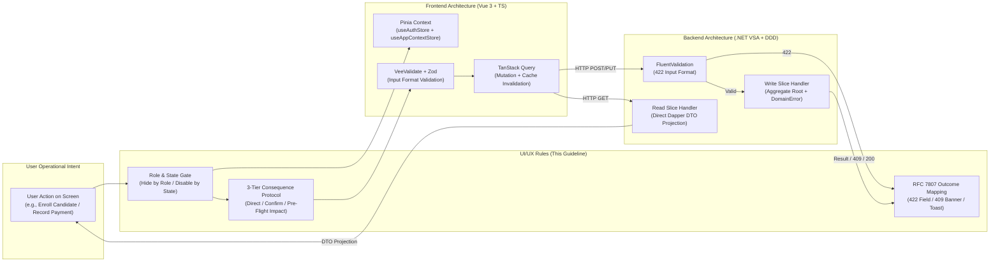
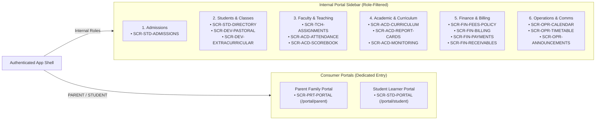
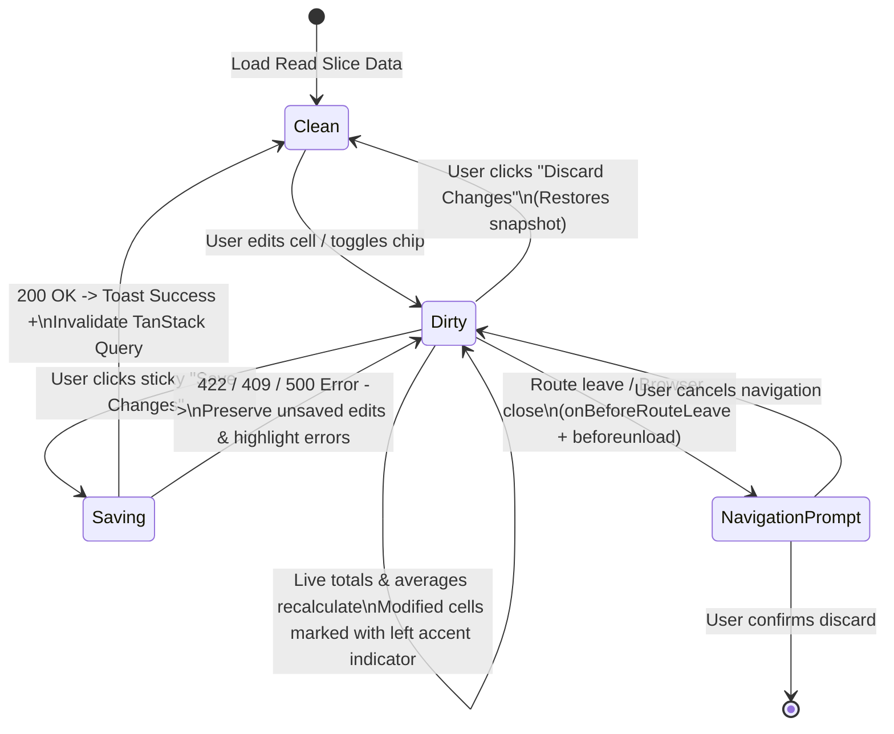
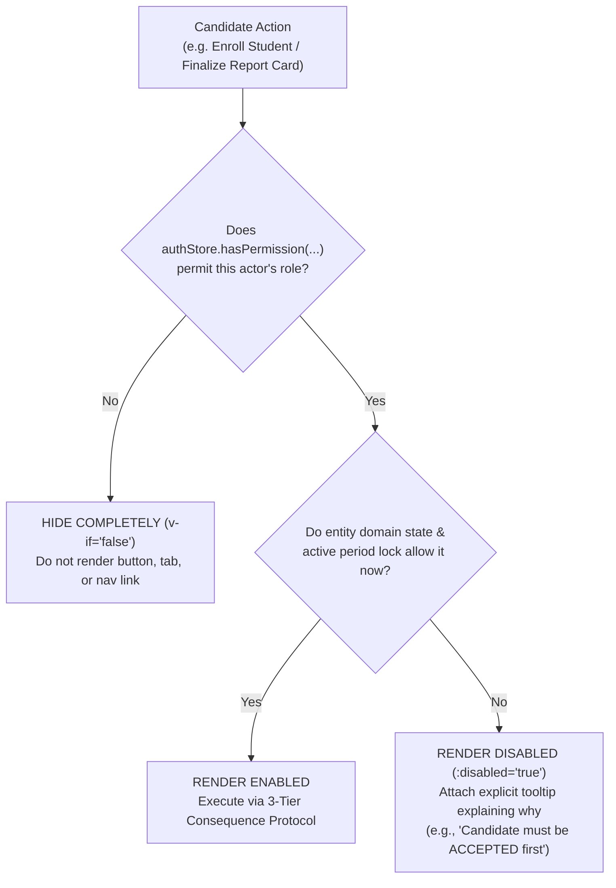
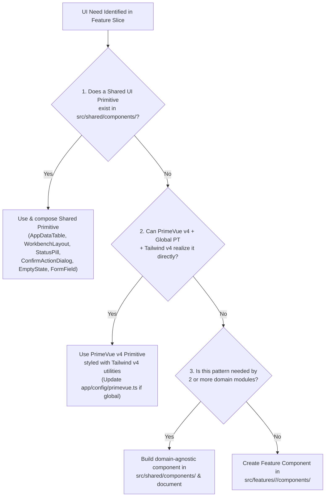

# Elsasa SIS — UI/UX Design Guideline

**Document Version:** 1.0  
**Status:** Authoritative Application Standard  
**Scope:** All 19 Screens across 6 Bounded Contexts (`opr`, `std`, `tch`, `acd`, `fin`, `dev`) & 2 Consumer Portals  
**Target Stack:** Vue 3 (`^3.5.0`), TypeScript (`^5.6.0`), Tailwind CSS v4 (`^4.0.0`), PrimeVue v4 (`^4.2.0` Aura + PassThrough), TanStack Query v5, Pinia v2, VeeValidate v4 + Zod  
**Aligned Architecture References:**
- [`docs/architecture/backend-architecture.md`](backend-architecture.md) — Modular Monolith, Vertical Slice Architecture (VSA), DDD Aggregate Roots, Mandatory CQRS (`Write` vs `Read` Slices), RFC 7807 `ProblemDetails`
- [`docs/architecture/frontend-architecture.md`](frontend-architecture.md) — Feature-Oriented Modular Frontend, State Ownership, Schema-First Validation, Shared Primitives, `AppErrorBoundary`
- [`docs/screen-inventory.md`](../screen-inventory.md) — 19 Operational Screens across 5 Screen Patterns covering 68 Use Cases
- [`docs/actors-roles-specification-basic.md`](../actors-roles-specification-basic.md) — 5 Core Internal Actors + 2 Read-Only Consumer Actors

---

## 1. Design Philosophy

### 1.1 Purpose & Authority

This document is the **authoritative behavioral, structural, and interaction rulebook** for the entire **Elsasa SIS** frontend application. It does not define low-level visual design tokens (which live in `src/shared/styles/main.css` and `src/app/config/primevue.ts`); instead, it establishes **system-wide rules** that govern how domain workflows are translated into user interfaces across all 19 operational screens and any future extensions.

Every screen specification, Vue component, modal, drawer, and automated UI test must conform to this guideline. Where an individual screen design conflicts with convenience or developer preference, **the 8 Core Principles and these rules take precedence**.

### 1.2 The 8 Core Authoritative Principles

#### Principle 1 — Operational First
> **Mandate:** Optimize interfaces for completing real-world school business activities with minimal friction, not merely for displaying database entities or CRUD tables.

- **Architectural Alignment:** Mirrors Backend Write vs. Read Slices (`backend-architecture.md`) and Activity-Centered Screens (`screen-inventory.md`). Screens consolidate all queries and commands needed to complete an operational mission in one place.
- **Concrete Rule:** Never build generic single-table admin grids (e.g., separate screens for Receipts, Allocations, and Invoices). For example, `SCR-FIN-PAYMENTS` unifies student lookup (`UC-FIN-10`), open charge inspection (`UC-FIN-08`), receipt recording (`UC-FIN-05`), fund/deposit allocation (`UC-FIN-06`), and official receipt printing (`UC-FIN-07`) in a single cashier workbench.
- **Prohibited Anti-Pattern:** Multi-screen navigation chains where an operator must open one page to copy a student's NIS, navigate to a second page to check open bills, and navigate to a third page to enter a payment.

#### Principle 2 — Information Clarity
> **Mandate:** Users must immediately know the current state of the system, the active temporal/role context, and which actions are available or blocked—without guessing.

- **Architectural Alignment:** Mirrors DDD Value Objects (`OrderStatus`-style state transitions) and Pinia `useAppContextStore` (`activeAcademicYearId`, `activePeriodId`).
- **Concrete Rule:** Every stateful entity displays a standardized `StatusPill`, every screen displays the active Academic Year and Semester in the global shell, and every state-blocked action remains visible in a `:disabled` state with an explicit tooltip explaining the unmet precondition (e.g., *"Candidate must be Accepted before Enrollment"*).
- **Prohibited Anti-Pattern:** Unexplained disabled buttons, ambiguous status labels (e.g., raw enums like `PARTIALLY_PAID` without formatting), or silent hidden contexts where staff accidentally enter data into the wrong academic year.

#### Principle 3 — Workflow Cohesion
> **Mandate:** Related operational steps that belong to the same mental workflow must be accessible within the same workspace without full-page navigation or context loss.

- **Architectural Alignment:** Maps to `WorkbenchLayout.vue` (Work Queue pattern) and right-anchored Slide-Over Drawers (`PrimeVue Drawer`).
- **Concrete Rule:** Selecting a student, candidate, or study group in a left worklist updates the right workbench pane in-place while preserving scroll position and active filters. Secondary sub-workflows (e.g., entering subject report card notes inside `SCR-ACD-SCOREBOOK`, configuring Study Groups inside `SCR-STD-DIRECTORY`, issuing ad-hoc charges inside `SCR-FIN-BILLING`) open in contextual drawers rather than forcing route changes.
- **Prohibited Anti-Pattern:** Navigating away to `/edit/:id` full-page forms that destroy the user's filtered work queue and force them to re-filter upon returning.

#### Principle 4 — Consistent Interaction
> **Mandate:** Similar operations must look, behave, confirm, and fail identically across all six bounded contexts (`opr`, `std`, `tch`, `acd`, `fin`, `dev`).

- **Architectural Alignment:** Enforced via `src/shared/components/` (`AppDataTable`, `WorkbenchLayout`, `StatusPill`, `ConfirmActionDialog`, `EmptyState`, `FormField`) and the 5 standardized Screen Patterns.
- **Concrete Rule:** An operator trained on `SCR-STD-ADMISSIONS` (Work Queue) must immediately understand `SCR-ACD-REPORT-CARDS` and `SCR-FIN-PAYMENTS` because worklists, status colors, filter reset controls, primary action placement, and confirmation dialogs follow identical spatial and behavioral rules.
- **Prohibited Anti-Pattern:** Per-module divergence (e.g., Finance using inline row delete icons without confirmation while Academic uses modal confirms, or one domain putting "Save" on the top-left and another on the bottom-right).

#### Principle 5 — Controlled Complexity
> **Mandate:** Expose essential decision-driving information on the primary canvas first; reveal secondary details, audit trails, and edge-case controls progressively on demand.

- **Architectural Alignment:** Separates thin primary Read projections from secondary detail queries fetched lazily by TanStack Query when a drawer or tab opens.
- **Concrete Rule:** Limit primary worklist items to 3–4 scannable data points (Primary Identifier, Name, Current Status, Urgency/Timestamp). Keep audit histories, guardian phone details, SMK block rotation schedules, and advanced batch overrides tucked inside tabs, expandable rows, or slide-over drawers.
- **Prohibited Anti-Pattern:** "Mega-forms" or overcrowded tables displaying 18 columns simultaneously with raw database foreign keys and unrequested metadata.

#### Principle 6 — Explicit Feedback
> **Mandate:** Every significant user action must communicate its pending execution, authoritative server outcome (`Result<T>`), and downstream cache/state effect.

- **Architectural Alignment:** Directly mirrors Backend `Result<T>`, `DomainError`, and RFC 7807 `ProblemDetails` (`422`, `409`, `404`, `401`, `403`, `500`) integrated with TanStack Query mutations (`isPending`, deterministic `invalidateQueries`) and PrimeVue `Toast`.
- **Concrete Rule:** Mutations show inline loading indicators and disable re-submission; successes emit specific toasts naming the affected entity and update counts/lists immediately; `422` errors highlight individual fields; `409` domain conflicts display persistent inline alert banners explaining the violated rule.
- **Prohibited Anti-Pattern:** Silent background saves without feedback, swallowing API errors into console logs, or showing vague *"Error 400: Bad Request"* messages.

#### Principle 7 — Role Awareness
> **Mandate:** Interfaces must strictly enforce actor responsibilities, data scopes, and segregation of duties across all 7 roles without exposing unauthorized navigation or controls.

- **Architectural Alignment:** Aligned with `actors-roles-specification-basic.md` and `frontend-architecture.md` Section 12 (`useAuthStore.hasPermission`, route guards, and backend authoritative enforcement).
- **Concrete Rule:** Apply **"Hide by Role, Disable by State"** (see Section 8.4). Navigation items and action triggers for unauthorized roles are omitted via `v-if`. Composable multi-role users (`TEACHER` + `HOMEROOM_TEACHER`) see additive capabilities seamlessly in shared workspaces (`SCR-ACD-REPORT-CARDS`, `SCR-DEV-PASTORAL`) without switching accounts. Financial commands remain strictly isolated to `FINANCE_OFFICER`.
- **Prohibited Anti-Pattern:** Showing `FINANCE_OFFICER` payment buttons to a `SCHOOL_ADMIN` with a 403 crash on click, or building separate duplicate screens per role for the same report card workflow.

#### Principle 8 — Data Integrity
> **Mandate:** Prevent ambiguous, accidental, or domain-invalid operations at the UI layer before and during Backend Write Slice execution.

- **Architectural Alignment:** Pairs client-side Zod schemas + VeeValidate dirty tracking + pre-flight confirmation modals with Backend Aggregate Root invariant protection (`Domain/` layer).
- **Concrete Rule:** High-velocity sheets (`SCR-ACD-ATTENDANCE`, `SCR-ACD-SCOREBOOK`, `SCR-FIN-PAYMENTS`) require explicit batch commit with dirty-state route guards (`onBeforeRouteLeave`); irreversible locks (`FINALIZED` report cards, bulk billing generation, academic year activation) require a Tier 3 Pre-Flight Impact Summary Modal; historical academic periods lock write actions automatically.
- **Prohibited Anti-Pattern:** Auto-deleting records on single click, silent auto-save mutations on partial financial allocations, or allowing destructive/irreversible state locks without summarizing affected record counts.

---

### 1.3 Architectural Alignment Matrix

The UI/UX layer acts as the **explicit behavioral bridge** between the user's operational goal, the Frontend Modular Slices, and the Backend CQRS/DDD Bounded Contexts:



| Architectural Layer | Source Reference | Authoritative UI/UX Binding Rule |
|---|---|---|
| **Backend Write Slice** (`Command`) | `backend-architecture.md` §6.1 | Every state-changing UI action maps 1:1 to a deliberate Write Slice trigger with explicit pending lock (`isPending`), dirty-state protection, and deterministic query invalidation on `200`/`201`. |
| **Backend Read Slice** (`Query`) | `backend-architecture.md` §6.2 | Worklists, monitoring drill-downs, and 360-degree dossiers consume purpose-built Read DTOs via TanStack Query; UI never expects or reconstructs internal Aggregate Root write models. |
| **Domain Aggregate Invariants** | `backend-architecture.md` §4 | Business transition rules (e.g., `REGISTERED -> ACCEPTED -> ENROLLED`, `DRAFT -> FINALIZED`) are reflected visually via `:disabled` state tooltips and handled gracefully when returned as `409 Conflict`. |
| **Input Format vs. Business Rules** | `backend-architecture.md` §6.3, `frontend-architecture.md` §11 | Zod mirrors `FluentValidation` (required fields, max length, `YYYY-MM-DD`, numeric bounds `0–100`) for immediate inline feedback; Domain invariants remain authoritative on the backend. |
| **Cross-Module Isolation** | `backend-architecture.md` §3.4, `frontend-architecture.md` §3.1 | Frontend `features/*` modules never cross-import components. Cross-domain navigation uses named Vue Router links carrying public identifiers (`studentId`, `studyGroupId`). |
| **State Ownership** | `frontend-architecture.md` §8 | Server lists/details live in TanStack Query; Active Academic Year/Semester & User Permissions live in Pinia; Unsaved form/grid edits & active drawer visibility live in local component refs. |

---

## 2. User Experience Principles

### 2.1 Activity-Centered vs. CRUD-Centered Design

Elsasa SIS strictly rejects generic "Database Table Management" UIs. Every screen is designed around **when, why, and how school staff perform a job**:

| Operational Dimension | Prohibited CRUD Mindset | Authoritative Elsasa SIS Activity Mindset |
|---|---|---|
| **Entity Grouping** | Separate pages for `candidates`, `candidate_guardians`, `students`, and `student_guardians`. | Unified `SCR-STD-ADMISSIONS` queue converting accepted candidates + guardians into official students atomically (`UC-ADM-08`). |
| **Classroom Rituals** | Opening a generic attendance CRUD grid requiring 35 manual dropdown saves. | `SCR-ACD-ATTENDANCE` presents today's class session with **"Mark All Present"** (1 click) + rapid exception chips (`S`/`I`/`A`/`T`) + single batch commit. |
| **Cashier Operations** | Navigating across `charges`, `payment_receipts`, and `payment_allocations` menus. | `SCR-FIN-PAYMENTS` acts as a real-time teller counter: search payer → see open dues & deposit balance → record receipt → auto-allocate oldest first → print PDF receipt. |
| **Collaborative Workflows** | Separate duplicate screens per actor for the same document. | `SCR-ACD-REPORT-CARDS` is a single shared workspace where Admin generates drafts, Teachers add subject notes, Homeroom Teachers write remarks & lock `FINALIZED`, and Principal monitors quality. |

### 2.2 Operational Nomenclature Rule

UI labels, page titles, tab headers, and action buttons must speak **Indonesian K-12 operational language** matching `screen-inventory.md`—never technical persistence or HTTP terms:

- **Screen Titles:** Use operational destinations (*"Admissions Processing Queue"*, *"Payment Collection & Deposit Allocation Workbench"*, *"Report Card Review & Finalization Workspace"*), never *"Candidate Master CRUD"* or *"Payment Allocation Table"*.
- **Action Buttons:** Use explicit domain verbs specifying the target outcome:
  - Use **"Enroll as Official Student"**, not *"Convert Record"*.
  - Use **"Finalize & Lock Report Card"**, not *"Set Status = FINALIZED"*.
  - Use **"Auto-Allocate to Oldest Charges"**, not *"Run Allocation Algorithm"*.
  - Use **"Mark All Present"**, not *"Bulk Update Present"*.
- **Column & Field Labels:** Use clear domain terminology (*"NIS"*, *"NISN"*, *"Rombel / Study Group"*, *"Outstanding Arrears"*, *"Advance Deposit Balance"*) rather than raw column names (`student_id`, `unallocated_amount`).

### 2.3 Zero Extraneous Navigation Hops

- **Two-Click Rule:** Every internal operational screen must be reachable within **at most 2 clicks** from anywhere in `AppLayout` (1 click on primary navigation group or direct sidebar link; 0 empty intermediate landing pages).
- **Direct Contextual Handoff:** When one operational task naturally produces input for the next domain (e.g., enrolling a student in `SCR-STD-ADMISSIONS` → assigning study group in `SCR-STD-DIRECTORY`, or generating billing in `SCR-FIN-BILLING` → collecting cash in `SCR-FIN-PAYMENTS`), provide a direct contextual deep-link action button rather than forcing the user back to the sidebar.

### 2.4 Cognitive Load & Screen Economy

- **Single Primary Mission:** Every screen has exactly **one primary operational goal** (documented in `screen-inventory.md` §3). Secondary setup or historical logs must never compete visually with the primary task.
- **Scannable Worklist Budget:** List items in a Work Queue left pane must contain **no more than 4 data elements** (1. Primary Name/Title, 2. Unique Identifier such as `NIS` or `Reg #`, 3. Semantic `StatusPill`, 4. Secondary metadata such as `Grade/Rombel` or `Timestamp`).
- **Action Bar Ceiling:** A workbench header action bar may expose **at most 1 primary action**, **2 secondary actions**, and overflow any remaining infrequent administrative commands (e.g., *"Export"*, *"Print"*, *"Unlock Override"*) into an explicit **"More Actions"** menu.

### 2.5 Composable Persona Ergonomics

Per `actors-roles-specification-basic.md`, `HOMEROOM_TEACHER` is an **additive RBAC role** layered onto a `TEACHER` account rather than a separate login:
- **Unified Workspace Adaptation:** A teacher who is also a homeroom teacher (`Wali Kelas`) never switches personas or portals.
- **Scoped Defaulting:** On `SCR-ACD-REPORT-CARDS` and `SCR-DEV-PASTORAL`, the interface checks `authStore.hasPermission(...)` and displays an explicit scope toggle when applicable (e.g., **"My Homeroom Class (8A)"** vs. **"My Taught Subjects"**), making the user's current operational hat unmistakable without duplicating navigation entries.

---

## 3. Information Architecture

### 3.1 Domain-Aligned Navigation Taxonomy

The primary internal navigation (`AppLayout` sidebar) organizes all **17 internal operational screens** into **6 operational groupings** tailored to school workflow rather than raw backend database schemas. The **2 external consumer screens** live under dedicated read-only portal entry routes (`/portal/parent`, `/portal/student`).



#### Authoritative Screen & Route Map

| Nav Group | Screen ID | Operational Screen Name | Domain | Pattern | Primary Route Path | Primary Actors |
|---|---|---|---|---|---|---|
| **1. Admissions** | `SCR-STD-ADMISSIONS` | Admissions Processing Queue | `std` | Work Queue | `/admissions/queue` | `SCHOOL_ADMIN`, `PRINCIPAL` |
| **2. Students & Classes** | `SCR-STD-DIRECTORY` | Student Directory & Placement Registry | `std` | Info Lookup | `/students/directory` | `SCHOOL_ADMIN`, `HOMEROOM_TEACHER`, `FINANCE_OFFICER` *(RO)* |
| **2. Students & Classes** | `SCR-DEV-PASTORAL` | Student Pastoral & Development Dossier | `dev` | Work Queue | `/students/pastoral` | `TEACHER`, `HOMEROOM_TEACHER`, `PRINCIPAL`, `SCHOOL_ADMIN` |
| **2. Students & Classes** | `SCR-DEV-EXTRACURRICULAR` | Extracurricular Activities & Clubs | `dev` | Info Lookup | `/students/extracurricular` | `SCHOOL_ADMIN`, `TEACHER` *(Supervisor)* |
| **3. Faculty & Teaching** | `SCR-TCH-ASSIGNMENTS` | Teacher Directory & Teaching Assignments | `tch` | Planning | `/teaching/assignments` | `SCHOOL_ADMIN`, `PRINCIPAL` *(RO)*, `TEACHER` *(RO)* |
| **3. Faculty & Teaching** | `SCR-ACD-ATTENDANCE` | Daily Classroom Attendance | `acd` | Work Queue | `/teaching/attendance` | `TEACHER`, `HOMEROOM_TEACHER` *(Review)* |
| **3. Faculty & Teaching** | `SCR-ACD-SCOREBOOK` | Teacher Scorebook & Assessments | `acd` | Work Queue | `/teaching/scorebook` | `TEACHER` |
| **4. Academic & Curriculum** | `SCR-ACD-CURRICULUM` | Curriculum & Academic Structure Setup | `acd` | Planning | `/academic/curriculum` | `SCHOOL_ADMIN` |
| **4. Academic & Curriculum** | `SCR-ACD-REPORT-CARDS` | Report Card Review & Finalization | `acd` | Work Queue | `/academic/report-cards` | `HOMEROOM_TEACHER`, `SCHOOL_ADMIN`, `TEACHER`, `PRINCIPAL` |
| **4. Academic & Curriculum** | `SCR-ACD-MONITORING` | School-Wide Academic Progress Monitoring | `acd` | Monitoring | `/academic/monitoring` | `SCHOOL_ADMIN`, `PRINCIPAL` |
| **5. Finance & Billing** | `SCR-FIN-FEES-POLICY` | Fee Structure & Student Discount Policy | `fin` | Planning | `/finance/fee-policies` | `FINANCE_OFFICER` |
| **5. Finance & Billing** | `SCR-FIN-BILLING` | Billing Generation & Charge Management | `fin` | Work Queue | `/finance/billing` | `FINANCE_OFFICER` |
| **5. Finance & Billing** | `SCR-FIN-PAYMENTS` | Payment Collection & Deposit Allocation | `fin` | Work Queue | `/finance/payments` | `FINANCE_OFFICER` |
| **5. Finance & Billing** | `SCR-FIN-RECEIVABLES` | Financial Receivables, Arrears & Reports | `fin` | Monitoring | `/finance/receivables` | `FINANCE_OFFICER`, `SCHOOL_ADMIN` *(RO)*, `PRINCIPAL` *(RO)* |
| **6. Operations & Comms** | `SCR-OPR-CALENDAR` | School Calendar & Academic Cycle | `opr` | Schedule Mgmt | `/operations/calendar` | `SCHOOL_ADMIN`, All Staff *(RO)* |
| **6. Operations & Comms** | `SCR-OPR-TIMETABLE` | Master Timetable & Scheduling Workspace | `opr` | Schedule Mgmt | `/operations/timetables` | `SCHOOL_ADMIN`, `TEACHER` *(RO)*, `PRINCIPAL` *(RO)* |
| **6. Operations & Comms** | `SCR-OPR-ANNOUNCEMENTS` | School Announcements & Bulletin | `opr` | Info Lookup | `/operations/announcements` | `SCHOOL_ADMIN`, `TEACHER`, All Staff *(RO)* |
| **Consumer Portal** | `SCR-PRT-PORTAL` | Parent Family Portal | `opr`+ | Info Lookup | `/portal/parent` | `PARENT` *(RO)* |
| **Consumer Portal** | `SCR-STD-PORTAL` | Student Learner Portal | `opr` | Schedule Mgmt | `/portal/student` | `STUDENT` *(RO)* |

> *(RO) indicates Read-Only query access for that actor.*

### 3.2 Global Temporal Context (`Academic Year` & `Operational Period`)

Nearly every operational record in Elsasa SIS (`std.study_groups`, `acd.academic_participations`, `acd.report_cards`, `fin.student_charges`, `opr.calendar_entries`) is scoped to an **Academic Year** (`opr.academic_years`) and **Operational Period / Semester** (`opr.operational_periods`).

1. **Automatic Active Default:** Upon authentication, `useAppContextStore` resolves and locks onto the school's currently `ACTIVE` Academic Year and active Operational Period automatically.
2. **Top-Bar Context Switcher:** The global top navigation bar houses an unmistakable **Academic Year & Semester Switcher** displaying the active selection with a semantic badge (e.g., `2026/2027 • Semester 1 [ACTIVE]`).
3. **Historical Period Protection (Global Lock Banner Rule):**
   - Users may select a closed/past Academic Year or Semester in the switcher for audit inspection, historical report card review, or receivables verification.
   - Whenever the selected context is **not** the school's `ACTIVE` operational period (i.e. a closed/historical period), `AppLayout.vue` **must render a persistent, high-contrast amber warning banner** directly beneath the top bar:
     > *"Viewing Historical Period: 2025/2026 — Semester 2 (Closed). Operational edits are locked in Read-Only Mode."*
   - While in Historical Read-Only Mode, transactional write controls (daily attendance recording, score entry, billing batch generation, payment allocation, timetable edits) are **disabled** with explanatory tooltips, preventing accidental mutations in closed school cycles (`Principle 8: Data Integrity`).
   - *Exception:* Pre-semester planning screens (`SCR-OPR-CALENDAR`, `SCR-ACD-CURRICULUM`, `SCR-TCH-ASSIGNMENTS`, `SCR-FIN-FEES-POLICY`) explicitly permit configuration on an upcoming `INACTIVE`/draft future year when initiated by `SCHOOL_ADMIN` or `FINANCE_OFFICER`, labeled clearly as **"Upcoming Planning Context"**.

### 3.3 URL & Route State Synchronization

To ensure refresh resilience, bookmarkability, and predictable Back/Forward browser navigation:
- **Selected Item in Work Queue / Lookup:** Selecting a student, candidate, or teaching session updates the URL route param or query param (e.g., `/admissions/queue?candidateId=...`, `/students/directory?studentId=...`).
- **Active Filters & Tabs:** Search query (`q`), status tab (`status`), study group (`studyGroupId`), and table page (`page`) bind to URL query parameters (debounced for text search).
- **TanStack Query Key Binding:** Query hooks consume reactive route/filter state directly so URL changes automatically trigger or retrieve cached query results without manual `watch` synchronization bugs.

### 3.4 Cross-Domain Linking Without Coupling

Aligned with `frontend-architecture.md` §3.1 (zero cross-feature imports):
- Feature A must **never** import components, modals, or composables from Feature B (e.g., `features/students/` never imports `features/finance/`).
- Cross-domain operational handoffs (such as clicking *"View Financial Ledger"* from `SCR-STD-DIRECTORY` or clicking *"Open Scorebook"* from `SCR-ACD-MONITORING`) navigate via **named Vue Router links** passing public domain identifiers:
  - Example: `router.push({ name: 'billing.payments.desk', query: { studentId } })`
  - Example: `router.push({ name: 'academic.report-cards', query: { studyGroupId, studentId } })`

---

## 4. Application Layout

### 4.1 The Four Authoritative Layout Shells (`src/app/layouts/`)

All routes must mount inside one of the four official layout shells defined in `frontend-architecture.md` §5.2:

| Layout Component | Purpose & Applicable Screens | Structural Characteristics |
|---|---|---|
| **`AppLayout.vue`** | Primary authenticated administrative portal shell for internal staff screens (`Monitoring`, `Information Lookup`, `Schedule Management`, `Planning`, and portal host). | Persistent Top Bar (`56px`), Collapsible Role-Filtered Sidebar (`256px` / `64px`), optional Historical Lock Banner, Page Header with Breadcrumbs & Primary Actions, and Main Scrollable Canvas. |
| **`WorkbenchLayout.vue`** | Specialized split-pane master-detail container embedded inside `AppLayout.vue` (or dedicated viewport height) for all 7 **Work Queue** screens. | Locks outer viewport height (`h-[calc(100vh-theme(spacing.14))]` on `lg:+`) so the Left Worklist Pane and Right Workbench Pane scroll independently without full-page jumping. |
| **`AuthLayout.vue`** | Unauthenticated login, MFA challenge, and password reset screens. | Centered, distraction-free card layout on neutral `slate-50` surface; zero navigation sidebar or operational data exposure. |
| **`PrintLayout.vue`** | Official printable school documents (`SCR-ACD-REPORT-CARDS` PDF/print, `SCR-FIN-PAYMENTS` official receipts, `SCR-OPR-TIMETABLE` schedules, `SCR-STD-ADMISSIONS` letters). | Strips all interactive buttons, sidebars, toasts, and shadows; renders pure black-on-white typography sized for A4/Receipt paper with `@media print` page-break rules. |

*Note on Consumer Portals (`SCR-PRT-PORTAL`, `SCR-STD-PORTAL`):* Because `PARENT` and `STUDENT` actors only access a single unified portal route each, their shell replaces the heavy multi-domain left sidebar with a streamlined top portal bar (School Brand + Child/Student Identity Badge + Logout) and clean tab/agenda navigation optimized for mobile and desktop viewports.

### 4.2 Global Shell Anatomy & Spatial Rules

```text
+---------------------------------------------------------------------------------------------------+
| TOP BAR (h-14 / 56px, bg-brand-primary-900, text-white)                                           |
| [Sidebar Toggle] [Elsasa SIS Brand]        [Year: 2026/2027 • Sem 1 (ACTIVE) v]   [Role] [User v] |
+---------------------------------------------------------------------------------------------------+
| [Optional: Historical Period Read-Only Warning Banner (bg-amber-50 border-b border-amber-300)]     |
+---------------------+-----------------------------------------------------------------------------+
| LEFT SIDEBAR        | PAGE HEADER BAR (bg-white border-b border-slate-200 px-6 py-4)              |
| (w-64 / w-16)       | Breadcrumb: Domain > Screen Name                                            |
|                     | [H1: Operational Screen Title]           [SecondaryBtn] [PrimaryActionBtn]  |
| - Admissions        +-----------------------------------------------------------------------------+
| - Students & Classes| MAIN CONTENT REGION (bg-slate-50 p-4 lg:p-6)                                |
|   > Directory       |                                                                             |
|   > Pastoral        |   e.g. WorkbenchLayout:                                                     |
|   > Extracurricular |   +----------------------------+----------------------------------------+   |
| - Faculty & Teach   |   | WORKLIST PANE (35%-40%)    | WORKBENCH CANVAS (60%-65%)             |   |
| - Academic          |   | Search / Status Tabs       | Contextual Summary + Primary Flow      |   |
| - Finance           |   | Compact Selectable Items   | Action Forms / Grids / Timeline        |   |
| - Operations        |   +----------------------------+----------------------------------------+   |
+---------------------+-----------------------------------------------------------------------------+
```

**Mandatory Spatial Rules:**
1. **Top Bar Stability:** Fixed height (`56px` / `h-14`). Never wraps onto two lines on desktop; always displays the active Academic Year & Semester switcher and authenticated actor identity + role pill.
2. **Two-Level Sidebar Maximum:** Sidebar navigation supports at most **2 levels** (Group Heading → Screen Link). Deep 3rd-level nested menus are prohibited; sub-views belong inside screen tabs or drawers.
3. **Header Action Placement:** Primary screen-level actions (e.g., *"+ Register Candidate"*, *"Generate Drafts"*, *"Run Billing Batch"*) anchor consistently at the **top-right** of the Page Header Bar or Workbench Header Bar.

### 4.3 The Strict 4-Tier Surface Selection Rule

To prevent arbitrary mixing of inline edits, modals, drawers, and sub-pages across domains, every interaction must use the exact surface specified by this decision matrix:

| Tier | UI Surface | When Mandatory | Hard Constraints & Examples |
|---|---|---|---|
| **Tier 1** | **Inline Canvas / Grid Cell** | High-frequency, rapid single-value or repetitive classroom/teller entry where modal opening would cripple speed. | Must commit via explicit batch Save (with dirty-state indicator) or immediate explicit action.<br>**Examples:** Daily attendance chips (`SCR-ACD-ATTENDANCE`), scorebook numeric cells (`SCR-ACD-SCOREBOOK`), payment fund allocation amount inputs (`SCR-FIN-PAYMENTS`). |
| **Tier 2** | **Modal Dialog** (`PrimeVue Dialog`) | Focused atomic decisions, confirmation prompts, or compact create/edit forms with **5 or fewer input fields** requiring immediate completion before resuming work. | Max width `max-w-lg` (`512px`) for forms or `max-w-md` (`448px`) for confirmations. **Never** put multi-tab forms or large tables inside a modal.<br>**Examples:** Accept/Reject Admission Decision + Notes (`SCR-STD-ADMISSIONS`), Create Assessment Column (`SCR-ACD-SCOREBOOK`), `ConfirmActionDialog`, Pre-Flight Impact Modal. |
| **Tier 3** | **Slide-Over Drawer** (`PrimeVue Drawer`, right-anchored) | Secondary workflows, multi-field forms (**6+ fields**), or contextual inspectors where the operator **must retain visual reference** to the parent screen behind it. | Anchored to the right edge (`w-full md:w-[480px] lg:w-[600px]`). Supports clean scrolling inside the drawer body with a sticky footer for `Cancel` / `Save`.<br>**Examples:** Study Group (Rombel) setup (`SCR-STD-DIRECTORY`), Report Card Subject Note drawer (`SCR-ACD-SCOREBOOK`), Ad-Hoc Individual Charge form (`SCR-FIN-BILLING`), Student Billing Statement ledger (`SCR-FIN-RECEIVABLES`), SMK Block Rotation editor (`SCR-OPR-TIMETABLE`). |
| **Tier 4** | **Split-Pane Workbench** (`WorkbenchLayout`) | The primary mission of a **Work Queue** or **Information Lookup** screen where selecting an item from a list drives a rich multi-section canvas. | Left pane `35%–40%` width (`min-w-[300px] max-w-[420px]`), Right pane `60%–65%` width (`flex-1`). Left and right panes scroll independently.<br>**Examples:** Admissions queue (`SCR-STD-ADMISSIONS`), Report card review (`SCR-ACD-REPORT-CARDS`), Cashier counter (`SCR-FIN-PAYMENTS`), Pastoral dossier (`SCR-DEV-PASTORAL`). |

> [!CAUTION]
> **Anti-Stacking Prohibition:**
> 1. **Never stack a Modal over another Modal.** (If a modal form requires confirmation, transition the modal's internal step to a confirmation view instead of spawning a second overlapping dialog).
> 2. **Never open a Drawer from inside another Drawer.**
> 3. **Never navigate to a standalone full-page `/edit` route** solely to edit fields that belong in a Tier 2 Modal or Tier 3 Drawer.

---

## 5. Visual Language

*Note: Exact hex values and CSS variables are governed by `src/shared/styles/main.css` (`@theme`) and `frontend-architecture.md` §10.2. This section defines the **semantic and structural rules** governing how visual styling is applied across the application.*

### 5.1 Dual Information Density Standard

Because Elsasa SIS serves both high-throughput school administrators/tellers and casual mobile-oriented parents/students, the application enforces two intentional density profiles:

| Profile | Applicable Screens | Typography & Spacing Standard | Rationale |
|---|---|---|---|
| **Operational High-Density** | All **17 Internal Staff Screens** (`SCHOOL_ADMIN`, `FINANCE_OFFICER`, `TEACHER`, `HOMEROOM_TEACHER`, `PRINCIPAL`) | Base body `text-sm` (`14px`), metadata `text-xs` (`12px`), compact table cell padding (`py-2 px-3`), compact card padding (`p-4`), section gaps (`gap-4`). | Staff scan 25–40 student rows, score grids, and financial ledgers continuously; compact density maximizes visible context without excessive scrolling. |
| **Consumer Comfort Density** | The **2 External Consumer Portals** (`SCR-PRT-PORTAL`, `SCR-STD-PORTAL`) | Base body `text-base` (`16px`), metadata `text-sm` (`14px`), generous card padding (`p-4 sm:p-6`), clear vertical rhythm (`gap-6`), minimum `44px` tap targets. | Parents and students inspect read-only summaries infrequently, often on smartphones; readability and touch ergonomics outweigh tabular density. |

### 5.2 Typography & Tabular Numerals Rule

1. **Numeric Alignment & `tabular-nums`:**
   - Every currency value (IDR), numeric score (`0.00–100.00`), attendance count, percentage, date, and sequential identifier **must apply `tabular-nums`** (`font-variant-numeric: tabular-nums`) so digits align cleanly down table columns and summary cards.
   - Numeric scores, counts, and currency amounts in tables must be **right-aligned** (`text-right`).
2. **Official Identifier Formatting:**
   - School identifiers (`NIS`, `NISN`, `NIP/NIK`, `Room Code`, `Receipt Number`, `Registration Number`) render using `font-mono text-xs tabular-nums` inside a subtle neutral pill or bordered code token (`bg-slate-100 text-slate-700 px-1.5 py-0.5 rounded`) so operators distinguish codes from prose instantaneously.

### 5.3 Strict Semantic Color Reservation & Status Taxonomy

Brand colors (`brand-primary-900` Slate Dark for structural chrome, `brand-accent-600` Teal for primary interactive actions and active selection states) are strictly separated from **Semantic Status Colors**.

> [!IMPORTANT]
> **Semantic Color Reservation Rule:** `emerald`, `amber`, `rose`, and `sky` palettes are **strictly reserved** for domain status badges, attendance indicators, validation states, and operational threshold alerts. Never use semantic colors for decorative card headers, arbitrary marketing banners, or neutral navigation styling.

All 6 bounded contexts must adhere strictly to this unified status taxonomy inside `StatusPill.vue`:

| Semantic Intent | Tailwind Palette | Standardized Domain Statuses Across All 6 Modules | Visual Rule |
|---|---|---|---|
| **Neutral / Draft / Inactive** | `slate` (`bg-slate-100 text-slate-700 border-slate-200`) | `DRAFT`, `INACTIVE`, `NOT_RECORDED`, `ARCHIVED`, `CLOSED` | Communicates unstarted, inactive, or paused states with zero visual alarm. |
| **Informational / Queued** | `sky` (`bg-sky-50 text-sky-700 border-sky-200`) | `REGISTERED`, `SUBMITTED`, `SCHEDULED`, `GENERAL`, `VOCATIONAL`, `REGULAR` | Communicates items awaiting triage or neutral schedule/block classification. |
| **Success / Active / Terminal Positive** | `emerald` (`bg-emerald-50 text-emerald-700 border-emerald-200`) | `ACTIVE`, `ACCEPTED`, `ENROLLED`, `PRESENT`, `FINALIZED`, `COMPLETED`, `PAID`, `PUBLISHED`, `POSITIVE` | Communicates verified completion, active eligibility, or healthy clearance. |
| **Warning / Partial / Attention** | `amber` (`bg-amber-50 text-amber-700 border-amber-200`) | `PARTIALLY_PAID`, `SICK`, `EXCUSED`, `LATE`, `UNDER_REVIEW`, `READY_TO_FINALIZE`, `VERBAL_WARNING`, `WRITTEN_WARNING` | Communicates partial fulfillment, non-critical exceptions, or items requiring review. |
| **Danger / Blocked / Terminal Negative** | `rose` (`bg-rose-50 text-rose-700 border-rose-200`) | `REJECTED`, `ABSENT`, `OVERDUE`, `WITHDRAWN`, `REMOVED`, `PARENT_MEETING`, `SUSPENSION`, `NEGATIVE` | Communicates arrears, rejections, absences, severe sanctions, or irreversible denials. |

### 5.4 Tailwind CSS v4 & PrimeVue v4 Styling Discipline

Aligned with `frontend-architecture.md` §10.1:
1. **CSS Cascade Layering:** `src/shared/styles/main.css` establishes `@layer primevue, custom;` so Tailwind utilities cleanly style or override PrimeVue components without `!important`.
2. **Centralized PrimeVue PassThrough (`pt`):** Structural customizations of PrimeVue widgets (`DataTable`, `Dialog`, `Drawer`, `Select`, `DatePicker`, `Tabs`) live centrally in `src/app/config/primevue.ts` and shared wrappers (`src/shared/components/`), never copy-pasted across feature views.
3. **Tailwind-First Template Discipline:**
   - Layout, spacing, borders, shadows, and typography in `.vue` files use **standard Tailwind CSS v4 utility classes** referencing `@theme` tokens (`brand-primary-*`, `brand-accent-*`, `slate-*`).
   - **Prohibited Practices:**
     - Hardcoded hex colors (`#0d9488`, `style="color: #e11d48"`) inside feature components.
     - Arbitrary magic pixel dimensions (`w-[347px]`, `p-[13px]`, `text-[15px]`)—use standard Tailwind scale tokens.
     - `<style scoped>` blocks for layout, margin, padding, or color styling (reserved strictly for complex print `@media print` rules or SVG animations).
     - `!important` utility prefixes (`!p-4`) to fight PrimeVue defaults; adjust `pt` configuration instead.

---

## 6. Interaction Patterns

### 6.1 The 5 Authoritative Screen Patterns

Every screen in Elsasa SIS implements **one and only one** of the five cataloged screen patterns from `screen-inventory.md` §2. No screen may invent an ad-hoc layout structure.

#### Pattern 1: Work Queue (`Worklist + Workbench`)
- **Screens (7):** `SCR-STD-ADMISSIONS`, `SCR-ACD-ATTENDANCE`, `SCR-ACD-SCOREBOOK`, `SCR-ACD-REPORT-CARDS`, `SCR-DEV-PASTORAL`, `SCR-FIN-BILLING`, `SCR-FIN-PAYMENTS`
- **Structural Rules:**
  - Uses `WorkbenchLayout.vue` (Left Worklist `35%–40%` + Right Working Canvas `60%–65%`).
  - Left pane contains status pipeline tabs (where stateful, e.g., `REGISTERED` / `ACCEPTED` / `REJECTED` / `ENROLLED`), keyword search, and concise queue items showing count badges per status.
  - Selecting an item immediately hydrates the Right Workbench without losing left-pane filter/scroll state.
  - Exception for wide matrix Work Queues (`SCR-ACD-SCOREBOOK`, `SCR-FIN-PAYMENTS`): When the working canvas requires full horizontal width (e.g., 10+ assessment columns), the left worklist collapses to a compact **class/student selector bar or collapsible side rail** (`w-64` toggleable) so the scoring grid receives maximum canvas width.

#### Pattern 2: Monitoring (`Executive Overview + Drill-Down`)
- **Screens (2):** `SCR-ACD-MONITORING`, `SCR-FIN-RECEIVABLES`
- **Structural Rules:**
  - **Top Overview Row:** 3 to 4 compact KPI summary cards (`tabular-nums` primary metric + period comparison/percentage) + explicit **Operational Exception Alert Strips** (e.g., *"3 classes have unrecorded attendance today"*, *"12 study groups have overdue SPP balances"*).
  - **Interactive Cross-Filtering:** Clicking an exception alert strip or KPI warning threshold **must automatically apply the matching filter** to the Drill-Down `AppDataTable` directly below and scroll smoothly to it.
  - **Drill-Down Continuity:** Table rows offer direct row-level deep-links or contextual drawers (e.g., Student Statement Drawer in `SCR-FIN-RECEIVABLES`, or navigating to `SCR-ACD-REPORT-CARDS` for an incomplete class).

#### Pattern 3: Information Lookup (`Search/List Filter + Detail Workspace`)
- **Screens (4):** `SCR-STD-DIRECTORY`, `SCR-OPR-ANNOUNCEMENTS`, `SCR-DEV-EXTRACURRICULAR`, `SCR-PRT-PORTAL`
- **Structural Rules:**
  - Features an indexed fast-search bar (`NIS`, `NISN`, `NIP`, `Name`) + faceted filter pills (`Grade`, `Study Group`, `Status`, `Audience`).
  - Presents a tabbed or modular **360-degree Detail Workspace** on selection (e.g., `SCR-STD-DIRECTORY` tabs: *Personal Profile*, *Guardians*, *Placement History*; `SCR-PRT-PORTAL` tabs: *Academic Report Cards*, *School Fees & Receipts*, *Announcements & Calendar*).
  - Read-mostly inspection by default; mutations occur inside scoped Edit Modals or Drawers respecting role permissions (`SCHOOL_ADMIN` edits student profiles; `HOMEROOM_TEACHER` and `FINANCE_OFFICER` see read-only views).

#### Pattern 4: Schedule Management (`Calendar/Timetable Grid + Inspector Drawer`)
- **Screens (3):** `SCR-OPR-CALENDAR`, `SCR-OPR-TIMETABLE`, `SCR-STD-PORTAL`
- **Structural Rules:**
  - **Temporal Canvas:** Primary viewport dedicated to the monthly calendar matrix (`SCR-OPR-CALENDAR`) or weekly period-by-day grid (`SCR-OPR-TIMETABLE`, `SCR-STD-PORTAL`).
  - **Inspector & Resource Drawer:** Clicking a date cell or timetable slot opens a right-anchored contextual Drawer (Tier 3) to inspect/edit day classifications (`SCHOOL_DAY`, `HOLIDAY`, `CLOSURE`) or assign `Subject + Teacher + Room`.
  - **SMK Block Rotation & Conflict Highlighting:** `SCR-OPR-TIMETABLE` provides an explicit mode toggle for `REGULAR` vs. SMK `GENERAL` / `VOCATIONAL` week templates, visually flagging **Room Double-Booking**, **Teacher Time Collisions**, or **Room Capacity Overflows** inline on the conflicting slot cell in `rose-600` before saving.

#### Pattern 5: Planning (`Hierarchy Tree / Policy Catalog + Assignment Matrix`)
- **Screens (3):** `SCR-ACD-CURRICULUM`, `SCR-TCH-ASSIGNMENTS`, `SCR-FIN-FEES-POLICY`
- **Structural Rules:**
  - **Dual-Region Structural Canvas:** Left/Top pane exposes the foundational catalog or hierarchy tree (`Subjects -> Subject Stages -> Learning Units` in `SCR-ACD-CURRICULUM`; `Teacher Roster & Capabilities` in `SCR-TCH-ASSIGNMENTS`; `Charge Types Catalog` in `SCR-FIN-FEES-POLICY`).
  - **Allocation Matrix / Configuration Canvas:** Main pane manages cross-entity mappings (`Subject Stage <-> Grade Mapping`, `Study Group x Subject Assignment Matrix`, `Standing Student Discounts`).
  - **Proactive Invariant Warnings:** Highlight unassigned teaching slots (`Unassigned` amber badge), capability mismatches (`BR-TCH-006`), and draft vs. active fee policies cleanly inline.

### 6.2 High-Velocity Batch Input & Dirty-State Guard Rule

Applies specifically to `SCR-ACD-ATTENDANCE`, `SCR-ACD-SCOREBOOK`, and `SCR-FIN-PAYMENTS` (fund allocation inputs):



1. **No Silent Auto-Save:** Toggling an attendance chip or typing a score updates local reactive state immediately (recalculating class attendance tallies or weighted score averages in real time), **without** firing background API mutations on every keystroke.
2. **Visual Dirty Cell Tracking:** Modified rows or cells display an unmistakable visual marker (e.g., `border-l-2 border-l-amber-500 bg-amber-50/40`) so teachers and tellers can review exact pending changes before committing.
3. **Sticky Commit Bar:** Whenever `isDirty === true`, render a persistent sticky bar at the bottom of the workbench displaying:
   - Exact count of modified records (e.g., `"6 unsaved student attendance changes"`).
   - **"Discard"** secondary text button (resets local state to the server snapshot).
   - **"Save Attendance"** / **"Save Scores"** primary action button (`:loading="isPending"`).
4. **Navigation Guard:** Register Vue Router `onBeforeRouteLeave` and window `beforeunload` guards whenever `isDirty === true`, prompting confirmation before leaving or switching the active queue item/class session.

### 6.3 Forms & Schema-First Validation (`VeeValidate` + `Zod`)

Aligned with `frontend-architecture.md` §11:
1. **Top-Aligned Labels:** All form field labels render directly above inputs inside `FormField.vue` (`font-medium text-slate-700 text-sm`). Required fields display a subtle rose asterisk (`*`); optional fields omit clutter or indicate `(Optional)` where helpful.
2. **Validation Timing ("Reward Early, Punish Late"):**
   - Untouched fields do **not** show red errors while the user is still typing for the first time.
   - Format validation (Zod via `toTypedSchema`) fires on field `blur` and on form `submit`.
   - Once a field displays an error, re-validate eagerly on `input` so the red error disappears immediately as soon as the user corrects the input.
3. **Server Error Mapping:** Backend `422 Unprocessable Entity` payloads (`ProblemDetails.errors`) bind directly into `form.setErrors(apiError.errors)` so domain-rejected fields show errors inline under the corresponding input.

### 6.4 Search, Filter Bars & Action Positioning

- **Debounced Search:** Keyword search inputs use `300ms` debounce (`useDebounceFn`) and render an inline clear (`X`) button whenever non-empty.
- **One-Click Filter Reset:** Whenever any filter beyond the default view is active, display a visible **"Reset Filters"** button plus active filter count badge.
- **Predictable Button Ordering:**
  - Inside Modals, Drawers, and Form Footers: Right-aligned cluster with secondary/neutral action on the left and primary commit action on the right (`[Cancel]  [Submit Record]`).
  - Destructive or Tier 2/3 actions inside confirmation modals always isolate the destructive button visually (`severity="danger"`) and label it with the specific verb (*"Reject Candidate"*, *"Void Charge"*, *"Finalize & Lock"*), never generic *"Yes"* or *"OK"*.

---

## 7. Data Presentation

### 7.1 Data Tables (`AppDataTable` Rules)

All tabular views must use `AppDataTable.vue` (wrapping PrimeVue `DataTable`):
- **Column Alignment Standard:**
  - *Left-aligned:* Entity names, descriptions, subjects, categories, notes.
  - *Center/Left-consistent:* Fixed-width badges (`StatusPill`, School Level `SD`/`SMP`/`SMA`/`SMK`, Gender).
  - *Right-aligned (`tabular-nums`):* IDR currency amounts, numeric scores, percentages, headcounts, durations/hours.
- **Sticky Headers & Identifier Columns:**
  - Data tables with vertical overflow lock the `<thead>` sticky header.
  - Wide horizontal grids (`SCR-ACD-SCOREBOOK` assessment columns, `SCR-TCH-ASSIGNMENTS` study group matrix) lock the first column (`Student Name + NIS` or `Subject`) with `sticky left-0 z-10 bg-white border-r border-slate-200` so the user never loses row identity while scrolling horizontally.
- **Pagination Policy:**
  - Standard registries (`SCR-STD-DIRECTORY`, `SCR-FIN-RECEIVABLES`, `SCR-STD-ADMISSIONS` history) paginate server-side at **`25` rows default** (selectable: `10`, `25`, `50`, `100`).
  - **Classroom Operational Sheets (`SCR-ACD-ATTENDANCE`, `SCR-ACD-SCOREBOOK`, `SCR-ACD-REPORT-CARDS`):** Must display the **entire Study Group (Rombel) roster on a single scrollable sheet without pagination** (typically 25–40 students) so teachers never accidentally omit students hiding on page 2 during roll call or grading.

### 7.2 Indonesian K-12 Data Formatting Standards (`src/shared/utils/`)

| Data Type | Utility Source | Authoritative Display Standard | Wire / Backend Format | Special Rules |
|---|---|---|---|---|
| **Currency (IDR)** | `currencyUtils.ts` | `Rp 1.500.000` (`id-ID` locale, dot thousands separator, zero decimals by default) | `decimal` numeric | Always `tabular-nums text-right`. Zero balances render muted (`text-slate-500`); overdue arrears highlight in `text-rose-600 font-semibold`; advance deposit credits show in `text-emerald-700`. |
| **Display Date** | `dateUtils.ts` | `18 Nov 2026` (`dd MMM yyyy`) | `yyyy-MM-dd` (`DateOnly`) | Consistent across tables, timelines, and dossier cards. |
| **Display DateTime** | `dateUtils.ts` | `18 Nov 2026, 14:30` (`dd MMM yyyy, HH:mm`) | ISO-8601 UTC | Always 24-hour format; converted cleanly to school local timezone. |
| **Class Time Slot** | `dateUtils.ts` | `07:30 – 09:00` (`HH:mm`) | `HH:mm:ss` (`TimeOnly`) | Used in `SCR-OPR-TIMETABLE` and `SCR-STD-PORTAL`. |
| **Academic Scores** | Formatter util | `87.50` or `88` (consistent scale `0–100`) | `decimal(5,2)` | `tabular-nums text-right`; show failing/below-threshold preview subtly if defined by curriculum policy. |
| **Official Identifiers** | `stringUtils.ts` | `NIS: 20260104` / `NISN: 0091234567` / `NIP` / `Receipt #` | `string` | `font-mono text-xs tabular-nums`; provide one-click copy icon on detail dossiers and cashier lookup headers. |
| **Attendance Shorthand** | Shared badge map | `H` (*Hadir* / `PRESENT`), `S` (*Sakit* / `SICK`), `I` (*Izin* / `EXCUSED`), `A` (*Alpa* / `ABSENT`), `T` (*Terlambat* / `LATE`) | Enum string | Compact chips use shorthand + semantic color in dense grids, always backed by full label text or accessible tooltip/aria-label. |

### 7.3 Empty States (`EmptyState.vue` Taxonomy)

Never display a blank white card or raw *"No rows"* table row. Every empty container renders `EmptyState.vue` classified into one of four intentional states:

| Empty State Variant | Visual Tone | Required Elements | Concrete Example |
|---|---|---|---|
| **1. No Queue Selection Yet** | Neutral (`slate`) | Contextual icon + clear prompt instructing selection from left pane. | `SCR-STD-DIRECTORY`: *"Select a student from the directory to view profile, guardians, and class placement."* |
| **2. Uninitialized / Zero Data** | Informational (`sky`) | Explanation of missing prerequisite + direct CTA button (only if actor has write permission). | `SCR-OPR-CALENDAR`: *"No operational periods configured for Academic Year 2026/2027."* + `[Configure Semesters]` |
| **3. Zero Filter / Search Matches** | Neutral (`slate`) | Search-miss icon + active query/filter echo + prominent `[Reset Filters]` action. | `SCR-FIN-RECEIVABLES`: *"No arrears records match 'Kelas 9C' with status 'Overdue'."* + `[Reset Filters]` |
| **4. All Caught Up (Empty Action Queue)** | Positive (`emerald`) | Checkmark icon + reassuring completion message confirming zero pending work. | `SCR-STD-ADMISSIONS` (`REGISTERED` tab): *"All admission candidates have been reviewed. No pending applications remain."* |

### 7.4 Official Printable Documents (`PrintLayout.vue` & PDF Exports)

Elsasa SIS relies on crisp printable outputs for Phase 1 operational distribution (`SCR-ACD-REPORT-CARDS`, `SCR-FIN-PAYMENTS`, `SCR-OPR-TIMETABLE`, `SCR-STD-ADMISSIONS`, `SCR-DEV-PASTORAL`):
- **Chrome Stripping:** `PrintLayout.vue` and `@media print` stylesheets must hide sidebars, top bars, filter bars, toast notifications, and interactive action buttons (`print:hidden`).
- **Document Header & Authority Footer:** Every printable document includes the official School Identity Header (Logo, School Name, Level `SD/SMP/SMA/SMK`, Academic Year & Semester), unique Document/Receipt Identifier, generation timestamp, and authorized signature blocks (Principal / Homeroom Teacher / Finance Officer).
- **Pagination Safety:** Apply `break-inside-avoid` to student mark blocks, receipt line tables, and signature blocks so signatures never detach onto an empty trailing page.

---

## 8. Feedback & System States

### 8.1 Loading & Skeleton State Rules

| Async State | TanStack Query Flag | Mandatory UI Behavior | Prohibited Behavior |
|---|---|---|---|
| **Initial Load** | `isLoading === true` | Render structural **Skeleton loaders** matching the target layout geometry (table row skeletons, KPI card skeletons, profile header skeletons). | Full-screen blocking loading overlays or blank empty flashes that cause layout shift (CLS). |
| **Background Refresh** | `isFetching && !isLoading` | Keep stale data visible and usable; optionally show a subtle non-blocking spinner in the refresh/header area. | Clearing visible rows back to skeletons during routine window-focus refetches. |
| **Mutation Executing** | `isPending === true` | Immediately disable the triggering submit button, show PrimeVue `:loading="isPending"` spinner inside the button, and prevent duplicate clicks or modal dismissal unless cancelled cleanly. | Allowing double-clicks that submit duplicate payment receipts (`UC-FIN-05`) or duplicate charges (`UC-FIN-04`). |

### 8.2 Explicit Outcome Feedback & Backend RFC 7807 Error Mapping

Aligned directly with `backend-architecture.md` §8.4 and `frontend-architecture.md` §9.2:

| Outcome / HTTP Status | Backend Origin | UI Feedback Surface | Mandatory User Experience Rule |
|---|---|---|---|
| **Success (`200` / `201`)** | Write Slice `Result.Success` | **PrimeVue `Toast` (`success`, 4s)** + Instant Cache Invalidation | Toast states exact entity & outcome (e.g., *"Enrollment Complete — Budi Santoso assigned NIS 20260142"*). Invalidate `lists()`, `details(id)`, and `counts()` immediately. |
| **Format / Field Validation (`422`)** | `FluentValidation` or `DomainError.Validation` | **Inline Field Error** via `form.setErrors(apiError.errors)` | Map errors directly under corresponding inputs in `FormField.vue`, set focus to the first invalid field, and keep user input intact. |
| **Business Rule Conflict (`409`)** | Aggregate Root `DomainError.Conflict` | **Persistent Inline `Alert` Banner (`amber`/`rose`)** inside active Modal/Drawer/Workbench | Do **not** rely solely on an auto-dismissing 4-second toast! Display the exact invariant explanation inline (e.g., *"Cannot remove the final guardian (`BR-STU-007`)"*, *"Teacher lacks subject capability (`BR-TCH-006`)"*, *"Report card is already FINALIZED"*) with a dismiss button so the user has time to read and resolve it. |
| **Not Found (`404`)** | Repository `null` → `DomainError.NotFound` | **Contextual `EmptyState`** or `/404` route | Offer a clear recovery action (*"Return to Admissions Queue"*). |
| **Unauthorized (`401`)** | Expired/Invalid JWT | **Redirect to `/auth/login?redirect=...`** | Clear TanStack Query cache (`queryClient.clear()`) and display informative session-expired toast. |
| **Forbidden (`403`)** | Missing Permission Claim | **Inline Permission Banner** or `/403` route | Never expose stack traces; inform the user which operational authority is required. |
| **Server / Network Crash (`500` / `0`)** | Unhandled Exception / Offline | **Persistent Error `Toast` / Retry Banner** | Surface the `X-Correlation-ID` for IT support and **preserve all unsaved form/grid inputs** so staff never lose entered scores or payment details. |

### 8.3 Widget Fault Isolation (`AppErrorBoundary.vue`)

Aligned with `frontend-architecture.md` §7.4:
- Every dashboard KPI row, independent workbench pane, calendar grid, and statement drawer **must be wrapped in `<AppErrorBoundary>`**.
- A rendering exception in a single analytics chart or pastoral timeline widget must isolate to a localized alert box with a **"Try Again"** reset button—never blanking out the sidebar or sibling operational panes.

### 8.4 Role Awareness & Action State Rule ("Hide by Role, Disable by State")

On shared multi-actor screens (`SCR-STD-ADMISSIONS`, `SCR-STD-DIRECTORY`, `SCR-ACD-REPORT-CARDS`, `SCR-DEV-PASTORAL`, `SCR-FIN-RECEIVABLES`), every navigation link and operational action strictly obeys this two-step gate:



1. **Hide by Role (`v-if`):** Never clutter a user's screen with actions their role is permanently unauthorized to run (e.g., `FINANCE_OFFICER` never sees *"Approve Admission"*; `SCHOOL_ADMIN` never sees *"Record Payment Receipt"*; `TEACHER` never sees *"Finalize Report Card"* unless they also hold `HOMEROOM_TEACHER` for that specific study group).
2. **Disable by State (`:disabled` + Tooltip):** When an actor *does* hold the role permission, but the entity's lifecycle state or historical period lock forbids the action right now, **keep the control visible and `:disabled` with an explicit explanatory tooltip**. This teaches staff the exact business precondition (`Principle 2: Information Clarity`) without triggering avoidable `409 Conflict` round-trips.

### 8.5 The 3-Tier Consequence & Confirmation Protocol

Balance high-speed daily execution (`Principle 1`) with absolute protection against accidental mutations (`Principle 8`):

| Tier | Operation Profile | Applicable Elsasa SIS Actions | Mandatory Confirmation Behavior |
|---|---|---|---|
| **Tier 1: Direct Commit** | Routine, reversible daily writes and draft saves | • Save Daily Attendance (`UC-TCH-01`)<br>• Save Scorebook Scores / Draft Notes (`UC-TCH-03`, `04`)<br>• Save Homeroom Draft Remarks (`UC-HRM-02`)<br>• Save Student Profile / Calendar Edits<br>• Author Draft Announcement | **Zero confirmation modal.** Commits directly with button spinner (`:loading="isPending"`) and `success` toast. |
| **Tier 2: Standard Confirmation** | Single-entity state transitions, removals, or rejections | • Reject Admission Candidate (`UC-ADM-07` / `UC-PRC-01`)<br>• Remove Teaching Assignment (`UC-ADM-15`)<br>• Deactivate Teacher / Fee / Club (`BR-TCH-008`, `BR-DEV-008`)<br>• Void Unallocated Charge (`SCR-FIN-BILLING`)<br>• Publish Announcement (`UC-ADM-05`) | **`ConfirmActionDialog.vue`:** Explicitly names the target entity (*"Reject candidate Ahmad Fauzi (REG-2026-019)?"*), states the consequence, and captures a mandatory reason field when required by domain rules. |
| **Tier 3: Pre-Flight Impact Summary** | Irreversible lifecycle locks, multi-record batches, or cross-domain atomic writes | • Enroll Accepted Candidate into Active Student (`UC-ADM-08`)<br>• Finalize & Lock Report Cards (`UC-HRM-03`, `UC-ADM-20`)<br>• Generate Bulk Student Charges (`UC-FIN-03`)<br>• Activate New Academic Year (`UC-ADM-01` — auto-deactivates prior year)<br>• Emergency Unlock Report Card (`SCR-ACD-REPORT-CARDS`) | **Pre-Flight Impact Summary Modal:** Displays computed impact totals *before* execution (e.g., *"Generating SPP Juli 2026 for 184 eligible students • Gross: Rp 92.000.000 • Discounts Applied: Rp 6.500.000 • 4 duplicates skipped"* or *"Finalizing 32 report cards will lock scores and mark academic participations COMPLETED"*). Requires explicit acknowledgement/verb button (`"Generate 184 Charges"` / `"Finalize & Lock 32 Report Cards"`). |

---

## 9. Responsive Behaviour

### 9.1 The 3-Tier Persona-Driven Responsive Matrix

Using Tailwind CSS v4 standard breakpoints (`sm: 640px`, `md: 768px`, `lg: 1024px`, `xl: 1280px`), every screen adheres to one of three responsive tiers matching real-world Indonesian school device usage:

| Tier | Viewport Target | Covered Screens | Mandatory Responsive Layout Rules |
|---|---|---|---|
| **Tier 1: Mobile-First** | `360px+` through Desktop | • `SCR-PRT-PORTAL`<br>• `SCR-STD-PORTAL`<br>• `SCR-ACD-ATTENDANCE`<br>• `SCR-DEV-PASTORAL`<br>• `SCR-OPR-ANNOUNCEMENTS` | • Single-column stacked layout below `md:` (`< 768px`).<br>• Minimum `44px x 44px` touch targets on attendance status chips (`H/S/I/A/T`), child switcher tabs, and PDF download buttons.<br>• Drawers expand to full-width bottom/side sheets (`w-full`) on mobile.<br>• Sticky bottom save bar stays cleanly above mobile virtual keyboards/safe areas. |
| **Tier 2: Tablet & Laptop Adaptive** | `768px (md:)` optimal; usable on mobile | • `SCR-STD-ADMISSIONS`<br>• `SCR-STD-DIRECTORY`<br>• `SCR-DEV-EXTRACURRICULAR`<br>• `SCR-ACD-MONITORING`<br>• `SCR-FIN-RECEIVABLES` | • On `lg:` (`>= 1024px`): Side-by-side split pane (`WorkbenchLayout`) + expanded sidebar.<br>• On `md:` (`768px–1023px`): Sidebar collapses to icon rail (`w-16`); Worklist converts into a toggleable slide-over selector or master-to-detail view transition with explicit `<- Back to List` header button.<br>• KPI overview grids shift from 4-column (`lg:grid-cols-4`) to 2-column (`md:grid-cols-2`) to 1-column (`grid-cols-1`). |
| **Tier 3: Desktop-Optimized High-Density** | `1024px (lg:)` / `1280px (xl:)` primary | • `SCR-OPR-CALENDAR`<br>• `SCR-OPR-TIMETABLE`<br>• `SCR-TCH-ASSIGNMENTS`<br>• `SCR-ACD-CURRICULUM`<br>• `SCR-ACD-SCOREBOOK`<br>• `SCR-ACD-REPORT-CARDS`<br>• `SCR-FIN-FEES-POLICY`<br>• `SCR-FIN-BILLING`<br>• `SCR-FIN-PAYMENTS` | • Complex spreadsheets and planning matrices optimize for desktop/laptop administrative workstations.<br>• Wide tables/matrices (`Scorebook`, `Timetable`, `Assignment Matrix`) **never squash columns or hide critical data** on narrower laptop screens (`1024px`); instead, wrap inside bounded `overflow-x-auto` containers with a **sticky left identifier column** (`sticky left-0 z-10 bg-white`).<br>• If opened on a `< 768px` phone viewport, present a clean responsive fallback banner advising landscape/tablet/desktop for dense matrix editing while keeping read lookup accessible. |

---

## 10. Accessibility

### 10.1 WCAG 2.1 AA Baseline Compliance

1. **Contrast Ratios:** Maintain at least `4.5:1` contrast for all body/table text (`slate-700`/`slate-900` on `white`/`slate-50`) and `3:1` for large headings, icons, and input borders (`slate-300`+ for interactive control borders).
2. **Never Rely on Color Alone:**
   - Every `StatusPill` and attendance toggle combines color with explicit readable text (`ACTIVE`, `OVERDUE`, `SICK`) and/or a Lucide icon.
   - Validation error fields pair `border-rose-500` with a clear icon and descriptive error message text.
   - Timetable collision warnings (`SCR-OPR-TIMETABLE`) pair `rose` border highlighting with a visible warning icon and collision label.
3. **Semantic Landmarks & Headings:**
   - Use proper HTML5 landmarks (`<header>`, `<nav aria-label="Main navigation">`, `<main>`, `<aside>`).
   - Enforce strict single-`<h1>` hierarchy per screen (`<h1>` Page Title → `<h2>` Pane/Section Header → `<h3>` Card/Group Title).
4. **Form Accessibility (`FormField.vue`):**
   - Every form control binds an explicit `<label :for="inputId">`.
   - Invalid inputs expose `aria-invalid="true"` and `aria-describedby="errorId"` so screen readers announce the exact Zod/RFC 7807 validation error.

### 10.2 Focus Management & Overlay Trapping

- **Visible Focus Rings:** All interactive buttons, links, tabs, table rows (when clickable), and inputs must preserve clear keyboard focus rings (`focus-visible:outline-none focus-visible:ring-2 focus-visible:ring-brand-accent-600 focus-visible:ring-offset-2`).
- **Dialog & Drawer Focus Trapping:** Rely on PrimeVue v4's built-in ARIA focus trap (`Dialog` / `Drawer`):
  - On open: Automatically move focus to the first interactive input (or the safe `Cancel` button inside destructive confirmation dialogs).
  - On close: Always return focus cleanly to the exact button or table row that opened the overlay.

### 10.3 Operational Keyboard-First Ergonomics

High-frequency staff workflows (`SCR-FIN-PAYMENTS` cashier counter, `SCR-ACD-SCOREBOOK` grading, `SCR-STD-DIRECTORY` lookup) must support rapid keyboard execution:
1. **Quick Search Focus (`/` or `Ctrl+K` / `Cmd+K`):** Pressing `/` (when not typing in an input) or `Ctrl+K` focuses the active screen's primary search or worklist filter input immediately.
2. **Scorebook Spreadsheet Navigation (`SCR-ACD-SCOREBOOK`):**
   - `Enter` or `ArrowDown`: Commits current numeric cell value and moves focus to the next student row down in the same assessment column.
   - `ArrowUp`: Moves one student row up.
   - `Tab` / `Shift+Tab` (or `ArrowRight` / `ArrowLeft` at boundary): Moves across assessment columns for the same student.
3. **Overlay Dismissal (`Escape`):** Pressing `Escape` closes an open Modal or Drawer—**unless** the overlay contains unsaved dirty form state (`isDirty === true`), in which case it intercepts and confirms before discarding edits (`Principle 8: Data Integrity`).

---

## 11. Design Governance

### 11.1 The 3-Tier Component Reuse Hierarchy

Before authoring any new `.vue` component, developers and AI coding agents must traverse this strict resolution hierarchy top-to-bottom:



### 11.2 Pattern & Dependency Governance Rules

1. **No Unapproved 6th Screen Pattern:** All screens must map cleanly to one of the 5 Screen Patterns (`Work Queue`, `Monitoring`, `Information Lookup`, `Schedule Management`, `Planning`). Introducing a 6th pattern requires a formal Architecture Decision Record (`ADR-UI-*`) reviewed alongside `screen-inventory.md` and `frontend-architecture.md`.
2. **Strict Library Boundary:** Introducing secondary CSS/component frameworks (Vuetify, Element Plus, Ant Design, DaisyUI, Bootstrap) alongside **PrimeVue v4 + Tailwind CSS v4** is strictly prohibited.
3. **No Domain Leakage into `shared/`:** Components inside `src/shared/components/` (including `StatusPill.vue`, `AppDataTable.vue`, `WorkbenchLayout.vue`) must accept generic typed props and slots—never importing OpenAPI DTOs or feature-specific stores from `src/features/*`.
4. **No Cross-Feature UI Imports:** Enforced automatically by ESLint `no-restricted-imports` rules (`frontend-architecture.md` §14.4).
5. **Deviation & Evolution Protocol:** Any requested exception to the 4-Tier Surface Rule, Semantic Color Reservation, or 3-Tier Consequence Protocol must be justified against the 8 Core Principles and recorded via an ADR before merging.

### 11.3 Authoritative UI/UX Verification Checklist (For Developers & Coding Agents)

Every PR, vertical slice UI implementation, and code review (`ica-architect`, `ica-implementer`, `ica-reviewer`) must pass every applicable check below:

#### Alignment with Core Principles & Architecture
- [ ] Does the screen implement exactly one of the **5 Screen Patterns** matching `docs/screen-inventory.md`?
- [ ] Are screen titles, headers, and action buttons phrased in **operational school language** (never raw CRUD/DB terms)?
- [ ] Does every Write interaction map cleanly to a Backend Write Slice via **TanStack Query `useMutation`**, invalidating `lists()`, `details()`, and `counts()` on success?
- [ ] Are **Pinia stores** restricted strictly to auth/session (`useAuthStore`), temporal context (`useAppContextStore`), and UI shell preferences (`useUIStore`)—zero cached entity lists?
- [ ] Are cross-domain handoffs executed exclusively via **named Vue Router routes** without cross-feature component imports?

#### Context, Role Awareness & Integrity
- [ ] Does the layout respect the global **Academic Year & Semester Context**, rendering the **Historical Lock Banner** and locking operational writes when viewing a closed/past period?
- [ ] Does the UI apply **"Hide by Role, Disable by State"**—omitting unauthorized controls (`v-if`) while keeping state-blocked controls visible (`:disabled`) with an explanatory tooltip?
- [ ] Do high-velocity entry sheets (`Attendance`, `Scorebook`, `Payment Allocation`) use **explicit batch commits**, dirty-cell indicators, sticky Save bars, and `onBeforeRouteLeave` guards?
- [ ] Does every action follow the **3-Tier Consequence Protocol** (Direct for Tier 1, `ConfirmActionDialog` for Tier 2, Pre-Flight Impact Summary Modal for Tier 3)?

#### Surfaces, Visual Language & Data Presentation
- [ ] Does every form/inspector follow the **4-Tier Surface Rule** (Inline / Modal <= 5 fields / Right Drawer 6+ fields / Split-Pane Workbench) with **zero nested modals or stacked drawers**?
- [ ] Are all component styles authored via **Tailwind CSS v4 utilities** and **PrimeVue `pt`** without hardcoded hex values, magic pixel sizes, or layout `<style scoped>` blocks?
- [ ] Are semantic colors (`emerald`, `amber`, `rose`, `sky`) used strictly according to the unified **StatusPill Taxonomy** and paired with text/icon labels?
- [ ] Do all IDR amounts (`Rp 1.500.000`), numeric scores, counts, and identifiers apply **`tabular-nums`**, with numeric columns **right-aligned** and dates formatted via `shared/utils/dateUtils.ts`?
- [ ] Are all 4 **EmptyState** variants handled properly, and are major workbenches/widgets wrapped in **`<AppErrorBoundary>`**?

#### Feedback, Accessibility & Responsiveness
- [ ] Are `422` validation errors mapped to individual `FormField` inputs via `form.setErrors()`, and `409` domain conflicts rendered in **persistent inline Alert banners**?
- [ ] Does the screen satisfy its assigned **Responsive Tier** (Tier 1 Mobile-First `>= 44px` touch targets; Tier 2 Tablet Adaptive; Tier 3 Desktop sticky-column horizontal scroll)?
- [ ] Do keyboard shortcuts (`/`, `Ctrl+K`, `Esc` dirty guard, Scorebook `Enter`/Arrow navigation), visible focus rings, and WCAG 2.1 AA contrast & label bindings (`for`, `aria-invalid`, `aria-describedby`) work cleanly?
