# Academic Domain — Analisis Tanggung Jawab & Level Prioritas

> [!NOTE]
> Dokumen ini mengklasifikasikan setiap tanggung jawab domain Academic ke dalam 3 level:
> - 🟢 **Dasar** — Harus ada di hari pertama. Tanpa ini, sekolah tidak bisa mencatat kegiatan belajar-mengajar.
> - 🟡 **Menengah** — Penting tapi bisa ditambahkan setelah fondasi berjalan. Menambah kedalaman evaluasi & tracking.
> - 🔴 **Enterprise** — Canggih, cocok untuk sekolah besar atau kurikulum kompleks. Bisa di-skip untuk v1.

---

## Ringkasan Cepat

| Level | Jumlah Tanggung Jawab | Fokus |
|-------|----------------------|-------|
| 🟢 Dasar | 5 | Struktur mata pelajaran, partisipasi murid, absensi, tugas/penilaian, nilai/rapor |
| 🟡 Menengah | 7 | Progress tracking, intervensi akademik, academic standing, rekomendasi kenaikan/kelulusan, prestasi, koreksi nilai |
| 🔴 Enterprise | 5 | Student Learning Plan, Academic Clearance, curriculum-neutral abstraction, multi-assessment model, full audit trail |

---

## 🟢 Level Dasar — Fondasi Akademik

Ini adalah **minimum viable** agar SIS bisa mencatat aktivitas belajar-mengajar. Ini yang guru dan orang tua paling butuhkan.

### 1. Struktur Mata Pelajaran (Learning Structure — Simplified)
**Apa:** Daftar mata pelajaran yang diajarkan di sekolah, terorganisir per jenjang/kelas.

| Aspek | Cakupan Dasar |
|-------|---------------|
| Data | Nama mata pelajaran, kode (opsional), jenjang/kelas yang berlaku |
| Fitur | CRUD mata pelajaran, assign mata pelajaran ke kelas |
| Contoh | Matematika — Kelas 7, Bahasa Indonesia — Kelas 10 |
| **Tidak termasuk** | Curriculum-neutral Learning Unit abstraction, learning outcomes, competency mapping, prerequisites, credit system, versioning, Learning Structure → Learning Unit → Learning Activity hierarchy |

**Mengapa dasar:** Guru dan murid perlu tahu "mata pelajaran apa saja yang ada di kelas ini." Ini adalah kerangka paling fundamental untuk semua aktivitas akademik.

---

### 2. Partisipasi Akademik Sederhana (Academic Participation — Simplified)
**Apa:** Menghubungkan murid dengan mata pelajaran yang mereka ikuti.

| Aspek | Cakupan Dasar |
|-------|---------------|
| Data | Murid, mata pelajaran, tahun ajaran/semester, status (aktif/selesai) |
| Fitur | Assign murid ke mata pelajaran (otomatis dari kelas atau manual), lihat daftar peserta per mata pelajaran |
| **Tidak termasuk** | Enrollment ≠ participation boundary formal, pause/resume/withdrawal dari partisipasi, prior learning recognition, individual progress pathway |

**Mengapa dasar:** Guru perlu tahu "siapa saja murid di kelas Matematika 7A." Tanpa ini, absensi dan penilaian tidak bisa dilakukan.

---

### 3. Absensi Murid (Student Attendance)
**Apa:** Mencatat kehadiran murid di kegiatan pembelajaran.

| Aspek | Cakupan Dasar |
|-------|---------------|
| Data | Murid, mata pelajaran (atau pertemuan), tanggal, status (hadir/tidak hadir/izin/sakit/terlambat) |
| Fitur | Input absensi per pertemuan (per mata pelajaran atau per kelas), lihat rekap absensi murid |
| **Tidak termasuk** | Attendance evidence, correction workflow formal, partial participation, asynchronous attendance, bulk correction with individual outcomes |

**Mengapa dasar:** Absensi adalah data harian yang paling sering di-input guru. Ini juga kebutuhan regulasi (Dapodik di Indonesia) dan kebutuhan orang tua.

---

### 4. Tugas & Penilaian Sederhana (Assignments & Assessment — Simplified)
**Apa:** Mencatat tugas yang diberikan guru dan nilai/skor yang diperoleh murid.

| Aspek | Cakupan Dasar |
|-------|---------------|
| Data | Nama tugas/ujian, mata pelajaran, tipe (tugas/UTS/UAS/kuis), tanggal, bobot (opsional), skor/nilai per murid |
| Fitur | Buat tugas/ujian, input nilai per murid, lihat daftar nilai |
| Model Nilai | Angka (0–100) sebagai default; huruf (A/B/C) opsional |
| **Tidak termasuk** | Assessment plan, criteria/rubric, assessment evidence, moderation, provisional → approved → published pipeline, reassessment, multiple evaluation models (competency, narrative, pass/fail), submission status tracking (Submitted/Late/Missing/Excused/Exempted) |

**Mengapa dasar:** Input nilai adalah pekerjaan utama guru setiap hari. Tanpa ini, rapor tidak bisa dibuat. Tapi di level dasar, cukup "tugas/ujian + skor" — tidak butuh pipeline approval.

---

### 5. Rapor Sederhana (Report Card — Simplified)
**Apa:** Menghasilkan laporan hasil belajar murid per periode.

| Aspek | Cakupan Dasar |
|-------|---------------|
| Data | Murid, semester, daftar mata pelajaran, nilai akhir per mata pelajaran, catatan guru (opsional) |
| Fitur | Generate rapor per murid per semester, cetak/export PDF |
| Perhitungan | Rata-rata nilai tugas/ujian per mata pelajaran (formula sederhana) |
| **Tidak termasuk** | Transcript, curriculum-specific layout configuration, report reproducibility under historical rules, provisional/approved/published distinction, academic achievement listing |

**Mengapa dasar:** Rapor adalah output utama yang diterima orang tua. Ini "produk akhir" dari seluruh proses akademik.

---

## 🟡 Level Menengah — Kedalaman Evaluasi & Tracking

Fitur-fitur ini menambah kemampuan tracking, evaluasi, dan keputusan akademik yang lebih terstruktur. Dibangun setelah guru sudah terbiasa menggunakan SIS.

### 6. Progress & Completion Tracking
**Apa:** Melacak kemajuan murid terhadap target pembelajaran per mata pelajaran.

| Aspek | Cakupan Menengah |
|-------|-----------------|
| Status | Not Started, In Progress, Completed, (Needs Remediation, Exempted — opsional) |
| Fitur | Tandai status progress per murid per mata pelajaran, lihat overview progress kelas |
| **Tidak termasuk** | Percentage-based progress, competency-level tracking, learning outcome mapping |

**Mengapa menengah:** Di level dasar, "sudah selesai atau belum" bisa dilihat dari ada-tidaknya nilai. Tracking eksplisit berguna ketika guru butuh pandangan menyeluruh tentang kemajuan setiap murid.

---

### 7. Intervensi Akademik (Academic Intervention)
**Apa:** Mencatat tindakan ketika murid butuh dukungan tambahan — remediasi, bimbingan, perpanjangan waktu, dsb.

| Aspek | Cakupan Menengah |
|-------|-----------------|
| Data | Murid, mata pelajaran, jenis intervensi (remediasi/bimbingan/pengayaan), catatan, status |
| Fitur | Buat catatan intervensi, tracking tindak lanjut |
| **Tidak termasuk** | Intervention plan formal, cross-domain referral workflow, academic warning system |

**Mengapa menengah:** Penting untuk murid yang butuh perhatian khusus, tapi di level dasar guru bisa mencatat ini secara informal. Fitur terstruktur membantu ketika volume meningkat.

---

### 8. Academic Standing (Status Akademik)
**Apa:** Menentukan kondisi akademik murid — baik, bersyarat, atau tidak baik.

| Aspek | Cakupan Menengah |
|-------|-----------------|
| Status | Good Standing, Conditional Standing, Not In Good Standing |
| Fitur | Tentukan standing per murid berdasarkan review, lihat daftar murid per standing |
| **Tidak termasuk** | Automatic standing derivation, policy engine, standing history tracking formal |

**Mengapa menengah:** Memberikan gambaran jelas tentang kondisi akademik murid. Di level dasar, ini tersirat dari nilai — tapi eksplisit menjadikannya lebih actionable.

---

### 9. Rekomendasi Kenaikan Kelas (Promotion Recommendation)
**Apa:** Academic domain memberikan rekomendasi apakah murid layak naik kelas, tinggal kelas, atau naik bersyarat.

| Aspek | Cakupan Menengah |
|-------|-----------------|
| Output | Promotion Eligible, Retention Recommended, Conditional Promotion |
| Fitur | Generate rekomendasi per murid, kirim ke Student domain untuk eksekusi |
| **Tidak termasuk** | Academic committee workflow, exception authority, conditional promotion tracking |

**Mengapa menengah:** Di level dasar, kenaikan kelas dilakukan langsung di domain Student tanpa rekomendasi formal. Fitur ini menambah accountability dan jejak keputusan.

---

### 10. Rekomendasi Kelulusan (Graduation Eligibility)
**Apa:** Academic domain menentukan apakah murid memenuhi syarat akademik untuk lulus.

| Aspek | Cakupan Menengah |
|-------|-----------------|
| Output | Graduation Eligible, Graduation Not Eligible, Conditional |
| Fitur | Evaluasi kelengkapan akademik, kirim ke Student domain |
| **Tidak termasuk** | Graduation requirement versioning, credit/competency calculation, academic committee review |

**Mengapa menengah:** Mirip dengan promotion — di level dasar, kelulusan ditentukan langsung. Fitur ini menambah validasi akademik formal.

---

### 11. Prestasi Akademik (Academic Achievement)
**Apa:** Mencatat pencapaian akademik murid — juara kelas, penghargaan mata pelajaran, dsb.

| Aspek | Cakupan Menengah |
|-------|-----------------|
| Data | Murid, jenis prestasi, mata pelajaran (jika relevan), tanggal, keterangan |
| Fitur | Catat prestasi, tampilkan di profil murid |
| **Tidak termasuk** | Certification, mastery recognition, competition management |

**Mengapa menengah:** Nice-to-have yang memperkaya profil murid. Di level dasar, prestasi bisa dicatat di catatan guru.

---

### 12. Koreksi Nilai (Result Correction — Simple)
**Apa:** Mengubah nilai yang sudah diinput dengan mencatat alasan perubahan.

| Aspek | Cakupan Menengah |
|-------|-----------------|
| Data | Nilai lama, nilai baru, alasan koreksi, tanggal, diubah oleh |
| Fitur | Edit nilai dengan wajib isi alasan, log perubahan |
| **Tidak termasuk** | Multi-tier correction authority, full audit trail with immutable records, correction impact analysis on standing/eligibility |

**Mengapa menengah:** Di level dasar, guru langsung edit nilai. Di level menengah, ada tracking siapa mengubah apa dan mengapa — penting untuk accountability.

---

## 🔴 Level Enterprise — Akademik Tingkat Lanjut

Fitur-fitur ini diperlukan oleh sekolah dengan kurikulum kompleks, multi-model, atau butuh compliance ketat. **Tidak dibutuhkan untuk v1 Elsasa.**

### 13. Student Learning Plan (Rencana Pembelajaran Individual)
**Apa:** Rencana pembelajaran yang disesuaikan per murid — untuk kasus akselerasi, remediasi, akomodasi, atau jalur individual.

| Aspek | Enterprise |
|-------|-----------|
| Fitur | Buat SLP per murid, approval oleh Academic Authority, revision tracking, Academic Plan Adjustments (akomodasi, substitusi, eksemsi) |
| Governance | Coordinator creates → Authority approves → max 1 active per period |
| **Mengapa enterprise** | Mayoritas murid mengikuti kurikulum standar kelas. SLP individual relevan untuk sekolah yang sudah mapan dengan kapasitas untuk personalisasi. Membutuhkan workflow approval yang menambah kompleksitas. |

---

### 14. Academic Clearance
**Apa:** Penentuan formal apakah prasyarat akademik terpenuhi untuk tujuan tertentu (misal: transfer keluar). Berbeda dari academic standing dan graduation eligibility.

| Aspek | Enterprise |
|-------|-----------|
| Fitur | Purpose-specific clearance (Transfer Out), 6 possible results (Granted/Denied/Conditional/Cannot Yet Be Determined/Expired/Revoked), correction procedure |
| **Mengapa enterprise** | Mekanisme clearance formal menambah overhead yang tidak proporsional untuk sekolah kecil-menengah. Koordinasi bisa dilakukan informal. |

---

### 15. Curriculum-Neutral Learning Abstraction
**Apa:** Model data yang mendukung berbagai model kurikulum (subject-based, course-based, module-based, PACE, project-based, competency-based) melalui satu abstraksi "Learning Unit" yang netral.

| Aspek | Enterprise |
|-------|-----------|
| Model | Learning Structure → Learning Unit → Learning Activity |
| **Mengapa enterprise** | Sekolah umumnya menggunakan satu model kurikulum. Abstraksi netral dibutuhkan hanya ketika satu organisasi menjalankan multiple curriculum models secara bersamaan. Di level dasar, "mata pelajaran" sudah cukup. |

---

### 16. Multi-Assessment Model & Approval Pipeline
**Apa:** Mendukung berbagai model evaluasi (numerik, huruf, pass/fail, competency, rubric, narrative, completion-based) dengan pipeline persetujuan (provisional → approved → published).

| Aspek | Enterprise |
|-------|-----------|
| Fitur | Multiple grading models, moderation, assessment officer role, result approval chain, bulk approval with individual failure tracking |
| **Mengapa enterprise** | Di level dasar, skor angka sudah cukup untuk mayoritas sekolah Indonesia. Multi-model assessment membutuhkan konfigurabilitas tinggi yang meningkatkan complexity secara signifikan. |

---

### 17. Full Academic Audit Trail & Record Correction
**Apa:** Menyimpan histori lengkap semua perubahan akademik (nilai, standing, eligibility, clearance) dengan mekanisme koreksi formal yang membedakan koreksi dari perubahan baru, termasuk dampak ke standing dan eligibility.

| Aspek | Enterprise |
|-------|-----------|
| Fitur | Immutable academic history, dedicated correction workflows per record type, correction impact propagation, historical report reproducibility |
| **Mengapa enterprise** | Membutuhkan infrastruktur yang kompleks (event sourcing / temporal tables). Di level menengah, log perubahan sederhana (siapa, kapan, nilai lama/baru, alasan) sudah memadai. |

---

## Rekomendasi Roadmap

```mermaid
flowchart LR
    subgraph Phase1["Phase 1 — Dasar"]
        A["Mata\nPelajaran"]
        B["Partisipasi\nMurid"]
        C["Absensi"]
        D["Tugas &\nPenilaian"]
        E["Rapor"]
    end

    subgraph Phase2["Phase 2 — Menengah"]
        F["Progress\nTracking"]
        G["Intervensi\nAkademik"]
        H["Academic\nStanding"]
        I["Rekomendasi\nKenaikan Kelas"]
        J["Rekomendasi\nKelulusan"]
        K["Prestasi\nAkademik"]
        L["Koreksi\nNilai"]
    end

    subgraph Phase3["Phase 3 — Enterprise"]
        M["Student\nLearning Plan"]
        N["Academic\nClearance"]
        O["Curriculum-Neutral\nAbstraction"]
        P["Multi-Assessment\nModel"]
        Q["Full Audit\nTrail"]
    end

    Phase1 --> Phase2 --> Phase3
```

> [!IMPORTANT]
> **Untuk memulai simplifikasi Elsasa, fokuskan domain Academic hanya pada 5 tanggung jawab level Dasar.** Dengan mata pelajaran, partisipasi murid, absensi, penilaian, dan rapor — guru sudah bisa menjalankan pekerjaan utama mereka. Ini yang paling "terasa" oleh pengguna.

---

## Perbandingan: Definisi Saat Ini vs. Rekomendasi Dasar

| Aspek | Definisi Saat Ini | Rekomendasi Dasar |
|-------|-------------------|-------------------|
| Learning Structure | Curriculum-neutral Learning Unit abstraction, Learning Structure → Learning Unit → Learning Activity hierarchy, outcomes, prerequisites, versioning | Daftar mata pelajaran per kelas |
| Participation | Formal enrollment ≠ participation boundary, pause/resume/withdrawal, prior learning recognition | Assign murid ke mata pelajaran |
| Attendance | Evidence, correction workflow, partial participation, authorized categories, bulk with individual outcomes | Hadir / Tidak Hadir / Izin / Sakit / Terlambat |
| Assignment & Assessment | Learning Activity → Assignment → Submission, 5 submission statuses, rubric, moderation, assessment plan, multiple evaluation models | Nama tugas + skor per murid |
| Results | Provisional → Approved → Published pipeline, correction workflow, result immutability | Input nilai langsung, edit langsung |
| Report Card | Transcript, curriculum-specific layout, reproducibility, approval | Rapor per semester, cetak PDF |
| Progress | Not Started / In Progress / Completed / Needs Remediation / Exempted | *(Phase 2)* |
| Standing | Good / Conditional / Not In Good Standing | *(Phase 2)* |
| Promotion/Graduation | Formal recommendation pipeline, Academic Authority/Committee | *(Phase 2)* |
| Student Learning Plan | Optional but with formal governance, approval, revision, Plan Adjustments | *(Phase 3)* |
| Academic Clearance | Purpose-specific, 6 results, correction procedure | *(Phase 3)* |
| Audit Trail | 18 workflow formal, 33 domain events, multi-tier correction | `updated_at` + `updated_by` |

---

## Catatan Penting

Domain Academic adalah **domain terbesar** (~1.794 baris, 18 workflow, 33 domain events). Ini juga domain yang paling terasa oleh pengguna sehari-hari (guru, murid, orang tua).

Perbedaan terbesar antara definisi saat ini dan level dasar:

1. **Learning Structure** — dari abstraksi curriculum-neutral yang mendukung 6+ model kurikulum, menjadi sederhana "daftar mata pelajaran"
2. **Assessment** — dari pipeline 3-stage (provisional → approved → published) dengan rubric dan moderation, menjadi "tugas + skor"
3. **Rapor** — dari transcript & curriculum-configurable report dengan reproducibility, menjadi "PDF rapor sederhana"

Level dasar mengorbankan fleksibilitas demi **kesederhanaan yang bisa langsung digunakan guru**.

