# Development Domain — Analisis Tanggung Jawab & Level Prioritas

> [!NOTE]
> Dokumen ini mengklasifikasikan setiap tanggung jawab domain Development ke dalam 3 level:
> - 🟢 **Dasar** — Harus ada di hari pertama. Tanpa ini, sekolah tidak bisa mencatat perilaku dan kegiatan non-akademik murid.
> - 🟡 **Menengah** — Penting tapi bisa ditambahkan setelah fondasi berjalan. Menambah kedalaman penanganan perilaku dan dukungan murid.
> - 🔴 **Enterprise** — Canggih, cocok untuk sekolah besar dengan tim konseling dan ekskul berskala besar. Bisa di-skip untuk v1.

---

## Ringkasan Cepat

| Level | Jumlah Tanggung Jawab | Fokus |
|-------|----------------------|-------|
| 🟢 Dasar | 4 | Catatan perilaku, pelanggaran/disiplin sederhana, ekskul & partisipasi, prestasi non-akademik |
| 🟡 Menengah | 5 | Insiden formal, proses disiplin terstruktur, intervensi non-akademik, referral, penghargaan perilaku positif |
| 🔴 Enterprise | 6 | Konseling/wellbeing case management, cross-domain recommendation, confidentiality classification, safeguarding, full audit trail, intervention plan formal |

---

## 🟢 Level Dasar — Fondasi Pembinaan Murid

Ini adalah **minimum viable** agar sekolah bisa mencatat hal-hal non-akademik yang penting. Domain Development saat ini sangat enterprise — menyerupai student support system — tapi di level dasar, kebutuhannya jauh lebih sederhana.

### 1. Catatan Perilaku (Behaviour Notes — Simplified)
**Apa:** Mencatat perilaku murid — baik positif maupun negatif — secara sederhana.

| Aspek | Cakupan Dasar |
|-------|---------------|
| Data | Murid, tanggal, jenis (positif/negatif), deskripsi singkat, dicatat oleh |
| Fitur | Input catatan perilaku, lihat riwayat per murid, filter positif/negatif |
| Contoh | "Ahmad membantu teman yang kesulitan" (positif), "Rina terlambat 3x minggu ini" (negatif) |
| **Tidak termasuk** | Observation vs incident vs allegation distinction, evidence attachment, contextual people involved, immediate response tracking, follow-up need identification |

**Mengapa dasar:** Guru perlu tempat mencatat perilaku murid yang penting. Di banyak sekolah, ini masih di buku catatan guru. Digitalisasi membuat catatan ini bisa diakses wali kelas dan kepala sekolah.

---

### 2. Pelanggaran & Sanksi Sederhana (Discipline — Simplified)
**Apa:** Mencatat pelanggaran tata tertib dan tindakan yang diambil.

| Aspek | Cakupan Dasar |
|-------|---------------|
| Data | Murid, tanggal, jenis pelanggaran, deskripsi, tindakan/sanksi, dicatat oleh |
| Contoh tindakan | Peringatan lisan, peringatan tertulis, pemanggilan orang tua, skorsing |
| Fitur | Catat pelanggaran + sanksi, lihat riwayat disiplin per murid |
| **Tidak termasuk** | Formal discipline case lifecycle (initiate → investigate → determine → appeal → close), policy version tracking, student response opportunity, evidence management, formal determination (substantiated/unsubstantiated), appeal/reconsideration workflow |

**Mengapa dasar:** Setiap sekolah punya tata tertib. Pencatatan pelanggaran dan sanksi adalah kebutuhan fundamental — terutama untuk murid yang berulang kali melanggar.

---

### 3. Kegiatan Ekstrakurikuler & Partisipasi (Extracurricular — Simplified)
**Apa:** Daftar ekskul yang tersedia dan murid mana yang mengikutinya.

| Aspek | Cakupan Dasar |
|-------|---------------|
| Data ekskul | Nama ekskul, deskripsi singkat, pembina/pelatih, status (aktif/tidak aktif) |
| Data partisipasi | Murid, ekskul yang diikuti, tahun ajaran, status (aktif/selesai/keluar) |
| Fitur | CRUD ekskul, daftarkan murid ke ekskul, lihat daftar peserta per ekskul, lihat ekskul per murid |
| **Tidak termasuk** | Development outcomes, eligibility rules, capacity/selection, participation roles, participation progress, application/nomination workflow, extracurricular attendance tracking |

**Mengapa dasar:** Ekskul adalah bagian penting kehidupan sekolah. Sekolah perlu tahu siapa ikut apa — untuk pelaporan, sertifikat, dan koordinasi.

---

### 4. Prestasi Non-Akademik (Non-Academic Achievement — Simplified)
**Apa:** Mencatat pencapaian murid di luar akademik — lomba, kejuaraan, penghargaan.

| Aspek | Cakupan Dasar |
|-------|---------------|
| Data | Murid, jenis prestasi, nama kegiatan/lomba, tingkat (sekolah/kota/provinsi/nasional), tanggal, keterangan |
| Fitur | Input prestasi, lihat daftar prestasi per murid, lihat semua prestasi sekolah |
| **Tidak termasuk** | Achievement categories as configurable policy, evidence attachment, verification of external claims, approval authority, publication status, team achievement representation |

**Mengapa dasar:** Prestasi non-akademik sering dibutuhkan untuk profil murid, pendaftaran ke jenjang berikutnya, dan kebanggaan sekolah. Pencatatan sederhana sudah sangat berharga.

---

## 🟡 Level Menengah — Penanganan Lebih Terstruktur

Fitur-fitur ini menambah kedalaman dalam menangani perilaku, insiden, dan dukungan murid. Dibangun ketika sekolah butuh proses yang lebih teratur.

### 5. Insiden Perilaku Formal (Behaviour Incident)
**Apa:** Mencatat kejadian yang memerlukan penanganan lebih serius — perkelahian, bullying, perusakan, dsb — dengan informasi yang lebih lengkap dari sekadar catatan.

| Aspek | Cakupan Menengah |
|-------|-----------------|
| Data | Tanggal, waktu, lokasi, pelapor, murid terlibat, deskripsi faktual, bukti (opsional), tindakan segera, status (dilaporkan/ditinjau/selesai) |
| Fitur | Laporan insiden terstruktur, tracking status, linking insiden terkait |
| **Tidak termasuk** | Triage workflow, safeguarding escalation, duplicate report handling, anonymous reporting |

**Mengapa menengah:** Di level dasar, insiden dicatat sebagai catatan perilaku biasa. Formulir insiden formal dibutuhkan untuk kejadian serius yang memerlukan dokumentasi lengkap.

---

### 6. Proses Disiplin Terstruktur (Discipline Case — Structured)
**Apa:** Mengelola kasus disiplin dengan tahapan yang lebih jelas: investigasi, temuan, tindakan, dan tindak lanjut.

| Aspek | Cakupan Menengah |
|-------|-----------------|
| Data | Kasus, insiden terkait, kebijakan yang dilanggar, temuan (terbukti/tidak terbukti), tindakan yang diambil, tindak lanjut |
| Status | Dibuka → Diinvestigasi → Ditentukan → Ditutup |
| Fitur | Buka kasus dari insiden, catat proses, catat keputusan dan tindakan |
| **Tidak termasuk** | Policy version tracking, formal student response opportunity, appeal/reconsideration workflow, discipline committee management, cross-domain recommendation to Students |

**Mengapa menengah:** Kasus serius (bullying, perusakan) membutuhkan proses yang terdokumentasi. Ini juga melindungi sekolah jika ada pertanyaan dari orang tua.

---

### 7. Intervensi Non-Akademik (Non-Academic Intervention — Simplified)
**Apa:** Mencatat rencana tindakan untuk murid yang butuh dukungan khusus — perbaikan perilaku, bimbingan, pendampingan.

| Aspek | Cakupan Menengah |
|-------|-----------------|
| Data | Murid, alasan, tujuan intervensi, tindakan yang direncanakan, penanggung jawab, tanggal mulai, review, status |
| Fitur | Buat rencana intervensi, catat progress, tandai selesai/dilanjutkan |
| **Tidak termasuk** | Formal intervention plan with goals/actions/reviews, multi-actor coordinated support, external referral management, intervention outcome evaluation |

**Mengapa menengah:** Beberapa murid butuh pendampingan berkelanjutan. Di level dasar, ini dicatat informal. Fitur terstruktur membantu tracking dan continuity.

---

### 8. Referral (Rujukan)
**Apa:** Mekanisme untuk merujuk murid ke pihak yang tepat — dari guru ke wali kelas, dari wali kelas ke konselor, dsb.

| Aspek | Cakupan Menengah |
|-------|-----------------|
| Data | Murid, pengirim referral, tujuan (wali kelas/BK/kepala sekolah), alasan, urgensi, status |
| Fitur | Kirim referral, tracking status (dikirim/diterima/ditindaklanjuti/selesai) |
| **Tidak termasuk** | Sharing permission management, confidential vs public referral distinction, referral redirection, restricted outcome disclosure rules |

**Mengapa menengah:** Membantu koordinasi antar pihak di sekolah. Di level dasar, komunikasi dilakukan langsung (lisan/WA). Fitur ini menambah jejak dan memastikan tidak ada yang terlewat.

---

### 9. Penghargaan Perilaku Positif (Positive Recognition — Structured)
**Apa:** Mengelola penghargaan formal untuk perilaku positif murid — bukan hanya catatan, tapi sistem pengakuan terstruktur.

| Aspek | Cakupan Menengah |
|-------|-----------------|
| Data | Murid, jenis penghargaan, alasan, tanggal, diberikan oleh |
| Contoh | Murid teladan bulan ini, penghargaan kepemimpinan, penghargaan layanan |
| Fitur | Berikan penghargaan, lihat riwayat per murid, laporan penghargaan per periode |
| **Tidak termasuk** | Recognition criteria as policy-configurable, approval authority chain, publication status management |

**Mengapa menengah:** Di level dasar, catatan positif sudah ada. Level menengah menambah jenis penghargaan terstruktur yang bisa ditampilkan di profil murid dan rapor.

---

## 🔴 Level Enterprise — Student Support System Lengkap

Fitur-fitur ini mencerminkan domain Development sebagai **comprehensive student support system**. **Tidak dibutuhkan untuk v1 Elsasa.**

### 10. Konseling (Counselling Case Management)
**Apa:** Mengelola layanan konseling sekolah secara lengkap — referral, consent, sesi, catatan konseling, tujuan, follow-up, dan closure — dengan tingkat kerahasiaan yang berbeda antara status referral dan catatan sesi.

| Aspek | Enterprise |
|-------|-----------|
| Fitur | Counselling referral, consent management, session tracking, restricted counselling notes, goals, external referral, closure |
| **Mengapa enterprise** | Membutuhkan model akses data yang kompleks (catatan sesi lebih rahasia dari status referral). Di sekolah kecil, konseling biasanya ditangani oleh satu guru BK tanpa perlu sistem case management digital. |

---

### 11. Wellbeing Case Management
**Apa:** Mengelola respons sekolah terhadap kekhawatiran kesejahteraan murid — emosional, sosial, personal — dengan assessment kebutuhan, rencana dukungan, monitoring, rujukan eksternal, dan closure.

| Aspek | Enterprise |
|-------|-----------|
| Fitur | Wellbeing concern intake, needs assessment, support plan, monitoring, external referral, review and closure |
| **Mengapa enterprise** | Memerlukan infrastruktur case management dan aturan kerahasiaan yang kompleks. Di sekolah reguler, guru BK menangani ini secara personal tanpa sistem formal. |

---

### 12. Cross-Domain Recommendation Formal
**Apa:** Mekanisme formal di mana Development menyampaikan rekomendasi ke domain lain — misalnya rekomendasi skorsing ke Student domain, rekomendasi akomodasi ke Academic domain — dengan tracking respons.

| Aspek | Enterprise |
|-------|-----------|
| Fitur | Formal recommendation issuance, purpose tagging, minimum-disclosure principle, receiving-domain response tracking |
| **Mengapa enterprise** | Di sekolah kecil-menengah, koordinasi lintas domain cukup melalui rapat atau komunikasi langsung. Formal recommendation pipeline cocok untuk organisasi besar. |

---

### 13. Confidentiality Classification
**Apa:** Sistem klasifikasi kerahasiaan per record — menentukan siapa boleh melihat apa, berdasarkan jenis record, aktor, tujuan, consent, dan kebijakan — di luar system-level access control biasa.

| Aspek | Enterprise |
|-------|-----------|
| Fitur | Record-level confidentiality tagging, purpose-based access rules, consent tracking, minimum-necessary disclosure enforcement |
| **Mengapa enterprise** | Membutuhkan model otorisasi data yang sangat granular. Di level dasar/menengah, role-based access (guru hanya lihat kelasnya sendiri, BK lihat semua) sudah memadai. |

---

### 14. Safeguarding & Child Protection
**Apa:** Mengelola kekhawatiran perlindungan anak — deteksi risiko, eskalasi, pelaporan wajib, akses sangat terbatas — sesuai kebijakan sekolah dan regulasi hukum.

| Aspek | Enterprise |
|-------|-----------|
| Fitur | Safeguarding concern intake, risk categorization, escalation workflow, mandatory reporting, highly restricted access |
| **Mengapa enterprise** | Memerlukan kejelasan legal dan kebijakan sekolah yang matang sebelum implementasi. Salah implementasi bisa berakibat hukum. Definisi saat ini bahkan menandainya sebagai "requires explicit school policy and legal clarification before implementation." |

---

### 15. Full Development Audit Trail & Record Correction
**Apa:** Menyimpan histori lengkap semua tindakan Development (observasi, insiden, disiplin, konseling, intervensi, partisipasi, prestasi, rekomendasi) dengan mekanisme koreksi yang membedakan dari perubahan baru.

| Aspek | Enterprise |
|-------|-----------|
| Fitur | Immutable history, correction workflow per record type, appeal distinction, affected-disclosure identification |
| **Mengapa enterprise** | Full audit trail butuh infrastruktur event-based. Di level menengah, log perubahan sederhana sudah memadai. |

---

## Rekomendasi Roadmap

```mermaid
flowchart LR
    subgraph Phase1["Phase 1 — Dasar"]
        A["Catatan\nPerilaku"]
        B["Pelanggaran\n& Sanksi"]
        C["Ekskul &\nPartisipasi"]
        D["Prestasi\nNon-Akademik"]
    end

    subgraph Phase2["Phase 2 — Menengah"]
        E["Insiden\nFormal"]
        F["Proses\nDisiplin"]
        G["Intervensi\nNon-Akademik"]
        H["Referral"]
        I["Penghargaan\nPositif"]
    end

    subgraph Phase3["Phase 3 — Enterprise"]
        J["Konseling\nCase Mgmt"]
        K["Wellbeing\nCase Mgmt"]
        L["Cross-Domain\nRecommendation"]
        M["Confidentiality\nClassification"]
        N["Safeguarding"]
        O["Full Audit\nTrail"]
    end

    Phase1 --> Phase2 --> Phase3
```

> [!IMPORTANT]
> **Untuk memulai simplifikasi Elsasa, fokuskan domain Development hanya pada 4 tanggung jawab level Dasar.** Catatan perilaku, pelanggaran/sanksi, ekskul + partisipasi, dan prestasi non-akademik — ini yang paling dibutuhkan guru dan wali kelas sehari-hari. Case management untuk konseling dan wellbeing bisa ditambahkan nanti.

---

## Perbandingan: Definisi Saat Ini vs. Rekomendasi Dasar

| Aspek | Definisi Saat Ini | Rekomendasi Dasar |
|-------|-------------------|-------------------|
| Behaviour | Observation vs Incident vs Allegation vs Determination hierarchy, evidence, contextual people, follow-up | Catatan sederhana: positif / negatif + deskripsi |
| Discipline | Full case lifecycle (initiate → investigate → determine → appeal → close), policy versioning, student response, determination types | Pelanggaran + Sanksi langsung |
| Counselling | Case management: referral → consent → session → goals → review → external referral → closure, restricted access | *(Phase 3)* |
| Wellbeing | Concern → assessment → support plan → monitoring → external referral → closure | *(Phase 3)* |
| Referral | Structured referral routing, urgency, sharing permission, restricted outcome | *(Phase 2 — rujukan sederhana)* |
| Intervention | Formal plan with goals, actions, responsible actors, review dates, outcome evaluation | *(Phase 2 — catatan rencana sederhana)* |
| Extracurricular | Program purpose & development outcomes, eligibility rules, capacity/selection, participation roles, progress | Daftar ekskul + peserta |
| Achievement | Category + evidence + verification + approval authority + publication status | Jenis + nama kegiatan + tingkat |
| Cross-Domain | Formal recommendation issuance, minimum disclosure, receiving-domain response tracking | *(Phase 3)* |
| Confidentiality | Record-level classification, purpose-based access, consent tracking | Role-based access sederhana |
| Audit | 30 domain events, 12 formal workflows, correction with original preservation | `updated_at` + `updated_by` |

---

## Catatan Penting

Domain Development (~1.495 baris) memiliki karakteristik unik dibanding domain lain:

1. **Sangat sensitif dari sisi data** — catatan konseling, disiplin, dan wellbeing memerlukan aturan akses yang hati-hati
2. **Highly policy-dependent** — hampir semua aturan (kategori perilaku, sanksi, proses banding, aturan kerahasiaan) harus datang dari kebijakan sekolah, bukan ditentukan oleh sistem
3. **Dua sisi yang berbeda** — mencakup baik *penanganan masalah* (disiplin, konseling, wellbeing) maupun *pengembangan positif* (ekskul, prestasi, recognition)

Level dasar mengambil **sisi yang paling low-risk dan high-value**:
- Catatan perilaku dan pelanggaran — low-risk karena bersifat factual, high-value karena dibutuhkan harian
- Ekskul dan prestasi — low-risk karena bersifat positif, high-value karena sering diminta untuk pelaporan

Sedangkan konseling dan wellbeing case management di-defer ke Phase 3 karena **risiko salah implementasi tinggi** — terutama terkait kerahasiaan dan regulasi.

