# Finance Domain — Analisis Tanggung Jawab & Level Prioritas

> [!NOTE]
> Dokumen ini mengklasifikasikan setiap tanggung jawab domain Finance ke dalam 3 level:
> - 🟢 **Dasar** — Harus ada di hari pertama. Tanpa ini, sekolah tidak bisa mencatat keuangan murid.
> - 🟡 **Menengah** — Penting tapi bisa ditambahkan setelah fondasi berjalan. Menangani skenario keuangan yang lebih kompleks.
> - 🔴 **Enterprise** — Canggih, cocok untuk sekolah besar atau yayasan. Bisa di-skip untuk v1.

---

## Ringkasan Cepat

| Level | Jumlah Tanggung Jawab | Fokus |
|-------|----------------------|-------|
| 🟢 Dasar | 4 | Jenis biaya, tagihan murid, penerimaan pembayaran, saldo/tunggakan |
| 🟡 Menengah | 6 | Beasiswa/potongan, cicilan, billing/kuitansi, refund, koreksi, saldo lebih |
| 🔴 Enterprise | 6 | Financial clearance, payment allocation formal, dispute, financial policy engine, benefit stacking, full audit trail |

---

## 🟢 Level Dasar — Fondasi Keuangan Murid

Ini adalah **minimum viable** agar sekolah bisa mencatat siapa yang bayar apa. Tanpa ini, pencatatan keuangan masih manual (spreadsheet/buku).

### 1. Jenis Biaya (Charge Types — Simplified)
**Apa:** Mendefinisikan jenis-jenis biaya yang dikenakan ke murid.

| Aspek | Cakupan Dasar |
|-------|---------------|
| Data | Nama biaya, nominal, tahun ajaran, jenjang/kelas yang berlaku |
| Contoh | SPP bulanan — Rp 500.000, Uang Pangkal — Rp 5.000.000, Uang Ujian — Rp 200.000 |
| Fitur | Buat/edit jenis biaya, tentukan berlaku untuk kelas mana |
| **Tidak termasuk** | Financial policy versioning, charge rule engine, applicability criteria formula, effective-period management, currency/rounding rules, proration, policy approval workflow |

**Mengapa dasar:** Sekolah harus tahu "biaya apa saja yang berlaku." Ini adalah master data keuangan paling mendasar.

---

### 2. Tagihan Murid (Student Charges — Simplified)
**Apa:** Mencatat biaya yang harus dibayar oleh setiap murid.

| Aspek | Cakupan Dasar |
|-------|---------------|
| Data | Murid, jenis biaya, nominal, tanggal jatuh tempo, status (belum bayar/lunas) |
| Fitur | Generate tagihan per murid (dari jenis biaya yang berlaku), lihat tagihan per murid, lihat daftar tunggakan |
| Generate | Bisa massal (seluruh kelas) atau per murid |
| **Tidak termasuk** | Obligation lifecycle management, installment schedules, due-date rules, duplicate detection, charge adjustments, source-domain trigger context |

**Mengapa dasar:** Ini menjawab pertanyaan paling utama: "Murid A harus bayar berapa?" Tanpa ini, sekolah tidak bisa menagih.

---

### 3. Penerimaan Pembayaran (Payment Receipt — Simplified)
**Apa:** Mencatat pembayaran yang diterima dari orang tua/murid.

| Aspek | Cakupan Dasar |
|-------|---------------|
| Data | Murid, tanggal bayar, jumlah, metode bayar (tunai/transfer), pembayar, keterangan |
| Fitur | Input pembayaran, otomatis kurangi tagihan, cetak bukti pembayaran/kuitansi |
| Alokasi | Satu pembayaran untuk satu tagihan (sederhana) |
| **Tidak termasuk** | Payment confirmation workflow (submitted → confirmed), external payment provider integration, payer ≠ student separation, unidentified/duplicate payment handling, payment reversal |

**Mengapa dasar:** Sekolah terima uang setiap hari. Pencatatan harus segera digital agar tidak hilang dan bisa dilacak.

---

### 4. Saldo & Tunggakan (Receivables — Simplified)
**Apa:** Melihat posisi keuangan setiap murid — berapa yang sudah dibayar, berapa yang belum.

| Aspek | Cakupan Dasar |
|-------|---------------|
| Data | Total tagihan, total pembayaran, sisa tunggakan per murid |
| Fitur | Lihat saldo per murid, laporan tunggakan per kelas, laporan penerimaan per periode |
| **Tidak termasuk** | Aging analysis, overdue status tracking, reminder system, payment arrangement, escalation, disputed amount, write-off |

**Mengapa dasar:** Sekolah harus tahu "siapa yang belum bayar." Ini adalah output keuangan paling penting untuk operasional harian.

---

## 🟡 Level Menengah — Skenario Keuangan Lebih Lengkap

Fitur-fitur ini menangani skenario yang pasti muncul seiring berjalannya waktu. Dibangun setelah alur dasar (tagih → bayar → cek tunggakan) stabil.

### 5. Beasiswa, Potongan & Keringanan (Scholarship, Discount & Waiver)
**Apa:** Memberikan pengurangan biaya kepada murid tertentu — beasiswa, potongan, atau keringanan.

| Aspek | Cakupan Menengah |
|-------|-----------------|
| Data | Murid, jenis benefit (beasiswa/potongan/keringanan), nominal atau persentase, alasan, periode berlaku |
| Fitur | Berikan benefit ke murid, otomatis kurangi tagihan terkait, lihat daftar penerima benefit |
| **Tidak termasuk** | Benefit Type as configurable policy, stacking rules (Allow Stacking = Yes/No), renewal/revocation workflow, scholarship application pipeline, academic/Development evidence consumption, formal appeal |

**Mengapa menengah:** Hampir semua sekolah punya beasiswa atau potongan. Di level dasar, ini bisa di-handle dengan mengurangi nominal tagihan secara manual. Fitur terstruktur menambah transparansi.

---

### 6. Cicilan / Payment Arrangement
**Apa:** Memungkinkan orang tua membayar tagihan besar secara bertahap.

| Aspek | Cakupan Menengah |
|-------|-----------------|
| Data | Tagihan asal, jumlah cicilan, jadwal cicilan, status per cicilan |
| Fitur | Buat rencana cicilan, catat pembayaran per cicilan, tracking cicilan yang jatuh tempo |
| **Tidak termasuk** | Formal approval workflow (Requester → Finance Officer → Finance Authority), arrangement states (Active/Delinquent/Completed/Cancelled), delinquent handling, eligibility rules |

**Mengapa menengah:** Uang pangkal atau biaya tahunan sering dicicil. Di level dasar, bisa dihandle sebagai beberapa tagihan terpisah. Fitur ini menambah kemudahan tracking.

---

### 7. Billing & Kuitansi Formal (Bill & Receipt)
**Apa:** Menghasilkan dokumen tagihan dan bukti pembayaran yang formal.

| Aspek | Cakupan Menengah |
|-------|-----------------|
| Data | Nomor invoice/kuitansi, daftar item tagihan, total, pembayaran, sisa |
| Fitur | Generate invoice/bill per murid, cetak kuitansi resmi, riwayat dokumen |
| **Tidak termasuk** | Statement of account, billing period management, delivery tracking, family-level billing, correction/replacement tracking |

**Mengapa menengah:** Di level dasar, bukti pembayaran sederhana sudah cukup. Invoice/kuitansi formal dibutuhkan ketika sekolah butuh dokumentasi yang rapi untuk audit atau orang tua.

---

### 8. Refund (Pengembalian Dana)
**Apa:** Mengembalikan uang ke orang tua/pembayar ketika ada kelebihan bayar atau murid mengundurkan diri.

| Aspek | Cakupan Menengah |
|-------|-----------------|
| Data | Murid, alasan refund, nominal, penerima, status (diajukan/disetujui/selesai), referensi pembayaran asal |
| Fitur | Ajukan refund, proses persetujuan sederhana, catat pengembalian |
| **Tidak termasuk** | Formal 3-step approval (Officer → Authority → Execute), payer ownership rules, refund reversal, deduction rules, refund-source tracing |

**Mengapa menengah:** Refund jarang terjadi tapi pasti ada. Di level dasar, bisa dicatat sebagai adjustment manual. Fitur ini menambah struktur dan audit trail.

---

### 9. Koreksi & Penyesuaian (Adjustment — Simple)
**Apa:** Memperbaiki kesalahan tagihan atau pembayaran yang sudah tercatat.

| Aspek | Cakupan Menengah |
|-------|-----------------|
| Data | Record asal, perubahan, alasan, diubah oleh, tanggal |
| Fitur | Koreksi nominal tagihan, koreksi data pembayaran, log perubahan |
| **Tidak termasuk** | Multi-tier adjustment authority (Billing Officer vs Finance Authority), charge reversal vs correction distinction, allocation reversal, dispute workflow |

**Mengapa menengah:** Kesalahan input pasti terjadi. Di level dasar, langsung edit. Di level menengah, ada jejak perubahan — penting untuk akuntabilitas.

---

### 10. Saldo Lebih / Kredit (Credit & Overpayment)
**Apa:** Mengelola kelebihan bayar yang bisa dialokasikan ke tagihan berikutnya.

| Aspek | Cakupan Menengah |
|-------|-----------------|
| Data | Murid, sumber kredit, nominal, status (tersedia/dialokasikan/di-refund) |
| Fitur | Deteksi overpayment otomatis, alokasikan ke tagihan lain, atau ajukan refund |
| **Tidak termasuk** | Cross-student credit transfer, credit expiration, formal refundability rules |

**Mengapa menengah:** Kelebihan bayar pasti terjadi. Di level dasar, ditangani ad-hoc. Fitur ini mencegah uang "hilang" dalam sistem.

---

## 🔴 Level Enterprise — Keuangan Tingkat Lanjut

Fitur-fitur ini diperlukan oleh sekolah/yayasan besar dengan volume transaksi tinggi dan kebutuhan compliance. **Tidak dibutuhkan untuk v1 Elsasa.**

### 11. Financial Clearance (Purpose-Specific)
**Apa:** Penentuan formal apakah prasyarat keuangan terpenuhi untuk tujuan tertentu (Transfer Out, Graduation), dengan 6 kemungkinan hasil (Granted/Denied/Conditional/Cannot Yet Be Determined/Expired/Revoked).

| Aspek | Enterprise |
|-------|-----------|
| Fitur | Purpose-specific clearance, mandatory obligation evaluation, blocking item identification, exception authority, correction procedure |
| **Mengapa enterprise** | Koordinasi bisa dilakukan informal — staf admin tanya ke bagian keuangan "anak ini masih ada tunggakan?" Formal clearance cocok untuk organisasi besar dengan banyak stakeholder. |

---

### 12. Payment Allocation Formal
**Apa:** Mengelola bagaimana pembayaran dialokasikan ke tagihan dengan aturan prioritas, partial settlement, reallocation, dan allocation reversal.

| Aspek | Enterprise |
|-------|-----------|
| Pipeline | Payment received → confirmed → allocated → obligation partially/fully settled |
| Fitur | Allocation priority rules, split payment across obligations, reallocation, reversal |
| **Mengapa enterprise** | Di level dasar/menengah, satu pembayaran = satu tagihan sudah cukup. Formal allocation dibutuhkan ketika satu pembayaran harus dipecah ke banyak tagihan dengan aturan tertentu. |

---

### 13. Financial Dispute Management
**Apa:** Mengelola keberatan/sengketa dari orang tua atas tagihan atau pemotongan, dengan workflow penyelesaian formal.

| Aspek | Enterprise |
|-------|-----------|
| Fitur | Dispute submission, review, determination (accepted/rejected/partial/escalated), dispute history |
| **Mengapa enterprise** | Volume dispute di sekolah kecil-menengah sangat rendah dan bisa diselesaikan langsung oleh kepala sekolah. Workflow formal cocok untuk yayasan besar. |

---

### 14. Financial Policy Engine
**Apa:** Engine konfigurabel untuk menentukan biaya berdasarkan berbagai kriteria (jenjang, program, kampus, periode, status murid) dengan versioning dan approval workflow.

| Aspek | Enterprise |
|-------|-----------|
| Fitur | Policy versioning, applicability formula, effective-period management, retroactive vs prospective rules, policy approval chain |
| **Mengapa enterprise** | Di sekolah kecil, jenis biaya jarang berubah dan cukup di-set manual. Policy engine dibutuhkan oleh yayasan besar dengan banyak variasi biaya per kampus/program. |

---

### 15. Benefit Stacking & Priority Rules
**Apa:** Aturan untuk menggabungkan beberapa benefit (beasiswa + potongan + keringanan) dengan prioritas dan batasan — apakah bisa digabung, mana yang diaplikasikan duluan, limit maksimum.

| Aspek | Enterprise |
|-------|-----------|
| Fitur | Allow Stacking = Yes/No per benefit type, priority ordering, maximum benefit cap |
| **Mengapa enterprise** | Di sekolah kecil, benefit biasanya satu per murid atau dikelola case-by-case. Stacking rules dibutuhkan ketika ada banyak jenis benefit yang bisa overlap. |

---

### 16. Full Financial Audit Trail
**Apa:** Menyimpan histori lengkap semua transaksi keuangan dengan prinsip "Adjust History, Never Rewrite History" — setiap perubahan melalui adjustment/reversal yang auditable, bukan edit langsung.

| Aspek | Enterprise |
|-------|-----------|
| Fitur | Immutable transaction history, adjustment vs correction distinction, separation of duties enforcement, multi-tier authorization |
| **Mengapa enterprise** | Full audit trail butuh infrastruktur event-based yang kompleks. Di level menengah, log perubahan sederhana (siapa, kapan, apa, alasan) sudah memadai untuk sekolah. |

---

## Rekomendasi Roadmap

```mermaid
flowchart LR
    subgraph Phase1["Phase 1 — Dasar"]
        A["Jenis\nBiaya"]
        B["Tagihan\nMurid"]
        C["Penerimaan\nPembayaran"]
        D["Saldo &\nTunggakan"]
    end

    subgraph Phase2["Phase 2 — Menengah"]
        E["Beasiswa &\nPotongan"]
        F["Cicilan"]
        G["Billing &\nKuitansi"]
        H["Refund"]
        I["Koreksi &\nAdjustment"]
        J["Saldo Lebih /\nKredit"]
    end

    subgraph Phase3["Phase 3 — Enterprise"]
        K["Financial\nClearance"]
        L["Payment\nAllocation"]
        M["Dispute\nManagement"]
        N["Policy\nEngine"]
        O["Benefit\nStacking"]
        P["Full Audit\nTrail"]
    end

    Phase1 --> Phase2 --> Phase3
```

> [!IMPORTANT]
> **Untuk memulai simplifikasi Elsasa, fokuskan domain Finance hanya pada 4 tanggung jawab level Dasar.** Dengan jenis biaya, tagihan murid, penerimaan pembayaran, dan laporan tunggakan — sekolah sudah bisa menjalankan operasi keuangan harian. Ini menggantikan buku kas atau spreadsheet manual.

---

## Perbandingan: Definisi Saat Ini vs. Rekomendasi Dasar

| Aspek | Definisi Saat Ini | Rekomendasi Dasar |
|-------|-------------------|-------------------|
| Charge | Policy engine dengan versioning, applicability criteria, effective period, approval workflow | Nama biaya + nominal + kelas yang berlaku |
| Obligation | Full lifecycle: issue → benefit → bill → payment → allocation → settlement | Generate tagihan + tandai lunas saat dibayar |
| Payment | Submitted → Confirmed pipeline, payer ≠ student, external provider, unidentified/duplicate handling | Input pembayaran langsung, cetak bukti |
| Allocation | Priority rules, split, partial, reallocation, reversal | 1 pembayaran = 1 tagihan |
| Receivable | Aging, reminder stages, arrangement, dispute, escalation, write-off | Daftar tunggakan per murid/kelas |
| Benefit | Scholarship/Discount/Waiver dengan configurable type, stacking rules, renewal, revocation | *(Phase 2 — potongan sederhana)* |
| Refund | 3-step approval, payer ownership, deduction rules | *(Phase 2 — ajukan + selesaikan)* |
| Clearance | Purpose-specific, 6 results, mandatory for Transfer Out & Graduation | *(Phase 3 — koordinasi informal)* |
| Audit | "Adjust History, Never Rewrite History," immutable records, multi-tier authority | `updated_at` + `updated_by` |

---

## Catatan Penting

Domain Finance saat ini (~1.867 baris) adalah **domain terpanjang kedua** setelah Academic. Ini mencerminkan kompleksitas yang muncul ketika keuangan harus terintegrasi formal dengan semua domain lain.

Perbedaan terbesar antara definisi saat ini dan level dasar:

1. **Payment lifecycle** — dari pipeline 4-tahap (submitted → confirmed → allocated → settled), menjadi *input langsung + tandai lunas*
2. **Benefit system** — dari configurable benefit engine dengan stacking dan revocation, menjadi *Phase 2: potongan sederhana*
3. **Financial Clearance** — dari purpose-specific clearance yang blocking Transfer Out & Graduation, menjadi *Phase 3: koordinasi informal*

Level dasar mengorbankan auditability formal demi **kemudahan penggunaan** — yang sangat penting agar staf keuangan sekolah mau beralih dari spreadsheet ke SIS.

