# Operational Domain — Analisis Tanggung Jawab & Level Prioritas

> [!NOTE]
> Dokumen ini mengklasifikasikan setiap tanggung jawab domain Operational ke dalam 3 level:
> - 🟢 **Dasar** — Harus ada di hari pertama. Tanpa ini, sekolah tidak bisa beroperasi secara digital.
> - 🟡 **Menengah** — Penting tapi bisa ditambahkan setelah fondasi berjalan. Meningkatkan efisiensi.
> - 🔴 **Enterprise** — Canggih, cocok untuk sekolah besar atau multi-kampus. Bisa di-skip untuk v1.

---

## Ringkasan Cepat

| Level | Jumlah Tanggung Jawab | Fokus |
|-------|----------------------|-------|
| 🟢 Dasar | 5 | Tahun ajaran, kalender, jadwal, ruangan, pengumuman sederhana |
| 🟡 Menengah | 5 | Manajemen event, conflict handling, perubahan jadwal, feasibility review |
| 🔴 Enterprise | 6 | Tentative holds, exception management, audit trail lengkap, multi-kampus coordination |

---

## 🟢 Level Dasar — Fondasi Operasional

Ini adalah **minimum viable** agar SIS bisa digunakan. Tanpa ini, sekolah tidak punya konteks waktu dan tempat yang terpusat.

### 1. Tahun Ajaran & Periode Operasional
**Apa:** Mendefinisikan tahun ajaran aktif beserta periode-periodenya (semester/term).

| Aspek | Cakupan Dasar |
|-------|---------------|
| Data | Nama tahun ajaran, tanggal mulai, tanggal selesai, status (aktif/tidak aktif) |
| Periode | Semester 1, Semester 2 (atau sesuai kebijakan sekolah) |
| Fitur | Buat, edit, aktifkan/nonaktifkan tahun ajaran |
| **Tidak termasuk** | Multi-kampus calendar, versioning, approval workflow, amendment history |

**Mengapa dasar:** Semua domain lain bergantung pada "sekarang tahun ajaran apa" dan "sekarang semester berapa." Ini adalah konteks paling fundamental.

---

### 2. Kalender Sekolah
**Apa:** Daftar hari efektif, hari libur, dan tanggal penting dalam satu tahun ajaran.

| Aspek | Cakupan Dasar |
|-------|---------------|
| Data | Tanggal, jenis hari (hari sekolah / libur / penutupan), keterangan |
| Fitur | Input tanggal-tanggal penting, tandai hari libur nasional & sekolah |
| Tampilan | Kalender sederhana yang bisa dilihat guru, murid, dan orang tua |
| **Tidak termasuk** | Approval workflow kalender, amendment tracking, domain-requested windows, campus-specific calendar |

**Mengapa dasar:** Guru dan orang tua perlu tahu kapan sekolah buka, kapan libur, kapan ujian. Ini informasi paling sering ditanyakan.

---

### 3. Jadwal Pelajaran (Timetable) Sederhana
**Apa:** Menempatkan aktivitas pembelajaran ke dalam slot waktu dan (opsional) ruangan.

| Aspek | Cakupan Dasar |
|-------|---------------|
| Data | Mata pelajaran, kelas, hari, jam mulai, jam selesai, ruangan (opsional), guru |
| Fitur | Buat jadwal per kelas per semester, lihat jadwal per kelas / per guru |
| Tampilan | Tabel grid jadwal mingguan |
| **Tidak termasuk** | Operational Activity Request formal, feasibility review, recurrence engine, conflict detection otomatis, tentative scheduling |

**Mengapa dasar:** Jadwal pelajaran adalah output operasional paling terlihat. Tanpa ini, SIS tidak punya fungsi inti.

---

### 4. Data Ruangan Sederhana
**Apa:** Daftar ruangan yang tersedia untuk digunakan.

| Aspek | Cakupan Dasar |
|-------|---------------|
| Data | Nama ruangan, tipe (kelas/lab/aula/lainnya), kapasitas |
| Fitur | CRUD ruangan, lihat daftar ruangan |
| **Tidak termasuk** | Suitability characteristics, availability windows, reservation system, restriction tracking, allocation history |

**Mengapa dasar:** Dibutuhkan agar jadwal bisa mereferensikan lokasi. Cukup sebagai master data sederhana.

---

### 5. Pengumuman Sederhana
**Apa:** Mempublikasikan informasi kepada warga sekolah.

| Aspek | Cakupan Dasar |
|-------|---------------|
| Data | Judul, isi, penulis, tanggal, target audiens (semua/guru/murid/orang tua) |
| Fitur | Buat pengumuman, lihat daftar pengumuman, arsipkan |
| **Tidak termasuk** | Approval workflow, expiry otomatis, acknowledgement tracking, correction/withdrawal tracking, channel management |

**Mengapa dasar:** Sekolah butuh cara menyampaikan informasi secara terpusat. Ini menggantikan grup WhatsApp yang tidak terstruktur.

---

## 🟡 Level Menengah — Meningkatkan Koordinasi

Fitur-fitur ini meningkatkan kualitas operasional. Dibangun setelah fondasi dasar stabil.

### 6. Manajemen Event Sekolah
**Apa:** Merencanakan dan mengoordinasikan kegiatan sekolah (upacara, lomba, rapat orang tua, dll).

| Aspek | Cakupan Menengah |
|-------|-----------------|
| Data | Nama event, tanggal, lokasi, penyelenggara, audiens, status |
| Fitur | Buat event, tentukan tanggal & lokasi, tandai status (direncanakan/disetujui/selesai/dibatalkan) |
| **Tidak termasuk** | Full lifecycle (proposal → feasibility → approval → publication), dependency tracking, multi-domain clearance |

**Mengapa menengah:** Sekolah pasti punya kegiatan, tapi di level dasar cukup dicatat di kalender. Modul event terpisah menambah struktur ketika kegiatan mulai banyak.

---

### 7. Alokasi & Reservasi Ruangan
**Apa:** Mengelola siapa yang menggunakan ruangan kapan, menghindari bentrok.

| Aspek | Cakupan Menengah |
|-------|-----------------|
| Data | Ruangan, slot waktu, kegiatan yang menggunakan, status (tersedia/terpakai) |
| Fitur | Reservasi ruangan, lihat ketersediaan, deteksi bentrok sederhana (double booking) |
| **Tidak termasuk** | Tentative holds, priority-based allocation, override dengan approval, suitability matching otomatis |

**Mengapa menengah:** Di level dasar, ruangan cukup di-assign langsung di jadwal. Reservasi terpisah dibutuhkan ketika ada banyak kegiatan non-rutin yang butuh ruangan.

---

### 8. Deteksi & Penanganan Konflik Sederhana
**Apa:** Mendeteksi bentrokan jadwal atau ruangan dan memberikan peringatan.

| Aspek | Cakupan Menengah |
|-------|-----------------|
| Deteksi | Double booking ruangan, guru dijadwalkan di 2 tempat bersamaan |
| Fitur | Warning saat input jadwal, daftar konflik yang perlu diselesaikan |
| **Tidak termasuk** | Conflict classification (prohibited vs warning), automated resolution, priority-based arbitration, escalation workflow |

**Mengapa menengah:** Di level dasar, pengecekan dilakukan manual. Deteksi otomatis mencegah kesalahan yang sering terjadi.

---

### 9. Perubahan & Pembatalan Jadwal
**Apa:** Mengelola perubahan jadwal karena guru izin, ruangan tidak tersedia, dll.

| Aspek | Cakupan Menengah |
|-------|-----------------|
| Data | Jadwal asli, perubahan, alasan, tanggal efektif |
| Fitur | Reschedule, batalkan satu sesi, notifikasi perubahan |
| **Tidak termasuk** | Full relocation/postponement workflow, impact analysis, approval chain, retroactive change protection |

**Mengapa menengah:** Perubahan jadwal pasti terjadi. Tanpa tracking, informasi menyebar tidak konsisten.

---

### 10. Penutupan Sekolah (School Closure)
**Apa:** Menandai penutupan sekolah mendadak (bencana, kebijakan pemerintah, dll) dan dampaknya.

| Aspek | Cakupan Menengah |
|-------|-----------------|
| Data | Tanggal penutupan, alasan, cakupan (seluruh sekolah / kelas tertentu) |
| Fitur | Tandai closure, tampilkan di kalender, identifikasi jadwal yang terdampak |
| **Tidak termasuk** | Recovery scheduling, multi-campus closure coordination, emergency authority chain |

**Mengapa menengah:** Penting tapi jarang terjadi. Di level dasar, cukup tandai hari libur di kalender.

---

## 🔴 Level Enterprise — Koordinasi Tingkat Lanjut

Fitur-fitur ini diperlukan oleh sekolah besar, multi-kampus, atau yang butuh audit ketat. **Tidak dibutuhkan untuk v1 Elsasa.**

### 11. Operational Activity Request Formal
**Apa:** Proses formal untuk meminta slot waktu dan ruangan dari domain lain, lengkap dengan validasi kelengkapan dan feasibility review.

| Aspek | Enterprise |
|-------|-----------|
| Proses | Request → Clarification → Feasibility → Approval → Scheduling |
| Validasi | Source Owner, Purpose, Time, Responsible Actor, Constraints |
| **Mengapa enterprise** | Sekolah kecil-menengah cukup koordinasi langsung. Formal request cocok untuk organisasi besar dengan banyak stakeholder. |

---

### 12. Feasibility Review & Approval Workflow
**Apa:** Menentukan apakah permintaan operasional bisa dipenuhi secara formal (feasible / conditionally feasible / infeasible), dengan chain of approval.

| **Mengapa enterprise** | Menambah birokrasi yang tidak proporsional untuk sekolah kecil. Scheduler bisa langsung putuskan. |

---

### 13. Tentative Hold & Expiry Management
**Apa:** Memegang reservasi sementara dengan batas waktu otomatis (default 48 jam) sebelum dikonfirmasi.

| **Mengapa enterprise** | Membutuhkan engine yang mengelola state dan timer. Di sekolah kecil-menengah, konfirmasi bisa dilakukan langsung. |

---

### 14. Exception & Override Management
**Apa:** Mengelola pengecualian terhadap aturan operasional dengan otorisasi formal, termasuk scope, reason, authority, dan effective period.

| **Mengapa enterprise** | Sekolah kecil bisa handle exception secara ad-hoc. Formal exception management cocok untuk lingkungan yang butuh compliance ketat. |

---

### 15. Full Audit Trail & Record Correction
**Apa:** Menyimpan histori lengkap semua perubahan operasional (apa yang diusulkan, disetujui, dipublikasikan, diubah, kapan, oleh siapa, mengapa) dengan mekanisme koreksi yang membedakan dari perubahan baru.

| **Mengapa enterprise** | Full audit trail butuh infrastruktur event sourcing yang kompleks. Di level dasar & menengah, log perubahan sederhana sudah cukup. |

---

### 16. Multi-Kampus & Cross-Domain Coordination
**Apa:** Mengoordinasikan operasi lintas kampus dengan kalender, jadwal, dan ruangan yang berbeda-beda, serta koordinasi formal dengan domain lain (meminta clearance dari Finance, assignment dari Teaching, dll).

| **Mengapa enterprise** | Hanya relevan untuk sekolah dengan banyak lokasi. Single-campus school tidak butuh ini. |

---

## Rekomendasi Roadmap

```mermaid
flowchart LR
    subgraph Phase1["Phase 1 — Dasar"]
        A["Tahun Ajaran\n& Periode"]
        B["Kalender\nSekolah"]
        C["Jadwal\nPelajaran"]
        D["Data\nRuangan"]
        E["Pengumuman\nSederhana"]
    end

    subgraph Phase2["Phase 2 — Menengah"]
        F["Event\nSekolah"]
        G["Reservasi\nRuangan"]
        H["Deteksi\nKonflik"]
        I["Perubahan\nJadwal"]
        J["School\nClosure"]
    end

    subgraph Phase3["Phase 3 — Enterprise"]
        K["Formal\nRequest"]
        L["Feasibility\n& Approval"]
        M["Tentative\nHold"]
        N["Exception\nManagement"]
        O["Audit\nTrail"]
        P["Multi-Kampus"]
    end

    Phase1 --> Phase2 --> Phase3
```

> [!IMPORTANT]
> **Untuk memulai simplifikasi Elsasa, fokuskan domain Operational hanya pada 5 tanggung jawab level Dasar.** Ini sudah cukup untuk sekolah beroperasi dengan SIS. Fitur menengah ditambahkan berdasarkan kebutuhan nyata, bukan spekulasi.

---

## Perbandingan: Definisi Saat Ini vs. Rekomendasi Dasar

| Aspek | Definisi Saat Ini | Rekomendasi Dasar |
|-------|-------------------|-------------------|
| Tahun Ajaran | Approval workflow, versioning, amendment history, multi-campus | Nama, tanggal mulai/selesai, periode, status aktif |
| Kalender | Domain-requested windows, campus-specific, publication status | Daftar tanggal + jenis hari, tampilan kalender |
| Jadwal | Formal request → feasibility → approval → scheduling pipeline | Input langsung: kelas + mapel + hari/jam + guru + ruangan |
| Ruangan | Type, capacity, suitability, availability windows, holds, conflict classification, override | Nama, tipe, kapasitas |
| Event | Full lifecycle: proposal → feasibility → approval → publication → completion | *(Tidak ada di Phase 1 — cukup tanggal di kalender)* |
| Pengumuman | Approval, channel, expiry, acknowledgement, correction, withdrawal | Buat, tampilkan, arsipkan |
| Konflik | Prohibited vs warning, priority-based resolution, escalation | *(Phase 2 — deteksi bentrok sederhana)* |
| Audit | Full event sourcing, correction vs change distinction | *(Phase 3 — log perubahan sederhana di Phase 2)* |

