# Student Domain — Analisis Tanggung Jawab & Level Prioritas

> [!NOTE]
> Dokumen ini mengklasifikasikan setiap tanggung jawab domain Student ke dalam 3 level:
> - 🟢 **Dasar** — Harus ada di hari pertama. Tanpa ini, sekolah tidak punya data murid.
> - 🟡 **Menengah** — Penting tapi bisa ditambahkan setelah fondasi berjalan. Menangani siklus hidup murid yang lebih lengkap.
> - 🔴 **Enterprise** — Canggih, cocok untuk sekolah besar atau multi-kampus. Bisa di-skip untuk v1.

---

## Ringkasan Cepat

| Level | Jumlah Tanggung Jawab | Fokus |
|-------|----------------------|-------|
| 🟢 Dasar | 5 | Identitas murid, orang tua/wali, pendaftaran, pendataan, penempatan |
| 🟡 Menengah | 6 | Kenaikan kelas, cuti, mutasi, penarikan diri, kelulusan, alumni |
| 🔴 Enterprise | 4 | Cross-domain clearance, admission formal pipeline, full audit trail, multi-kampus |

---

## 🟢 Level Dasar — Fondasi Data Murid

Ini adalah **minimum viable** agar SIS mempunyai sumber kebenaran tentang "siapa murid kita." Tanpa ini, semua domain lain tidak punya referensi.

### 1. Identitas Murid (Student Identity)
**Apa:** Data diri resmi setiap murid yang terdaftar.

| Aspek | Cakupan Dasar |
|-------|---------------|
| Data | Nama lengkap, nama panggilan, tanggal lahir, jenis kelamin, nomor induk siswa (NIS/NISN), kontak |
| Fitur | Buat profil murid, edit data, cari murid, lihat daftar murid |
| Validasi | Nomor induk unik, tidak ada duplikasi murid |
| **Tidak termasuk** | Nationality, government ID, previous school history, document management, duplicate detection otomatis |

**Mengapa dasar:** Ini adalah data paling fundamental — semua domain lain mereferensikan "siapa murid ini." Tanpa identitas murid, tidak ada yang bisa dilakukan.

---

### 2. Data Orang Tua / Wali (Parent & Guardian)
**Apa:** Informasi orang-orang yang bertanggung jawab atas murid.

| Aspek | Cakupan Dasar |
|-------|---------------|
| Data | Nama, hubungan (ayah/ibu/wali), nomor telepon, email, alamat |
| Fitur | Tambah/edit data orang tua, hubungkan ke murid |
| Relasi | Satu murid bisa punya beberapa orang tua/wali |
| **Tidak termasuk** | Role-based relationship types (financial contact, emergency contact, authorized pickup), komunikasi consent, multi-guardian authority rules |

**Mengapa dasar:** Sekolah harus bisa menghubungi orang tua. Ini juga kebutuhan legal dan operasional paling mendasar.

---

### 3. Penerimaan Murid Baru — Sederhana (Simple Admission)
**Apa:** Mendaftarkan calon murid baru ke sekolah dan mencatatkan keputusan diterima/ditolak.

| Aspek | Cakupan Dasar |
|-------|---------------|
| Data | Data calon murid, tahun ajaran masuk, jenjang/kelas yang dituju, status (mendaftar/diterima/ditolak) |
| Fitur | Input pendaftaran, tandai diterima atau ditolak |
| Alur | Daftar → Diterima / Ditolak. Selesai. |
| **Tidak termasuk** | Admission period management, waitlist, application review workflow, admission committee, document verification pipeline, entrance assessment, multi-program application, deferral |

**Mengapa dasar:** Sekolah perlu mencatat siapa yang mendaftar dan apakah diterima. Tapi di level dasar, ini cukup sederhana — tidak butuh pipeline formal.

---

### 4. Pendataan / Enrollment Sederhana
**Apa:** Mengaktifkan calon murid yang sudah diterima menjadi murid resmi.

| Aspek | Cakupan Dasar |
|-------|---------------|
| Data | Tanggal enrollment, nomor induk, status aktif |
| Fitur | Aktivasi murid dari status "diterima" menjadi "aktif", assignment nomor induk otomatis |
| Alur | Diterima → Enrolled/Aktif |
| **Tidak termasuk** | Enrollment conditions, document completion checklist, financial prerequisite check, enrollment approval chain, re-enrollment tahunan |

**Mengapa dasar:** Transisi dari "calon" ke "murid resmi" adalah titik dimana semua domain lain mulai beroperasi (Academic perlu tahu murid aktif, Finance perlu tahu siapa yang ditagih, dll).

---

### 5. Penempatan Administratif (Administrative Placement)
**Apa:** Di mana murid ditempatkan secara administratif — kelas berapa, jenjang apa.

| Aspek | Cakupan Dasar |
|-------|---------------|
| Data | Tahun ajaran, jenjang (SD/SMP/SMA), kelas/tingkat (Kelas 1, 2, dst.), rombongan belajar (opsional) |
| Fitur | Tetapkan penempatan saat enrollment, lihat murid per kelas |
| **Tidak termasuk** | Campus, program/stream, homeroom assignment, placement history tracking, mid-period placement changes, multi-group membership |

**Mengapa dasar:** Domain Academic dan Teaching butuh tahu "murid ini di kelas berapa" untuk menyusun jadwal, absensi, dan penilaian.

---

## 🟡 Level Menengah — Siklus Hidup Murid Lengkap

Fitur-fitur ini melengkapi lifecycle murid. Dibangun setelah fondasi dasar stabil dan sekolah sudah mulai beroperasi dengan SIS.

### 6. Status Murid & Transisi Eksplisit
**Apa:** Mengelola perubahan status resmi murid secara eksplisit dengan alur yang jelas.

| Aspek | Cakupan Menengah |
|-------|-----------------|
| Status | Aktif, Cuti, Pindah, Mengundurkan Diri, Lulus, Alumni |
| Fitur | Ubah status dengan alasan, tanggal efektif, dan catatan; lihat riwayat status |
| Rule | Transisi hanya bisa dilakukan oleh aktor yang berwenang |
| **Tidak termasuk** | Leave Expired auto-state, full state machine enforcement, cross-domain prerequisite validation |

**Mengapa menengah:** Di level dasar, status cukup Aktif/Tidak Aktif. Lifecycle lengkap dibutuhkan ketika sekolah mulai mengelola cuti, mutasi, dan kelulusan secara terstruktur.

---

### 7. Kenaikan Kelas & Tinggal Kelas (Promotion / Retention)
**Apa:** Menaikkan atau menahan murid di kelas/jenjang tertentu berdasarkan rekomendasi akademik.

| Aspek | Cakupan Menengah |
|-------|-----------------|
| Data | Kelas asal, kelas tujuan, tanggal efektif, keputusan (naik/tinggal), referensi rekomendasi |
| Fitur | Proses kenaikan kelas per murid, kenaikan kelas massal (bulk promotion), catat tinggal kelas |
| **Tidak termasuk** | Conditional promotion tracking, Academic domain recommendation consumption formal, bulk partial failure recovery |

**Mengapa menengah:** Kenaikan kelas terjadi setahun sekali dan bisa dilakukan manual di fase awal. Fitur ini menjadi penting ketika volume murid meningkat.

---

### 8. Cuti Murid (Leave of Absence)
**Apa:** Mencatat murid yang tidak aktif sementara karena alasan tertentu.

| Aspek | Cakupan Menengah |
|-------|-----------------|
| Data | Tanggal mulai cuti, perkiraan kembali, alasan, persetujuan |
| Fitur | Ajukan cuti, setujui/tolak, catat kembali dari cuti |
| **Tidak termasuk** | Leave Expired auto-state, maximum leave duration enforcement, cross-domain consequence notification |

**Mengapa menengah:** Cuti jarang terjadi di sekolah reguler. Tapi ketika terjadi, perlu ada catatan resmi agar status murid tidak ambigu.

---

### 9. Mutasi / Transfer
**Apa:** Mengelola perpindahan murid — baik internal (antar kelas/program) maupun eksternal (masuk dari / keluar ke sekolah lain).

| Aspek | Cakupan Menengah |
|-------|-----------------|
| Internal | Pindah rombel, pindah program — cukup update placement |
| Eksternal keluar | Catat tanggal keluar, sekolah tujuan (jika diketahui), alasan |
| Eksternal masuk | Lewat admission (transfer-in type) |
| **Tidak termasuk** | Academic Clearance request/consume workflow, Financial Clearance request/consume workflow, multi-campus transfer rules |

**Mengapa menengah:** Mutasi terjadi secara berkala. Di level dasar, cukup ubah status menjadi tidak aktif. Fitur transfer terstruktur menambah jejak audit yang baik.

---

### 10. Penarikan Diri / Withdrawal
**Apa:** Mencatat murid yang berhenti sekolah sebelum lulus.

| Aspek | Cakupan Menengah |
|-------|-----------------|
| Data | Tanggal efektif, alasan (sukarela / pindah / disiplin / lainnya), persetujuan |
| Fitur | Proses withdrawal, catat alasan, update status |
| **Tidak termasuk** | Standardized reason taxonomy, cross-domain supporting decision references, withdrawal approval chain |

**Mengapa menengah:** Penting untuk catatan resmi, tapi volume rendah. Di level dasar, cukup nonaktifkan murid.

---

### 11. Kelulusan (Graduation)
**Apa:** Mencatat murid yang telah menyelesaikan pendidikan dan resmi lulus.

| Aspek | Cakupan Menengah |
|-------|-----------------|
| Data | Tanggal kelulusan, angkatan, kelas akhir, referensi persetujuan |
| Fitur | Proses kelulusan per murid atau massal, update status menjadi Lulus |
| **Tidak termasuk** | Academic eligibility consumption, Financial Clearance gate, certificate/diploma management, immutable graduation records with formal correction process |

**Mengapa menengah:** Kelulusan terjadi setahun sekali. Di level dasar, bisa ditandai manual. Fitur formal dibutuhkan untuk menghasilkan dokumen kelulusan.

---

## 🔴 Level Enterprise — Manajemen Tingkat Lanjut

Fitur-fitur ini diperlukan oleh sekolah besar, multi-kampus, atau yang butuh compliance ketat. **Tidak dibutuhkan untuk v1 Elsasa.**

### 12. Admission Pipeline Formal
**Apa:** Proses penerimaan murid baru dengan tahapan lengkap: registrasi → verifikasi dokumen → review komite → keputusan → waitlist → acceptance → deferral.

| Aspek | Enterprise |
|-------|-----------|
| Proses | Application → Document Verification → Committee Review → Decision (Accept/Reject/Waitlist) → Offer → Acceptance/Deferral |
| Fitur | Admission period management, application tracking, document checklist, review assignment, waitlist management |
| **Mengapa enterprise** | Sekolah kecil-menengah cukup "daftar → diterima/ditolak." Pipeline formal cocok untuk sekolah dengan ratusan pendaftar dan proses seleksi ketat. |

---

### 13. Cross-Domain Clearance (Academic & Financial)
**Apa:** Proses formal meminta dan mengonsumsi clearance dari domain Academic (untuk transfer/graduation eligibility) dan Finance (untuk financial clearance) sebelum menjalankan transisi administratif.

| Aspek | Enterprise |
|-------|-----------|
| Proses | Students request → Domain evaluates → Result consumed (Granted/Denied/Conditional/Expired/Revoked) |
| Fitur | Clearance request workflow, status tracking, purpose-specific clearance (Transfer Out, Graduation) |
| **Mengapa enterprise** | Menambah kompleksitas inter-domain yang signifikan. Di sekolah kecil-menengah, koordinasi bisa dilakukan informal — staf admin langsung cek ke bagian keuangan atau akademik. |

---

### 14. Full Audit Trail & Record Correction
**Apa:** Menyimpan histori lengkap semua perubahan data murid dan transisi status dengan mekanisme koreksi formal yang membedakan dari perubahan baru. Setiap koreksi mencatat apa yang berubah, kapan, oleh siapa, dan mengapa.

| Aspek | Enterprise |
|-------|-----------|
| Fitur | Immutable history log, correction workflow (distinct from update), previous-value preservation, authorization tracking |
| **Mengapa enterprise** | Full audit trail butuh infrastruktur event sourcing atau temporal tables. Di level dasar dan menengah, "updated_at" dan "updated_by" pada record sudah cukup. |

---

### 15. Multi-Kampus Identity & Placement
**Apa:** Mengelola identitas murid yang berlaku global lintas kampus dengan aturan penempatan yang membatasi satu placement aktif pada satu waktu, transfer antar kampus, dan kontrol keputusan terpusat vs per-kampus.

| Aspek | Enterprise |
|-------|-----------|
| Fitur | Organization-wide student number, campus-level placement rules, cross-campus transfer workflow, centralized vs decentralized decision authority |
| **Mengapa enterprise** | Hanya relevan untuk yayasan/organisasi dengan banyak lokasi sekolah. Single-campus school tidak butuh ini. |

---

## Rekomendasi Roadmap

```mermaid
flowchart LR
    subgraph Phase1["Phase 1 — Dasar"]
        A["Identitas\nMurid"]
        B["Data\nOrang Tua/Wali"]
        C["Penerimaan\nSederhana"]
        D["Enrollment\nSederhana"]
        E["Penempatan\nAdministratif"]
    end

    subgraph Phase2["Phase 2 — Menengah"]
        F["Status &\nTransisi"]
        G["Kenaikan\nKelas"]
        H["Cuti\nMurid"]
        I["Mutasi /\nTransfer"]
        J["Withdrawal"]
        K["Kelulusan"]
    end

    subgraph Phase3["Phase 3 — Enterprise"]
        L["Admission\nPipeline Formal"]
        M["Cross-Domain\nClearance"]
        N["Full Audit\nTrail"]
        O["Multi-Kampus"]
    end

    Phase1 --> Phase2 --> Phase3
```

> [!IMPORTANT]
> **Untuk memulai simplifikasi Elsasa, fokuskan domain Student hanya pada 5 tanggung jawab level Dasar.** Dengan ini, sekolah sudah bisa mendaftarkan murid, mengaktifkannya, dan menempatkannya di kelas — cukup untuk SIS beroperasi. Lifecycle lengkap (kenaikan kelas, cuti, mutasi, kelulusan) ditambahkan di Phase 2.

---

## Perbandingan: Definisi Saat Ini vs. Rekomendasi Dasar

| Aspek | Definisi Saat Ini | Rekomendasi Dasar |
|-------|-------------------|-------------------|
| Identitas Murid | Nationality, gov ID, previous school, supporting documents, duplicate detection | Nama, TTL, gender, NIS, kontak |
| Orang Tua/Wali | 5 role types (parent, guardian, emergency, pickup, financial contact) | Nama, hubungan, telepon, email |
| Admission | Multi-step pipeline: register → review → decision (accept/reject/waitlist/withdrawn/expired), admission period, committee | Daftar → Diterima / Ditolak |
| Enrollment | Acceptance confirmation, document completion, initial placement, approval chain, financial prerequisite | Aktivasi murid + assign NIS |
| Placement | Campus, school level, grade, program, stream, cohort, homeroom, placement history | Jenjang + Kelas/Tingkat |
| Status Model | 10 states (Applicant → Accepted → Enrolled → Active → On Leave → Leave Expired → Transferred → Withdrawn → Graduated → Alumni) | Aktif / Tidak Aktif |
| Promotion | Academic recommendation consumption, conditional promote, bulk partial failure handling | *(Phase 2 — manual/bulk sederhana)* |
| Leave | Formal request, max 1 year, Leave Expired auto-state, return workflow | *(Phase 2 — catat cuti + kembali)* |
| Transfer | Academic Clearance + Financial Clearance consumption, internal/external separation | *(Phase 2 — catat pindah + alasan)* |
| Graduation | Academic eligibility + Financial Clearance gate, immutable records, auto-alumni | *(Phase 2 — tandai lulus + tanggal)* |
| Audit Trail | Full event history, correction vs change distinction, immutable records | `updated_at` + `updated_by` |
| Multi-Campus | Global student number, one active placement, cross-campus rules | *(Phase 3 — tidak relevan single campus)* |

---

## Catatan tentang Definisi Saat Ini

Definisi domain Student saat ini (~1.760 baris) sudah sangat matang dari sisi domain modeling:

1. **15 workflow formal** dengan trigger, actor, input, outcome, dan business rules
2. **19 domain events** konseptual
3. **Clearance mechanism** formal untuk transfer dan graduation
4. **State machine** dengan 10 status dan aturan transisi eksplisit
5. **Ownership matrix** yang jelas antara 6 domain

Ini semua bagus untuk enterprise system, tapi **terlalu berat untuk sekolah yang baru mulai digital**. Level Dasar yang direkomendasikan di atas cukup untuk ~95% kebutuhan harian sekolah kecil-menengah.

