# Teaching Domain — Analisis Tanggung Jawab & Level Prioritas

> [!NOTE]
> Dokumen ini mengklasifikasikan setiap tanggung jawab domain Teaching ke dalam 3 level:
> - 🟢 **Dasar** — Harus ada di hari pertama. Tanpa ini, SIS tidak tahu siapa guru-gurunya.
> - 🟡 **Menengah** — Penting tapi bisa ditambahkan setelah fondasi berjalan. Mengelola penugasan dan ketersediaan guru lebih terstruktur.
> - 🔴 **Enterprise** — Canggih, cocok untuk sekolah besar dengan banyak guru dan kompleksitas tinggi. Bisa di-skip untuk v1.

---

## Ringkasan Cepat

| Level | Jumlah Tanggung Jawab | Fokus |
|-------|----------------------|-------|
| 🟢 Dasar | 3 | Profil guru, assign guru ke mata pelajaran/kelas, data mata pelajaran yang diampu |
| 🟡 Menengah | 5 | Ketersediaan guru, substitusi/penggantian, beban mengajar, kualifikasi, perubahan assignment |
| 🔴 Enterprise | 7 | Teaching Authorization formal, Teaching Demand pipeline, eligibility evaluation, capacity conflict, workload exception, full audit trail, correction workflow |

---

## 🟢 Level Dasar — Fondasi Data Guru

Ini adalah **minimum viable** agar SIS tahu siapa guru-gurunya dan siapa mengajar apa. Domain Teaching saat ini sangat enterprise-oriented — di level dasar, sebagian besar fungsinya bisa disederhanakan drastis.

### 1. Profil Guru (Teacher Profile — Simplified)
**Apa:** Data dasar setiap guru yang mengajar di sekolah.

| Aspek | Cakupan Dasar |
|-------|---------------|
| Data | Nama lengkap, NIP/NIK (opsional), nomor telepon, email, status (aktif/tidak aktif) |
| Fitur | Buat profil guru, edit data, lihat daftar guru, cari guru |
| **Tidak termasuk** | Teaching role types (contract, visiting, external assessor, volunteer), campus/department affiliation, teaching standing (active/restricted/suspended/inactive), effective dates, source authority |

**Mengapa dasar:** Semua domain lain (Academic, Operational) mereferensikan "siapa guru ini." Ini setara pentingnya dengan identitas murid di domain Student.

---

### 2. Penugasan Guru (Teacher Assignment — Simplified)
**Apa:** Menghubungkan guru dengan mata pelajaran dan kelas yang diajarnya.

| Aspek | Cakupan Dasar |
|-------|---------------|
| Data | Guru, mata pelajaran, kelas/rombel, tahun ajaran/semester |
| Fitur | Assign guru ke mata pelajaran + kelas, lihat daftar assignment per guru, lihat guru per kelas |
| Contoh | Bu Sari → Matematika → Kelas 7A, Semester 1 2024/2025 |
| **Tidak termasuk** | Assignment roles (primary/co-teacher/assessor/moderator/supervisor), assignment authority & approval, Teaching Demand intake, eligibility evaluation, workload commitment, effective dates, assignment states (proposed/approved/rejected), predecessor/replacement tracking |

**Mengapa dasar:** Ini menjawab pertanyaan paling fundamental: "Siapa yang mengajar apa di kelas mana?" Tanpa ini, jadwal dan absensi tidak bisa berfungsi.

---

### 3. Mata Pelajaran yang Diampu (Teaching Capability — Simplified)
**Apa:** Mencatat mata pelajaran apa saja yang bisa diajarkan oleh setiap guru.

| Aspek | Cakupan Dasar |
|-------|---------------|
| Data | Guru, daftar mata pelajaran yang dikuasai |
| Fitur | Tandai mata pelajaran yang bisa diajarkan per guru |
| **Tidak termasuk** | Capability taxonomy, level/stage/program, delivery mode, language of instruction, specialist activities, assessment/moderation capability |

**Mengapa dasar:** Membantu saat assign guru ke kelas — "Bu Sari bisa mengajar Matematika dan Fisika." Di level dasar, ini cukup sebagai tag/checklist sederhana.

---

## 🟡 Level Menengah — Pengelolaan Guru Lebih Terstruktur

Fitur-fitur ini mengelola situasi yang pasti muncul di setiap sekolah — guru izin, beban kerja, penggantian. Dibangun setelah data dasar guru stabil.

### 4. Ketersediaan Guru (Teacher Availability)
**Apa:** Mencatat kapan guru tersedia atau tidak tersedia untuk mengajar.

| Aspek | Cakupan Menengah |
|-------|-----------------|
| Data | Guru, hari/tanggal, status (tersedia/tidak tersedia), alasan |
| Fitur | Input ketidaktersediaan (izin, sakit, tugas luar), lihat kalender ketersediaan guru |
| **Tidak termasuk** | Recurring availability patterns, campus-specific availability, maximum capacity declaration, employment constraint consumption |

**Mengapa menengah:** Di level dasar, ketidakhadiran guru di-handle secara ad-hoc. Tracking terstruktur membantu perencanaan dan substitusi.

---

### 5. Penggantian Guru / Substitusi (Substitution — Simplified)
**Apa:** Mencatat ketika guru lain menggantikan guru yang berhalangan.

| Aspek | Cakupan Menengah |
|-------|-----------------|
| Data | Guru asli, guru pengganti, mata pelajaran, kelas, tanggal, alasan |
| Fitur | Catat substitusi, lihat riwayat penggantian |
| **Tidak termasuk** | Substitute eligibility evaluation, formal coverage request, partial transfer of responsibility, handover requirements, reassignment (permanent change) |

**Mengapa menengah:** Penggantian guru terjadi rutin. Di level dasar, tidak tercatat di sistem. Tracking substitusi membantu penyesuaian absensi dan beban kerja.

---

### 6. Beban Mengajar (Workload Tracking — Simplified)
**Apa:** Menghitung dan menampilkan berapa jam mengajar setiap guru per minggu/semester.

| Aspek | Cakupan Menengah |
|-------|-----------------|
| Data | Guru, total jam mengajar, dihitung dari assignment |
| Fitur | Lihat beban mengajar per guru, peringatan jika mendekati/melebihi batas (misal: 24 jam/minggu) |
| **Tidak termasuk** | Workload Unit as configurable policy, non-contact effort, overload approval workflow, workload exception, capacity conflict management, workload reproducibility |

**Mengapa menengah:** Penting untuk distribusi kerja yang adil dan kepatuhan regulasi (misal: batas jam mengajar PNS). Di level dasar, dihitung manual.

---

### 7. Kualifikasi Guru (Qualification — Simplified)
**Apa:** Mencatat kualifikasi/sertifikasi yang dimiliki guru.

| Aspek | Cakupan Menengah |
|-------|-----------------|
| Data | Guru, jenis kualifikasi (S1/S2/Sertifikasi Pendidik/dll), institusi penerbit, tanggal, status |
| Fitur | Input data kualifikasi, tandai expired jika berlaku, lihat daftar per guru |
| **Tidak termasuk** | Verification workflow (claimed → submitted → verified → rejected), verification actor tracking, recognized issuer configuration, renewal requirements per type, qualification → authorization linkage |

**Mengapa menengah:** Data kualifikasi diperlukan untuk pelaporan (Dapodik) dan pertimbangan penugasan. Di level dasar, cukup disimpan di luar SIS.

---

### 8. Perubahan & Pembatalan Assignment
**Apa:** Mengelola perubahan penugasan guru — pindah kelas, ganti mata pelajaran, berhenti mengajar.

| Aspek | Cakupan Menengah |
|-------|-----------------|
| Data | Assignment asli, perubahan, alasan, tanggal efektif |
| Fitur | Edit assignment, batalkan assignment, log perubahan |
| **Tidak termasuk** | Formal approval chain, assignment states (proposed → approved → suspended → cancelled), demand change consumption, predecessor/replacement tracking |

**Mengapa menengah:** Perubahan penugasan terjadi — guru mutasi, perubahan kurikulum, dsb. Di level dasar, langsung edit. Di level menengah, ada tracking.

---

## 🔴 Level Enterprise — Manajemen Guru Tingkat Lanjut

Fitur-fitur ini mencerminkan domain Teaching sebagai **teaching resource management system** yang lengkap. **Tidak dibutuhkan untuk v1 Elsasa.**

### 9. Teaching Authorization Formal
**Apa:** Proses formal pemberian izin mengajar — dari kualifikasi terverifikasi, melalui review coordinator, hingga approval oleh Teaching Authority. Dengan status lifecycle: Active, Restricted, Suspended, Revoked, Expired, Authorized Under Supervision.

| **Mengapa enterprise** | Sekolah kecil-menengah cukup "guru ini bisa mengajar mata pelajaran X" tanpa proses otorisasi formal multi-tahap. |

---

### 10. Teaching Demand Pipeline
**Apa:** Proses formal dimana Academic/Development domain mengirimkan permintaan kapasitas mengajar, lengkap dengan requirement capability, role, effort, dan periode — lalu Teaching men-staffing-nya.

| **Mengapa enterprise** | Di sekolah reguler, kepala sekolah langsung assign guru ke kelas. Formal demand pipeline cocok untuk organisasi besar dengan banyak program dan koordinator. |

---

### 11. Teacher Eligibility Evaluation
**Apa:** Evaluasi formal apakah guru memenuhi syarat untuk pekerjaan tertentu berdasarkan profil, otorisasi, kualifikasi, ketersediaan, beban kerja, dan kampus.

| **Mengapa enterprise** | Di sekolah reguler, "Bu Sari bisa mengajar Matematika dan tersedia" sudah cukup. Evaluasi eligibility multi-faktor cocok untuk sekolah besar dengan aturan ketat. |

---

### 12. Capacity & Assignment Conflict Management
**Apa:** Mendeteksi dan mengelola konflik penugasan — otorisasi expired, kualifikasi belum terverifikasi, beban kerja melebihi batas, jadwal tumpang tindih, kampus tidak sesuai — dengan classification (warning vs prohibited) dan resolution workflow.

| **Mengapa enterprise** | Di level menengah, deteksi beban kerja berlebih sudah cukup. Full conflict management dengan classification dan resolution cocok untuk operasi besar. |

---

### 13. Workload Exception & Approval Workflow
**Apa:** Proses formal untuk menyetujui pengecualian beban kerja (overload) dengan approval chain: Coordinator recommends → Authority approves → Exception Granted.

| **Mengapa enterprise** | Di sekolah kecil, kepala sekolah langsung putuskan. Formal exception workflow menambah birokrasi yang tidak proporsional. |

---

### 14. Assignment Completion & Handover
**Apa:** Proses formal untuk menyelesaikan penugasan — termasuk konfirmasi dari Academics, pengecekan tanggung jawab yang belum selesai, handover requirement, dan capacity release.

| **Mengapa enterprise** | Di sekolah reguler, assignment berakhir saat semester/tahun ajaran berakhir. Completion workflow formal cocok untuk kontrak guru tamu atau proyek pendidikan tertentu. |

---

### 15. Full Teaching Audit Trail & Record Correction
**Apa:** Menyimpan histori lengkap semua keputusan terkait guru (profil, kualifikasi, otorisasi, ketersediaan, assignment, substitusi, workload exception) dengan mekanisme koreksi yang membedakan dari perubahan baru.

| **Mengapa enterprise** | Full audit trail butuh infrastruktur event-based. Di level menengah, log perubahan sederhana sudah memadai. |

---

## Rekomendasi Roadmap

```mermaid
flowchart LR
    subgraph Phase1["Phase 1 — Dasar"]
        A["Profil\nGuru"]
        B["Penugasan\nGuru"]
        C["Mapel\nyang Diampu"]
    end

    subgraph Phase2["Phase 2 — Menengah"]
        D["Ketersediaan\nGuru"]
        E["Substitusi /\nPenggantian"]
        F["Beban\nMengajar"]
        G["Kualifikasi\nGuru"]
        H["Perubahan\nAssignment"]
    end

    subgraph Phase3["Phase 3 — Enterprise"]
        I["Teaching\nAuthorization"]
        J["Teaching\nDemand Pipeline"]
        K["Eligibility\nEvaluation"]
        L["Conflict\nManagement"]
        M["Workload\nException"]
        N["Completion &\nHandover"]
        O["Full Audit\nTrail"]
    end

    Phase1 --> Phase2 --> Phase3
```

> [!IMPORTANT]
> **Untuk memulai simplifikasi Elsasa, fokuskan domain Teaching hanya pada 3 tanggung jawab level Dasar.** Profil guru, penugasan ke mata pelajaran/kelas, dan mata pelajaran yang diampu — ini yang dibutuhkan agar jadwal dan absensi bisa berfungsi. Domain Teaching saat ini adalah salah satu yang paling "over-engineered" relatif terhadap kebutuhan sekolah kecil-menengah.

---

## Perbandingan: Definisi Saat Ini vs. Rekomendasi Dasar

| Aspek | Definisi Saat Ini | Rekomendasi Dasar |
|-------|-------------------|-------------------|
| Profile | Teaching role types, campus/department affiliation, teaching standing (Active/Restricted/Suspended/Inactive), effective dates | Nama, NIP, telepon, email, status aktif/tidak |
| Capability | Curriculum-neutral taxonomy, level/stage/program, delivery mode, language, specialist activity | Tag mata pelajaran yang bisa diajar |
| Qualification | Claim → Submit → Verify → Reject pipeline, issuer configuration, renewal per type, verification actor | *(Phase 2 — input kualifikasi sederhana)* |
| Authorization | Qualification Verified → Coordinator Review → Authority Approval, 6 states, supervision support | *(Phase 3 — tidak ada)* |
| Availability | Effective period, campus, delivery mode, recurring patterns, capacity declaration | *(Phase 2 — catat ketidaktersediaan)* |
| Demand | Formal request from Academic/Development, capability/role requirement, effort basis | *(Phase 3 — tidak ada)* |
| Eligibility | Multi-factor evaluation: profile + authorization + qualification + availability + workload | *(Phase 3 — tidak ada)* |
| Assignment | Formal authorization with scope, role, authority, effective dates, workload commitment, states (proposed/approved/rejected) | Guru + Mapel + Kelas + Semester |
| Workload | Configurable unit, capacity limits (Warning/Prohibited), exception workflow | *(Phase 2 — hitungan jam sederhana)* |
| Substitution | Eligibility evaluation, formal coverage request, partial responsibility transfer, handover | *(Phase 2 — catat guru pengganti)* |
| Audit | 33 domain events, 12 formal workflows, full correction procedure | `updated_at` + `updated_by` |

---

## Catatan Penting

Domain Teaching (~1.703 baris) adalah domain yang **paling over-engineered relative to school reality**. Di sekolah Indonesia umumnya:

1. **Tidak ada proses otorisasi formal** untuk mengajar — kepala sekolah langsung tentukan siapa mengajar apa
2. **Tidak ada demand pipeline** — rapat awal tahun memutuskan penugasan
3. **Tidak ada eligibility evaluation multi-faktor** — "Bu Sari lulusan Matematika, ya dia mengajar Matematika"
4. **Substitusi** dicatat di buku piket, bukan di sistem formal

Level dasar mengakui realitas ini: **3 tanggung jawab saja sudah cukup** untuk membuat SIS fungsional dari sisi data guru. Domain ini bisa ditambah bertahap ketika sekolah sudah matang secara operasional.

