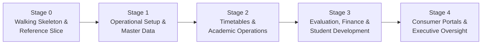

# ELSASA-SIS v4 — Development Roadmap

**Document Code:** ELSASA-SIS-DEV-STAGES  
**Status:** Approved  
**Authoritative Architectural Reference:** [ELSASA-SIS-ARCHITECTURE.md](file:///d:/Project.Private/elsasa-sis-v4/docs/architecture/ELSASA-SIS-ARCHITECTURE.md)  
**Upstream Inputs:** 68 Use Cases ([use-case-discovery-basic.md](file:///d:/Project.Private/elsasa-sis-v4/docs/use-case-discovery-basic.md)), 20 Screens ([screen-inventory.md](file:///d:/Project.Private/elsasa-sis-v4/docs/screen-inventory.md)), 6 Pure Persistence Table Designs ([docs/architecture/](file:///d:/Project.Private/elsasa-sis-v4/docs/architecture/)).

---

## 1. Executive Summary & Staged Strategy

Implementing an enterprise-grade School Information System across **6 bounded contexts**, **68 actor-driven use cases**, and **20 rich interaction screens** in a single monolithic implementation plan introduces excessive cognitive load, long planning cycles, and elevated execution risk for autonomous agents.

To ensure deterministic delivery, continuous verification, and rapid validation of foundational architecture, the engineering of **ELSASA-SIS (Basic Level)** is divided into **5 sequential stages**. 




### Strategic Benefits of Staged Development
1. **Manageable Plan Complexity:** Each stage contains between 7 and 28 use cases, allowing autonomous implementer and reviewer subagents to operate within clean dependency boundaries.
2. **Immediate Proof of Technology (Stage 0):** Establishes the monorepo scaffold, authentication pipeline, database migrations, and one full reference vertical slice before scaling out parallel development.
3. **Strict Dependency Order:** Upstream dependencies (such as Academic Years and Student Master Data) are fully verified and frozen before dependent downstream workflows (such as Timetables, Grading, and Tuition Billing) are implemented.
4. **Independent Verifiability:** Each stage delivers working end-to-end user screens that can be tested in isolation by human testers and test packages.

---

## 2. Stage Taxonomy & Lifecycle Overview

| Stage | Stage Name | Primary Bounded Contexts | Scope (Use Cases & Screens) | Key Operational Milestone |
| :---: | :--- | :--- | :--- | :--- |
| **Stage 0** | **Walking Skeleton & Reference Slice** | `auth`, `opr`, `SharedKernel`, `Database`, `Api` | **1 UC** (`UC-ADM-01`)<br>**2 Screens** (`SCR-AUTH-LOGIN`, `SCR-OPR-CALENDAR` Pt.1) | Working monorepo, JWT login, DbUp migrations, NetArchTest boundary enforcement, and one complete end-to-end slice. |
| **Stage 1** | **Operational Setup & Master Data Foundation** | `opr`, `std`, `tch` | **23 UCs** (`UC-ADM-02..16`, `UC-ADM-27`, `UC-PRC-01`, `UC-PRC-05`, `UC-PRC-07`, `UC-TCH-11`, `UC-HRM-05`)<br>**5 Screens** | Complete school setup: calendar, rooms, bulletins, candidate admissions, student enrollment with NIS, guardians, teacher directory, capabilities, study groups (rombel), and class placement. |
| **Stage 2** | **Timetables & Daily Academic Operations** | `opr` (timetables), `acd` (curriculum, attendance, scorebook) | **8 UCs** (`UC-ADM-04`, `UC-ADM-17..18`, `UC-TCH-01..03`, `UC-TCH-05`, `UC-TCH-10`)<br>**4 Screens** | Master timetables with SMK rotation templates, subject curriculum structure, student subject enrollment, daily classroom attendance, and teacher scorebook grading. |
| **Stage 3** | **Evaluation, Finance & Student Development** | `acd` (report cards), `dev` (pastoral, discipline, clubs), `fin` (billing, cashier) | **28 UCs** (`UC-ADM-19..20`, `UC-ADM-22..25`, `UC-TCH-04`, `UC-TCH-06..09`, `UC-HRM-01..04`, `UC-PRC-02..04`, `UC-FIN-01..08`, `UC-FIN-10..11`)<br>**6 Screens** | Semester report cards (draft to finalization lock), complete pastoral/discipline/achievement/club tracking, and full fee policy, billing, cashier receipts, advance deposits, and allocations. |
| **Stage 4** | **Consumer Portals & Executive Governance** | `portal-parent`, `portal-student`, `acd` (monitoring), `fin` (receivables) | **8 UCs** (`UC-PRT-01..04`, `UC-STD-01..03`, `UC-ADM-21`, `UC-ADM-26`, `UC-FIN-09`, `UC-PRC-06`)<br>**4 Screens** | Parent Family Portal, Student Learner Portal, School-Wide Academic Monitoring, and Financial Receivables / Arrears Aging Oversight. |
| **TOTAL** | | | **68 Use Cases (40 Commands, 28 Queries)**<br>**20 UI Screens** | **Complete Basic ELSASA-SIS System** |

---

## 3. Detailed Stage Breakdown

---

### Stage 0: Walking Skeleton & Reference Slice

* **Goal:** Prove the full technical stack end-to-end, eliminate architectural risk early, and provide a concrete reference pattern for all future slices.
* **Target Boundaries:**
  * Backend: `backend/src/ElsasaSis.SharedKernel`, `backend/src/ElsasaSis.Contracts`, `backend/src/ElsasaSis.Database`, `backend/src/Modules/ElsasaSis.Modules.Auth`, `backend/src/Modules/ElsasaSis.Modules.Opr`, `backend/src/ElsasaSis.Api`, `backend/tests/ElsasaSis.ArchitectureTests`.
  * Frontend: `frontend/src/app/`, `frontend/src/shared/`, `frontend/src/features/auth/`, `frontend/src/features/operational/`.
* **Database Schemas Initialized:** `auth`, `outbox`, `opr`, `std`, `tch`, `acd`, `fin`, `dev`.
* **Use Cases Realized:**
  * `UC-ADM-01` (`COMMAND`): Manage Academic Years & Operational Periods.
* **Screens Implemented:**
  * `SCR-AUTH-LOGIN`: User sign in with username/password, JWT receipt, and session storage.
  * `SCR-OPR-CALENDAR` *(Part 1 — Academic Cycle tab)*: List academic years, create/edit academic year, and set active operational semester.
* **Key Architectural Deliverables:**
  1. Monorepo folder layout with .NET 8 solution and Vue 3 / Vite TypeScript project.
  2. DbUp migration runner executing schema creation and initial admin seed (`admin` user with `SCHOOL_ADMIN` role).
  3. `ElsasaSis.SharedKernel` primitives: `Result<T>`, `DomainError`, `AggregateRoot<TId>`, `Entity<TId>`, `IDomainEventDispatcher`.
  4. ASP.NET Core Minimal API pipeline: CORS, JWT Bearer authentication, Swagger with `.Produces` metadata, and RFC 7807 `ProblemDetails` error handler.
  5. NetArchTest architecture test project verifying module isolation.
  6. Frontend foundation: Tailwind CSS, Axios/Fetch HTTP client with auth interceptor, TanStack Query v5 provider, Pinia auth store, and route guards.
  7. **Reference Vertical Slice:** `POST /api/opr/academic-years`, `PUT /api/opr/academic-years/{id}`, `GET /api/opr/academic-years` end-to-end.
* **Verification Gate (Stage Exit Criteria):**
  * Admin logs in via `/login`, receives valid JWT with role claims.
  * Admin navigates to `/operational/calendar`, creates an academic year (e.g. 2026/2027) with two semesters, and activates it.
  * Attempting an invalid date range returns RFC 7807 `422 Unprocessable Entity` with `camelCase` validation errors.
  * `dotnet test` passes NetArchTest architecture boundary verification.

---

### Stage 1: Operational Setup & Master Data Foundation

* **Goal:** Implement master data backbones across school operations, prospective student admissions, official student enrollment with guardian management, teacher profiles, study groups (rombel), and annual class placements.
* **Target Boundaries:**
  * Backend: `ElsasaSis.Modules.Opr`, `ElsasaSis.Modules.Std`, `ElsasaSis.Modules.Tch`.
  * Frontend: `frontend/src/features/operational/`, `frontend/src/features/student/`, `frontend/src/features/teaching/`.
* **Use Cases Realized (23 UCs):**
  * **Operational (`opr`):**
    * `UC-ADM-02` (`COMMAND`): Manage School Calendar Entries (holidays, closures).
    * `UC-ADM-03` (`COMMAND`): Manage Room Master Data (classrooms, labs, capacities).
    * `UC-ADM-05` (`COMMAND`): Author & Publish School Announcements.
    * `UC-ADM-27` (`QUERY`): Browse Operational Dashboard & Calendar.
    * `UC-TCH-11` (`QUERY`): Browse School Calendar & Teacher Bulletins.
    * `UC-PRC-07` (`QUERY`): View School Calendar, Timetables & Bulletins.
  * **Student (`std`):**
    * `UC-ADM-06` (`COMMAND`): Register Admission Candidate & Guardians.
    * `UC-ADM-07` (`COMMAND`): Record Candidate Admission Decision (`SCHOOL_ADMIN`).
    * `UC-PRC-01` (`COMMAND`): Approve or Reject Admission Candidates (`PRINCIPAL`).
    * `UC-ADM-08` (`COMMAND`): Enroll Accepted Candidate (atomically generates NIS and student record).
    * `UC-ADM-09` (`COMMAND`): Maintain Student Profile & Guardians.
    * `UC-ADM-10` (`COMMAND`): Manage Annual Study Groups (Rombel).
    * `UC-ADM-11` (`COMMAND`): Assign Student Placement.
    * `UC-ADM-12` (`QUERY`): Browse Student Directory, Candidate Queue & Rosters.
    * `UC-HRM-05` (`QUERY`): View Study Group Roster & Guardian Contacts (scoped to own rombel).
  * **Teaching (`tch`):**
    * `UC-ADM-13` (`COMMAND`): Manage Teacher Profiles (NIP/NIK, contacts, active status).
    * `UC-ADM-14` (`COMMAND`): Maintain Teacher Subject Capabilities.
    * `UC-ADM-15` (`COMMAND`): Assign & Remove Teacher Teaching Assignments.
    * `UC-ADM-16` (`QUERY`): View Teacher Directory & Assignment Matrix.
    * `UC-PRC-05` (`QUERY`): Review Teacher Assignments & Workload Distribution.
* **Screens Implemented (5 Screens):**
  1. `SCR-OPR-CALENDAR` *(Full)*: Calendar entries, holiday planner, and operational period toggle.
  2. `SCR-OPR-ANNOUNCEMENTS`: Rich announcement authoring, draft/published workflow, and target audience targeting.
  3. `SCR-STD-ADMISSIONS`: Prospective applicant intake, application status filters, and decision/enrollment actions.
  4. `SCR-STD-DIRECTORY`: Student directory, guardian contacts, rombel management, and class placement matrix.
  5. `SCR-TCH-ASSIGNMENTS`: Teacher roster, qualified subject tags, study group allocations, and workload balancing.
* **Verification Gate (Stage Exit Criteria):**
  * School admin can register candidate $\rightarrow$ principal approves candidate $\rightarrow$ admin enrolls candidate into official student.
  * Enrolled student is placed into an active Study Group (e.g., Grade 7A) for the active Academic Year.
  * Teacher is created, tagged with subject capabilities, and assigned to a study group.
  * Homeroom teacher account can log in and view strictly their assigned study group's roster and guardian phone numbers.

---

### Stage 2: Timetables & Daily Academic Operations

* **Goal:** Enable the school's core daily academic engine: weekly timetable scheduling (including SMK vocational block rotations), curriculum structure, student subject enrollment, daily classroom attendance, and the teacher scorebook.
* **Target Boundaries:**
  * Backend: `ElsasaSis.Modules.Opr` (Timetables), `ElsasaSis.Modules.Acd` (Curriculum, Attendance, Scorebook).
  * Frontend: `frontend/src/features/operational/` (Timetable), `frontend/src/features/academic/` (Curriculum, Attendance, Scorebook).
* **Use Cases Realized (8 UCs):**
  * **Timetable (`opr`):**
    * `UC-ADM-04` (`COMMAND`): Configure Study Group Timetables & Block Rotations.
    * `UC-TCH-10` (`QUERY`): View Assigned Classes & Teaching Timetable (scoped to logged-in teacher).
  * **Curriculum & Participation (`acd`):**
    * `UC-ADM-17` (`COMMAND`): Manage Learning Structure (Subjects, Stages, Units, Grade Mappings).
    * `UC-ADM-18` (`COMMAND`): Batch Enroll Students into Subject Stages (`academic_participations`).
  * **Daily Attendance (`acd`):**
    * `UC-TCH-01` (`COMMAND`): Record Daily Subject Attendance (`PRESENT`, `ABSENT`, `LATE`, `EXCUSED`).
  * **Grading & Scorebook (`acd`):**
    * `UC-TCH-02` (`COMMAND`): Create Classroom Assignment or Assessment (`FORMATIVE`, `SUMMATIVE`, `EXAM`).
    * `UC-TCH-03` (`COMMAND`): Enter Student Scores & Feedback.
    * `UC-TCH-05` (`QUERY`): View Subject Gradebook & Attendance Summary.
* **Screens Implemented (4 Screens):**
  1. `SCR-OPR-TIMETABLE`: Weekly master grid, room allocation, teacher assignment linking, and SMK alternate-week cycle overlay.
  2. `SCR-ACD-CURRICULUM`: Subject directory, ordered stages, learning units, and batch student enrollment action.
  3. `SCR-ACD-ATTENDANCE`: Date/period selector, student attendance roster checklist with bulk "Mark All Present" toggle.
  4. `SCR-ACD-SCOREBOOK`: Subject scorebook spreadsheet grid, assessment creator modal, and score entry with visual pass/fail indicator.
* **Verification Gate (Stage Exit Criteria):**
  * School admin creates subject "Matematika", stages 7-1, and enrolls 7A students into the stage.
  * Admin schedules Monday Period 1 Matematika for 7A in Room 101 with Teacher Budi.
  * Teacher Budi logs in, opens `/academic/attendance`, takes attendance for 7A, and saves.
  * Teacher Budi creates "Quiz 1" in `/academic/scorebook`, enters marks for all students, and the system computes the running subject grade.

---

### Stage 3: Evaluation, Finance & Student Development

* **Goal:** Deliver the school's high-stakes operational workflows: collaborative semester report cards, student pastoral care / disciplinary tracking / extracurriculars, and the complete cashier and tuition fee management engine.
* **Target Boundaries:**
  * Backend: `ElsasaSis.Modules.Acd` (Report Cards), `ElsasaSis.Modules.Dev` (Pastoral, Discipline, Clubs, Awards), `ElsasaSis.Modules.Fin` (Fees, Billing, Cashier, Ledger).
  * Frontend: `frontend/src/features/academic/` (Report Cards), `frontend/src/features/development/`, `frontend/src/features/finance/`.
* **Use Cases Realized (28 UCs):**
  * **Report Cards (`acd`):**
    * `UC-ADM-19` (`COMMAND`): Batch-Generate Draft Semester Report Cards.
    * `UC-ADM-20` (`COMMAND`): Administrative Report Card Override & Unlock.
    * `UC-TCH-04` (`COMMAND`): Provide Subject Evaluation Notes for Report Card.
    * `UC-HRM-01` (`QUERY`): Review Draft Semester Report Cards for Study Group.
    * `UC-HRM-02` (`COMMAND`): Write General Remarks on Draft Report Card.
    * `UC-HRM-03` (`COMMAND`): Finalize Study Group Report Cards (locks report card to `FINALIZED`).
    * `UC-PRC-02` (`QUERY`): Review Draft & Finalized Student Report Cards.
  * **Pastoral & Development (`dev`):**
    * `UC-TCH-06` (`COMMAND`): Record Student Behaviour Observation Note.
    * `UC-TCH-07` (`COMMAND`): Record Classroom Incident & Disciplinary Action.
    * `UC-ADM-22` (`COMMAND`): Record Administrative Disciplinary Incident.
    * `UC-PRC-03` (`COMMAND`): Record Escalated Disciplinary Sanction (`PARENT_MEETING`, `SUSPENSION`).
    * `UC-TCH-08` / `UC-ADM-23` (`COMMAND`): Record Student Achievement Award.
    * `UC-ADM-25` (`COMMAND`): Manage Extracurricular Activities Catalog.
    * `UC-TCH-09` (`COMMAND`): Record Extracurricular Attendance & Activity Log.
    * `UC-ADM-24` / `UC-HRM-04` / `UC-PRC-04` (`QUERY`): View Holistic Student Development Dossier.
  * **Finance & Cashier (`fin`):**
    * `UC-FIN-01` (`COMMAND`): Define Fee Structure & Charge Types (SPP, registration, uniform).
    * `UC-FIN-02` (`COMMAND`): Grant & Revoke Student Discounts (sibling, scholarship).
    * `UC-FIN-03` (`COMMAND`): Generate Periodic Student Charges (Monthly tuition batch billing).
    * `UC-FIN-04` (`COMMAND`): Issue Manual Ad-Hoc Student Charge.
    * `UC-FIN-05` (`COMMAND`): Cancel Erroneous Unpaid Student Charge.
    * `UC-FIN-06` (`COMMAND`): Record Payment Receipt & Allocate to Open Charges.
    * `UC-FIN-07` (`COMMAND`): Allocate Advance Deposit Balance to Open Charges.
    * `UC-FIN-08` (`QUERY`): View Student Financial Statement & Balance Ledger.
    * `UC-FIN-10` (`QUERY`): Lookup Student & Guardian Billing Contacts *(contract query)*.
    * `UC-FIN-11` (`QUERY`): Generate Daily Cashier & Payment Collection Summary.
* **Screens Implemented (6 Screens):**
  1. `SCR-ACD-REPORT-CARDS`: Collaborative workspace with draft generation, subject remarks, homeroom remarks, finalization locking, and official PDF print layout.
  2. `SCR-DEV-PASTORAL`: Unified 360-degree student dossier (behaviour timeline, infractions, awards, and extracurricular logs).
  3. `SCR-DEV-EXTRACURRICULAR`: Activity roster, student member enrollments, and attendance logger.
  4. `SCR-FIN-FEES-POLICY`: Fee catalog, default amounts per grade level, and student discount assignment.
  5. `SCR-FIN-BILLING`: Monthly batch tuition billing generator with preview, ad-hoc invoice creator, and charge cancellation.
  6. `SCR-FIN-PAYMENTS`: Front-line cashier counter: payment receipt recording (`CASH`, `BANK_TRANSFER`), itemized charge allocation, advance deposit holding, and official receipt PDF printing.
* **Verification Gate (Stage Exit Criteria):**
  * Admin generates draft report cards $\rightarrow$ Teacher inputs subject feedback $\rightarrow$ Homeroom teacher enters remarks and finalizes $\rightarrow$ Status changes to `FINALIZED` and PDF is printable.
  * Teacher logs disciplinary infraction; Principal issues suspension sanction; dossier updates immediately.
  * Finance officer configures monthly SPP (Rp 500,000) $\rightarrow$ runs monthly billing $\rightarrow$ collects payment from parent at cashier counter $\rightarrow$ issues official receipt with remaining deposit balance $\rightarrow$ student ledger updates to settled.

---

### Stage 4: Consumer Portals & Executive Governance

* **Goal:** Extend the verified core system with mobile-friendly read-only self-service portals for Parents and Students, and deliver executive governance monitoring dashboards for Principals and Financial Officers.
* **Target Boundaries:**
  * Backend: `ElsasaSis.Modules.Acd` (Monitoring), `ElsasaSis.Modules.Fin` (Receivables), `ElsasaSis.Api` (Portal endpoints with consumer data scoping).
  * Frontend: `frontend/src/features/portal-parent/`, `frontend/src/features/portal-student/`, `frontend/src/features/academic/` (Monitoring), `frontend/src/features/finance/` (Receivables).
* **Use Cases Realized (8 UCs):**
  * **Parent Portal (`portal-parent`):**
    * `UC-PRT-01` (`QUERY`): View & Download Child's Finalized Report Card.
    * `UC-PRT-02` (`QUERY`): View Child's Monthly Billing Statements & Deposit Balance.
    * `UC-PRT-03` (`QUERY`): View & Download Official Payment Receipts.
    * `UC-PRT-04` (`QUERY`): View School Calendar & Parent Announcements.
  * **Student Portal (`portal-student`):**
    * `UC-STD-01` (`QUERY`): View Personal Study Group Timetable.
    * `UC-STD-02` (`QUERY`): View School Calendar.
    * `UC-STD-03` (`QUERY`): View Student Announcements.
  * **Executive Governance & Monitoring:**
    * `UC-ADM-21` (`QUERY`): Monitor School-Wide Academic Progress (`SCR-ACD-MONITORING`).
    * `UC-ADM-26` / `UC-PRC-06` / `UC-FIN-09` (`QUERY`): Financial Receivables, Arrears Aging & Collection Monitoring (`SCR-FIN-RECEIVABLES`).
* **Screens Implemented (4 Screens):**
  1. `SCR-PRT-PORTAL`: Responsive portal for parents to select linked children, view report cards, inspect monthly tuition status, download receipts, and view announcements.
  2. `SCR-STD-PORTAL`: Mobile-first dashboard for students to check their daily schedule, school calendar, and announcements.
  3. `SCR-ACD-MONITORING`: High-level curriculum completion metrics, average subject grades, and attendance rates across grades and rombel.
  4. `SCR-FIN-RECEIVABLES`: Financial receivables dashboard, aged arrears breakdown (30/60/90 days), and total period collection summaries.
* **Verification Gate (Stage Exit Criteria):**
  * Parent logs in with guardian credentials, sees only their linked children, views their finalized report card (drafts are hidden), views paid receipts, and downloads billing statements.
  * Student logs in, sees their personal timetable with correct SMK week rotation.
  * Principal opens `/finance/receivables`, views accurate school-wide collection totals and delinquent student lists without requiring access to cashier operations.

---

## 4. Stage Traceability & Coverage Matrix

Every one of the 68 Use Cases is assigned to exactly one stage:

```
Stage 0 (1 UC)  : UC-ADM-01
Stage 1 (23 UCs): UC-ADM-02, UC-ADM-03, UC-ADM-05, UC-ADM-06, UC-ADM-07, UC-ADM-08,
                  UC-ADM-09, UC-ADM-10, UC-ADM-11, UC-ADM-12, UC-ADM-13, UC-ADM-14,
                  UC-ADM-15, UC-ADM-16, UC-ADM-27, UC-HRM-05, UC-PRC-01, UC-PRC-05,
                  UC-PRC-07, UC-TCH-11
Stage 2 (8 UCs) : UC-ADM-04, UC-ADM-17, UC-ADM-18, UC-TCH-01, UC-TCH-02, UC-TCH-03,
                  UC-TCH-05, UC-TCH-10
Stage 3 (28 UCs): UC-ADM-19, UC-ADM-20, UC-ADM-22, UC-ADM-23, UC-ADM-24, UC-ADM-25,
                  UC-FIN-01, UC-FIN-02, UC-FIN-03, UC-FIN-04, UC-FIN-05, UC-FIN-06,
                  UC-FIN-07, UC-FIN-08, UC-FIN-10, UC-FIN-11, UC-HRM-01, UC-HRM-02,
                  UC-HRM-03, UC-HRM-04, UC-PRC-02, UC-PRC-03, UC-PRC-04, UC-TCH-04,
                  UC-TCH-06, UC-TCH-07, UC-TCH-08, UC-TCH-09
Stage 4 (8 UCs) : UC-ADM-21, UC-ADM-26, UC-FIN-09, UC-PRC-06, UC-PRT-01, UC-PRT-02,
                  UC-PRT-03, UC-PRT-04, UC-STD-01, UC-STD-02, UC-STD-03
-----------------------------------------------------------------------------------------
TOTAL           : 68 Use Cases across 20 Screens
```

---