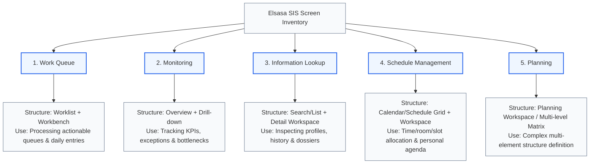
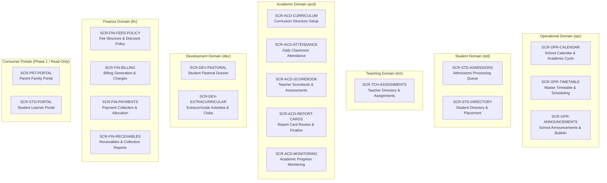

# Elsasa SIS (Basic) — Screen Inventory & Interaction Architecture

**Document Type:** UI/UX & Functional Screen Specification  
**Scope:** Basic Level (6 Bounded Contexts: `opr`, `std`, `tch`, `acd`, `fin`, `dev`)  
**Source Inputs:**  
* `docs/use-case-discovery-basic.md` (68 Discovered Use Cases)  
* `docs/actors-roles-specification-basic.md` (5 Internal Core Actors + 2 External Consumer Actors)  
* 6 Domain Persistence Table Designs (`opr`, `std`, `tch`, `acd`, `fin`, `dev`)  

**Development Roadmap Alignment:**  
1. ~~Domain Definition~~ *(Completed)*  
2. ~~Persistence Design~~ *(Completed)*  
3. ~~Actor Discovery~~ *(Completed)*  
4. ~~Use-Case Discovery~~ *(Completed — 68 UCs)*  
5. **Screen Inventory** *(This Document)*  
6. **Development** *(Vertical Slices, API Endpoints & UI Implementation)*  

---

## 1. Design Principles

This screen inventory bridges the gap between raw database models, actor use cases, and the real-world operational rhythm of Indonesian K-12 educational institutions (SD, SMP, SMA, and SMK). The following five core principles govern every screen definition:

### 1.1 Pragmatic
- **Operations Over Theory:** Screens are organized around how school staff actually carry out their daily, weekly, and seasonal work—not around database tables or conceptual CRUD symmetry.
- **Workflow Cohesion:** Tasks naturally performed together share a single operational screen (e.g., recording a payment, allocating funds to open tuition charges, and printing an official receipt occur within a single workbench).
- **Zero Extraneous Layers:** Unnecessary intermediate navigation hubs, empty dashboard menus, and redundant confirmation clicks are avoided.
- **Strict Scope Boundaries:** Functionality strictly honors the 68 use cases defined in `docs/use-case-discovery-basic.md` without introducing unsupported features or speculative complexity.

### 1.2 Minimalist
- **Screen Economy without Overcrowding:** The entire system is realized in **19 cohesive operational screens**, covering 100% of all 68 use cases across 7 actors without generating a fragmented sprawl of single-entity CRUD forms.
- **Cognitive Load Control:** Each screen possesses one unambiguous primary purpose. Attributes that do not influence the current operational decision are suppressed.
- **Progressive Disclosure:** Advanced settings, historical audit trails, and secondary actions remain tucked inside contextual drawers, expandable rows, or focused modals, revealing themselves only when triggered by user intent.
- **Focused Workspaces:** Complex screens prioritize large, unobstructed work areas over fragmented tab clusters.

### 1.3 Explicit
- **Operational Nomenclature:** Screens are named after the real-world operational activity they facilitate (e.g., *Admissions Processing Queue*, *Payment Collection & Deposit Allocation Workbench*, *Report Card Review & Finalization Workspace*) rather than technical entity labels (e.g., *Candidate Manager*, *Receipt View*).
- **Unambiguous Actor Ownership:** Every screen designates a primary operational actor and documents secondary actors with explicit role-based access boundaries.
- **Clear Cause-and-Effect:** State mutations, transitions, and business rule guardrails are explicitly communicated to users through clear visual indicators and actionable prompts.

### 1.4 Operational Focus
- **Activity-Centered Taxonomy:** Screen layouts prioritize:
  1. Processing actionable queues (admissions intake, payment settlement, report card finalization).
  2. Recording daily occurrences with high speed and low friction (subject attendance, score entry, behaviour incidents).
  3. Monitoring operational completeness and resolving bottlenecks (unrecorded attendance, missing grades, tuition arrears).
  4. Executing structured planning cycles (curriculum setup, teacher assignments, timetable scheduling, fee structures).
- **Anti-CRUD Stance:** The system actively resists presenting raw database tables as data-entry grids. Instead, it provides purposeful working environments tailored to specific school staff duties.

### 1.5 Familiarity and Consistency
- **Predictable Interaction Patterns:** Only five standardized screen patterns are utilized across all 6 domains.
- **Standardized Spatial Layouts:** 
  - Worklists, search filters, and selector trees consistently anchor the left pane or upper header.
  - Detail workbenches, score grids, and inspection dossiers anchor the central/right working canvas.
  - Primary workflow completion buttons consistently occupy the upper-right or sticky bottom-right toolbar.
  - Status indicators share a unified school-wide color taxonomy (`DRAFT`: Slate, `REGISTERED`: Blue, `ACTIVE`/`ACCEPTED`: Green, `FINALIZED`/`COMPLETED`: Emerald, `REJECTED`/`OVERDUE`/`ABSENT`: Rose, `PARTIALLY_PAID`/`SICK`/`LATE`: Amber).
- **Rapid Onboarding:** An operator trained on the Admissions Queue immediately feels familiar navigating the Payment Collection Workbench or Report Card Finalization Workspace.

---

## 2. Screen Pattern Catalog

To maintain a uniform learning curve across all domains, all 19 screens are mapped to one of five established Screen Patterns.

### Pattern 1: Work Queue
* **Structural Blueprint:** `Worklist (Left / Selector) + Workbench (Right / Center Working Canvas)`
* **Operational Purpose:** Designed for high-frequency or stateful transactional workflows where staff process incoming items, verify evidence, make operational decisions, or record repetitive classroom data.
* **Component Mechanics:**
  - **Worklist:** Filterable list or status queue (e.g., pending admission candidates, unpaid student charges, teaching sessions today, draft report cards). Features status badges, urgency indicators, and instant keyword filtering.
  - **Workbench:** Displays the complete working context of the selected item, eliminating the need to navigate elsewhere. Provides direct action buttons (Approve, Enroll, Mark Attendance, Allocate, Lock/Finalize).
* **Screens Utilizing this Pattern:**
  - `SCR-STD-ADMISSIONS`: Admissions Processing Queue
  - `SCR-ACD-ATTENDANCE`: Daily Classroom Attendance
  - `SCR-ACD-SCOREBOOK`: Teacher Scorebook & Assessment Management
  - `SCR-ACD-REPORT-CARDS`: Report Card Review & Finalization Workspace
  - `SCR-DEV-PASTORAL`: Student Pastoral & Development Dossier
  - `SCR-FIN-BILLING`: Billing Generation & Charge Management
  - `SCR-FIN-PAYMENTS`: Payment Collection & Deposit Allocation Workbench

### Pattern 2: Monitoring
* **Structural Blueprint:** `Executive Overview (Top KPI Cards & Alerts) + Drill-down (Bottom Tabular Analysis & Filters)`
* **Operational Purpose:** Designed for school leaders and administrative supervisors to maintain operational quality assurance, track milestone completion, identify exceptions, and trace receivables without drowning in raw rows.
* **Component Mechanics:**
  - **Overview:** Compact metric cards displaying critical operational indicators (e.g., attendance rate today, score completion %, report cards finalized %, total tuition arrears). Includes visual exception alerts highlighting bottlenecks requiring immediate administrative intervention.
  - **Drill-down:** Multi-dimensional data table allowing users to filter by School Level, Grade, Study Group, Subject, or Date Range, expanding down to specific delinquent accounts or missing records with direct contact links.
* **Screens Utilizing this Pattern:**
  - `SCR-ACD-MONITORING`: School-Wide Academic Progress Monitoring
  - `SCR-FIN-RECEIVABLES`: Financial Receivables, Arrears & Collection Monitoring

### Pattern 3: Information Lookup
* **Structural Blueprint:** `Search / List Filter (Left / Top Header) + Detail Workspace (Main Canvas)`
* **Operational Purpose:** Used when users need to find, review, cross-reference, and maintain profiles, historical records, or reference data without an active pending queue.
* **Component Mechanics:**
  - **Search / List:** High-speed filter bar with indexed search (NIS, NISN, NIP, Name), facet toggles (status, grade, room type), and compact summary cards.
  - **Detail Workspace:** Tabbed or modular dossier presenting master entity details, associated relationship cards (e.g., parents/guardians, study group placements, enrolled clubs), and contextual editing drawers governed by role permissions.
* **Screens Utilizing this Pattern:**
  - `SCR-STD-DIRECTORY`: Student Directory & Placement Registry
  - `SCR-OPR-ANNOUNCEMENTS`: School Announcements & Bulletin
  - `SCR-DEV-EXTRACURRICULAR`: Extracurricular Activities & Clubs
  - `SCR-PRT-PORTAL`: Parent Family Portal

### Pattern 4: Schedule Management
* **Structural Blueprint:** `Calendar / Timetable Grid (Main Canvas) + Inspector & Resource Drawer (Side / Modal)`
* **Operational Purpose:** Designed for temporal and spatial workflows organized around dates, clock hours, room allocation, and rotation cycles.
* **Component Mechanics:**
  - **Calendar / Grid:** Time-block or day/month grid visualizing sessions, holidays, and room bookings. Resolves complex school schedules, including SMK vocational block rotations (`GENERAL` vs `VOCATIONAL`).
  - **Inspector & Resource Drawer:** Contextual inspector showing assigned teacher, subject, room capacity status, and conflicting slot warnings, with quick drag-and-drop or select-and-assign controls.
* **Screens Utilizing this Pattern:**
  - `SCR-OPR-CALENDAR`: School Calendar & Academic Cycle
  - `SCR-OPR-TIMETABLE`: Master Timetable & Scheduling Workspace
  - `SCR-STD-PORTAL`: Student Learner Portal

### Pattern 5: Planning
* **Structural Blueprint:** `Planning Workspace (Multi-Level Hierarchy Tree + Policy / Assignment Matrix)`
* **Operational Purpose:** Used during pre-semester preparation when administrative staff configure complex structural dependencies linking multiple domain elements together.
* **Component Mechanics:**
  - **Hierarchy Tree / Structural Map:** Visual representation of nested curriculum entities (Subject $\rightarrow$ Stages $\rightarrow$ Learning Units $\rightarrow$ Grade Mappings) or fee schedules.
  - **Assignment Matrix:** Interactive allocation canvas where staff map capabilities to teachers, define grade linkages, or establish standing student waivers.
* **Screens Utilizing this Pattern:**
  - `SCR-ACD-CURRICULUM`: Curriculum & Academic Structure Setup
  - `SCR-TCH-ASSIGNMENTS`: Teacher Directory & Teaching Assignment Workspace
  - `SCR-FIN-FEES-POLICY`: Fee Structure & Student Discount Policy

---

## 3. Screen Inventory

The following catalog specifies all **19 screens** in Elsasa SIS (Basic). Each screen is defined with operational purpose, supported use cases, information architecture, available actions, navigation context, and detailed structural component breakdown.

---

### 3.1 Operational Domain (`opr`)

#### Screen ID: `SCR-OPR-CALENDAR`
* **Screen Name:** School Calendar & Academic Cycle
* **Domain:** Operational (`opr`)
* **Primary Actor:** `SCHOOL_ADMIN` (School Administrator)
* **Secondary Actors:** `PRINCIPAL`, `TEACHER`, `FINANCE_OFFICER`, `PARENT`, `STUDENT` (Read-Only)
* **Screen Pattern:** Schedule Management
* **Operational Purpose:** Establish and maintain the school's temporal backbone: active academic years, semester operational periods, and day classifications (school days, national holidays, school breaks, and closures).
* **Supported Use Cases:**
  * `UC-ADM-01` (`COMMAND`) — Manage Academic Years & Operational Periods
  * `UC-ADM-02` (`COMMAND`) — Manage School Calendar Entries
  * `UC-ADM-27` (`QUERY`) — View School Calendar & Master Timetables (Calendar slice)
  * `UC-FIN-11` (`QUERY`) — View School Calendar & Announcements (Calendar slice)
  * `UC-TCH-11` (`QUERY`) — View Personal Teaching Schedule & School Calendar (Calendar slice)
  * `UC-PRC-07` (`QUERY`) — View School Calendar, Timetables & Announcements (Calendar slice)
  * `UC-PRT-04` (`QUERY`) — View School Calendar & Parent Announcements (Calendar slice)
  * `UC-STD-02` (`QUERY`) — View School Calendar
* **Primary Information Presented:**
  * Active Academic Year banner with start/end dates and current active status (`ACTIVE`/`INACTIVE`).
  * Operational Periods list (Semester 1, Semester 2) with respective date boundaries.
  * Interactive monthly/yearly calendar matrix with color-coded day classifications: Effective School Days (`SCHOOL_DAY`), Public/Religious Holidays (`HOLIDAY`), and Administrative Closures (`CLOSURE`).
  * Date inspection panel showing date name, holiday reason, and semester affiliation.
* **Available Actions:**
  * Create new Academic Year with start and end dates.
  * Activate Academic Year (automatically deactivating any prior active year per `BR-OPS-003`).
  * Add or modify Operational Periods (Semester 1 & 2) within the active year.
  * Classify or bulk-classify calendar dates (`SCHOOL_DAY`, `HOLIDAY`, `CLOSURE`) with holiday descriptions.
  * Filter calendar view by month, operational period, or day type.
* **Navigation Context:**
  * Access: Main Navigation $\rightarrow$ Operations $\rightarrow$ Academic Calendar & Cycle.
  * Links to: `SCR-OPR-TIMETABLE` (to configure class schedules once periods are active).
* **Pattern Structural Areas:**
  * **Calendar Grid:** Full-width monthly/term grid displaying date numbers, day-type badges, and holiday tags.
  * **Workspace / Control Panel:** Sidebar panel housing the Academic Year switch selector, period date configuration inputs, and quick-add form for marking holidays or closures.

---

#### Screen ID: `SCR-OPR-TIMETABLE`
* **Screen Name:** Master Timetable & Scheduling Workspace
* **Domain:** Operational (`opr`)
* **Primary Actor:** `SCHOOL_ADMIN` (School Administrator)
* **Secondary Actors:** `TEACHER` (Personal schedule), `PRINCIPAL` (Oversight), `STUDENT` (Class schedule)
* **Screen Pattern:** Schedule Management
* **Operational Purpose:** Plan, visualize, and resolve weekly class schedules, classroom allocations, and SMK block rotation schedules across all study groups and school levels.
* **Supported Use Cases:**
  * `UC-ADM-03` (`COMMAND`) — Manage Room Master Data
  * `UC-ADM-04` (`COMMAND`) — Configure Study Group Timetables & Block Rotations
  * `UC-ADM-27` (`QUERY`) — View School Calendar & Master Timetables (Timetable slice)
  * `UC-TCH-11` (`QUERY`) — View Personal Teaching Schedule & School Calendar (Timetable slice)
  * `UC-PRC-07` (`QUERY`) — View School Calendar, Timetables & Announcements (Timetable slice)
  * `UC-STD-01` (`QUERY`) — View Personal Study Group Timetable
* **Primary Information Presented:**
  * Timetable Grid arranged by Day of Week (Monday–Friday/Saturday) and Time Periods (Period 1 to Period 8).
  * Filter selectors: View by Study Group (e.g., 7A, 10 TKJ 1), by Room (e.g., Lab Komputer, Ruang 101), or by Teacher.
  * Slot detail cards: Subject name, Teacher name, Room code, Start/End times, and Template type (`REGULAR`, or SMK `GENERAL`/`VOCATIONAL`).
  * SMK Block Rotation calendar drawer: Date-range windows mapped to General or Vocational week templates per `EXT-OPS-001`..`004`.
  * Room Master registry panel: Room code, room name, room type (`CLASSROOM`, `LABORATORY`, `HALL`, `OTHER`), and student capacity.
* **Available Actions:**
  * Add, update, or deactivate physical rooms (with room code, name, type, and capacity).
  * Assign a teaching slot: select Day, Period, Subject, Teacher, and physical Room.
  * Configure SMK block rotation templates and assign date windows.
  * Detect and visually flag room capacity overflows or room double-booking.
  * Export/Print class timetable or teacher timetable to PDF.
* **Navigation Context:**
  * Access: Main Navigation $\rightarrow$ Operations $\rightarrow$ Timetables & Rooms.
  * Links to: `SCR-TCH-ASSIGNMENTS` (to review teacher availability and capabilities).
* **Pattern Structural Areas:**
  * **Schedule Grid:** Multi-column weekly schedule grid showing active assignments per period.
  * **Workspace / Drawer:** Contextual slot editor drawer for picking subject, teacher, and room; Room Master maintenance modal drawer.

---

#### Screen ID: `SCR-OPR-ANNOUNCEMENTS`
* **Screen Name:** School Announcements & Bulletin
* **Domain:** Operational (`opr`)
* **Primary Actor:** `SCHOOL_ADMIN` & `TEACHER` (Authors)
* **Secondary Actors:** `PRINCIPAL`, `FINANCE_OFFICER`, `PARENT`, `STUDENT` (Readers)
* **Screen Pattern:** Information Lookup
* **Operational Purpose:** Author, publish, and broadcast official school bulletins targeted to specific audiences (`ALL`, `TEACHERS`, `STUDENTS`, `PARENTS`).
* **Supported Use Cases:**
  * `UC-ADM-05` (`COMMAND`) — Author & Publish School Announcements
  * `UC-TCH-10` (`COMMAND`) — Publish Announcement to Students or Parents
  * `UC-ADM-27` (`QUERY`) — View School Calendar & Master Timetables (Announcements slice)
  * `UC-FIN-11` (`QUERY`) — View School Calendar & Announcements (Announcements slice)
  * `UC-PRC-07` (`QUERY`) — View School Calendar, Timetables & Announcements (Announcements slice)
  * `UC-PRT-04` (`QUERY`) — View School Calendar & Parent Announcements (Announcements slice)
  * `UC-STD-03` (`QUERY`) — View Student Announcements
* **Primary Information Presented:**
  * Bulletin feed of published announcements with publication date, author name, target audience badge, and summary snippet.
  * Announcement authoring draft canvas: Title, target audience selector (`ALL`, `TEACHERS`, `STUDENTS`, `PARENTS`), body content, and publication status (`DRAFT`, `PUBLISHED`, `ARCHIVED`).
  * Target audience filter pills allowing users to review messages relevant to their profile.
* **Available Actions:**
  * Compose draft announcement.
  * Publish draft announcement (`DRAFT` $\rightarrow$ `PUBLISHED`), making it instantly visible to targeted actors per `BR-OPS-012`..`013`.
  * Edit or archive published announcements.
  * Read full announcement content in modal reader.
* **Navigation Context:**
  * Access: Main Navigation $\rightarrow$ Communications $\rightarrow$ Announcements.
* **Pattern Structural Areas:**
  * **Search / List:** Left/Top feed filterable by status (`DRAFT`/`PUBLISHED`), audience, and date.
  * **Detail Workspace:** Dedicated announcement composer and preview pane.

---

### 3.2 Student Domain (`std`)

#### Screen ID: `SCR-STD-ADMISSIONS`
* **Screen Name:** Admissions Processing Queue
* **Domain:** Student (`std`)
* **Primary Actor:** `SCHOOL_ADMIN` (Operational Operator) & `PRINCIPAL` (Decision Maker)
* **Secondary Actors:** None
* **Screen Pattern:** Work Queue
* **Operational Purpose:** Process incoming student admission applications for an admission cycle, record leadership admission decisions (`ACCEPTED`/`REJECTED`), and atomically enroll accepted candidates as official active students.
* **Supported Use Cases:**
  * `UC-ADM-06` (`COMMAND`) — Register Admission Candidate
  * `UC-ADM-07` (`COMMAND`) — Record Candidate Admission Decision
  * `UC-ADM-08` (`COMMAND`) — Enroll Accepted Candidate
  * `UC-ADM-12` (`QUERY`) — Browse Student Directory, Candidate Queue & Study Group Rosters (Candidate Queue slice)
  * `UC-PRC-01` (`COMMAND`) — Approve or Reject Admission Candidates
* **Primary Information Presented:**
  * Candidate status pipeline tabs: `REGISTERED` (Pending Decision), `ACCEPTED` (Ready to Enroll), `REJECTED`, and `ENROLLED`.
  * Candidate summary card: Registration Number, Full Name, Gender, Birth Date, Target Admission Year, Target School Level, and Submission Timestamp.
  * Candidate Guardian information card: Parent/Guardian Name, Relationship (`FATHER`, `MOTHER`, `GUARDIAN`), Phone Number, and Address.
  * Decision metadata: Decision date, decision maker notes, and decision status.
  * Enrollment Form: Official Student NIS input, initial placement grade, and enrollment date.
* **Available Actions:**
  * Register new prospective candidate with personal info and at least one guardian (`BR-STU-007`).
  * Record Admission Decision: Transition candidate from `REGISTERED` to `ACCEPTED` or `REJECTED` (executable by School Admin or Principal per `BR-STU-009`).
  * Enroll Accepted Candidate: Atomically convert `ACCEPTED` candidate into `ACTIVE` student in `std.students`, copy guardian records into `std.student_guardians`, and assign unique NIS (`UC-ADM-08`, `BR-STU-001`..`006`).
  * Print official Candidate Registration Proof or Acceptance Letter.
* **Navigation Context:**
  * Access: Main Navigation $\rightarrow$ Admissions $\rightarrow$ Admissions Queue.
  * Links to: `SCR-STD-DIRECTORY` (navigates directly to the enrolled student profile).
* **Pattern Structural Areas:**
  * **Worklist:** Filterable candidate list categorized by status tabs (`REGISTERED`, `ACCEPTED`, `REJECTED`, `ENROLLED`) with instant name/registration number search.
  * **Workbench:** Two-column dossier displaying candidate personal data, guardian contact cards, leadership decision action buttons (Accept / Reject), and the atomic Enrollment trigger panel.
  * **Workbench Actions:** "Accept Application", "Reject Application", "Enroll as Official Student", "Print Registration Card".

---

#### Screen ID: `SCR-STD-DIRECTORY`
* **Screen Name:** Student Directory & Placement Registry
* **Domain:** Student (`std`)
* **Primary Actor:** `SCHOOL_ADMIN` (Full Management)
* **Secondary Actors:** `HOMEROOM_TEACHER` (Scoped Study Group view), `FINANCE_OFFICER` (Read-Only Lookup)
* **Screen Pattern:** Information Lookup
* **Operational Purpose:** Central repository for enrolled student master data, official guardian records, annual study group (rombel) definition, and annual student class placements.
* **Supported Use Cases:**
  * `UC-ADM-09` (`COMMAND`) — Maintain Student Profile & Guardians
  * `UC-ADM-10` (`COMMAND`) — Manage Annual Study Groups (Rombel)
  * `UC-ADM-11` (`COMMAND`) — Assign Student Placement
  * `UC-ADM-12` (`QUERY`) — Browse Student Directory, Candidate Queue & Study Group Rosters (Directory slice)
  * `UC-FIN-10` (`QUERY`) — Lookup Students & Guardians (Read-Only)
  * `UC-HRM-05` (`QUERY`) — View Study Group Roster & Guardian Contacts
* **Primary Information Presented:**
  * Filterable Student Roster: NIS, NISN, Full Name, Gender, School Level (`SD`/`SMP`/`SMA`/`SMK`), Current Grade, Current Study Group, and Status (`ACTIVE`, `INACTIVE`, `GRADUATED`).
  * Student Detailed Dossier:
    - Master Tab: NIS, NISN, birth details, religion, enrollment date, home address.
    - Guardians Tab: List of associated parents/guardians with relationship, national ID, phone number, and primary emergency contact indicator (enforcing invariant: at least 1 guardian preserved per `BR-STU-007`).
    - Placement History Tab: Academic Year, School Level, Grade, and assigned Study Group.
  * Study Group Management Drawer: Annual rombel catalog (e.g., 7A, 10 TKJ 1) per Academic Year, School Level, and Grade, with assigned Homeroom Teacher.
* **Available Actions:**
  * Search students by NIS, NISN, or Name; filter by Grade, Study Group, or Status.
  * Edit student personal details and unique national NISN (`BR-STU-002`).
  * Add, update, or remove student guardian records (preventing deletion of the last guardian per `BR-STU-007`).
  * Create or update annual Study Groups (Rombel) scoped to an Academic Year and Grade (`UC-ADM-10`).
  * Assign or reassign student placement to a Study Group for an Academic Year (`UC-ADM-11`, `BR-STU-004`).
  * Export/Print class rosters with student and guardian contact info for homeroom teachers.
* **Navigation Context:**
  * Access: Main Navigation $\rightarrow$ Students $\rightarrow$ Student Directory.
  * Links to: `SCR-DEV-PASTORAL` (pastoral history), `SCR-FIN-PAYMENTS` (financial ledger).
* **Pattern Structural Areas:**
  * **Search / List:** Left master list with search input, academic year selector, grade filter pills, and study group dropdown.
  * **Detail Workspace:** Tabbed profile canvas (Personal, Guardians, Placement History) with contextual edit modals and a slide-out Study Group setup drawer.

---

### 3.3 Teaching Domain (`tch`)

#### Screen ID: `SCR-TCH-ASSIGNMENTS`
* **Screen Name:** Teacher Directory & Teaching Assignment Workspace
* **Domain:** Teaching (`tch`)
* **Primary Actor:** `SCHOOL_ADMIN` (Operational Setup)
* **Secondary Actors:** `PRINCIPAL` (Staffing & Workload Oversight), `TEACHER` (Personal Profile & Assignments)
* **Screen Pattern:** Planning
* **Operational Purpose:** Manage faculty master profiles, maintain subject qualifications/capabilities, allocate semester teaching assignments across study groups, and monitor faculty workload distribution.
* **Supported Use Cases:**
  * `UC-ADM-13` (`COMMAND`) — Manage Teacher Profiles
  * `UC-ADM-14` (`COMMAND`) — Maintain Teacher Subject Capabilities
  * `UC-ADM-15` (`COMMAND`) — Assign & Remove Teacher Teaching Assignments
  * `UC-ADM-16` (`QUERY`) — View Teacher Directory & Assignment Matrix
  * `UC-PRC-05` (`QUERY`) — Review Teacher Assignments & Workload Distribution
* **Primary Information Presented:**
  * Faculty Roster: Full Name, optional NIP/NIK, Employment Status (`ACTIVE`/`INACTIVE`), Phone/Email, and total assigned teaching periods/classes.
  * Teacher Capability Matrix: Registered subjects a teacher is certified/qualified to teach (`BR-TCH-006`).
  * Teaching Assignment Grid: Matrix showing Study Groups (rows) $\times$ Curriculum Subjects (columns) for an Operational Period, showing assigned teacher or "Unassigned" warning badge.
  * Workload Balance Inspector: Teaching load distribution summary per teacher to identify under-allocated or overburdened faculty.
* **Available Actions:**
  * Register new faculty member (with mandatory contact method per `BR-TCH-007`) and toggle active status (`BR-TCH-008`).
  * Add or remove qualified subjects to a teacher's capability portfolio (`UC-ADM-14`).
  * Assign an active teacher to a Subject and Study Group for a semester, enforcing capability match (`UC-ADM-15`, `BR-TCH-003`..`006`).
  * Remove or reassign teaching assignments (`REMOVED` status).
  * Print or export Teacher Assignment Matrix and Faculty Workload Reports for Principal review.
* **Navigation Context:**
  * Access: Main Navigation $\rightarrow$ Faculty $\rightarrow$ Teachers & Assignments.
  * Links to: `SCR-OPR-TIMETABLE` (to place assigned teachers into timetable slots).
* **Pattern Structural Areas:**
  * **Planning Workspace:** Multi-pane workspace: Left pane hosts the Teacher Roster and capability tags; Right pane hosts the Study Group Assignment Matrix and Workload summary inspector.

---

### 3.4 Academic Domain (`acd`)

#### Screen ID: `SCR-ACD-CURRICULUM`
* **Screen Name:** Curriculum & Academic Structure Setup
* **Domain:** Academic (`acd`)
* **Primary Actor:** `SCHOOL_ADMIN` (School Administrator)
* **Secondary Actors:** None
* **Screen Pattern:** Planning
* **Operational Purpose:** Configure the institutional learning framework: subjects, ordered subject stages, granular learning units, administrative grade mappings, and student academic participations.
* **Supported Use Cases:**
  * `UC-ADM-17` (`COMMAND`) — Manage Learning Structure (Subjects, Stages, Units & Grade Mappings)
  * `UC-ADM-18` (`COMMAND`) — Establish Student Academic Participations
* **Primary Information Presented:**
  * Hierarchical Curriculum Explorer:
    - Subjects (e.g., Mathematics, English, Indonesian, Physics).
    - Subject Stages (e.g., Math Stage 1, Stage 2, Stage 3) with progression sequence numbers.
    - Learning Units per stage (e.g., Module 1, PACE 101, Lesson 3, Presentation) with unit types (`MODULE`, `PACE`, `LESSON`, `PRESENTATION`, `BOOK`, `OTHER`).
  * Grade Mapping Configuration: Linkages between Subject Stages and standard administrative grades (e.g., Stage 7 maps to Grade 7).
  * Student Academic Participation Enrollment Panel: Active enrollments connecting students to Subject Stages for the current Operational Period.
* **Available Actions:**
  * Create, edit, and reorder Subjects and Subject Stages (`BR-LSTR-001`..`003`).
  * Add and sequence Learning Units within a Subject Stage (`BR-LSTR-004`).
  * Map Subject Stages to Administrative Grades (`BR-LSTR-005`).
  * Bulk-enroll student cohort into Subject Stages based on Grade mappings for an Operational Period (`UC-ADM-18`, `BR-APRT-001`..`003`).
  * Manually enroll individual students into advanced or remedial Subject Stages (supporting self-paced learning).
* **Navigation Context:**
  * Access: Main Navigation $\rightarrow$ Academic $\rightarrow$ Curriculum Structure.
  * Links to: `SCR-TCH-ASSIGNMENTS` (to assign teachers to defined subjects).
* **Pattern Structural Areas:**
  * **Planning Workspace:** Tree view on left showing Curriculum structure; Center canvas editing stage details and learning units; Right slide-out drawer executing cohort academic participations.

---

#### Screen ID: `SCR-ACD-ATTENDANCE`
* **Screen Name:** Daily Classroom Attendance
* **Domain:** Academic (`acd`)
* **Primary Actor:** `TEACHER` (Subject Teacher)
* **Secondary Actors:** `HOMEROOM_TEACHER` (Review)
* **Screen Pattern:** Work Queue
* **Operational Purpose:** Enable subject teachers to record student classroom attendance daily per subject session with speed, zero cognitive clutter, and rapid exception marking.
* **Supported Use Cases:**
  * `UC-TCH-01` (`COMMAND`) — Record Daily Subject Attendance
  * `UC-TCH-05` (`QUERY`) — View Subject Roster, Attendance Log & Scorebook (Attendance slice)
* **Primary Information Presented:**
  * Class Session Selector: Today's date, assigned Study Groups and Subjects taught by the logged-in teacher (e.g., "Kelas 8A — Matematika, Jam ke 1-2").
  * Session Attendance Status badge (`NOT_RECORDED`, `RECORDED`).
  * Student Classroom Sheet: List of active students enrolled in the subject stage with photo, NIS, full name, and current attendance status chip (`PRESENT`, `ABSENT`, `SICK`, `EXCUSED`, `LATE`).
  * Attendance Summary counter: Total Students, Present count, Absent count, Sick count, Excused count, Late count.
  * Historical Attendance Log: Date-by-date attendance sheets for the selected study group and subject.
* **Available Actions:**
  * One-Click "Mark All Present" shortcut to set baseline presence in 1 second.
  * Quick-toggle individual student attendance status chip (`PRESENT`, `ABSENT`, `SICK`, `EXCUSED`, `LATE`) per `BR-ATTN-001`..`003`.
  * Add optional contextual note (e.g., "Surat dokter diserahkan").
  * Save and confirm attendance record.
  * Switch date to review or retroactively correct attendance for past sessions.
* **Navigation Context:**
  * Access: Teacher Dashboard $\rightarrow$ Daily Attendance.
  * Links to: `SCR-ACD-SCOREBOOK` (navigates to grading for the same class).
* **Pattern Structural Areas:**
  * **Worklist:** Left sidebar listing teacher's scheduled teaching sessions for the day with completion status badges.
  * **Workbench:** Main sheet displaying the student list with rapid-tap attendance status buttons and summary tally bar.
  * **Workbench Actions:** "Mark All Present", "Save Attendance", "View Attendance Log".

---

#### Screen ID: `SCR-ACD-SCOREBOOK`
* **Screen Name:** Teacher Scorebook & Assessment Management
* **Domain:** Academic (`acd`)
* **Primary Actor:** `TEACHER` (Subject Teacher)
* **Secondary Actors:** None
* **Screen Pattern:** Work Queue
* **Operational Purpose:** Create assessment components (homework, quizzes, exams), enter numeric grades in a spreadsheet-like grid, compute running averages, and write subject notes for semester report cards.
* **Supported Use Cases:**
  * `UC-TCH-02` (`COMMAND`) — Create & Manage Assignments / Exams
  * `UC-TCH-03` (`COMMAND`) — Enter & Update Student Scores
  * `UC-TCH-04` (`COMMAND`) — Write Subject Stage Note on Draft Report Card
  * `UC-TCH-05` (`QUERY`) — View Subject Roster, Attendance Log & Scorebook (Scorebook slice)
* **Primary Information Presented:**
  * Subject & Class Selector: Active teaching assignments for the teacher in the current Operational Period.
  * Assessment Component Columns: Assessment Name, Type (`ASSIGNMENT`, `QUIZ`, `MIDTERM`, `FINAL`), optional Learning Unit link, Max Score (100), and percentage weight (`BR-ASGN-001`..`002`, `006`).
  * Interactive Score Grid: Table listing enrolled students (rows) $\times$ Assessment columns. Displays numeric scores (0.00–100.00), computed weighted average, and letter grade preview.
  * Subject Report Card Note Drawer: Student-by-student draft comment box (`teacher_note`) to record qualitative subject feedback prior to report card finalization.
* **Available Actions:**
  * Create new assessment column with type, optional learning unit reference, and weight.
  * Inline score entry: click and type scores directly into cells with keyboard navigation (Arrow keys / Enter).
  * Bulk score update or CSV score import.
  * Write or edit `teacher_note` on draft report card entries (`EXT-ACD-001`).
  * Export scorebook spreadsheet to Excel or PDF.
* **Navigation Context:**
  * Access: Teacher Dashboard $\rightarrow$ Scorebook & Grading.
  * Links to: `SCR-ACD-REPORT-CARDS` (to see how scores flow into official draft report cards).
* **Pattern Structural Areas:**
  * **Worklist:** Left selector for classes and subjects taught by the teacher.
  * **Workbench:** Broad spreadsheet-like scoring grid with column headers for each assessment, student rows, and inline editable score cells.
  * **Workbench Actions:** "Add Assessment", "Save Scores", "Open Report Card Notes Drawer", "Export Scorebook".

---

#### Screen ID: `SCR-ACD-REPORT-CARDS`
* **Screen Name:** Report Card Review & Finalization Workspace
* **Domain:** Academic (`acd`)
* **Primary Actor:** `HOMEROOM_TEACHER` (Review & Finalization) & `SCHOOL_ADMIN` (Generation & Override)
* **Secondary Actors:** `PRINCIPAL` (Oversight), `TEACHER` (Subject Notes), `PARENT` (Print/PDF View)
* **Screen Pattern:** Work Queue
* **Operational Purpose:** End-of-term hub where draft report cards are batch-generated, verified for completeness, enriched with homeroom general remarks, locked to `FINALIZED`, and exported to official PDFs.
* **Supported Use Cases:**
  * `UC-ADM-19` (`COMMAND`) — Generate Draft Semester Report Cards
  * `UC-ADM-20` (`COMMAND`) — Finalize Report Cards (Administrative Override)
  * `UC-HRM-01` (`QUERY`) — Review Draft Report Cards for Assigned Study Group
  * `UC-HRM-02` (`COMMAND`) — Write General Remarks on Draft Report Card
  * `UC-HRM-03` (`COMMAND`) — Finalize Study Group Report Cards
  * `UC-PRC-02` (`QUERY`) — Review Draft & Finalized Student Report Cards
  * `UC-TCH-04` (`COMMAND`) — Write Subject Stage Note on Draft Report Card (Review context)
  * `UC-PRT-01` (`QUERY`) — View & Download Child's Finalized Report Card (Print engine context)
* **Primary Information Presented:**
  * Study Group Student Roster Worklist: List of students in the rombel with report card status badges (`DRAFT` [Incomplete Grades / Incomplete Notes], `READY_TO_FINALIZE`, `FINALIZED`).
  * Official Report Card Preview Workbench:
    - Student & School header (Name, NIS, NISN, School Level, Semester, Academic Year).
    - Academic Marks Table: Subject Stage name, Final Average Score (0–100), Final Letter Grade, and Teacher Qualitative Note.
    - Attendance Summary Block: S/I/A totals (Sick, Excused, Unexcused Absence).
    - Extracurricular & Character Summary: Enrolled clubs, achievements, and conduct notes.
    - Homeroom Remarks Field: General qualitative narrative on student growth (`general_remarks`).
    - Signatures & Finalization metadata: `finalized_at` timestamp and locking status.
* **Available Actions:**
  * Batch or single Generate Draft Report Cards for an operational period (`UC-ADM-19`, `BR-RPCD-001`..`004`).
  * Edit Homeroom `general_remarks` for any student in the homeroom teacher's study group.
  * Finalize Report Card (`DRAFT` $\rightarrow$ `FINALIZED`): locks report card against further edits and transitions associated `acd.academic_participations` to `COMPLETED` (`UC-HRM-03`, `EXT-ACD-001`).
  * Administrative Finalization Override (accessible by School Admin to resolve edge cases per `UC-ADM-20`).
  * Print or download official bilingual (Indonesian/English) Report Card PDF.
* **Navigation Context:**
  * Access: Main Navigation $\rightarrow$ Academic $\rightarrow$ Report Card Workspace.
* **Pattern Structural Areas:**
  * **Worklist:** Left student queue showing validation readiness indicators (flagging missing scores or empty teacher notes).
  * **Workbench:** Pixel-accurate, printable report card preview with inline editing for homeroom general remarks.
  * **Workbench Actions:** "Generate Drafts", "Save Remarks", "Finalize & Lock Report Card", "Print / Download PDF".

---

#### Screen ID: `SCR-ACD-MONITORING`
* **Screen Name:** School-Wide Academic Progress Monitoring
* **Domain:** Academic (`acd`)
* **Primary Actor:** `SCHOOL_ADMIN` & `PRINCIPAL` (Governance & Leadership)
* **Secondary Actors:** None
* **Screen Pattern:** Monitoring
* **Operational Purpose:** Provide real-time institutional oversight across all study groups, tracking daily attendance rates, grading submission completeness, and report card finalization readiness ahead of deadlines.
* **Supported Use Cases:**
  * `UC-ADM-21` (`QUERY`) — Monitor School-Wide Attendance, Assessment & Report Card Progress
  * `UC-PRC-02` (`QUERY`) — Review Draft & Finalized Student Report Cards (Progress slice)
* **Primary Information Presented:**
  * Executive Overview Metric Tiles:
    - School-wide attendance rate today (percentage and count breakdown).
    - Assessment score completeness rate (% of scheduled assessments graded).
    - Report card generation & finalization progress bar (Draft vs Finalized count per grade).
  * Operational Exception Banners:
    - Alert list of classes with unrecorded attendance today.
    - Alert list of subjects with overdue assignment/exam grades.
    - Alert list of study groups with unfinalized report cards approaching publication deadline.
  * Drill-down Breakdown Table: Filterable by School Level, Grade, Study Group, and Subject Stage, showing teacher name, attendance %, assignments entered, and report cards finalized.
* **Available Actions:**
  * Filter dashboard by Academic Year, Operational Period, and School Level.
  * Drill down from grade level to study group, and from study group to specific subject scorebook.
  * Export academic progress compliance report to PDF/Excel for management review.
* **Navigation Context:**
  * Access: Main Navigation $\rightarrow$ Academic $\rightarrow$ Academic Monitoring.
  * Links to: `SCR-ACD-REPORT-CARDS` (to inspect specific class report cards).
* **Pattern Structural Areas:**
  * **Overview:** Top KPI cards and exception alert banners.
  * **Drill-down:** Multi-level table allowing progressive drill-down from School Level $\rightarrow$ Study Group $\rightarrow$ Subject $\rightarrow$ Teacher score status.

---

### 3.5 Development Domain (`dev`)

#### Screen ID: `SCR-DEV-PASTORAL`
* **Screen Name:** Student Pastoral & Development Dossier
* **Domain:** Development (`dev`)
* **Primary Actor:** `TEACHER`, `HOMEROOM_TEACHER`, `PRINCIPAL`, `SCHOOL_ADMIN`
* **Secondary Actors:** None
* **Screen Pattern:** Work Queue
* **Operational Purpose:** Comprehensive pastoral hub for logging dated positive/negative behaviour observations, recording code-of-conduct disciplinary violations and sanctions, documenting non-academic student achievements, and reviewing longitudinal student development.
* **Supported Use Cases:**
  * `UC-TCH-06` (`COMMAND`) — Record Student Behaviour Note
  * `UC-TCH-07` (`COMMAND`) — Record Student Discipline Violation & Sanction
  * `UC-TCH-08` (`COMMAND`) — Record Student Non-Academic Achievement
  * `UC-HRM-04` (`QUERY`) — View Holistic Student Development Profile
  * `UC-PRC-03` (`COMMAND`) — Record Escalated Disciplinary Sanction
  * `UC-PRC-04` (`QUERY`) — Monitor School-Wide Student Development, Discipline & Achievements
  * `UC-ADM-24` (`COMMAND`) — Record Administrative Discipline or Achievement Entry
* **Primary Information Presented:**
  * Student Selector & Quick Search: Search by student name/NIS or filter by study group; displays active disciplinary alert badges.
  * Holistic Pastoral Timeline (Chronological Dossier):
    - Behaviour Notes: Dated observations with sentiment tag (`POSITIVE` / `NEGATIVE`) and narrative note (`BR-DEV-001`..`003`).
    - Discipline Log: Infraction record with violation type, date, detailed description, and recorded sanction (`VERBAL_WARNING`, `WRITTEN_WARNING`, `PARENT_MEETING`, `SUSPENSION`) per `BR-DEV-004`..`006`, `014`.
    - Achievements Log: Dated accomplishment record with title, competition/event name, category, and achievement level (`SCHOOL`, `CITY`, `PROVINCE`, `NATIONAL`) per `BR-DEV-011`..`013`.
    - Extracurricular summary: Currently enrolled activities and historical participations.
  * School-Wide Incident Analytics (Principal/Admin View): Aggregated summary of disciplinary sanctions and student achievements across the school.
* **Available Actions:**
  * Log Behaviour Note: Select sentiment (`POSITIVE` / `NEGATIVE`), date, and enter observation note.
  * Record Discipline Incident & Sanction: Log violation details and assign sanction; sanctions requiring executive escalation (`PARENT_MEETING`, `SUSPENSION`) require Principal or authorized Administrative action per `UC-PRC-03`.
  * Record Non-Academic Achievement: Input event title, category, level, and award date.
  * Print confidential Student Pastoral Summary for parent-teacher conferences.
* **Navigation Context:**
  * Access: Main Navigation $\rightarrow$ Student Well-Being $\rightarrow$ Pastoral & Development.
  * Links to: `SCR-STD-DIRECTORY` (student profile), `SCR-ACD-REPORT-CARDS` (report card preview).
* **Pattern Structural Areas:**
  * **Worklist:** Left student list with quick-filter pills (Study Group, Students with Recent Incidents, Award Winners).
  * **Workbench:** Central timeline stream combining behaviour notes, discipline actions, and achievement badges, flanked by a quick-entry action bar.
  * **Workbench Actions:** "Log Behaviour Note", "Record Disciplinary Action", "Add Achievement Award", "Export Pastoral Dossier".

---

#### Screen ID: `SCR-DEV-EXTRACURRICULAR`
* **Screen Name:** Extracurricular Activities & Clubs
* **Domain:** Development (`dev`)
* **Primary Actor:** `SCHOOL_ADMIN` (Catalog & Enrollment) & `TEACHER` (Activity Supervisor)
* **Secondary Actors:** None
* **Screen Pattern:** Information Lookup
* **Operational Purpose:** Manage the institutional catalog of school clubs and extracurricular activities (Pramuka, Paskibra, PMR, Sports, Arts, Robotics), assign faculty supervisors, manage student enrollments, and track participation outcomes.
* **Supported Use Cases:**
  * `UC-ADM-22` (`COMMAND`) — Manage Extracurricular Activity Catalog
  * `UC-ADM-23` (`COMMAND`) — Manage Student Extracurricular Participations
  * `UC-ADM-25` (`QUERY`) — View Extracurricular Activity Rosters
  * `UC-TCH-09` (`QUERY`) — View Supervised Extracurricular Roster
* **Primary Information Presented:**
  * Extracurricular Activity Catalog: Club name, category, faculty supervisor (`supervisor_id` referencing `tch.teachers`), status (`ACTIVE`/`INACTIVE`), and total member count.
  * Club Membership Roster: List of enrolled students for the active Academic Year with student name, grade, study group, enrollment date, and participation status (`ACTIVE`, `COMPLETED`, `WITHDRAWN`).
* **Available Actions:**
  * Create new extracurricular activity and assign a faculty supervisor (`BR-DEV-007`..`008`).
  * Toggle activity status (`ACTIVE` $\leftrightarrow$ `INACTIVE`).
  * Enroll students into active extracurricular activities for an Academic Year (`UC-ADM-23`, `BR-DEV-009`..`010`).
  * Update student participation status to terminal state `COMPLETED` or `WITHDRAWN` (`EXT-DEV-002`).
  * Filter roster to show only activities supervised by the logged-in teacher (`UC-TCH-09`).
  * Export/Print activity rosters.
* **Navigation Context:**
  * Access: Main Navigation $\rightarrow$ Student Well-Being $\rightarrow$ Extracurriculars.
* **Pattern Structural Areas:**
  * **Search / List:** Left activity list displaying active clubs with member counts and supervisor names.
  * **Detail Workspace:** Right pane showing club details, supervisor assignment dropdown, student member table, and enrollment action drawer.

---

### 3.6 Finance Domain (`fin`)

#### Screen ID: `SCR-FIN-FEES-POLICY`
* **Screen Name:** Fee Structure & Student Discount Policy
* **Domain:** Finance (`fin`)
* **Primary Actor:** `FINANCE_OFFICER` (Finance Officer / Bendahara)
* **Secondary Actors:** None
* **Screen Pattern:** Planning
* **Operational Purpose:** Establish the school's fee schedule (tuition, registration fees, building fees, materials), configure billing recurrence rules, and establish standing per-student waivers and discounts (scholarships, sibling discounts, staff child waivers).
* **Supported Use Cases:**
  * `UC-FIN-01` (`COMMAND`) — Manage Charge Types (Fee Structure)
  * `UC-FIN-02` (`COMMAND`) — Manage Standing Student Discounts
* **Primary Information Presented:**
  * Fee Catalog Table (Charge Types): Fee Code, Name, Billing Frequency (`MONTHLY`, `SEMESTER`, `YEARLY`, `ONE_TIME`), Unit Amount (IDR), Applicable Scope (All School, School Level, Grade, or Study Group), and Status (`DRAFT`, `ACTIVE`).
  * Standing Student Discounts Ledger: Student Name, NIS, applicable Charge Type, Academic Year, Discount Calculation Type (`FIXED_AMOUNT` or `PERCENTAGE`), Discount Value, and Active toggle.
* **Available Actions:**
  * Create, update, and activate fee definitions (`DRAFT` $\rightarrow$ `ACTIVE`) per `BR-FIN-001`..`002`.
  * Establish standing student discounts for specific students and fee types for an Academic Year (`UC-FIN-02`, `BR-FIN-006`).
  * Toggle discount rules (`ACTIVE` $\leftrightarrow$ `INACTIVE`).
  * Duplicate previous year's fee structure into the new Academic Year.
* **Navigation Context:**
  * Access: Main Navigation $\rightarrow$ Finance $\rightarrow$ Fee Structure & Policies.
  * Links to: `SCR-FIN-BILLING` (to generate charges based on active charge types).
* **Pattern Structural Areas:**
  * **Planning Workspace:** Split-view layout: Top section houses the Charge Types Catalog with status controls; Bottom section houses the Standing Discounts Matrix with student search and discount configuration drawers.

---

#### Screen ID: `SCR-FIN-BILLING`
* **Screen Name:** Billing Generation & Charge Management
* **Domain:** Finance (`fin`)
* **Primary Actor:** `FINANCE_OFFICER` (Finance Officer / Bendahara)
* **Secondary Actors:** None
* **Screen Pattern:** Work Queue
* **Operational Purpose:** Execute monthly or term tuition billing batches across study groups/grades (automatically applying standing discounts and skipping duplicate charges) and issue ad-hoc itemized charges to individual students.
* **Supported Use Cases:**
  * `UC-FIN-03` (`COMMAND`) — Generate Bulk Student Charges
  * `UC-FIN-04` (`COMMAND`) — Create Individual Student Charge
* **Primary Information Presented:**
  * Billing Batch Worklist: Historical and scheduled billing generation runs (e.g., "SPP Juli 2026 — SMP", "Uang Pangkal 2026/2027 — Gelombang 1") with generation date, target study groups, total students billed, total gross amount, total discounts applied, and net receivable generated.
  * Bulk Charge Generation Workbench: Form to select Billing Month (`YYYY-MM`), Target Scope (School Level, Grade, or Study Group), and Charge Type. Shows live preview of eligible students, pre-calculated discounts, and duplicate-skip warnings.
  * Ad-Hoc Individual Charge Drawer: Form to issue custom or variable-quantity charges to a specific student (e.g., replacement ID cards, uniform items, PACE workbooks) with inline manual discount support (`BR-FIN-003`..`005`, `007`).
* **Available Actions:**
  * Trigger Bulk Student Charge Generation batch (`UC-FIN-03`, `BR-FIN-003`..`005`).
  * Issue Ad-Hoc Individual Student Charge with custom quantity and inline discount (`UC-FIN-04`).
  * Review generated charge audit log before releasing charges to student ledgers.
  * Void unallocated erroneous charges.
* **Navigation Context:**
  * Access: Main Navigation $\rightarrow$ Finance $\rightarrow$ Billing & Invoicing.
  * Links to: `SCR-FIN-PAYMENTS` (navigates directly to cashier counter to collect payments).
* **Pattern Structural Areas:**
  * **Worklist:** Left list of billing runs and recent charge batches with audit status badges.
  * **Workbench:** Two-tab workspace: Tab 1 houses the Bulk Billing Generation Engine; Tab 2 houses the Individual Student Charge Issuer.
  * **Workbench Actions:** "Run Billing Generation Batch", "Issue Individual Charge", "Audit Generated Charges".

---

#### Screen ID: `SCR-FIN-PAYMENTS`
* **Screen Name:** Payment Collection & Deposit Allocation Workbench
* **Domain:** Finance (`fin`)
* **Primary Actor:** `FINANCE_OFFICER` (Finance Officer / Bendahara)
* **Secondary Actors:** `PARENT` (Print/PDF Receipt view)
* **Screen Pattern:** Work Queue
* **Operational Purpose:** Front-line cashier counter workspace for searching students/payers, recording incoming cash or bank transfer payments, allocating funds to open tuition charges, managing advance guardian deposits, and immediately printing official payment receipts.
* **Supported Use Cases:**
  * `UC-FIN-05` (`COMMAND`) — Record Payment Receipt or Guardian Deposit
  * `UC-FIN-06` (`COMMAND`) — Allocate Payment or Deposit Balance to Charges
  * `UC-FIN-07` (`QUERY`) — View & Print Official Payment Receipt
  * `UC-FIN-08` (`QUERY`) — View Student Monthly Billing Statement & Deposit Position (Ledger slice)
  * `UC-FIN-10` (`QUERY`) — Lookup Students & Guardians (Teller context)
  * `UC-PRT-03` (`QUERY`) — View & Download Official Payment Receipts (Receipt slice)
* **Primary Information Presented:**
  * Student & Payer Quick Lookup: Instant search by NIS, Student Name, or Guardian Name/Phone (`UC-FIN-10`).
  * Student Financial Summary Card: NIS, Student Name, Grade, Study Group, Total Outstanding Debt (`outstanding_amount`), and Current Advance Guardian Deposit Balance (`unallocated_amount`).
  * Open Unpaid / Partially Paid Charges Table: Itemized list of open obligations with Charge Type, Billing Month, Due Date, Gross Amount, Discount, Amount Already Paid, and Outstanding Balance.
  * Payment Receipt Transaction Form: Payment Method (`CASH`, `BANK_TRANSFER`), Transaction Reference / Transfer Number, Amount Paid, Payer Name, and Notes.
  * Fund Allocation Inspector: Interactive allocation rows allowing the teller to apply paid funds or existing deposit balance directly to specific charges. Shows automatic allocation suggestion (oldest charges first).
  * Excess Deposit Tag: Visual notification showing any unallocated remainder that will be safely credited as an advance guardian deposit balance (`BR-FIN-008`..`011`, `EXT-FIN-001`).
* **Available Actions:**
  * Record incoming payment receipt (Cash or Bank Transfer) with unique system-generated receipt number (`UC-FIN-05`).
  * Allocate payment funds or existing unallocated deposit balance to open charges (`UC-FIN-06`).
  * Instant 1-Click "Auto-Allocate to Oldest Charges" button.
  * Apply advance deposit balance to settle newly issued charges without collecting new cash.
  * View, print, or export Official Payment Receipt PDF displaying itemized payment allocations and remaining advance balance (`UC-FIN-07`).
* **Navigation Context:**
  * Access: Main Navigation $\rightarrow$ Finance $\rightarrow$ Payment Counter.
  * Links to: `SCR-FIN-RECEIVABLES` (receivables reporting).
* **Pattern Structural Areas:**
  * **Worklist / Search:** Header search bar for rapid student lookup with quick-access cards for recently billed students.
  * **Workbench:** Central canvas presenting open student charges on the left, payment/deposit recording form on the right, and the allocation calculation preview below.
  * **Workbench Actions:** "Record & Allocate Payment", "Apply Deposit Balance", "Print Official Receipt", "Reset Form".

---

#### Screen ID: `SCR-FIN-RECEIVABLES`
* **Screen Name:** Financial Receivables, Arrears & Collection Monitoring
* **Domain:** Finance (`fin`)
* **Primary Actor:** `FINANCE_OFFICER` (Finance Officer / Bendahara)
* **Secondary Actors:** `SCHOOL_ADMIN` (Receivables Summary Read-Only), `PRINCIPAL` (Financial Oversight Read-Only), `PARENT` (Billing Statement slice)
* **Screen Pattern:** Monitoring
* **Operational Purpose:** Provide total transparency over school revenue streams, tracking period collection totals by payment method, identifying study group fee arrears (*tunggakan*), and generating comprehensive student billing statements.
* **Supported Use Cases:**
  * `UC-FIN-08` (`QUERY`) — View Student Monthly Billing Statement & Deposit Position
  * `UC-FIN-09` (`QUERY`) — View Study Group Arrears & Period Collection Reports
  * `UC-ADM-26` (`QUERY`) — View Financial Receivables Summary (Read-Only)
  * `UC-PRC-06` (`QUERY`) — Monitor School Financial Collection & Arrears Reports (Read-Only)
  * `UC-PRT-02` (`QUERY`) — View Child's Monthly Billing Statements & Deposit Balance (Statement slice)
* **Primary Information Presented:**
  * Executive Financial Overview Cards:
    - Total Receivables Outstanding across the school (IDR).
    - Total Cash Collected this Period (IDR).
    - Total Bank Transfers Collected this Period (IDR).
    - Total Advance Guardian Deposit Liabilities held on account (IDR).
  * Study Group Arrears Breakdown (*Laporan Tunggakan per Rombel*):
    - Table showing School Level, Grade, and Study Group with count of delinquent students, total overdue amount, and percentage of collection target achieved.
  * Detailed Collection Ledger: Chronological transaction log of all receipts issued within a date window with payer name, amount, payment method, teller ID, and allocation summary.
  * Student Monthly Billing Statement Drawer: Complete itemized ledger for any selected student, grouping charges by `billing_month`, showing net payable, paid amount, remaining balance, and deposit credits.
* **Available Actions:**
  * Filter reports by Academic Year, Operational Period, School Level, Study Group, and Date Range.
  * Drill down from study group arrears into individual student billing statements.
  * Print or export Study Group Arrears Report to Excel or PDF for homeroom teachers and school leadership.
  * Export Period Financial Collection Summary for school foundation/treasury auditing.
* **Navigation Context:**
  * Access: Main Navigation $\rightarrow$ Finance $\rightarrow$ Financial Reports & Arrears.
  * Links to: `SCR-FIN-PAYMENTS` (to resolve arrears for a specific student).
* **Pattern Structural Areas:**
  * **Overview:** Top executive summary tiles displaying total revenue, outstanding arrears, and collection progress.
  * **Drill-down:** Multi-tab analytical table: Tab 1 displays Arrears by Study Group; Tab 2 displays the Daily Collection Ledger; Tab 3 provides individual Student Statement drill-downs.

---

### 3.7 Consumer Portals (Parent & Student Read-Only)

#### Screen ID: `SCR-PRT-PORTAL`
* **Screen Name:** Parent Family Portal
* **Domain:** Operational (`opr`) / Cross-Domain Consumer
* **Primary Actor:** `PARENT` (Parent / Guardian)
* **Secondary Actors:** None (Strict Read-Only)
* **Screen Pattern:** Information Lookup
* **Operational Purpose:** Dedicated self-service portal for parents/guardians to select their enrolled children, inspect finalized academic report cards, monitor monthly school fee obligations, download official payment receipts, and read school announcements.
* **Supported Use Cases:**
  * `UC-PRT-01` (`QUERY`) — View & Download Child's Finalized Report Card
  * `UC-PRT-02` (`QUERY`) — View Child's Monthly Billing Statements & Deposit Balance
  * `UC-PRT-03` (`QUERY`) — View & Download Official Payment Receipts
  * `UC-PRT-04` (`QUERY`) — View School Calendar & Parent Announcements
* **Primary Information Presented:**
  * Child Profile Selector: Allows parents with multiple enrolled children to switch between child dossiers with 1 click.
  * Three-Tab Family Dashboard:
    - **Tab 1: Academic Report Cards:** List of finalized semester report cards (`status = 'FINALIZED'`), showing final subject letter grades, teacher notes, homeroom general remarks, and an instant "Download Report Card PDF" button. (Draft report cards are strictly hidden per `UC-PRT-01`).
    - **Tab 2: School Fees & Payment Receipts:** Itemized monthly charges grouped by billing month, showing paid status, outstanding balance, remaining advance deposit balance, and historical payment receipt table with "Download Official Receipt PDF" buttons.
    - **Tab 3: Announcements & School Calendar:** Published school announcements targeted to `ALL` or `PARENTS`, alongside school calendar dates, holidays, and upcoming school breaks.
* **Available Actions:**
  * Switch active child profile.
  * View and download official finalized Report Card PDF.
  * View monthly billing statements and download official Payment Receipt PDFs.
  * Read published parent announcements and inspect school calendar.
* **Navigation Context:**
  * Dedicated consumer portal URL (`/portal/parent`). Reuses internal PDF export formats.
* **Pattern Structural Areas:**
  * **Search / List:** Top child switcher tabs (e.g., "[Ananda: Ahmad - 7A] [Ananda: Siti - 10 TKJ 1]").
  * **Detail Workspace:** Clean, tabbed mobile-responsive portal canvas (Report Cards, Finances, School Life).

---

#### Screen ID: `SCR-STD-PORTAL`
* **Screen Name:** Student Learner Portal
* **Domain:** Operational (`opr`) / Cross-Domain Consumer
* **Primary Actor:** `STUDENT` (Student)
* **Secondary Actors:** None (Strict Read-Only)
* **Screen Pattern:** Schedule Management
* **Operational Purpose:** Provide enrolled learners with direct, distraction-free access to their daily/weekly class timetable (automatically resolving vocational block rotations), school calendar, and student announcements.
* **Supported Use Cases:**
  * `UC-STD-01` (`QUERY`) — View Personal Study Group Timetable
  * `UC-STD-02` (`QUERY`) — View School Calendar
  * `UC-STD-03` (`QUERY`) — View Student Announcements
* **Primary Information Presented:**
  * Student Header: Name, NIS, School Level, Grade, and assigned Study Group.
  * Weekly Class Schedule Grid: Visual timetable showing Day, Time Period, Subject Name, Teacher Name, and Room Location. For SMK students, automatically resolves whether the current calendar date falls into a `GENERAL` or `VOCATIONAL` block per `EXT-OPS-001`..`004`.
  * Today's Class Agenda Card: Quick view of today's remaining classes, periods, and rooms.
  * School Calendar & Announcements Feed: Upcoming holidays, exam dates, and announcements targeted to `ALL` or `STUDENTS`.
* **Available Actions:**
  * Toggle between Today's Schedule Agenda and Full Weekly Timetable view.
  * View room locations and teacher assignments.
  * Read student announcements and view school holiday dates.
* **Navigation Context:**
  * Dedicated consumer portal URL (`/portal/student`).
* **Pattern Structural Areas:**
  * **Schedule Grid:** Primary responsive weekly timetable matrix with current-day highlighting.
  * **Workspace / Feed:** Side bulletin feed displaying today's agenda, upcoming calendar events, and published student announcements.

---

## 4. Use Case Coverage Matrix

The following matrix provides 100% complete traceability between all **68 Use Cases** defined in `docs/use-case-discovery-basic.md` and the **19 Screens** specified in this inventory.

| Actor Code | UC ID | Operation | Use Case Name | Primary Domain | Supporting Screen ID(s) | Operational Role & Screen Context |
| :--- | :--- | :---: | :--- | :---: | :--- | :--- |
| **`SCHOOL_ADMIN`** | `UC-ADM-01` | `COMMAND` | Manage Academic Years & Operational Periods | `opr` | `SCR-OPR-CALENDAR` | Primary setup of academic years and semesters |
| | `UC-ADM-02` | `COMMAND` | Manage School Calendar Entries | `opr` | `SCR-OPR-CALENDAR` | Classification of school days, holidays, closures |
| | `UC-ADM-03` | `COMMAND` | Manage Room Master Data | `opr` | `SCR-OPR-TIMETABLE` | Maintenance of room codes, types, and capacities |
| | `UC-ADM-04` | `COMMAND` | Configure Study Group Timetables & Block Rotations | `opr` | `SCR-OPR-TIMETABLE` | Weekly schedule planning & SMK rotation dates |
| | `UC-ADM-05` | `COMMAND` | Author & Publish School Announcements | `opr` | `SCR-OPR-ANNOUNCEMENTS` | Authoring and publishing school-wide bulletins |
| | `UC-ADM-06` | `COMMAND` | Register Admission Candidate | `std` | `SCR-STD-ADMISSIONS` | Registration of prospective students and guardians |
| | `UC-ADM-07` | `COMMAND` | Record Candidate Admission Decision | `std` | `SCR-STD-ADMISSIONS` | Administrative recording of accepted/rejected state |
| | `UC-ADM-08` | `COMMAND` | Enroll Accepted Candidate | `std` | `SCR-STD-ADMISSIONS` | Atomic conversion of candidate to official student |
| | `UC-ADM-09` | `COMMAND` | Maintain Student Profile & Guardians | `std` | `SCR-STD-DIRECTORY` | Personal details and guardian contacts maintenance |
| | `UC-ADM-10` | `COMMAND` | Manage Annual Study Groups (Rombel) | `std` | `SCR-STD-DIRECTORY` | Annual rombel creation and homeroom assignment |
| | `UC-ADM-11` | `COMMAND` | Assign Student Placement | `std` | `SCR-STD-DIRECTORY` | Placement of student into rombel for academic year |
| | `UC-ADM-12` | `QUERY` | Browse Student Directory, Candidate Queue & Rosters | `std` | `SCR-STD-DIRECTORY` `SCR-STD-ADMISSIONS` | Candidate search (Admissions) & Student directory |
| | `UC-ADM-13` | `COMMAND` | Manage Teacher Profiles | `tch` | `SCR-TCH-ASSIGNMENTS` | Faculty master registration and active status |
| | `UC-ADM-14` | `COMMAND` | Maintain Teacher Subject Capabilities | `tch` | `SCR-TCH-ASSIGNMENTS` | Adding/removing qualified teaching subjects |
| | `UC-ADM-15` | `COMMAND` | Assign & Remove Teacher Teaching Assignments | `tch` | `SCR-TCH-ASSIGNMENTS` | Allocation of teachers to study group subjects |
| | `UC-ADM-16` | `QUERY` | View Teacher Directory & Assignment Matrix | `tch` | `SCR-TCH-ASSIGNMENTS` | Roster and assignment matrix visualization |
| | `UC-ADM-17` | `COMMAND` | Manage Learning Structure (Subjects, Stages, Units) | `acd` | `SCR-ACD-CURRICULUM` | Curriculum tree, learning units & grade mappings |
| | `UC-ADM-18` | `COMMAND` | Establish Student Academic Participations | `acd` | `SCR-ACD-CURRICULUM` | Cohort bulk enrollment or individual stage links |
| | `UC-ADM-19` | `COMMAND` | Generate Draft Semester Report Cards | `acd` | `SCR-ACD-REPORT-CARDS` | Batch generation of draft report card records |
| | `UC-ADM-20` | `COMMAND` | Finalize Report Cards (Administrative Override) | `acd` | `SCR-ACD-REPORT-CARDS` | Administrative lock override for edge cases |
| | `UC-ADM-21` | `QUERY` | Monitor School-Wide Attendance, Assessment & Report Cards | `acd` | `SCR-ACD-MONITORING` | Institutional progress and exception dashboard |
| | `UC-ADM-22` | `COMMAND` | Manage Extracurricular Activity Catalog | `dev` | `SCR-DEV-EXTRACURRICULAR` | Creation of clubs and supervisor teacher assignment |
| | `UC-ADM-23` | `COMMAND` | Manage Student Extracurricular Participations | `dev` | `SCR-DEV-EXTRACURRICULAR` | Enrolling students into clubs and completion states |
| | `UC-ADM-24` | `COMMAND` | Record Administrative Discipline or Achievement Entry | `dev` | `SCR-DEV-PASTORAL` | Administrative logging of conduct or awards |
| | `UC-ADM-25` | `QUERY` | View Extracurricular Activity Rosters | `dev` | `SCR-DEV-EXTRACURRICULAR` | Club member rosters and participation tracking |
| | `UC-ADM-26` | `QUERY` | View Financial Receivables Summary (Read-Only) | `fin` | `SCR-FIN-RECEIVABLES` | Read-only visibility of student tuition balances |
| | `UC-ADM-27` | `QUERY` | View School Calendar & Master Timetables | `opr` | `SCR-OPR-CALENDAR` `SCR-OPR-TIMETABLE` `SCR-OPR-ANNOUNCEMENTS` | Read-only operational calendar and timetables |
| **`FINANCE_OFFICER`** | `UC-FIN-01` | `COMMAND` | Manage Charge Types (Fee Structure) | `fin` | `SCR-FIN-FEES-POLICY` | Definition of fee types, frequencies, and unit rates |
| | `UC-FIN-02` | `COMMAND` | Manage Standing Student Discounts | `fin` | `SCR-FIN-FEES-POLICY` | Configuring standing percentage or fixed waivers |
| | `UC-FIN-03` | `COMMAND` | Generate Bulk Student Charges | `fin` | `SCR-FIN-BILLING` | Monthly tuition batch generation with auto-discounts |
| | `UC-FIN-04` | `COMMAND` | Create Individual Student Charge | `fin` | `SCR-FIN-BILLING` | Ad-hoc fee issuing with variable quantity/discounts |
| | `UC-FIN-05` | `COMMAND` | Record Payment Receipt or Guardian Deposit | `fin` | `SCR-FIN-PAYMENTS` | Recording cash/transfer receipts and deposit funds |
| | `UC-FIN-06` | `COMMAND` | Allocate Payment or Deposit Balance to Charges | `fin` | `SCR-FIN-PAYMENTS` | Applying payment funds or deposit credit to charges |
| | `UC-FIN-07` | `QUERY` | View & Print Official Payment Receipt | `fin` | `SCR-FIN-PAYMENTS` | Generating and printing itemized official receipts |
| | `UC-FIN-08` | `QUERY` | View Student Monthly Billing Statement & Deposit Position | `fin` | `SCR-FIN-PAYMENTS` `SCR-FIN-RECEIVABLES` | Detailed student billing ledger and deposit balance |
| | `UC-FIN-09` | `QUERY` | View Study Group Arrears & Period Collection Reports | `fin` | `SCR-FIN-RECEIVABLES` | Delinquent tuition arrears and cashier summaries |
| | `UC-FIN-10` | `QUERY` | Lookup Students & Guardians (Read-Only) | `std` | `SCR-FIN-PAYMENTS` `SCR-STD-DIRECTORY` | Teller search for billing targets and payers |
| | `UC-FIN-11` | `QUERY` | View School Calendar & Announcements (Read-Only) | `opr` | `SCR-OPR-CALENDAR` `SCR-OPR-ANNOUNCEMENTS` | Read-only reference for operating days and events |
| **`TEACHER`** | `UC-TCH-01` | `COMMAND` | Record Daily Subject Attendance | `acd` | `SCR-ACD-ATTENDANCE` | Fast classroom presence and exception marking |
| | `UC-TCH-02` | `COMMAND` | Create & Manage Assignments / Exams | `acd` | `SCR-ACD-SCOREBOOK` | Assessment column definition and weighting |
| | `UC-TCH-03` | `COMMAND` | Enter & Update Student Scores | `acd` | `SCR-ACD-SCOREBOOK` | Grid score entry (0-100) and running averages |
| | `UC-TCH-04` | `COMMAND` | Write Subject Stage Note on Draft Report Card | `acd` | `SCR-ACD-SCOREBOOK` `SCR-ACD-REPORT-CARDS` | Entering qualitative subject feedback for report card |
| | `UC-TCH-05` | `QUERY` | View Subject Roster, Attendance Log & Scorebook | `acd` | `SCR-ACD-ATTENDANCE` `SCR-ACD-SCOREBOOK` | Enrolled student rosters, sheets, and scorebook |
| | `UC-TCH-06` | `COMMAND` | Record Student Behaviour Note | `dev` | `SCR-DEV-PASTORAL` | Logging positive/negative pastoral observations |
| | `UC-TCH-07` | `COMMAND` | Record Student Discipline Violation & Sanction | `dev` | `SCR-DEV-PASTORAL` | Recording code-of-conduct breaches and sanctions |
| | `UC-TCH-08` | `COMMAND` | Record Student Non-Academic Achievement | `dev` | `SCR-DEV-PASTORAL` | Recording student competition wins and awards |
| | `UC-TCH-09` | `QUERY` | View Supervised Extracurricular Roster | `dev` | `SCR-DEV-EXTRACURRICULAR` | Member rosters for teacher's supervised clubs |
| | `UC-TCH-10` | `COMMAND` | Publish Announcement to Students or Parents | `opr` | `SCR-OPR-ANNOUNCEMENTS` | Authoring bulletins for students or parents |
| | `UC-TCH-11` | `QUERY` | View Personal Teaching Schedule & School Calendar | `opr` | `SCR-OPR-TIMETABLE` `SCR-OPR-CALENDAR` | Viewing assigned teaching timetable and calendar |
| **`HOMEROOM_TEACHER`** | `UC-HRM-01` | `QUERY` | Review Draft Report Cards for Assigned Study Group | `acd` | `SCR-ACD-REPORT-CARDS` | Study group completeness review before finalization |
| | `UC-HRM-02` | `COMMAND` | Write General Remarks on Draft Report Card | `acd` | `SCR-ACD-REPORT-CARDS` | Entering overall narrative feedback on report card |
| | `UC-HRM-03` | `COMMAND` | Finalize Study Group Report Cards | `acd` | `SCR-ACD-REPORT-CARDS` | Locking report cards and setting participations completed |
| | `UC-HRM-04` | `QUERY` | View Holistic Student Development Profile | `dev` | `SCR-DEV-PASTORAL` | Consolidated pastoral view for assigned students |
| | `UC-HRM-05` | `QUERY` | View Study Group Roster & Guardian Contacts | `std` | `SCR-STD-DIRECTORY` | Contact lists for parent-teacher coordination |
| **`PRINCIPAL`** | `UC-PRC-01` | `COMMAND` | Approve or Reject Admission Candidates | `std` | `SCR-STD-ADMISSIONS` | Leadership admission approval/rejection decision |
| | `UC-PRC-02` | `QUERY` | Review Draft & Finalized Student Report Cards | `acd` | `SCR-ACD-REPORT-CARDS` `SCR-ACD-MONITORING` | Executive inspection of semester report cards |
| | `UC-PRC-03` | `COMMAND` | Record Escalated Disciplinary Sanction | `dev` | `SCR-DEV-PASTORAL` | Recording parent meetings, suspensions, severe sanctions |
| | `UC-PRC-04` | `QUERY` | Monitor School-Wide Student Development, Discipline | `dev` | `SCR-DEV-PASTORAL` | School-wide behavioural trends and achievements |
| | `UC-PRC-05` | `QUERY` | Review Teacher Assignments & Workload Distribution | `tch` | `SCR-TCH-ASSIGNMENTS` | Faculty teaching hours and allocation oversight |
| | `UC-PRC-06` | `QUERY` | Monitor School Financial Collection & Arrears Reports | `fin` | `SCR-FIN-RECEIVABLES` | Executive overview of revenue and fee collection |
| | `UC-PRC-07` | `QUERY` | View School Calendar, Timetables & Announcements | `opr` | `SCR-OPR-CALENDAR` `SCR-OPR-TIMETABLE` `SCR-OPR-ANNOUNCEMENTS` | Institutional operational schedule overview |
| **`PARENT`** | `UC-PRT-01` | `QUERY` | View & Download Child's Finalized Report Card | `acd` | `SCR-PRT-PORTAL` | Read-only download of finalized semester marks |
| | `UC-PRT-02` | `QUERY` | View Child's Monthly Billing Statements & Deposit | `fin` | `SCR-PRT-PORTAL` | Monthly fee obligation and advance deposit balance |
| | `UC-PRT-03` | `QUERY` | View & Download Official Payment Receipts | `fin` | `SCR-PRT-PORTAL` | Official receipts download with itemized allocations |
| | `UC-PRT-04` | `QUERY` | View School Calendar & Parent Announcements | `opr` | `SCR-PRT-PORTAL` | Family-targeted school announcements and calendar |
| **`STUDENT`** | `UC-STD-01` | `QUERY` | View Personal Study Group Timetable | `opr` | `SCR-STD-PORTAL` | Student weekly schedule with SMK rotation dates |
| | `UC-STD-02` | `QUERY` | View School Calendar | `opr` | `SCR-STD-PORTAL` | School days, holidays, and term breaks |
| | `UC-STD-03` | `QUERY` | View Student Announcements | `opr` | `SCR-STD-PORTAL` | School announcements targeted to learners |

### Coverage Statistics
* **Total Use Cases Defined in Specification:** 68 (40 Commands, 28 Queries)
* **Total Use Cases Covered in Screen Inventory:** 68 (100.0% Complete Coverage)
* **Total Inventory Screens:** 19 (17 Internal Operational Screens + 2 Read-Only Consumer Portals)
* **Average Use Cases per Screen:** 4.7 UCs per screen (indicating high cohesion without overloading)

---

## 5. Screen Grouping Rationale

The screen boundaries established in this inventory reflect deliberate architectural choices designed to optimize operational efficiency while avoiding both screen fragmentation and screen overload.

### 5.1 Separation of Admissions Queue (`SCR-STD-ADMISSIONS`) from Student Directory (`SCR-STD-DIRECTORY`)
* **Rationale:** Prospective applicants undergo a seasonal, highly transactional, multi-stage state transition pipeline (`REGISTERED` $\rightarrow$ `ACCEPTED`/`REJECTED` $\rightarrow$ `ENROLLED`). Once enrolled, students transition into an ongoing, multi-year entity requiring contact maintenance, annual rombel placement, and pastoral tracking.
* **Why not combine:** Combining admissions intake into the active student directory would clutter the daily student registry with hundreds of rejected or incomplete applications, introducing visual noise and complex filtering overhead for daily operations.

### 5.2 Collaborative Report Card Finalization Workspace (`SCR-ACD-REPORT-CARDS`)
* **Rationale:** Report card processing is a phased, collaborative lifecycle: School Admin triggers batch computation of draft averages $\rightarrow$ Subject Teachers supply qualitative subject performance notes $\rightarrow$ Homeroom Teachers inspect completeness and author general narrative remarks $\rightarrow$ Homeroom Teachers or Admin lock the report card to `FINALIZED` $\rightarrow$ Principal exercises quality oversight $\rightarrow$ Parents receive official prints.
* **Why not split into separate screens per actor:** Providing distinct screens for Admin, Teacher, Homeroom Teacher, and Principal would create redundant screens displaying the exact same report card layout. By hosting a single shared workspace governed by role-based action locks, all actors inspect the identical live document, eliminating communication lag and handoff friction.

### 5.3 Separation of Daily Attendance (`SCR-ACD-ATTENDANCE`) from Scorebook Grading (`SCR-ACD-SCOREBOOK`)
* **Rationale:** Daily classroom attendance is an ultra-fast, high-frequency operational ritual executed at the beginning of each class period (typically taking 30–60 seconds via one-click "Mark All Present" and exception toggles). Assessment grading is an intensive, analytical activity involving score computation, rubric evaluation, and qualitative commentary.
* **Why not combine:** Merging attendance into the grading scorebook would force teachers to wait for heavy grade tables to load just to take daily roll, increasing cognitive friction and reducing attendance recording compliance.

### 5.4 Separation of Front-Line Cashier Counter (`SCR-FIN-PAYMENTS`) from Fee Policy (`SCR-FIN-FEES-POLICY`) and Batch Billing (`SCR-FIN-BILLING`)
* **Rationale:** Front-line payment collection is a rapid teller workflow where parents or students stand at the counter paying cash or submitting transfer proofs. The teller must locate the student, view outstanding dues, record the payment, allocate funds across charges, handle deposit balances, and print an official receipt within seconds. Fee structure definition is an annual policy activity, and billing generation is a monthly batch process.
* **Why not combine:** Placing fee configuration or bulk billing tools on the cashier payment counter would introduce dangerous accidental modification risks and clutter the teller screen with non-actionable administrative controls.

### 5.5 Unified Student Pastoral & Development Dossier (`SCR-DEV-PASTORAL`)
* **Rationale:** Student character development, discipline records, positive behavioural praise, and competition achievements are deeply interconnected. When a homeroom teacher or principal handles a behavioral infraction or prepares for a parent conference, they require a 360-degree chronological timeline of the student's behavior and achievements.
* **Why not create separate screens for Discipline, Behaviour, and Achievements:** Creating three isolated screens would fragment the student's pastoral history, forcing counselors and teachers to switch back and forth between multiple pages to understand the full context of a student's conduct.

### 5.6 Minimalist Phased Consumer Portals (`SCR-PRT-PORTAL` & `SCR-STD-PORTAL`)
* **Rationale:** External consumers (Parents and Students) possess zero write commands in Elsasa SIS Basic. Their operational goal is clear, distraction-free consumption: checking finalized grades, checking tuition balances, printing receipts, and viewing schedules.
* **Architectural Advantage:** In Phase 1, internal school staff can operate immediately without waiting for self-service portal rollout by utilizing the internal print engines (`SCR-ACD-REPORT-CARDS` PDF, `SCR-FIN-PAYMENTS` Receipt PDF, and `SCR-OPR-TIMETABLE` PDF). When consumer portals are activated, `SCR-PRT-PORTAL` and `SCR-STD-PORTAL` present clean, mobile-optimized read-only views backed by the identical underlying query handlers.

---

## 6. Consistency Review

A rigorous architectural evaluation was performed against the proposed 19 screens to verify adherence to interaction standards, cognitive load limits, and navigational ergonomics.

### 6.1 Screen Fragmentation Check
* **Finding:** No micro-screens or single-entity CRUD pages exist. Every screen aggregates multiple related commands and queries around an authentic operational context. For example:
  - `SCR-STD-DIRECTORY` unifies student personal profiles, guardian invariant management, study group setup, and class placement into one workspace.
  - `SCR-TCH-ASSIGNMENTS` combines teacher master profiles, qualified subject capabilities, study group allocations, and workload balancing.
  - `SCR-OPR-TIMETABLE` unifies physical room setup, weekly timetables, and SMK rotation blocks.

### 6.2 Screen Overload & Cognitive Load Check
* **Finding:** No screen acts as an uncontrolled "mega-dashboard". Screens handling multiple entities (e.g., `SCR-FIN-PAYMENTS` handling receipts, open charges, and advance deposits) strictly organize information through progressive disclosure:
  - Search/List selectors narrow the working context to a single entity (a single student, a single class session, or a single study group).
  - Secondary details (such as guardian emergency contacts, historical attendance sheets, or billing audit logs) open inside contextual slide-out drawers or modal panels rather than overcrowding the primary canvas.

### 6.3 Interaction Consistency Check
* **Spatial Predictability:** Across all Work Queue screens (`SCR-STD-ADMISSIONS`, `SCR-ACD-ATTENDANCE`, `SCR-ACD-SCOREBOOK`, `SCR-ACD-REPORT-CARDS`, `SCR-FIN-PAYMENTS`), the user is consistently presented with the worklist queue on the left (or top header) and the rich detail/action canvas on the right/center.
* **Action Positioning:** Primary lifecycle progression buttons (Enroll, Finalize, Record Payment, Save Attendance) are consistently placed in the upper-right action bar of the active workbench.
* **Unified Status Taxonomy:** Color codes for entity states are strictly standardized across all domains:
  - `DRAFT` / `INACTIVE` / `NOT_RECORDED`: Slate / Cool Gray
  - `REGISTERED` / `SUBMITTED`: Blue
  - `ACTIVE` / `ACCEPTED` / `PRESENT` / `COMPLETED`: Emerald / Green
  - `PARTIALLY_PAID` / `SICK` / `LATE` / `PENDING_REVIEW`: Amber / Orange
  - `REJECTED` / `ABSENT` / `WITHDRAWN` / `SUSPENSION`: Rose / Red

### 6.4 Navigational Ergonomics
The entire application is accessible through a clean, role-tailored primary navigation bar containing only 6 operational groupings:
1. **Admissions** (`SCR-STD-ADMISSIONS`)
2. **Students & Classes** (`SCR-STD-DIRECTORY`, `SCR-DEV-PASTORAL`, `SCR-DEV-EXTRACURRICULAR`)
3. **Faculty & Teaching** (`SCR-TCH-ASSIGNMENTS`, `SCR-ACD-ATTENDANCE`, `SCR-ACD-SCOREBOOK`)
4. **Academic & Curriculum** (`SCR-ACD-CURRICULUM`, `SCR-ACD-REPORT-CARDS`, `SCR-ACD-MONITORING`)
5. **Finance & Billing** (`SCR-FIN-FEES-POLICY`, `SCR-FIN-BILLING`, `SCR-FIN-PAYMENTS`, `SCR-FIN-RECEIVABLES`)
6. **Operations & Communications** (`SCR-OPR-CALENDAR`, `SCR-OPR-TIMETABLE`, `SCR-OPR-ANNOUNCEMENTS`)

---

## 7. Open Questions & Implementation Notes

During the analysis and screen mapping, the following operational nuances were identified for implementation consideration during Step 6 (Development):

1. **Unenrolled Candidate Rollover Across Admission Cycles:**
   * *Observation:* In `std.candidates`, prospective students register for an `admission_year`. If an applicant is accepted but defers enrollment, does their candidate record roll over to the subsequent academic year automatically, or must School Admin re-register them?
   * *Recommendation:* In `SCR-STD-ADMISSIONS`, provide an administrative action "Rollover Candidate to Next Cycle" that clones the candidate record with the new `admission_year`.

2. **Split Payment Transactions (Cash + Transfer):**
   * *Observation:* In Indonesian private schools, a parent occasionally pays part of a monthly fee in cash at the counter and transfers the remaining portion via mobile banking in the same sitting.
   * *Recommendation:* `SCR-FIN-PAYMENTS` records individual receipts per payment method (`BR-FIN-008`). If a split payment occurs, the teller records two distinct receipts (one `CASH`, one `BANK_TRANSFER`), allocating both to the same open charge until settled. The UI should offer an "Add Linked Payment Method" shortcut to execute this seamlessly.

3. **SMK Block Rotation Schedule Conflict Handling:**
   * *Observation:* When an SMK class rotates between a 2-week `GENERAL` academic block and a 2-week `VOCATIONAL` workshop block, teacher room allocations must not collide with other rotating classes.
   * *Recommendation:* `SCR-OPR-TIMETABLE` should feature a dual-template overlay mode where administrators can toggle between General Week and Vocational Week views, visually flagging resource collisions across the alternating cycles.

4. **Mid-Semester Student Transfers (*Mutasi Siswa*):**
   * *Observation:* When a student transfers into the school mid-semester, they enter after draft charges have already been generated and attendance sessions logged.
   * *Recommendation:* When `SCR-STD-DIRECTORY` assigns a student placement mid-semester, the system should prompt School Admin to automatically enroll the student into active Subject Stages (`SCR-ACD-CURRICULUM`) and trigger an ad-hoc prorated tuition charge (`SCR-FIN-BILLING`).

5. **Emergency Report Card Unlocking Protocol:**
   * *Observation:* Once a report card is locked to `FINALIZED` (`UC-HRM-03`), domain rules forbid further edits. In rare real-world scenarios, an administrative clerical error is detected after report card distribution.
   * *Recommendation:* `SCR-ACD-REPORT-CARDS` includes `UC-ADM-20` (Administrative Finalization Override). To support emergency error corrections, `SCHOOL_ADMIN` should have a audited command "Unlock Report Card to Draft", requiring an explicit audit reason before allowing edits.
